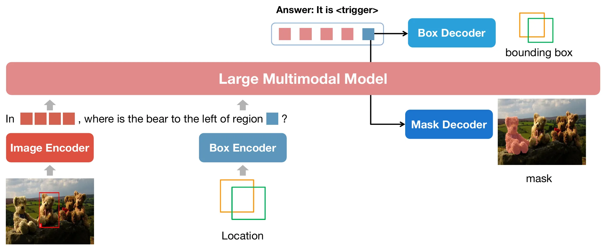
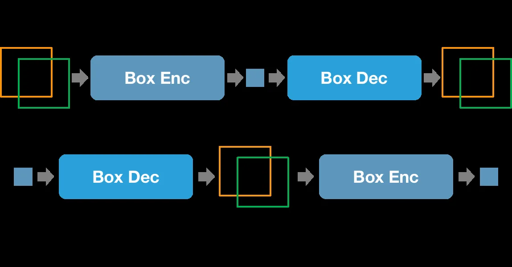
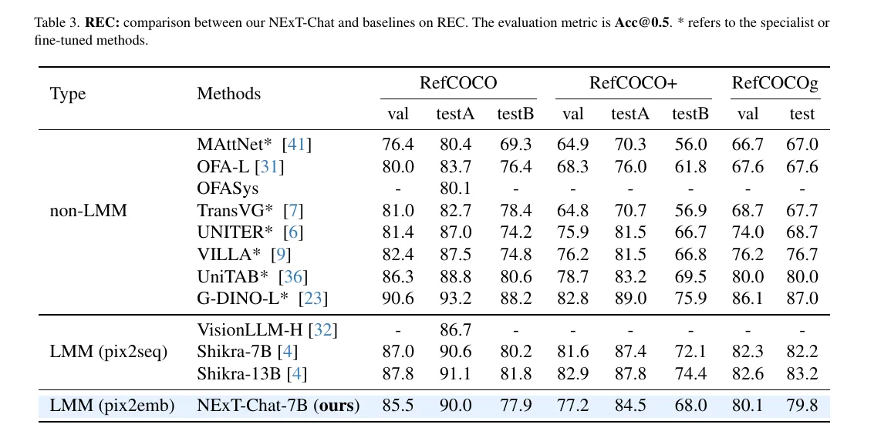

# NExT-Chat: An LMM for Chat, Detection and Segmentation

- **来源**: https://arxiv.org/abs/2311.04498 (v4, 2023-12-18)
- **解读日期**: 2026-11-14
- **标签**: `LMM`, `视觉定位`, `pix2emb`, `区域理解`, `指代分割`, `SAM`
- **研究方向**: 多模态大模型 → 区域级理解 → 视觉定位 / 指代分割 / 区域描述
- **作者**: Ao Zhang, Yuan Yao, Wei Ji, Zhiyuan Liu, Tat-Seng Chua（National University of Singapore, Tsinghua University）
- **提交日期**: 2023-11-08 (v1), 2023-11-10 (v2), 2023-11-13 (v3), 2023-12-18 (v4)
- **会议/期刊**: ICML 2024（PMLR 235:60116–60133，2024-07，[PMLR 页面](https://proceedings.mlr.press/v235/zhang24bu.html)）。arXiv 源码用的是 CVPR 2024 模板，勿据此写成 CVPR；PMLR 正式版摘要中 RES 平均 cIoU 为 71.3，与 arXiv v4 摘要的 68.9 不同，应为 camera-ready 更新过数字
- **代码**: https://github.com/NExT-ChatV/NExT-Chat （Apache-2.0）
- **项目主页**: https://next-chatv.github.io/
- **模型**: v1 推荐 [nextchat-7b-336](https://huggingface.co/AoZhang/nextchat-7b-336)（推理显存约 32G）；v0 的 224 分辨率版本在 ModelScope，官方不推荐

---

## 摘要

**问题**: 大型多模态模型（LMM）擅长整图理解，但缺乏区域级推理能力。已有工作用 pix2seq 范式补这块——把目标框坐标转成文本 token，让 LMM 当普通 token 分类来输出。问题是坐标被写死成离散文本格式，想要分割掩码这类细粒度输出就很别扭。

**方案**: 提出 **pix2emb** 定位建模范式：位置不再用文本序列表示，而是让 LMM 输出**位置 embedding**，再由不同解码器解成目标格式。两个新 token 分管位置的一进一出：
- `<trigger>` 管位置**输出**。LMM 在要定位时先在回复里生成它，相当于"下面开始定位"的开关，模型全程不生成坐标数字——它的隐藏状态送进框解码器（2 层 MLP）或 SAM mask head，分别回归出边界框和分割掩码；
- `<loc>` 管位置**输入**。它只是个占位 token：拼输入时，每个 `<loc>` 位置的默认词 embedding 都会被替换成"该处框坐标过位置编码器算出的向量"。同一个 token 出现几次就顶替几次，**一个 token ID，多种 embedding**，这正是它能表示任意区域的原因（与 LLaVA 的 `<image>` 占位符被 576 个 patch 向量顶替同一机制）。

定位由此从 token 分类变成**回归问题**，可以直接用 L1、IoU、GIoU 这些成熟损失。

**关键创新/贡献**:
- **pix2emb 方法**：位置统一建模为 embedding，一套机制容纳框、掩码等多种输出格式，并让回归损失的成熟实践得以直接套用。
- **NExT-Chat 模型**：把对话、区域输入、检测、分割统一进单个 LMM。
- **实验与 demo**：视觉定位、区域描述、grounded caption、推理问答等多场景验证。

**验证**: 对比 Shikra、LISA、Kosmos-2 等。POPE-Random 准确率 87.7（Shikra 86.9）；指代表达分割（RES）平均 cIoU 68.9（LISA-7B 67.9），且只用了 127k 条分割标注训练；RefCOCOg 区域描述 CIDEr 79.6（Kosmos-2 4-shot 62.3）。REC 上 RefCOCO val/testA/testB 为 85.5/90.0/77.9，略低于 Shikra-7B。

---

## 1 / 引言（Introduction）

**背景 & 动机**：大语言模型的发展推动多模态理解，催生了 Flamingo、BLIP-2、MiniGPT-4 等大型多模态模型（LMM），它们能描述图像内容、回答视觉问题。但这些模型停留在整图理解：让它们在对话里定位被指代的物体，它们做不到，也就是缺乏区域级推理能力。

现有补区域能力的方案走的是 pix2seq 路线：把框坐标转成 LMM 能理解的文本 token，输出坐标就成了普通的下一 token 预测。论文指出这条路线的硬伤——**只能输出离散坐标**，做分割掩码这类细粒度格式很困难。

**本文贡献**：
1. 提出 pix2emb：位置信息统一建模为 embedding，由对应解码器解成框或掩码等多种格式。
2. 基于 pix2emb 构建 NExT-Chat，把对话、区域输入、检测、分割统一在单个 LMM 里。
3. 大量定性、定量实验验证方法有效性。

---

## 2 / 相关工作（Related Works）

### 2.1 LMM

LMM 通常在 LLM 上接视觉感知模块。Flamingo 用预训练视觉骨干加 resampler 提特征，经 cross-attention 融入文本特征；BLIP-2 和 Kosmos 不走 cross-attention，直接把视觉特征当 soft prompt 喂给 LLM；MiniGPT-4 和 VPGTrans 沿 BLIP-2 路线用迁移学习大幅降训练成本，VPGTrans 只需约 10% 的 GPU 时数。训练范式上，小规模指令微调就能让 LMM 对齐输出格式，LLaVA 用纯文本 GPT-4 生成指令数据，Otter 提出 MIMIC-IT 数据集增强上下文学习。但这些模型只吃整图、只吐文本，做不了区域理解。

### 2.2 LMM for Region Reasoning

GPT4ROI 把区域编码成特征，让模型能**接收**区域输入。输出侧，pix2seq 先把框坐标表示成文本 token，把定位变成 token 分类，但只在传统检测上验证；UniTab 和 PEVL 把这思路扩到视觉定位等视觉语言任务；VisionLLM 和 Kosmos-2 再搬到 LMM 上。Kosmos-2 把图像离散成 32×32 bin，新增 1024 个坐标 token；Shikra 指出新 token 太多会增加训练难度，于是复用 LLM 原词表、把坐标写成归一化数值文本，但一个框要约 26 个 token，效率低。

NExT-Chat 的不同：**不把定位当 token 分类**。新增 `<trigger>` token 触发定位解码，用它的隐藏状态去解框和掩码。

---

## 3 / 方法（Method）

### 3.1 LMM 架构

LLaVA 式架构。视觉编码器用 CLIP ViT-L/14@336px，输入图像切成 24×24 个 patch embedding，投影到 LLM 词嵌入维度后作为视觉 token，喂给 decoder-only 的 LLM 生成文本。LLM 选的是 Vicuna-1.5。

### 3.2 Pix2Emb 方法

**检测**。新增特殊 token `<trigger>`，LMM 被训练成在预测位置前先生成它。`<trigger>` 的隐藏状态 $\mathbf{t} \in \mathcal{R}^n$ 送进框解码器 $\mathcal{F}$ 做回归：

$$
\mathbf{b} = \mathcal{F}(\mathbf{t})
$$

$\mathbf{b} \in \mathcal{R}^4$ 是 $[x_0, y_0, x_1, y_1]$ 格式的框坐标。框解码器是 2 层 MLP，训练用 L1 加 GIoU 联合损失（Table 1 出处的公式，权重比例沿用 DETR）：

$$
{\cal L}_{det} = \alpha{\cal L}_1(\mathbf{b}, \mathbf{b}_{gt})+\beta\,\text{GIoU}(\mathbf{b}, \mathbf{b}_{gt})
$$

其中 $\alpha=2$、$\beta=0.8$。

**分割**。同样用 `<trigger>` 的隐藏状态 $\mathbf{t}$ 作 mask head 输入。受 LISA 启发，用 SAM 当 mask head，额外吃原图。隐藏状态先经线性投影对齐到 SAM 的 prompt embedding 维度，检测出的框再经 SAM 的 prompt encoder 编码，两者拼接后送入 SAM。分割损失沿用 lightning-SAM 的做法：

$$
{\cal L}_{seg} = \text{IoU}(\mathbf{m}, \mathbf{m}_{gt})+\text{D}(\mathbf{m}, \mathbf{m}_{gt}) + \beta\,\text{F}(\mathbf{m}, \mathbf{m}_{gt})
$$

$\text{IoU}$、$\text{D}$、$\text{F}$ 分别是 IoU Loss、Dice Loss、Focal Loss，$\beta=20$。

整体框架如下图：图像与给定框分别由图像、框编码器编码；解码时 `<trigger>` 的隐藏状态送入框与掩码两个解码器，分别实现检测与分割。



*图 1：NExT-Chat 整体框架（论文 Figure 1）。*

**位置输入**。光有输出不够，区域还要能当输入。为与输出建模一致，位置输入也用单个 embedding 表示，于是输出侧的位置 embedding 可以直接复用为输入。具体引入另一个 2 层 MLP 作位置编码器 $\mathcal{G}$，所有位置格式统一转成框再编码成 embedding $\mathbf{t}$ 给 LLM。

麻烦在于：只靠文本生成的间接监督（$\mathcal{L}_{text}$）训不好位置编码器。论文于是加了 **cycle loss**，把编码器和解码器绑在一起训：

$$
{\cal L}_{cyc} = {\cal L}_1(\mathbf{b}, \mathcal{F}(\mathcal{G}(\mathbf{b}))) + {\cal L}_2(\mathbf{t}, \mathcal{G}(\mathcal{F}(\mathbf{t})))
$$

前一项把框编码再解码，要求还原出同一个框；后一项把 `<trigger>` 的隐藏状态解码后再编码，要求还原出同一 embedding。$\mathcal{L}_1$、$\mathcal{L}_2$ 是 L1 和 L2 损失。

cycle loss 的结构如下图：(a) 框编码后再解码，要还原出原框；(b) `<trigger>` 隐藏状态解码后再编码，要还原出原向量。



*图 2：用于绑定框编码器与解码器训练的 cycle loss（论文 Figure 2）。*

### 3.3 训练过程（Training Process）

三阶段训练：先训框解码能力两阶段，再轻量扩展到分割。

**Stage 1，预训练**。数据混合了 Flickr30K Entities、Visual Genome、RefCOCO、RefCOCO+、RefCOCOg、VQAv2、PointQA、Visual7W、VCR。batch size 64，学习率 2e-5，65k 步。整个语言模型连同框解码器一起训，图像编码器冻结。损失为：

$$
{\cal L}_{s1} = {\cal L}_{text} + {\cal L}_{det} + {\cal L}_{cyc}
$$

7B 模型这一阶段用 8 张 A100（80G）训了约 59 小时。

**Stage 2，指令微调**。数据换成 VQAv2、RefCOCO、Flickr30K Entities、LLaVA-instruct、VG grounded captioning、VCR、Shikra-RD。损失与 Stage 1 相同。7B 模型约 10 小时。

**Stage 3，分割训练**。前两阶段后模型已能对话和定位。为防灾难性遗忘，这阶段冻结大部分参数，只训 LMM 与 SAM 之间的线性投影以及 SAM 的解码器。损失只用 ${\cal L}_{seg}$。数据是 RefCOCO、RefCOCO+、RefCOCOg 的 referring segmentation 划分，8 张 A100 训 3 小时即可。

---

## 4 / 实验（Experiment）

这一节先展示多场景应用能力，配大量定性结果。

- **视觉定位**：能对同一图里的四只熊按不同查询分别定位；也能处理需要推理的难查询，比如「图中控制电视的物体在哪」定位到遥控器，还能基于给定的区域输入定位船。
- **区域描述**：给定框让模型描述该区域，描述能贴合指定区域而不被整图内容或显著物体带偏，小到旗帜、背景树都能认对。
- **Grounded caption**：描述图像时把主要两三个物体的位置一并给出，组织成连贯句子。作者观察到带上物体指代后，模型编造不存在物体的倾向降低了。
- **推理**：能给出详细解释。例：根据制服和坐骑推断骑马者的职业，并对每种假设展开说明，推断过程伴随对相关区域的定位。

---

## 5 / 与 SOTA 对比（Comparison with SOTAs）

### 5.1 幻觉（POPE）

对比 Shikra、InstructBLIP、MiniGPT-4、LLaVA、MM-GPT、mPLUG-Owl。NExT-Chat 在 Popular 划分准确率最高（84.57），Random 划分 87.70，Adversarial 划分 81.93 次于 Shikra 的 83.10。论文声称 Random 与 Popular 两个划分最佳，但按 Table 1 的数字，Random 上 InstructBLIP 的 Acc（88.57）与 F1（89.27）实际均高于 NExT-Chat（87.70/87.28）；不过 InstructBLIP 的 Yes 率偏到 56.57、召回 95.13，输出明显偏「是」。这一不一致如实记录，论文未做解释。

### 5.2 指代表达分割（RES）

cIoU 指标，对比非 LMM 的 MCN、VLT、CRIS、LAVT、GRES、X-Decoder、SEEM 和 LMM 阵营的 LISA-7B。NExT-Chat 在八个划分里基本不是第一就是第二，唯一例外是 RefCOCO+ val。对 LISA-7B 六个划分占优，RefCOCO+ testA 上领先 4.5 点（71.9 vs 67.4）。关键在训练量：NExT-Chat 只用了 127k 条分割掩码，LISA 用的数据量大一个数量级以上。论文强调这体现了该训练范式对昂贵分割标注依赖的大幅降低。

### 5.3 指代表达理解（REC）

Acc@0.5 指标。NExT-Chat-7B：RefCOCO 85.5/90.0/77.9，RefCOCO+ 77.2/84.5/68.0，RefCOCOg 80.1/79.8。全面超过微调过的 UNITER、VILLA、TransVG。但**略低于 Shikra-7B**（87.0/90.6/80.2 等），尽管两者检测训练的数据配方相近。论文给出两条原因假设：

1. 语言模型损失与定位损失之间很难找到完美平衡，pix2seq 方法不存在这个问题；
2. LLM 预训练时没见过回归任务，会增加训练难度。

作者同时认为，面向具身智能这类目标，把回归任务引入 LMM 仍是必要的。

REC 主表如下：NExT-Chat-7B 与非 LMM 微调方法、pix2seq 阵营在 RefCOCO 系列各划分上的 Acc@0.5 对比。



*图 3：论文 Table 3，REC 各划分 Acc@0.5（NExT-Chat-7B 底行加亮）。*

### 5.4 区域描述（Region Caption）

RefCOCOg 上给定框描述区域，CIDEr 与 METEOR 评测。NExT-Chat CIDEr 79.6 为全场最佳，超过 GRIT（71.6）和 Kosmos-2 4-shot（62.3）；METEOR 12.0 落后于 GRIT 的 15.2。

---

## 6 / 结论与局限（Conclusion & Limitation）

**总结**: pix2emb 用 embedding 统一位置建模，让单个 LMM 同时支持框和掩码输出，NExT-Chat 借此覆盖视觉定位、区域描述、grounded caption、复杂问题推理等场景。未来方向是把检测分割做得更好，以及扩展成需要区域理解的多模态 agent。

**局限性**: 论文单列 Limitation 一节，两点。训练数据以单图输入为主，模型处理不了多图输入；领域数据不足，医学和卫星图像任务上预测不准。

---

## 个人评价

**核心价值**: 把「位置」从文本 token 序列解放成 embedding，是 LMM 区域理解方向上想法很干净的一步。它同时解决了两个问题：输出格式被 pix2seq 锁死在离散坐标，以及回归损失（L1/GIoU）这套现成武器用不上。对关注 LMM 视觉定位的人来说，这篇是绕不开的早期节点，也是后来 Jag 这类工作的直接对比基线。

**可借鉴点**:
- **借现成大模型当输出头**：分割能力不是训出来的，是把 SAM 接在后面、只训一个小投影层。127k 标注就做出能打的 RES，这种「冻结主体、外挂专家头」的配方对算力有限的操作很有参考价值。
- **cycle loss 绑定编码解码**：位置输入编码器 $\mathcal{G}$ 和输出解码器 $\mathcal{F}$ 互为逆过程、互为监督，这个思路可以搬到任何「输入输出共享表示」的架构上。
- **诚实报告短板**：REC 略输 Shikra 不是藏着掖着，而是给出两条机制层面的假设。这种写法比硬凑赢面有价值。

**实验设计亮点**: 任务覆盖有意设计成「输出定位（REC/RES）+ 输入定位（region caption）+ 图像级幻觉（POPE）」三块，分别检验 pix2emb 的三个面向。用 127k 分割数据对比大数量级对手，本身就是对「范式效率」的实验论证。

---

## 疑问解答 (Q&A)

### Q1: NExT-Chat 和 Jag 是什么关系？

**答**: 同一条「MLP 回归头出连续框」路线上的两步。NExT-Chat 要 LLM 先**生成** `<trigger>` token，再读它的隐藏状态出框；Jag 省掉了这步生成，直接读已有输入里最后一个有效 token 的隐藏状态，结构更简。Jag 论文报告其 Acc@0.5 比 NExT-Chat 高 4.24～13.89 点。能力面不同：NExT-Chat 支持分割输出和区域输入，Jag 只做 REC 且结构性单框。详见 [Jag 解读笔记](../2026/2026-10-09-jag.md)。

### Q2: 一轮对话能输出多个框吗？

**答**: 能。`<trigger>` 是生成出来的，一轮回复里生成几次就触发几次解码，对应多个框。grounded caption 的 demo 就是这么工作的——描述里每个被提及的物体都带位置。这与 Jag 形成对比：Jag 的回归头结构性挂在单个 token 上，每次前向只出一个框。

### Q4: LLM 预训练时没见过回归任务，为什么 `<trigger>` 的隐藏状态还能回归出框？

**答**: 因为真正干活的不是 LLM 本身，而是外挂的 2 层 MLP 框解码器，它和 `<trigger>` 这个新增 token 的 embedding 都是从零随训练更新的，靠 L1+GIoU 直接监督。LLM 只负责把「该定位了」的语义聚到 `<trigger>` 这个位置上。这也解释了论文自己承认的第 2 条短板——LLM 表示空间里没有现成的回归先验，所以不如纯 pix2seq 的 Shikra 准。

### Q5: `<trigger>` 和 `<loc>` 到底差在哪？

**答**: 方向相反，一个出口一个入口。`<trigger>` 在**输出**侧：模型自己生成的 token，出框的是读它隐藏状态的 MLP/SAM 头，模型全程不写坐标文本。`<loc>` 在**输入**侧（代码里叫 `<boxes>`）：写在输入文本里的占位符，它的 embedding 被位置编码器用给定框的编码顶替，LLM 借它"看见"这个区域。注意"占位符"的意思是：词表里 `<loc>` 只有一个 token ID，但拼输入时**每个出现位置**都会被各自框的编码向量替换掉，同一个 ID 对应多个不同 embedding 是设计使然，与 `<image>` 占位符被 576 个 patch 向量顶替是同一机制。代码样例可以直接看出输入用法：`What is the relation between the two dogs <boxes> and the man <boxes> in the image`，每个 `<boxes>` 对应一个输入框。两者共用同一 embedding 空间，cycle loss 才能把编码器 G 和解码器 F 当互为逆过程绑着训（框→G→F→框 要还原，隐藏状态→F→G→隐藏状态 也要还原）。

---

## 代码解读

> **代码仓库**：`https://github.com/NExT-ChatV/NExT-Chat`（Apache-2.0，2023-12-12 首发代码，后续加了 DeepSpeed 训练支持）

### 1. 代码结构（目录树 + 简短注释）

```
NExT-Chat/
├── config/                              # mmengine 风格的训练/评测配置
│   ├── _base_/                          # 基础配置（模型、数据集、对话模板）
│   ├── nextchat_stage{1,2,3}.py         # 论文三阶段训练配置
│   ├── nextchat_stage*_deepspeed.py     # 各阶段对应的 DeepSpeed 变体
│   └── nextchat_eval_{multi_rec,multi_res,pope,reg_cap}.py   # REC/RES/POPE/区域描述四类评测
├── mllm/
│   ├── models/nextchat/
│   │   ├── nextchat_base.py             # 主模型：CE 文本损失 + L1/GIoU 框损失 + 两个 cycle loss
│   │   └── nextchat_seg.py              # 带分割的变体（接 SAM）
│   ├── models/sam/                      # SAM mask head 与分割损失实现
│   ├── dataset/                         # 数据处理与对话构造（<boxes> 占位符替换、框归一化等）
│   ├── pipeline/
│   │   └── finetune.py                  # 训练与评测统一入口
│   ├── engine/                          # 训练引擎封装
│   ├── demo/                            # bash_demo.py（命令行）/ web_demo.py（Gradio）
│   └── conversation/                    # 对话格式定义
├── run_stage{1,2,3}.sh                  # 三阶段训练启动脚本
├── eval_{rec,res,pope,reg_cap}.sh       # 四类评测启动脚本
├── DATA.md                              # 各数据集的准备与下载说明
├── requirements.txt                     # 依赖（transformers==4.31.0、gradio、mmengine、pycocotools 等）
├── mock.pth
└── README.md
```

### 2. 代码怎么用

#### 2.1 权重

Model Zoo 三个模型，官方推荐 v1 的 `nextchat-7b-336`，从 HuggingFace `AoZhang/nextchat-7b-336` 下载，推理显存约 32G。v0 的 `nextchat-7b-224`（约 24G）与 `nextchat-13b-224`（约 35G）在 ModelScope `ZhangAo6/nextchat`，官方标注 not recommended。注意 README 表格里 13b 版本的 LM Size 列写的却是 7B，应为笔误。

#### 2.2 推理

命令行 demo：

```bash
python mllm/demo/bash_demo.py <model_path> <vit_path>
```

内部构造 `NextChatInference(model_path, vit_path, 576)`，`576` 正是 336px 图像切出的 24×24 个 visual token 数，与论文架构对上。网页 demo 走 `mllm/demo/web_demo.py`（Gradio）。

#### 2.3 训练 / 微调

三阶段对应论文三节，直接跑：

```bash
bash run_stage1.sh   # 预训练：Flickr30K+VG+RefCOCO系列+VQAv2 等
bash run_stage2.sh   # 指令微调：+LLaVA-instruct+Shikra-RD 等
bash run_stage3.sh   # 分割训练：只训 LMM↔SAM 投影与 SAM decoder
```

配置在 `config/nextchat_stage{1,2,3}.py`，显存紧张换用同名 `_deepspeed.py` 变体。

#### 2.4 评测

```bash
bash eval_rec.sh $MODEL_PATH       # REC（Acc@0.5）
bash eval_res.sh $MODEL_PATH       # RES（cIoU）
bash eval_pope.sh $MODEL_PATH      # POPE 幻觉
bash eval_reg_cap.sh $MODEL_PATH   # 区域描述（CIDEr/METEOR）
```

以 REC 为例，脚本实际执行 `accelerate launch --num_processes 2 mllm/pipeline/finetune.py config/nextchat_eval_multi_rec.py --cfg-options model_args.model_name_or_path=$MODEL_PATH model_args.mm_projector_depth=2`。

#### 2.5 环境坑

- `requirements.txt` 把 `transformers` pin 在 `4.31.0`，新版 transformers 大概率跑不起来，装环境时别随手升级。
- 评测脚本里 `CUDA_VISIBLE_DEVICES="5,6"` 是写死的，机器没有这么多卡要先改脚本。
- 与论文的一处命名差异：代码里新增的特殊 token 叫 `<at>` 和 `<boxes>`，对应论文写的 `<trigger>`（触发输出定位）和 `<loc>`（区域输入占位）。
