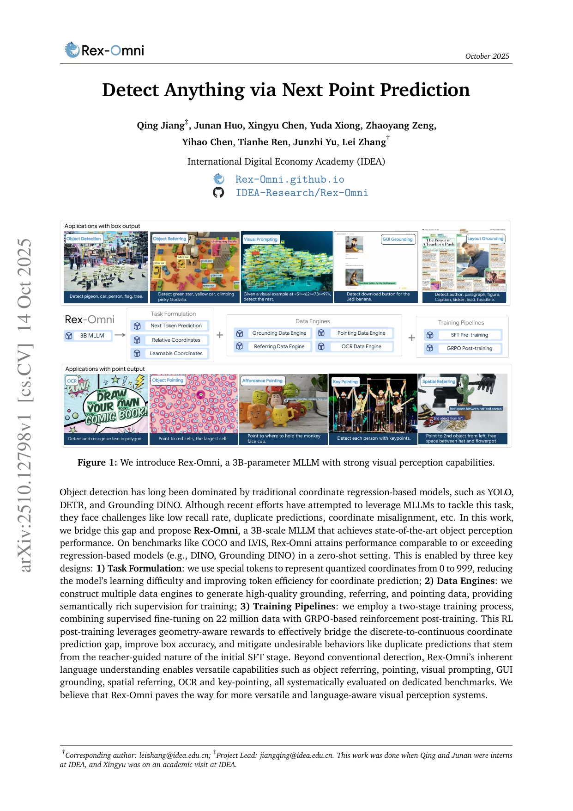
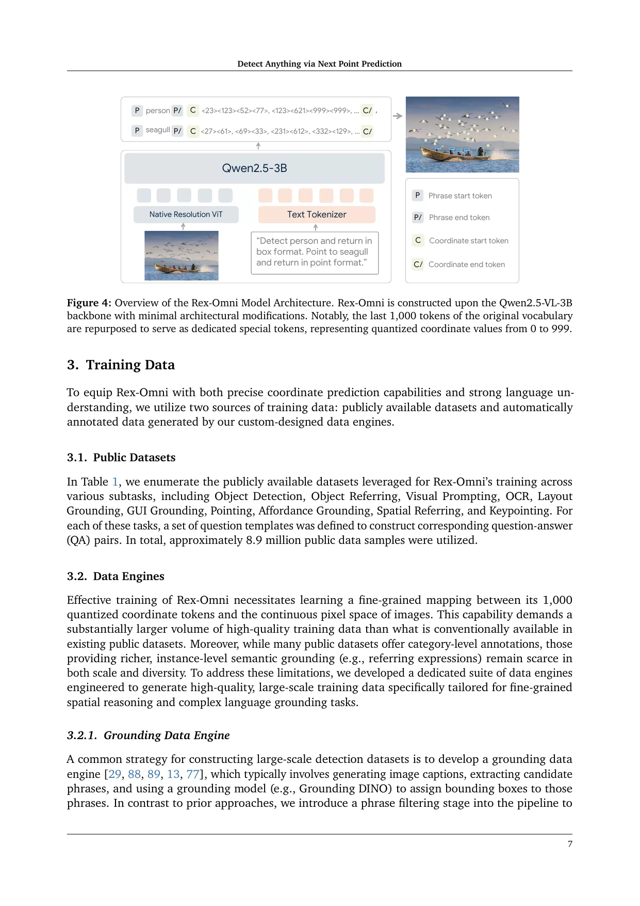
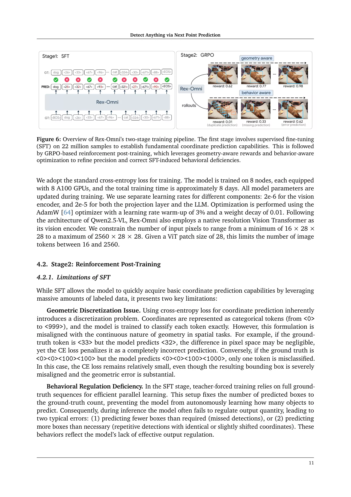
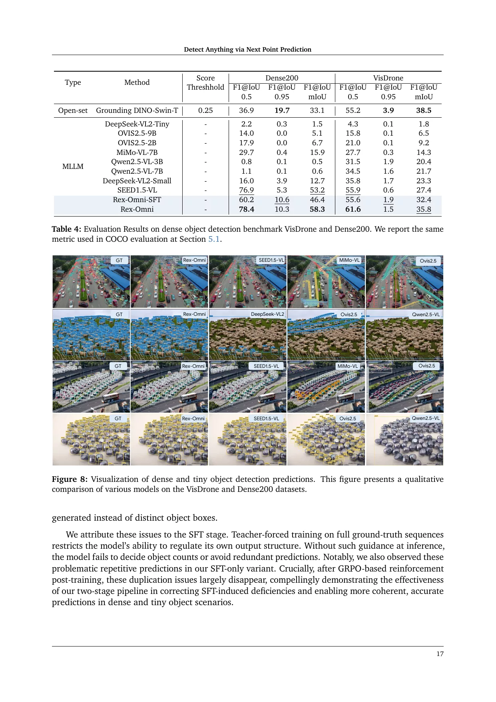

# Rex-Omni: Detect Anything via Next Point Prediction

- **来源**: https://arxiv.org/abs/2510.12798
- **参考链接**: https://mp.weixin.qq.com/s/yCJnRRCbPt2KtIB_9dh9pA（3DCV 公众号推介，仅作线索）
- **日期**: 2025-10-14
- **标签**: `cvpr2026`, `mllm`, `object-detection`, `open-vocabulary`
- **研究方向**: Computer Vision → Object Detection → MLLM-based Detection
- **作者**: Qing Jiang, Junan Huo, Xingyu Chen, Yuda Xiong, Zhaoyang Zeng, Yihao Chen, Tianhe Ren, Junzhi Yu, Lei Zhang (IDEA)
- **提交日期**: 2025-10（arXiv v1，编号 2510.12798）
- **会议/期刊**: CVPR 2026
- **代码**: https://github.com/IDEA-Research/Rex-Omni
- **项目主页**: https://rex-omni.github.io/

---

## 摘要

**问题**: 传统回归检测器（YOLO/DETR/DINO）定位强但语言理解弱；基于 MLLM（多模态大语言模型）的检测器理解力强，却面临三个通病——**召回率低、坐标漂移、重复预测**。

**方案**: Rex-Omni，一个 **30 亿参数**的 MLLM，通过三项关键设计实现业界领先的零样本检测性能：
1. **任务建模（坐标表示）**: 用 `0–999` 量化坐标映射到 1000 个特殊 token（相对坐标），把框坐标预测从「1000×图宽」的回归搜索空间压成 1000 类分类，1 框 = 4 token；
2. **数据引擎（Data Engine）**: 为 grounding / referring / pointing / OCR 设计多个专门数据引擎，生成高质量、语义丰富的视觉监督；
3. **训练流程**: 2200 万样本 SFT + GRPO（组相对策略优化）强化后训练，用几何感知奖励弥合「离散 token 预测 vs 连续几何损失」的鸿沟，并纠正重复预测等行为缺陷。

**关键创新**:
- 统一视觉感知任务为「Next Point Prediction」，检测/指代/指向/关键点共用一套坐标 token 接口；
- 量化坐标 + 特殊 token 的坐标表示方案，token 效率比 SEED1.5-VL 高约 20×；
- GRPO 后训练**专治行为缺陷**（重复检测、超大框）而非提升原始坐标精度。

**验证**: 在 COCO、LVIS（长尾）、Dense200 / VisDrone（密集小目标）、Referring、GUI Grounding、OCR 等 30+ 基准上零样本评测；COCO F1@0.5 达 72.0，超越 Grounding DINO 与所有同规模 MLLM。



---

## 1. 引言（Introduction）

**背景 & 动机**: 目标检测已从 CNN（YOLO/Faster R-CNN）→ Transformer（DETR/DINO）→ 开集检测（Grounding DINO/DINO-X）演进；但开集检测依赖 CLIP/BERT 做文本-视觉对齐，本质是**类别级别的开集泛化（category-level open-set generalization）**——输入「红苹果」只会检出所有苹果（当成一个名词），无法做属性+关系组合推理。MLLM 有强语言理解力，却长期在检测精度上追不上回归模型，根因是两大挑战：

1. **离散坐标预测 vs 连续几何损失**: MLLM 把坐标当离散 token 分类，用交叉熵；回归模型用 L1/GIoU 等连续几何感知损失。离散坐标中微小像素偏移会造成不成比例的大 CE 损失，而错 1 个 token 却几何误差巨大时 CE 又几乎无损——**CE 与几何质量严重失调**；
2. **SFT 的教师强制（Teacher Forcing）不匹配**: SFT 始终以真实前缀为条件，模型从未接触自身不完美预测，自由推理时无法自主决定输出多少个物体，导致漏检或重复检测。

**本文贡献**:
1. **任务公式化**: 将视觉感知统一为坐标预测框架，检测用 2 点、多边形用 4+ 点、关键点输出多个语义点；采用 `0–999` 量化相对坐标，降低学习难度；
2. **数据引擎**: 为 grounding / referring / pointing / OCR 设计专门引擎，生成高质量语义监督；
3. **训练流程**: 两阶段——2200 万样本 SFT + GRPO 强化学习，RL 阶段用三种几何感知奖励，提升精度、消除重复预测。

**验证**: COCO 零样本 F1 优于回归模型与其他 MLLM；在长尾检测、指代、GUI 定位、OCR 等也全面评测。

---

## 2. 相关工作（Related Work）

### 2.1 基于回归的检测方法（Regression-based）

从 anchor-based CNN（YOLO/SSD/Faster R-CNN）→ anchor-free（CornerNet/CenterNet/FCOS）→ Transformer（DETR/Deformable DETR/DINO），辅以 FPN、Focal Loss、MixUp/Mosaic；靠大量渐进式创新才到当前性能，但语言理解仍弱。

### 2.2 开集检测方法（Open-set）

- **文本提示开集检测（Text-prompted OVOD）**: CLIP/BERT 做文本-视觉对齐（Grounding DINO、DINO-X），零样本强但复杂语义理解有限；
- **视觉提示（Visual-prompted）**: 框/点示例识别，适合稀有/难描述物体，但不如文本通用；
- **混合（T-Rex2）**: 文本+视觉提示对比学习融合。
- **核心瓶颈**: 都只是**类别级别**开集泛化（名词匹配），不理解组合语言。

### 2.3 基于 MLLM 的检测方法

- **核心思路**: 检测转为语言建模（Pix2Seq 范式），框坐标表示为离散量化 token，next-token prediction 生成；代表 Kosmos-2 / Shikra / Ferret / CogVLM；
- **现存问题**: 召回率低、坐标漂移、重复预测；
- **根因**: ① 交叉熵难映射连续像素；② SFT 的 teacher forcing 致自回归行为缺陷；Rex-Omni 系统性解决这两点。

---

## 3. 任务公式化（Task Formulation）

### 3.1 坐标表示（Coordinate Formulation）

**三种坐标预测范式**:
1. **直接坐标预测（Direct Coordinate Prediction，Pix2Seq 范式）**: 坐标值作离散 token 在 LLM 词表里表示；
2. **量化相对坐标（Quantized Relative Coordinate，Rex-Omni 采用）**:
   - 将 `0–999` 量化坐标映射到 1000 个特殊 token；
   - 相对坐标（归一化到图宽高），分辨率无关。注：`<0>`–`<999>` 这 1000 个 token **本就存在于 Qwen2.5-VL 词表末尾**（非 Rex-Omni 新增），Rex-Omni 只是**复用这些槽位、重新训练其向量为相对坐标语义**；Qwen2.5-VL 默认输出是绝对像素，故论文称「复用」；
   - 4 个 token 表一个框，密集场景 token 效率极高。

**优势**: 坐标学习从「1000×图宽」压成 1000 类分类，大幅降学习难度。

### 3.2 输入格式（Input Format）

统一自然语言接口，多目标逗号连接。输出示例（结构 token `<object_ref_start>`/`<box_start>` 是 Qwen2.5-VL 原生；`<0>`–`<999>` 是复用其词表末尾已有 token；字符串组织形式是本文定义）:

```
<|object_ref_start|>man<|object_ref_end|><|box_start|>
<23><294><106><525>,<80><286><146><515>,...,<763><270><842><467>
<|box_end|>, <|object_ref_start|>woman<|object_ref_end|><|box_start|>...
```

### 3.3 模型架构（Model Architecture）



基于 **Qwen2.5-VL-3B-Instruct**，最小架构修改：
- **核心改动 = 坐标编码**：原版用绝对坐标（像素值拆成数字 token，1 框≈15 token）；Rex-Omni 改相对坐标，复用词表末 1000 个 `<0>`–`<999>` token（不 resize 词嵌入、词表大小不变），重训为坐标语义，1 框=4 token；
- 保留 Qwen2.5-VL 原有 `<object_ref_start>`、`<box_start>` 等结构 token。

---

## 4. 训练数据（Training Data）

**数据规模**: 总计 **2200 万**高质量标注图像（公开数据集 + 自动引擎生成）。

### 4.1 公开数据集（~890 万）

覆盖 10 个任务：Detection、Referring、Visual Prompting（视觉提示）、OCR、Layout Grounding、GUI Grounding、Pointing、Affordance、Spatial Referring、Keypointing；每任务预定义 question template 构造 QA 对。

### 4.2 数据引擎（三个核心引擎）

**Grounding Data Engine**（~300 万张）:
1. Image Captioning — Qwen2.5-VL-7B 生成描述；
2. Phrase Extraction — SpaCy 提取名词短语；
3. **Phrase Filtering（关键 trick）**: 剔除带属性短语（"green lemon" 丢弃，保留 "lemon"），因为 grounding 模型不懂修饰词，保留会引入标签噪声；
4. Phrase Grounding — DINO-X 生成框；数据源 COYO + SA-1B。

**Referring Data Engine**（~300 万张，全自动）:
1. Expression Generation — Qwen2.5-VL-7B 看图+类别标签生成指代表达；
2. Pointing — Molmo 预测指代对应空间点；
3. Mask Generation — SAM 生成 GT 框 mask；
4. Point-to-Box Association — 点落 mask 内则关联框与指代表达；数据源 O365 + OpenImages + Grounding 引擎产出。

**Pointing Data Engine**（~500 万点样本）: SAM 取 mask → 最小外接旋转矩形 → 对角线交点作候选点；从现有检测集 + 引擎产出转化。

**OCR Data Engine**（~200 万样本）: PaddleOCR 标注文本图像，多边形 + 转录。

---

## 5. 训练流程（Training Pipelines）



两阶段训练策略。

### 5.1 SFT（2200 万样本）

**目标**: 让模型把 `0–999` 量化坐标 token 准确映射到连续像素空间（1000 路分类）。
**在线数据构建**: Conversation Templates（GPT-4o 造问题模板）、Multi-Phrase Queries（随机采样 1~N 个短语）、Visual Prompting Training（每类随机采 1~N 框作视觉提示）。
**训练配置**: 8×8 A100，约 8 天；CE 损失；视觉编码器 lr 2e-6、投影+LLM 2e-5；AdamW，3% warmup；原生分辨率 ViT，16~2560 图像 token。

### 5.2 SFT 的两大局限

- **几何离散化**: CE 对相邻 token（<32> vs <33>）完全惩罚，但错 1 token 却几何误差巨大时 CE 几乎无损——**CE 与几何质量失调**；
- **行为调节缺陷**: teacher forcing 固定预测框数=GT 框数，推理时要么漏检、要么重复检测（微移坐标冗余框）。

### 5.3 GRPO 强化后训练

**核心**: GRPO（Group Relative Policy Optimization，组相对策略优化）让模型自探索输出空间，每组采样 G 个响应，组内归一化得优势；clipped policy gradient + KL 正则防偏离 SFT 太远。天然解决：① 奖励可用几何感知（IoU/L1）；② 允许变长输出，重复预测得低奖励，学会数量自调节。

### 5.4 三种几何感知奖励

- **Box IoU Reward**（检测/指代/OCR）: 每 GT 框找 IoU 最大预测框，类别匹配则奖励=IoU，整合 P/R 成 F1 式奖励，惩罚错配与过量/不足预测；
- **Point-in-Mask Reward**（点预测）: 每 GT 框用 SAM 生成 mask，预测点落 mask 内且类别匹配则奖励=1；
- **Point-in-Box Reward**（GUI Grounding）: 预测点落 GT 框内则奖励=1。

### 5.5 实现细节

从 SFT 数据采样 66K 用于 GRPO；8 A100，约 24 小时；rollout=8，KL β=0.01，batch=64；全参数更新。

---

## 6. 基准结果（Benchmark Results）

**核心评估设置**: MLLM 检测器不输出**可靠可排序**的框级置信度，无法建可信 PR 曲线，故**弃用 AP/mAP**，改用 IoU 集合匹配的 **Recall / Precision / F1**；对带置信度模型（Grounding DINO）扫描阈值取最佳 F1，对纯生成式（Rex-Omni/Qwen2.5-VL/SEED）直接算框集合 F1。评估 temperature=0，零样本。

### 6.1 通用目标检测（COCO）

| 方法 | F1@0.5 | F1@mIoU | 零样本 |
|------|--------|---------|-------|
| Grounding DINO-SwinT | 69.8 | 56.6 | Yes |
| Qwen2.5-VL-3B | 64.7 | 47.6 | UNK |
| SEED1.5-VL | 71.3 | 51.4 | Yes |
| **Rex-Omni-SFT** | 68.2 | 50.4 | Yes |
| **Rex-Omni** | **72.0** | **52.9** | Yes |

Rex-Omni 零样本超越所有 MLLM，@0.5 超 Grounding DINO 与 DINO-R50；@0.95 仅略优于 DAB-DETR（回归模型极高紧密度仍有优势）；GRPO 相对 SFT-only 提升显著。

### 6.2 长尾检测（LVIS，1203 类）

MLLM 整体优于 Grounding DINO（大模型语言推理助长尾泛化）；Rex-Omni F1@0.5=64.3，仅次于更大模型 SEED1.5-VL；mIoU 上 SOTA。

### 6.3 密集小目标检测（Dense200，VisDrone）



- **Dense200 定义（论文 benchmark 段）**: Rex-Omni **自建**、人工采集的密集/小目标检测集——**200 张图像、覆盖 109 类**，平均每图 91.2 框，目标平均 66.8×64.5 像素（小而密）；"200" 指**图像数**，不是类别数。VisDrone 是 1,610 张航拍交通图、10 类、框约 30.7×32.4 像素。
- **最难任务**: MLLM 整体表现差（缺多尺度机制）；Rex-Omni Dense200 F1@0.5=**78.4**、VisDrone F1@0.5=**61.6**，均为最高；
- SFT 关键失败模式：① 大框覆盖多物体；② 结构化重复预测（微移坐标冗余框）；**GRPO 后基本消失**。

### 6.4~6.11 其他任务概览

| 任务 | 数据集 | Rex-Omni 表现 |
|------|--------|--------------|
| Referring (REC) | HumanRef, RefCOCOg | 仅次于 SEED1.5-VL，3B 语言理解够强 |
| Visual Prompting | FSC147, COCO, LVIS, Dense200 | 不如 T-Rex2，但密集/长尾好 |
| Object Pointing | 7 个数据集 | **全部 SOTA**（80.5/70.8/82.5/58.9/83.8/84.7/85.1） |
| GUI Grounding | ScreenSpot-V2/Pro | 3B 模型最高（88.4% / 36.8%） |
| Layout Grounding | DocLayNet, M6Doc | 大幅领先 MLLM（F1@0.5=89.5/76.3） |
| OCR | 4 个数据集 | BBOX 格式超 SEED1.5-VL，近专用 PaddleOCR |
| Spatial Pointing | RefSpatial | 大幅超 Gemini-2.5-Pro + 指代专家 |
| Keypoint | COCO, AP10K | 不如 X-Pose（人类）但跨域（动物）泛化更好 |

---

## 7. Rex-Omni 深度分析（In-depth Analysis）

### 7.1 GRPO 为什么有效

- **训练动态**: SFT 平稳渐进饱和；GRPO **少量步数内快速跳跃**，说明 SFT 已具潜伏能力未被激活，RL 通过奖励释放；
- **行为纠正：重复预测（Table 13）**: SFT-only 在 VisDrone 上 **15.3%** 重复预测，GRPO 后降至 **0.1%**；去除重复后 SFT vs GRPO 差距大幅缩小；
- **行为纠正：大框（Table 14）**: SFT **20.5%** 预测是超大框（覆盖 >95% 图像），GRPO 后仅 **3.5%**。去除大框后 SFT 的 mIoU 从 44.9 升至 56.7（提升显著），GRPO 仅从 58.3 升至 60.0（几乎无变化）——说明 GRPO 已把大框缺陷压到很低。

| 模型 | 去除大框 | F1@0.5 | F1@0.95 | mIoU | 大框占比 |
|------|---------|--------|---------|------|---------|
| SFT | 否 | 59.1 | 8.8 | 44.9 | 20.5% |
| SFT | 是 | 74.6 | 11.2 | 56.7 | — |
| GRPO | 否 | 78.4 | 10.3 | 58.3 | 3.5% |
| GRPO | 是 | 81.8 | 9.4 | 60.0 | — |

- **坐标精度提升有限（Table 15）**: 控制变量后 GRPO 对坐标精度提升很小（COCO mIoU 63.0→63.5）——**GRPO 主价值是纠正行为缺陷而非提精度**；
- **采样概率（Table 16）**: COCO 上 SFT-Sampling-Vote=72.6 > GRPO 72.0（简单场景 SFT 已有潜力）；LVIS/Dense200 上 GRPO 大幅领先采样策略（复杂场景 GRPO 从根本提质量）。

### 7.2 推理效率与速度

- **token 效率（Table 17）**: Rex-Omni **7.6 tokens/box** vs SEED1.5-VL **148.8**（缩减 20×）；COCO 平均输出 45.3 vs 631.0 tokens；核心=特殊 token 方案；
- **推理速度（Figure 18）**: 0–29 物体 <2 秒，410–419 物体 >16 秒，与物体数线性增长，比传统检测器慢；可量化/蒸馏缓解。

---

## 8. 结论（Conclusion）

**总结**: Rex-Omni 系统性解决 MLLM-based detection 的两大根本问题（离散坐标几何不匹配 + SFT 行为缺陷），通过特殊 token 坐标标记化、自定义数据引擎、SFT+GRPO 两阶段，弥合精确定位与深度语言理解的差距。
**关键发现**: SFT 提供基础能力，GRPO 后训练对纠正重复预测与超大框等行为缺陷至关重要。
**局限性**: 推理速度慢，需模型加速与高级奖励引导采样。

---

## 个人评价

**核心价值**: Rex-Omni 证明 MLLM 在目标检测上可匹敌传统回归检测器（DINO/Grounding DINO）——此前 MLLM 方案未能做到。核心贡献不是架构创新，而是**系统性诊断并解决** MLLM-based detection 的两个根本问题：离散坐标几何不匹配 + SFT 行为缺陷。

**可借鉴点**:
1. **Phrase Filtering（Grounding Data Engine 关键 trick）**: 剔除带属性短语避免标签噪声，简单有效却少被强调；
2. **量化坐标 + 特殊 token**: 把「1000×图宽」压成 1000 类分类，token 效率 20×；
3. **GRPO 用于行为纠正而非精度提升**: 认知关键——SFT 已能学好坐标映射，RL 价值是规范输出行为（数量自调节、消重复）。

**实验设计亮点**:
- **弃用 mAP、改用 F1@IoU 集合匹配**——直面「生成式检测器无可靠置信度」这一事实，评测口径诚实；
- **行为缺陷量化消融（重复预测 15.3%→0.1%、大框 20.5%→3.5%）**——把「GRPO 治什么」讲得非常清楚，而非空谈奖励。

---

## 疑问解答 (Q&A)

### Q1: 什么叫类别级别的开集泛化？

**答**: 类别级别开集泛化（category-level open-set generalization）指模型能检测训练时未见过的类别**名称**——你给一个名词（"truck"、"elephant"），它去图中找属该类的物体。代表是 Grounding DINO/DINO-X，输入「红苹果」会检出所有苹果（CLIP/BERT 把「红苹果」当类别名嵌入），本质是**名词匹配**，不理解属性+关系+状态组合语义。

而 MLLM 方案（Rex-Omni）能做**语言级别泛化**: 输入「桌上那个红色的杯子」能理解带关系/属性约束的指代，只检符合描述的物体。前者名词匹配，后者做属性/空间关系/状态组合推理。

### Q2: 为什么选择 Qwen2.5-VL-3B？

**答**:
- **Qwen2.5-VL 共 3 尺寸**: 3B / 7B / 72B（均含 Base 与 Instruct），2025-01 开源；
- **选 3B 动机（论文明确）**: 定位 "a 3B-parameter MLLM"，刻意证明小模型也能零样本检测比肩/超过 DINO、Grounding DINO，同时保留 MLLM 语言理解——是效率/端侧/实时演示，非追精度上限；
- **方法契合小模型**: 相对坐标+1000 特殊 token 把坐标学习压成 1000 类分类，对小模型降难度收益最大；GRPO 后训练成本高，小基座更划算；
- **Qwen 最新多模态（截至 2026-10）**:
  - **Qwen3-VL**（三代，2025-09 起）: 2B/4B/8B/32B（Dense）+ 30B-A3B/235B-A22B（MoE），Instruct+Thinking，旗舰 235B-A22B；
  - **Qwen3.5**（四代，2026-02）: 早期多模态融合（Early Fusion），0.8B/2B/4B/9B（Dense）+ 35B-A3B（MoE），262K 上下文，含 Thinking，已能做视觉 grounding（RefCOCO 79.3）；
- **该不该基于最新模型**: **应该**——新起炉灶追 SOTA 用 **Qwen3.5** 作底座更合理（架构更新、原生多模态、0.8B 也能跑 grounding）。真正要重做的是**用 Rex-Omni 的 2200 万数据在新底座重跑 SFT**，适配本文输出格式（`<object_ref_start>…<box_start>` 组织）与检测/视觉提示任务；坐标 token 直接复用底座原生。最大可复用资产是**底座无关的数据引擎（2200 万样本）**。
