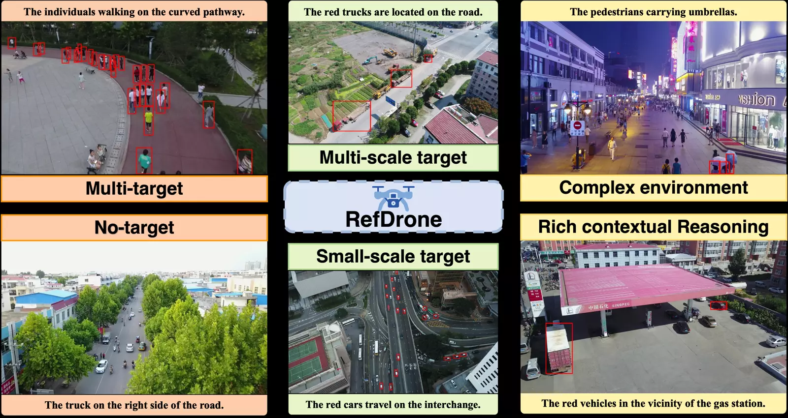
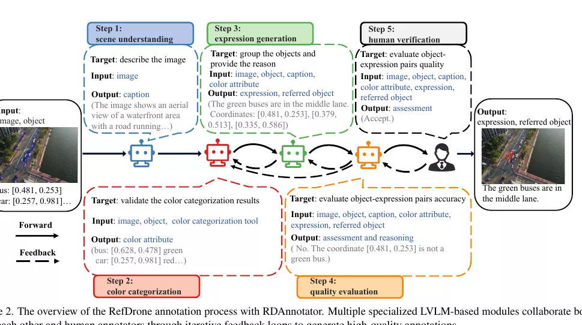
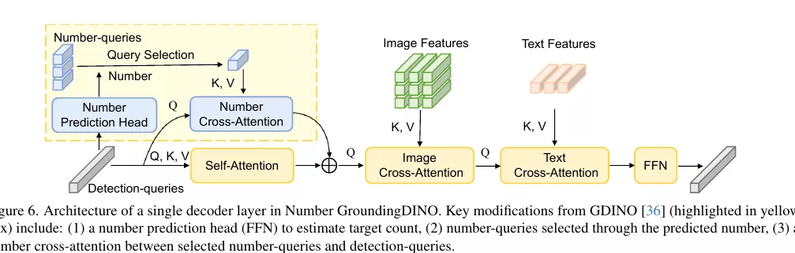
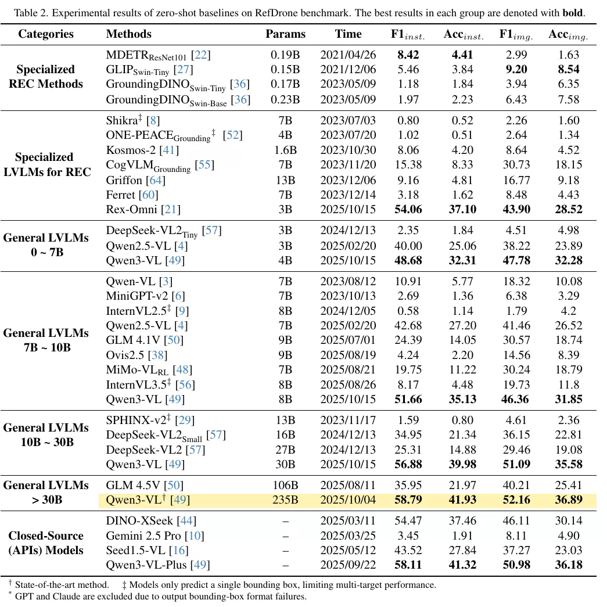
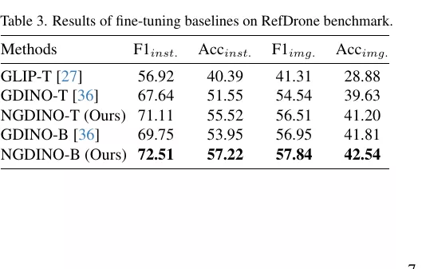
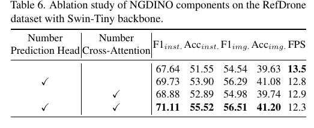
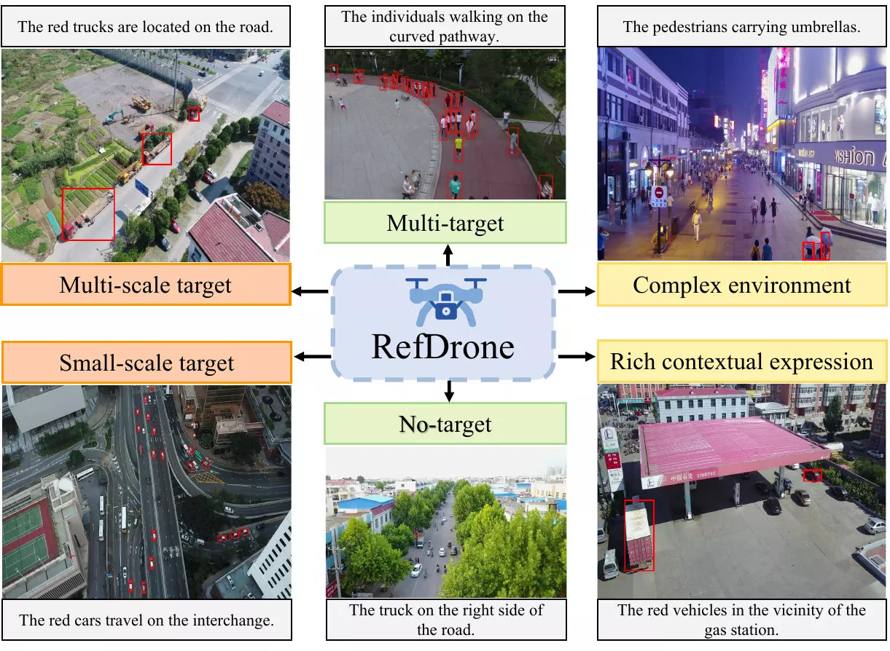

# RefDrone: A Challenging Benchmark for Referring Expression Comprehension in Drone Scenes

- **来源**: https://arxiv.org/abs/2502.00392
- **本地PDF**: `../../raw/2025-11-24-refdrone.pdf`
- **日期**: 2025-11-24
- **标签**: `REC`, `UAV`, `drone`, `benchmark`, `multi-target`, `small object`
- **研究方向**: Computer Vision → Referring Expression Comprehension → UAV-based REC
- **作者**: Zhichao Sun, Yepeng Liu, Zhiling Su, Huachao Zhu, Yuliang Gu, Yuda Zou, Zelong Liu, Gui-Song Xia, Bo Du, Yongchao Xu (Wuhan University)
- **提交日期**: 2025-02-01 (v1), 2025-05-19 (v2), 2025-11-24 (v3)
- **会议/期刊**: **CVPR 2026 Findings**（Findings 轨道而非主会（主会被拒 由 AC 推荐 → 再筛55%），[CVF Open Access](https://openaccess.thecvf.com/content/CVPR2026F/html/Sun_RefDrone_A_Challenging_Benchmark_for_Referring_Expression_Comprehension_in_Drone_CVPRF_2026_paper.html)）
- **代码**: https://github.com/sunzc-sunny/refdrone （NGDINO 训练/推理，MMDetection 框架）；[RDAnnotator 单独开源](https://github.com/sunzc-sunny/RDAnnotator)；[数据集与 NGDINO 权重在 HuggingFace](https://huggingface.co/sunzc-sunny/ngdino)

关联笔记：[Rex-Omni](./2025-10-14-rex-omni.md)（本基准 zero-shot 专用 LVLM 第二名）、[WeDetect](./2025-12-16-wedetect.md)（检索式 REC 的另一条路线）、[WeVisOne-VL](../2026/2026-10-22-wevisone-vl.md)（多目标 + 拒识的生成式路线）、[SkyAnchor](../2026/2026-07-22-skyanchor.md)（无人机小目标）。

---

## 摘要

**问题**: 无人机航拍场景的指代表达理解（REC）数据集匮乏，现有 REC 数据集均为地面视角，无法覆盖无人机场景的独特挑战。

**方案**: 构建 RefDrone 基准数据集 + RDAnnotator 半自动标注框架 + NGDINO 方法（显式建模目标数量）。

**关键创新/贡献**：
- **RefDrone 数据集**: 首个无人机场景 REC 基准（公开预印本早于 SkyFind），17,900 表达式 / 8,536 图像 / 63,679 目标，三大挑战：多目标与无目标（0–242 个/表达式）、多尺度小目标（小目标 31%）、复杂环境上下文推理
- **RDAnnotator 框架**: 多 LVLM 模块 + 人在环的半自动标注，$0.0539/表达式，人工时间 7 分钟 → 1 分钟（-85%）；框架本身作为两阶段方法评测也超 GPT-4o（Table 9）
- **NGDINO 方法**: 显式预测目标数量（量化 5 类），数量引导 query 选择 + 数量交叉注意力；RefDrone / gRefCOCO / RSVG 三个基准 SOTA

**验证**: 26 个 SOTA 模型统一协议零样本评测——全线崩溃（Qwen2.5-VL-7B：RefCOCO 92.5% → RefDrone 26.52% Accimg.，Table 2）；微调后 NGDINO-B 72.51% F1inst.，超最强零样本 LVLM Qwen3-VL-235B（58.79%）13.7 分，且参数少 3 个数量级（Table 3）。

---

## 1. 引言

**背景 & 动机**:
- 无人机已是主流机器人平台（娱乐、物流、交通监控、应急救援），具身智能需要 REC 能力：用自然语言定位目标
- 现有 REC 数据集（RefCOCO 系）均为地面视角；无人机视角带来独特挑战：**多目标（0–242 个）、小目标（31%）、复杂环境**
- RefDrone 与相关基准的对比（Table 1）——三大差异就是它的难度来源：

| 基准 | 图像源 | 规模（图像/表达式） | 平均目标数/表达式 | 平均长度(词) | 无目标 | 表达式来源 | 小目标占比 | 简介 |
|------|--------|-------------------|-----------------|-------------|--------|-----------|-----------|------|
| RefCOCO/+/g | COCO | 19,994 图/142,209 式；19,992 图/141,564 式；g 未核实 | 1.0 | 3.6/3.5/8.4 | ✗ | 人工 | 0% | 地面视角 REC 开山基准，指代单一目标（+：禁用方位词，只准靠外观描述；g：Google 收集版，表达式更长更自然，分 Google/UMD 两种划分） |
| gRefCOCO | COCO | 19,994 图/278,232 式 | 1.4 | 4.9 | ✓ | 人工 | 0.1% | RefCOCO 的多目标扩展 |
| D3       | COCO | 10.6K 图/表达式数未核实 | 1.3 | 6.3 | ✓ | 人工 | 6.3% | 表达更丰富、更具挑战性的描述 |
| RIS-CQ   | VG+COCO | 118,287 图/查询数未核实 | 2.2 | 13.2 | ✗ | LLM | 17.2% | LLM 生成复杂语言（与视觉内容解耦，易视觉歧义） |
| RSVG     | DIOR | 17,402 图/38,320 图文对 | 3.6 | 7.5 | ✗ | 模板 | — | 遥感图像定位（DIOR 为 Google Earth 光学遥感，800×800、0.5–30m 分辨率，混有部分航拍），但表达上下文贫乏、模板化 |
| RefDrone | VisDrone | 8,536 图/17,900 表达式 | 3.8 | 9.0 | ✓ | LVLM | 31.1% | 本文：无人机视角，多目标/无目标 + 小目标 + 富上下文 |

**本文贡献**:
1. RefDrone 基准：首个无人机 REC 基准，26 个模型评测
2. RDAnnotator 框架：低成本半自动标注，可扩展到其他 REC 任务
3. NGDINO 方法：显式数量建模，RefDrone / gRefCOCO / RSVG 三榜 SOTA

---

## 2. 相关工作

### 2.1 指代理解数据集

| 类型 | 数据集 | 特点 |
|------|--------|------|
| 早期 | ReferIt, RefCOCO | 简单表达式、单一目标 |
| 进阶 | gRefCOCO, D3, RIS-CQ | 多目标、更具挑战的语言 |
| 领域专用 | RSVG（遥感）、RAVAR（视频动作）、RIO（affordance） | 特定领域 |
| 航拍 | RSVG（遥感单目标空间关系）、AerialVG | 均不覆盖多目标/无目标 |
| 无人机 | **RefDrone**（本文） | 空白填补 |

**LLM 辅助标注的两种流派**：RIS-CQ 等让 LLM 生成纯文本表达式、与视觉内容解耦——语言复杂但**视觉上可能有歧义**；本文的 RDAnnotator 用迭代反馈机制把生成绑定到视觉证据上（详见 §3.2）。

### 2.2 REC 方法

| 类别 | 代表方法 | 特点 |
|------|----------|------|
| LVLM | GPT-4V, Qwen-VL 系 | 指令跟随强，但下采样/token 压缩丢细粒度细节，小目标定位差 |
| 两阶段 | MDETR, GLIP 系 | 先 proposals 再排序，推理慢 |
| 一阶段 | GroundingDINO | 直接预测，SOTA 但无法处理多目标/无目标 |

**本文定位**：基于 GDINO 改进，在解码器里加显式数量建模。

---

## 3. RefDrone 基准

### 3.1 数据来源

- 基于 **VisDrone2019-DET**（跨场景、光照、飞行高度的无人机检测数据集），**沿用其 train/val/test 划分**
- 过滤：只保留**至少 3 个目标**的图像；**排除框面积 < 64 px²（即小于 8×8）**的目标
- 坐标转为**归一化中心点 (0–1)**：减少送入 LVLM 的 token 数，同时保留空间关系（注：这只是标注管线中给 GPT-4o 的坐标格式，数据集本身存完整框，发布为 MDETR 兼容 JSON）

### 3.2 RDAnnotator 标注框架

**核心思想**: 多个专用 LVLM 模块协作 + 人在环验证，五步流水线（Figure 2）：

1. **场景理解**：GPT-4o 每图生成 **3 条不同 caption**，建立空间布局与物体关系的基础语境
2. **颜色分类**（CNN 提案 + LVLM 复核）：颜色出现在 **69%** 的表达式里，是关键判别特征。三步流程：
   - **造训练集**：用 HSV 色彩空间规则对物体裁片自动打标，再人工校验去噪
   - **训练 WideResNet-101 颜色分类器**（12 类），标注时对每个物体出初始颜色预测
   - **GPT-4o 复核**：结构化 prompt 下确认或纠正 CNN 的预测，专门处理光照/遮挡导致的语义模糊（红 vs 粉 vs 橙）
   - 分工：CNN 便宜地先说一遍（每图几十个物体都要问颜色），LVLM 贵但准地裁决；词表从 6 个基本色扩到 **12 色**（加橙/粉/灰/紫/棕/银）
   - **为什么用颜色**：无人机视角下判别轴塌缩——地面视角的主力描述（细节纹理）在小目标上消失，只剩类别/颜色/位置/交互；而颜色是对裁片的一阶统计量（主色调），恰恰是**最抗尺寸缩小**的属性（详见 Q7）
3. **表达式生成**：重构为**物体分组任务**——聚类语义相关物体 + 生成分组理由（即表达式）+ 输出各组坐标；**动态反馈回路**：若生成中出现新颜色词，触发 Step 2 重新分析，保证属性一致性。**位置/交互没有专用模块**：坐标以归一化中心点喂给 GPT-4o（prompt 明文解释坐标语义），模型对照 Step 1 caption 自由写方位/交互，输出须回写所指物体坐标供 Step 4 对账
4. **质量评估**：自动校验语义准确性与唯一性；**错误按类型路由**——语义错误回 Step 3，颜色错误回 Step 2
5. **人工验证**：三级审核——直接接受 / 微调 / 拒绝重做；42% 直接接受，47% 需微调，11% 拒绝

**两个值得注意的设计**：
- **无目标样本的来源**：反复验证仍无法落地的表达式**不丢弃**，而是 designated 为 "no-target" 样本——一组上下文有效但无目标的负例（847 条），比凭空构造负例自然得多
- **标注器即方法**：让标注工具自证标注质量。两阶段考场：同一批 Faster-RCNN（18.0 mAP）候选框，只比第二阶段"怎么选"——RDAnnotator 把标注流程倒着跑（caption 场景 → 核颜色 → 按坐标核对）得 **58.14 F1inst.**，超 GPT-4o（52.38）、远超 CLIP 排序 ReCLIP（24.62）。

**成本**: $0.0539/表达式（GPT-4o API），人工时间 7 分钟 → 1 分钟（**-85%**）。

### 3.3 数据集分析

**规模**: 17,900 表达式 / 63,679 目标 / 8,536 图像 / 10 类；平均 9.0 词、3.8 目标/表达式。

**三大挑战**：
1. **多目标/无目标**：11,362 多目标 + 847 无目标表达式，目标数 **0–242**；gRefCOCO 的表达式通常只指 1–2 个目标，RefDrone 的数量分布长尾得多（Figure 3）
2. **多尺度/小目标**：小目标（<32² 像素）**31%**、中目标（32²–96²）55%、大目标（>96²）14%（Figure 4）
3. **复杂环境上下文推理**：表达式超越简单颜色/方位（"left of"），覆盖**物体-物体交互**（"the white trucks carrying livestock"）与**物体-环境交互**（"the white cars line up at the intersection"）

### 3.4 评估指标

标准 image-level 指标对多目标太粗——漏掉大组里的个别目标无法细粒度惩罚，故引入 instance-level 指标（逐目标算 TP/FP/FN，IoU≥0.5 为 TP；无目标样本无预测 = TN、有预测 = FP）：

$$
\text{Acc}_{inst.} = \frac{TP + TN}{TP + TN + FP + FN}, \qquad \text{F1}_{inst.} = \frac{2 \cdot TP}{2 \cdot TP + FP + FN}
$$

Image-level（Accimg. / F1img.）更严：**逐条表达式**判，把该表达式的全部预测框当整体，集合与 GT 集**完全匹配**才算 TP（缺、多、不准 → 整条 FP，一票否决）；无目标表达式什么都不输出 = TN。两套指标用同样公式，只是记账粒度不同。

**与旧协议的关系**：RefCOCO 系每条只有 1 个 GT 框，评测就是单框 Acc@0.5——集合大小恒为 1 时 instance/image 两套指标天然重合，这套 2×2 指标是多目标逼出来的。gRefCOCO 首次引入 **Pr@0.5**（"全对率"：逐条表达式算预测集与 GT 集的 F1，**F1=1 才算对**——多选、漏选、错一个都灭）与 **N-acc**（拒识准确率：无目标样本中成功输出"空"的比例），RefDrone 在 gRefCOCO 上沿用原版协议（Table 4），并把自己的基准补全成 Acc/F1 × instance/image 四件套。注意 RefCOCO 的 92.5 与 RefDrone 的 26.52 协议不同，只能定性感受崩溃幅度，不可直接相减。

---

## 4. NGDINO

**核心思想**: 显式对"表达式指了几个目标"做数值推理，是多目标/无目标场景精确定位的关键。继承 GDINO 双编码器-单解码器结构，**改动集中在解码器**（Figure 6 黄框）三处：

### 4.1 数量预测头

检测 queries $Q_{det} \in \mathbb{R}^{B \times L_d \times D}$ 过 FFN + 均值池化，输出目标数量的概率分布：

$$
N_{prob} = \text{softmax}(\text{MeanPool}(\text{FFN}(Q_{det}))), \qquad N_{pred} = \text{argmax}(N_{prob})
$$

**量化成 5 类** $\mathcal{C} = \{0, 1, 2, 3, 4+\}$：目标数量服从 Zipf 型长尾分布，量化把开放域回归转成稳定的多分类，"4+" 合并吸收长尾。

### 4.2 数量引导 Query 选择

引入可学习 number-queries $Q_{num} \in \mathbb{R}^{B \times L_n \times D}$，训练编码不同数量的模式；预测数量作索引选对应 slice：

$$
Q_{num}^{sel} = Q_{num}[:, L_s \cdot N_{pred} : L_s \cdot (N_{pred}+1), :]
$$

每类 $L_s = 10$ 个、共 $L_n = 50$（5 类 × 10）——由消融确定（见 §5.3）。

### 4.3 数量交叉注意力

检测 queries 作 Q、选中的 number-queries 作 K 和 V，与 self-attention **并行**，输出加到 self-attention 结果上——把数量上下文注入检测流程。

### 4.4 训练目标与实现

- 损失 = GDINO 原损失（框回归 + 标签分类）+ 数量预测 Cross-Entropy，端到端
- **两阶段训练**（附录 A.2）：Stage 1 用预训练 GDINO 初始化、**冻结全部只训数量头** 5 epochs（防止随机初始化的头扰乱训好的检测器）；Stage 2 全参数微调
- 8×A100，MMDetection 框架；**所有微调统一禁用随机裁剪增强**——位置敏感的表达式里裁掉目标就是标签噪声
- **输入尺寸**（源码 configs/NGDINO/）：训练 `RandomChoiceResize` 多尺度短边 480–800 / 长边 ≤1333，推理 `FixScaleResize(800, 1333)`——VisDrone 图（~2000×1500）缩到约 **0.53×**，32px 小目标进网络只剩 ~17px。缓解：数据集已过滤 <64px 目标。
- **数据增广**：只用多尺度 Resize，翻转和裁剪全禁——表达式带方位词（"left side"），翻转或裁掉目标都会让标签错位
- Zero-shot 评测协议：专用方法走 MMDetection 官方 checkpoint，LVLM 统一进 VLMEvalKit、用各自官方推荐 prompt

---

## 5. 实验

### 5.1 零样本结果（Table 2）

26 个模型分四组：3 专用 REC + 7 REC 专用 LVLM + 12 通用 LVLM + 4 闭源 API。

**全场最佳是开源 Qwen3-VL-235B**：58.79 F1inst. / 41.93 Accinst. / 52.16 F1img. / 36.89 Accimg.，超专为 REC 设计的闭源 API DINO-XSeek（54.47）。

几个值得注意的模式：
- **规模定律成立**：Qwen3-VL 系 4B → 8B → 30B → 235B 单调爬升（48.68 → 51.66 → 56.88 → 58.79 F1inst.）；唯一例外是 DeepSeek-VL2（Small 16B 34.95 > 27B 25.31）
- **专用 REC 方法全线崩溃**：MDETR/GLIP/GDINO 零样本 F1inst. 均 <10%，说明**通用域预训练跨不到无人机域**
- **单框输出模型直接出局**：Shikra/ONE-PEACE/SPHINX-v2 等只能输出一个框（表中标 ‡），F1inst. <2%
- **Rex-Omni 54.06 是专用 LVLM 里唯一能打的**（3B），逼近闭源 SOTA
- **闭源 API 参差**：Gemini 2.5 Pro 仅 3.45、Seed1.5-VL 43.52、Qwen3-VL-Plus 58.11；**GPT 和 Claude 因无法输出合规框格式被剔除**——头部商用模型并未为细粒度定位优化

### 5.2 微调结果

**RefDrone（Table 3，50 epochs）**：

| 方法 | F1inst. | Accinst. | F1img. | Accimg. |
|------|---------|----------|--------|---------|
| GLIP-T | 56.92 | 40.39 | 41.31 | 28.88 |
| GDINO-T | 67.64 | 51.55 | 54.54 | 39.63 |
| **NGDINO-T** | **71.11** | **55.52** | **56.51** | **41.20** |
| GDINO-B | 69.75 | 53.95 | 56.95 | 41.81 |
| **NGDINO-B** | **72.51** | **57.22** | **57.84** | **42.54** |

NGDINO-T 超 GDINO-T：+3.47 / +3.97 / +1.97 / +1.57（四指标）；NGDINO-B 72.51 F1inst. 比最强零样本 LVLM（Qwen3-VL-235B 58.79）高 13.7 分——**专用小模型（0.24B vs 235B，差 3 个数量级）微调后反超**，这正是无人机等边缘平台可部署的路线。

**gRefCOCO（Table 4，5 epochs，Pr@0.5 = F1=1@IoU≥0.5 的比例，N-acc = 无目标样本准确率）**：

| 方法 | testA Pr@0.5 | testA N-acc | testB Pr@0.5 | testB N-acc |
|------|------------|------------|------------|------------|
| MDETR* | **50.0** | 34.5 | 36.5 | 31.0 |
| UNINEXT* | 46.4 | 49.3 | 42.9 | 48.2 |
| GDINO-T | 45.69 | 79.02 | 44.83 | 76.69 |
| NGDINO-T | 46.05 | **83.17** | **45.57** | **78.08** |

N-acc 提升 4.15（testA）/ 1.39（testB）；Pr@0.5 提升温和（+0.36/+0.74）——因为 gRefCOCO 多目标结构简单（多为一两个目标），数量先验的用武之地小。MDETR 的 Pr@0.5 高但 N-acc 低：倾向过度输出，在无目标样本上全是 FP。

**RSVG 遥感基准（Table 5，5 epochs）**：

| 方法 | Pr@0.5 | Pr@0.6 | Pr@0.7 | Pr@0.8 | Pr@0.9 |
|------|--------|--------|--------|--------|--------|
| TransVG* | 72.41 | 67.38 | 60.05 | 49.10 | 27.84 |
| MGVLF* | 76.78 | 72.68 | 66.74 | 56.42 | 35.07 |
| EarthGPT* | 76.65 | 71.93 | 66.52 | 56.53 | 37.63 |
| GDINO-T | 76.99 | 75.81 | 73.36 | 66.77 | 49.96 |
| NGDINO-T | **77.16** | **76.03** | **73.81** | **67.84** | **51.39** |

所有阈值全面超越此前 SOTA（含 EarthGPT）——高 IoU 阈值下优势更明显（Pr@0.9：51.39 vs 37.63），数量先验带来的定位质量提升在严准则下更值钱。

### 5.3 消融实验

**组件消融（Table 6，Swin-Tiny）**：

| 数量预测头 | 数量交叉注意力 | F1inst. | Accinst. | F1img. | Accimg. | FPS |
|-----------|--------------|---------|----------|--------|---------|-----|
| — | — | 67.64 | 51.55 | 54.54 | 39.63 | 13.5 |
| ✓ | — | 69.73 | 53.90 | 56.29 | 41.08 | 12.8 |
| — | ✓ | 68.88 | 52.89 | 54.98 | 39.74 | 12.9 |
| ✓ | ✓ | **71.11** | **55.52** | **56.51** | **41.20** | 12.3 |

- 数量头单独 +2.09：**辅助数量预测任务本身就提升 grounding**（多任务正则效应）
- 交叉注意力单独 +1.24：部分增益来自新增参数
- 合计 +3.47，速度仅 13.5 → 12.3 FPS——**近乎免费的精度**

**数量头自身精度**：MAE 0.21，数量预测准确率 75.3%——数量先验的可靠性是整个机制成立的前提。

**Number-query 每类个数消融（Table 8）**：number-query 是数量分支里的一组**可学习查询向量**，共 5 类 × $L_s$ 个；数量头预测出类别 $k$ 后，就取第 $k$ 组这 $L_s$ 个向量作为数量交叉注意力的 K/V，让 decoder 按"目标数量剧本"聚合信息。

| $L_s$（每类查询数） | number-query 总数 | 附加参数 | F1inst. |
|------|------|------|------|
| 1 | 5 | 1.58M | 70.20 |
| **10** | **50** | **1.65M** | **71.11** |
| 100 | 500 | 2.34M | 70.44 |

10 是甜点：1 个 query 装不下复杂数量模式，100 个徒增优化难度。

### 5.4 分尺度结果（附录 A.4）

按小/中/大目标拆开看（Acc），LVLM 与专用方法的差距集中在**小目标**：

| 方法 | Acc_s | Acc_m | Acc_l | Accinst. |
|------|-------|-------|-------|----------|
| Qwen3-VL-235B（zero-shot） | 26.54 | 51.60 | 55.79 | 41.93 |
| DINO-XSeek（API） | 24.54 | 46.52 | 62.51 | 37.46 |
| GLIP-T（微调） | 21.08 | 48.82 | 54.35 | 40.39 |
| GDINO-T（微调） | 38.56 | 56.69 | 66.13 | 51.55 |
| **NGDINO-B（微调）** | **44.08** | **62.59** | **68.20** | **57.22** |

即使是 235B 的巨模型，小目标 Acc 也只有 26.54%——**小目标是这个基准最硬的骨头**，也正是无人机场景的核心难点（呼应 [SkyAnchor](../2026/2026-07-22-skyanchor.md)）。

### 5.5 局限性（论文 §5.4）

NGDINO 的失败案例（Figure 7）归为三类：① 表达式复杂、需要深度上下文推理；② 杂乱背景伪装目标；③ 极小目标固有检测困难。

---

## 6. 结论

**总结**: 提出 RefDrone 基准（无人机 REC 三大挑战）+ RDAnnotator 高效半自动标注（LVLM 模块 + 人在环）+ NGDINO（显式数量建模解决多目标/无目标）。26 个 SOTA 方法在 RefDrone 上性能大幅下滑，暴露现有 REC 方法的关键短板；NGDINO 在 RefDrone/gRefCOCO/RSVG 三榜 SOTA。未来：扩展更大规模场景、增加指代分割（RES）与跟踪任务。

---

## 7. 代码仓库补充（论文未涵盖）

- **框架**：NGDINO 实现在 MMDetection 上（configs/NGDINO/），推荐 4×A100 + CUDA 12.1；数据集需转成 **ODVG 格式**（`tools/dataset_converters/refcoco2odvg.py`）后训练
- **训练配置**：`ngdino_swin-t_refdrone.py`（5 epochs，对应附录两阶段里的端到端阶段）与 `*_e50.py`（50 epochs，Table 3 的设定）；swin-t/swin-b 双骨干 + gRefCOCO 配置齐全
- **文本塔**：`bert-base-uncased`，token 上限 **256**（非 512，超长截断）；**非冻结**——RefDrone 微调阶段未设 lr_mult，以全学习率 2e-4 参与训练（预训练阶段 lr_mult=0.1），与原版 GroundingDINO 冻结 BERT 不同
- **标注如何利用（训练）**：整句 caption 始终喂 BERT 得**上下文相关的 token embedding**（全局/组合语义在每个 token 里都在，并非只取几个 token）；`tokens_positive` 仅为每个 GT 框建 positive_map，标出"该框在句里的正样本 token 区间"，grounding 头先算"框特征 × 每个 token"相似度（全 token），再由 `convert_grounding_to_cls_scores`（`atss_vlfusion_head.py:31-52`）对正样本 token 取均值映射成类别分；其余 token（含方位词）在对比损失里**自动当负样本**。（区别于 WeDetect 用独立类名 embedding、丢失句内组合性）
- **评测配置**：`RefDroneMetric`（thresh_score=0.7、thresh_f1=1.0、iou_thrs=0.5）；F1inst.@0.7 是**单点阈值敏感**指标，高阈值为 F1@1 零 FP 所迫，论文未给阈值敏感性分析
- **权重**：HuggingFace `sunzc-sunny/ngdino`（NGDINO_T.pth）；单图推理 `demo/image_demo.py  <config> --weights NGDINO_T.pth --texts '...' --tokens-positive -1`
- **RDAnnotator 独立开源**（sunzc-sunny/RDAnnotator），prompt 全文在论文附录 A.9（Table 11–14，含各步骤 system prompt 与反馈机制 prompt，均为 GPT-4o in-context learning）
- License：CC BY 4.0

---

## 个人评价

**核心价值**: 这是"无人机 REC"的定基调之作——第一个专用基准，把地面视角 REC 社区默认成立的假设（单目标、大目标、简单背景）全部打破：26 个模型零样本全线崩溃（最好的也只有 58.79 F1inst.），而 RefCOCO 上同样模型 92%+。方法侧的 NGDINO 证明了"显式数量先验"是处理多目标/无目标的**廉价且有效**的手段：+3.47 F1inst. 只花 1.65M 参数和 9% 的速度。对我们而言，"数量"这个被 REC 社区长期忽略的信号值得注意——它与 [WeDetect](./2025-12-16-wedetect.md) 的"候选 + 逐个打分"、[WeVisOne-VL](../2026/2026-10-22-wevisone-vl.md) 的"生成任意多个框 + None 拒识"是处理多目标的三条不同路线。

**可借鉴点**:
- **数量量化分类**：长尾分布（Zipf）下的计数/数量回归，离散成 {0,1,2,3,4+} 五桶转分类，是通用且稳定的招
- **无目标负例的来源设计**："反复验证失败的表达式不丢弃、转为 no-target 负例"——与 [WeVisOne-VL](../2026/2026-10-22-wevisone-vl.md) 硬负例体系（"负例必须全图复核"）异曲同工，但实现成本更低
- **错误按类型路由的反馈回路**：RDAnnotator 里语义错误回 Step 3、颜色错误回 Step 2——自动标注管线里"结构化错误分诊"比"统一重试"有效得多
- **RDAnnotator 即方法的自证**：把标注框架当两阶段方法跑榜（58.14 > GPT-4o 52.38），标注工具与方法互相验证，这个评测设计少见且说服力强

**实验设计亮点**: 26 模型统一协议（LVLM 全部走 VLMEvalKit + 官方 prompt，专用方法走 MMDetection）；instance-level 与 image-level 双粒度指标，把"漏一个"和"全错"分开记账；分尺度评测（Acc_s/m/l）直接暴露"235B 巨模型小目标也只有 26.54%"这一反直觉事实。

**批判 / 保留**:
- 表达式全部由 GPT-4o 生成，语言风格可能同质化（LVLM 生成式表达式的措辞偏好会系统性偏向某些句式），"LVLM 生成"本身也写进了 Table 1 的对比维度——基准难度可能部分来自生成风格而非真实场景分布
- 数量量化到 "4+" 后，>4 目标的场景数量先验不再区分（分布里 10+ 的表达式仍占相当比例），数量头对超多目标场景是粗粒度的
- NGDINO 只动解码器，小目标瓶颈（Acc_s 44.08 仍不高）在视觉塔表征层面没有触及
- 无目标样本仅 847 条（占 4.7%），N-acc 类指标的统计力有限
- **数据源单一、分布覆盖窄**：图像全部来自 VisDrone2019-DET 单一采集（城市无人机航拍，地理/场景/光照/飞行高度有限），表达式又是 GPT-4o 每图 3 条生成（措辞偏好同质化、词汇有限）。故基准主要衡量 **VisDrone 分布内**的无人机 REC，结论外推到其他无人机采集条件（不同地域、传感器、高度、分辨率）需谨慎。

---

## 疑问解答 (Q&A)

### Q1: 为什么数量要量化成 5 类，而不是直接回归一个数？

**答**: 论文的理由是真实数据中目标数量服从 **Zipf 型长尾分布**（大量 0–3、少数 10+ 甚至 242），开放域回归在这种分布下不稳定（尾部几乎无监督信号）；量化成 {0,1,2,3,4+} 变成稳定的五分类，长尾被 "4+" 桶合并吸收。代价是 >4 目标时不再区分精确数量——但检测解码靠 query 集合输出，数量头只需提供"大概几个"的先验，不需要精确计数。

### Q2: NGDINO 的"显式数量"路线，与生成式 LVLM 多目标（Rex-Omni）相比处在什么位置？

**答**: 两条路线的分工在这个基准上很清晰：**零样本**时生成式 LVLM 强（Qwen3-VL-235B 58.79、Rex-Omni-3B 54.06，专用 REC 方法 <10）；**微调后**带数量先验的专用检测器反超（NGDINO-B 72.51），且参数小 3 个数量级、12.3 FPS 可上机。数据集论文作者的立场明确：无人机是边缘平台，专用小模型 + 领域微调是可部署路线，LVLM 是零样本上限的参照。注意 Rex-Omni 用的也是坐标 token 生成式方案，它能拿 54.06 说明生成式在无人机域并非不行，只是没微调。

### Q3: 无目标（no-target）样本是怎么来的，可靠吗？

**答**: 来源两路：① RDAnnotator 生成中**反复验证失败**的表达式被保留为 no-target（上下文有效但图中无匹配目标）；② 评测协议里无目标样本"无预测 = TN、有预测 = FP"，直接进入 Acc/F1 计算。可靠性靠双重机制兜底：生成侧错误路由反馈 + 人工三级审核；评测侧 no-target 样本只占 4.7%（847 条），不会淹没主指标。

### Q4: RDAnnotator 里为什么颜色要单独搞一条 CNN + LVLM 的混合管线？

**答**: 因为颜色出现在 69% 的表达式里，是 REC 最常用的判别属性，但无人机视角下最难判：光照/大气变化、遮挡、语义模糊（红/粉/橙边界）。纯 CNN（WideResNet-101）快但语义判断弱，纯 LVLM 贵且不稳定——所以 CNN 提案（HSV 程序化打标 + 人工校验训练）+ LVLM 复核裁决。收益可直接量化：颜色词表从 6 基本色扩到 12 色仍保持一致。

### Q5: 训练时为什么要全体系禁用随机裁剪？

**答**: 附录 A.2 的统一协议：REC 表达式是**位置敏感**的（"左侧""路口附近"），随机裁剪可能把目标或其空间参照物裁掉，产生标签噪声——表达式还在说"左侧的车"，但图里已经没有"左"了。这对定位类任务微调是个通用提醒：数据增强要跟着任务的标注语义走。

### Q6: NGDINO 在 RefCOCO/+/g 上会退步吗？

**答**: 不会，但也没收益（附录 A.7）：NGDINO-T 与 GDINO-T 基本持平（91.5 vs 91.4 RefCOCO testA 等）。原因如论文所说：RefCOCO 系每表达式只有 1 个目标，数量分支无事可做。这说明数量建模是**即插即用的增量模块**，不损害单目标基线——跨域部署时不需要按场景开关。

### Q7: 小目标本来像素就少，为什么还要大费周章给每个物体标颜色？

**答**: 因为颜色是**最抗尺寸缩小**的属性：① 纹理/部件（眼镜、车灯、文字）是高频特征，目标一缩小就消失；颜色是对裁片做**一阶统计**（主色调/色相直方图），一辆 30×15 px 的红车哪怕一半像素被阴影污染，红色调仍在直方图里占主峰——退化最平缓，这也是 HSV 规则打标敢用的前提。② 无人机视角下判别轴只有类别/**颜色**/位置关系/物体-环境交互，无目标负例多靠颜色错配构造。
