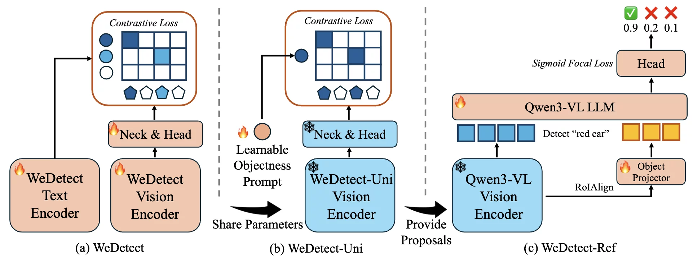
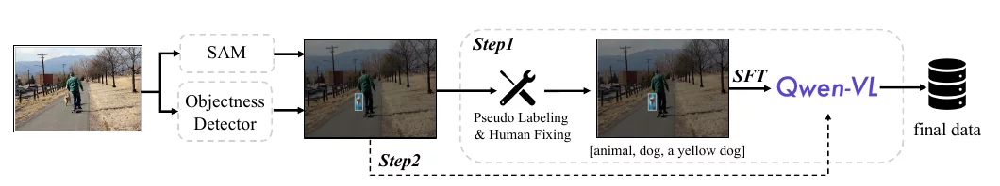
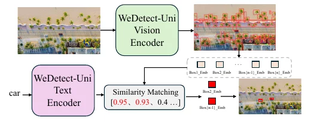
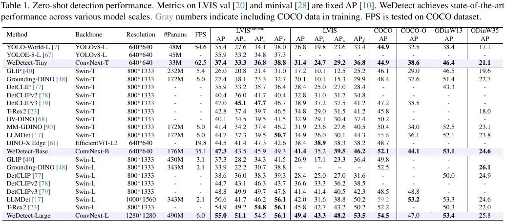
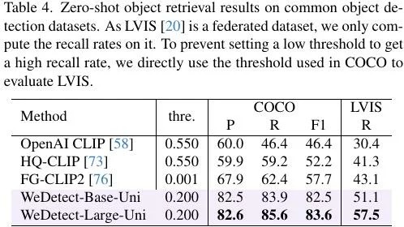
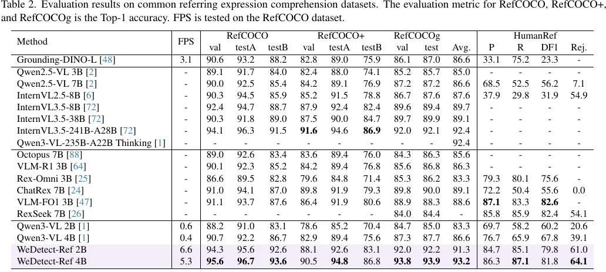
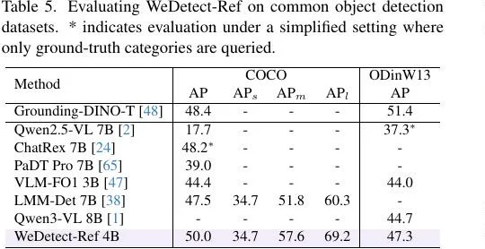

# WeDetect: Fast Open-Vocabulary Object Detection as Retrieval

- **来源**: https://arxiv.org/abs/2512.12309
- **本地PDF**: `../../raw/2025-12-16-wedetect.pdf`
- **日期**: 2025-12-16
- **标签**: `open-vocabulary detection` `retrieval` `dual-tower` `REC` `object retrieval` 
- **研究方向**: 计算机视觉 → 开放词汇感知 → 开放词汇目标检测 / 指代理解
- **作者**: Shenghao Fu†, Yukun Su†, Fengyun Rao*, Jing LYU, Xiaohua Xie*, Wei-Shi Zheng* (WeChat Vision, Tencent Inc. / Pazhou Laboratory (Huangpu) / Shenzhen Loop Area Institute)
- **提交日期**: 2025-12-13 (v1)
- **会议/期刊**: CVPR 2026
- **代码**: https://github.com/WeChatCV/WeDetect

---

## 摘要

**问题**: 开放词汇目标检测（Open-Vocabulary Object Detection, OVD）里，融合型方法（Grounding-DINO、GLIP、DetCLIP 等）靠深度跨模态融合层拿精度，但融合层计算量大、推理慢，而且视觉特征是 query 特定的，不同文本 prompt 之间无法共享特征——Grounding-DINO 在 1203 类 LVIS 上 chunk=40 要 31 次前向、数秒级延迟。

**方案**: 全程贯彻「检索」哲学：不做跨模态融合，把识别当作在共享嵌入空间里"区域特征 × 文本 query"的匹配问题（retrieval）。提出模型家族 WeDetect：
1. **WeDetect**：无融合层的双塔实时检测器，靠精心构造的数据和充分训练，non-fusion 精度反超融合型模型，成为强检测底座；
2. **WeDetect-Uni**：冻结整个检测器、只训一个 objectness prompt 的通用 proposal 生成器，bbox 走原有 anchor-free 回归分支，分类只判"是不是物体"（类别无关）。因检测器冻结，每个框的 box embedding 仍与类别空间对齐——支撑新任务 **object retrieval**：①入库阶段，每图只跑一次 Uni，取 top-300 框连同 embedding 存进历史库，之后永不再过检测器；②查询阶段，新类名"烟头"编码成一个文本向量，与库内全部 embedding 做点积排序，召回命中的图。相比 CLIP 每图单全局向量（小物体语义被整图平均稀释），每图一组局部 embedding 保得住小物体（Table 4 F1 83.6 vs CLIP 46.4）；
3. **WeDetect-Ref**：基于 LMM（Qwen3-VL）的 REC 模型。定位交给 Uni 的 100 个候选框，LLM 只当打分器：每个框抽 RoI 特征压成 1 个 object token（bbox 作位置 embedding），拼成 `assistant: ⟨object⟩×100` 的 prompt，LLM **一次前向**并行输出各 token 的 hidden embedding，二分类头逐一打分（如 query="穿7号球衣的球员"→7号球员 0.96、其余 0.1），不生成任何坐标 token、无 next-token prediction——既保住 LLM 的复杂指代理解，又规避其坐标回归不准与串行解码慢两大死穴，图里无目标时全低分可直接拒绝；

**关键创新/贡献**：
- **创新点1**: 用 ConvNeXt 版 CLIP 变体做底座预训练 + 15M 图/330M 框的数据引擎（Qwen2.5-VL 7B 自动打多粒度层级标签），证明"好数据 + 充分训练"能让无融合层的双塔超过融合模型；
- **创新点2**: WeDetect-Uni 的"冻结检测器 + 单 objectness prompt"设计，使 top-scoring proposal 的 embedding 天然类别相关，免费获得 object retrieval 能力；
- **创新点3**: 把 REC 改造成检索：LLM 只当分类器，对 proposal 列表一次前向并行打分，摆脱 LLM 回归坐标不敏感 + next-token 串行解码两大顽疾。

**验证**: 15 个 benchmark SOTA。LVIS minival：Tiny 37.4 AP @62.5fps（超 YOLO-World-L 2.0 AP 且更快）、Base 47.3、Large 55.0（Table 1）；object retrieval 上 Large-Uni F1 83.6，比 CLIP 高 37.2（Table 4）；REC：Ref 4B 在 RefCOCO/+/g 平均 93.2，超 Qwen3-VL 4B 6.6 分且快 13 倍，还是首个 COCO 检测超 50 AP 的 LMM（50.0，Table 5）。

---

## 1. 引言

**背景 & 动机**: 识别是 CV 的中心问题，图像级从闭集分类走到大规规模图文对比学习支撑的开放词汇图像检索；区域级的 OVD 则希望用文本 prompt 检测任意类别。现有 OVD 提升视觉-语言对齐的主流手段是深度跨模态融合层，精度高但计算昂贵，且视觉特征 query 特定、无法跨 prompt 共享复用。

**本文贡献**:
1. 提出 retrieval 范式的模型家族 WeDetect：WeDetect（检测底座，实时 + SOTA 零样本精度）、WeDetect-Uni（通用 proposal 生成器 + object retrieval 新应用）、WeDetect-Ref（LMM 做 REC，一次前向并行分类）；
2. 三项使 non-fusion 达到 SOTA 的关键技术：ConvNeXt 版 CLIP 变体底座预训练、无融合层双塔结构、15M 图/330M 框的多粒度标签数据引擎；
3. 在 15 个 benchmark 上同时拿到 SOTA 精度和高吞吐，WeDetect-Ref 4B 在 RefCOCO/+/g 上 93.2 平均分、13 倍速于 Qwen3-VL 4B。

---

## 2. 相关工作

**2.1 Open-Vocabulary Object Detection**: 已有工作沿四条路对齐视觉-语言——(1) 训练数据构建（GLIP 区域-词对比预训练、hard negative 构造、规模化）；(2) 训练目标（除区域-词对比外统一 MLM、dense captioning、与 LLM 协同训练如 LLMDet）；(3) 视觉-语言融合层（精度↑但效率↓且特征不共享）；(4) 模型蒸馏（从基础模型蒸馏开放词汇知识）。本文回归"无融合层的朴素结构 + 检索式方法论"。

**2.2 Large Vision-Language Model**: LVLM 开放词汇感知强，但给 LVLM 加区域感知的现有做法（GPT4RoI、Osprey、VideoRefer 等）把物体编码成特殊 token 后仍走 next-token prediction：数字被拆成离散 token 用交叉熵优化，对精确框回归不敏感，且物体逐个串行解码、推理慢。本文让 LLM 只当分类器，对物体并行处理。

---

## 3. WeDetect 检测底座

### 3.1 模型架构

**核心思想**: 双塔（dual-tower）无融合。语言编码器初始化自 **XLM-RoBERTa**；视觉侧是 YOLO-like 结构：**ConvNeXt backbone**（天然多尺度）+ **CSPRepBiFPAN neck** + **YOLO-World 对比头**。两塔都弃用原版 CLIP 组件：
- 视觉塔：因 ViT 的 plain 设计不适合检测、缺多尺度金字塔（论文明确说明），ConvNeXt 层级式特征正好喂 neck，ConvNeXt 本来就是冲着替代 Swin 做密集预测任务设计的；
- 文本塔：论文未说明理由。三层动机：①原生 CLIP text encoder 很弱（63M、77 token 上限），XLM-R（base 270M/large 560M）表征更强，纯英文模型也该换；②多语能力使一套权重双语两用——代码实锤：COCO/LVIS 英文 benchmark 的 eval config 用的全是**中文类名文件**（`config/wedetect_base.py` → `coco_zh_class_texts.json`），论文榜单数字是中文 prompt 跑出来的，中文支持是"顺手就有"而非牺牲英文；③落地需要（作者为腾讯微信视觉，WeDetect-Anything 词表数千中文类目）。另外注意：预训练数据（CLIP-stage 图文对，来源含 SAM-1B/LAION/CC12M/Zero[74]=中文数据集 CCMB/自爬）不开源，中英比例论文未披露；两塔均非从零训练——文本塔明说 initialized from XLM-RoBERTa，自研的是对齐预训练（CLIP-like 图文对比）而非塔本身；
- 损失与标签分配策略与 YOLO-World 相同（区域-文本对比损失 + 框回归损失），唯一区别是 neck 内**不用任何融合层**，分类就是图像网格特征与类别文本 embedding 的点积。

**两塔与 YOLO-World 的组件对照**（详见 [YOLO-World 笔记](../2024/2024-01-30-yoloworld.md)）：

| 组件 | YOLO-World | WeDetect | 换/留的理由 |
|------|-----------|----------|------------|
| 视觉塔 | YOLOv8 骨干（Darknet 系 CNN） | **ConvNeXt backbone** | 层级式特征正好喂 neck；不学 Rex-Omni 系用 ViT，因 plain 设计缺多尺度金字塔 |
| 文本塔 | CLIP text encoder（63M / 77 token，冻结） | **XLM-RoBERTa**（base 270M / large 560M） | CLIP 弱、77 token 上限、仅英文；XLM-R 表征强 + 多语（微信数千中文类目落地） |
| neck | PAN + RepVL-PAN（含图文融合，可重参数化） | CSPRepBiFPAN neck | **去掉融合**，坚守无融合检索范式 |
| 检测头 | YOLOWorldHead（anchor-free 点回归、TAL、DFL） | 同款保留 | 血缘所在，范式不变 |
| 预训练 | 直接用现成 CLIP 对齐 | **自研 CLIP 式对齐预训练**（底座初始化自 ConvNeXt 版 CLIP 变体 + XLM-R） | 换塔后原对齐失效，须重新对齐两塔 |

### 3.2 数据引擎

**核心思想**: 数据引擎分两步——
- **源图采样**：SAM-1B、LAION、CC12M、Zero + 自爬授权图，用原始 caption 中的稀有名词平衡概念，共 15M 图；
- **框标注流水线**：先用所有可用检测数据集训一个 objectness 检测器召回全部物体（配 SAM mask），再用 SFT 过的 **Qwen2.5-VL 7B** 生成实例特定的层级标签（如 "animal, dog, a yellow dog"）。标注器被微调出两个关键能力：**结构化输出**（先粗后细的固定模板）和**拒绝识别**（对错误框不生成标签，兼做 proposal 质量校验）。为增强 Qwen2.5-VL 局部感知，用 SAM mask 高亮物体边界 + 文本框坐标作为输入。

最终自标数据 **15M 图 / 330M 框**，另混入 OpenImagesV6、Objects365 V2、V3Det、ImageNetBox、GoldG（合计约 5M，Table 8）。

**Table 8. WeDetect 训练数据明细**（#Sample 为图像数）：

| 数据来源 | 图像数 (#Sample) | 说明 |
|---------|----------------|------|
| OpenImagesV6 [33] | 1.74M | 公开检测集 |
| Objects365 V2 [63] | 1.74M | 公开检测集 |
| V3Det [69] | 0.18M | 公开检测集（13K 类） |
| ImageNetBox [11] | 0.54M | 公开检测集 |
| GoldG [40] | 0.8M | 公开 grounding 集（GLIP） |
| **公开集小计** | **5.0M** | |
| self-collected（自标） | 15.0M | 330M 框，见 §3.2 数据引擎 |
| **训练总计** | **20.0M** | 与 §3.3「约 20M 样本」一致 |

> 注：330M 框仅对应自标 15M 图；Table 8 只列图像数，未给公开集各自的框数。

### 3.3 分阶段训练

**分阶段训练（staged-wise）**: (1) 先在大规模图文数据上做 CLIP 式图像级对比预训练，用其初始化视觉/语言编码器；(2) 冻结双塔，只训随机初始化的 neck 和 head；(3) 全参数端到端训练。避免随机初始化的 head 扰动 CLIP 预训练特征。

> 注：阶段 (1) 的「图像级对比预训练」是**整图 ↔ 文本**对齐，采用标准 CLIP 配方——数据是大尺度**图文对**（SAM-1B/LAION/CC12M/Zero/自爬图 + 其 caption，见 §3.2 行 161），**完全不涉及框**；「文本描述对应框」只发生在阶段 (2)(3) 的检测训练（15M 自标 + 5M 公开集的框级层级标签）。二者是两套不同数据/任务。此外，ConvNeXt 虽输出多尺度特征图，但图像级对比时只需对最终阶段特征图做**全局池化**（CLIP 的 CNN 视觉塔正是如此，用 pooling/attention pooling 把空间维压成一维）再过投影头，与文本 embedding 做 CLIP/InfoNCE 对比；多尺度特征图只在检测阶段经 neck（CSPRepBiFPAN）使用，预训练阶段用不到。

**多粒度标签采样（multi-granularity label sampling）**: 每个物体带层级标签列表，训练时每次迭代独立采样其中一个（实验中取最细与次细两级）做数据增强——既给单物体富监督，又给全 batch 构造多样的负类词表。

> 三点易误读（附录原文核过）：① 固定模板只约束"先粗后细"，例子 "animal, dog, a yellow dog" 是三级，但论文未承诺所有实例恰好三级；② 采样只取**最后两级**（the finest and the second finest，附录行 492–494），最粗级（如 "animal"）实际不参与训练损失；③ 层级标签**只属于 15M 自标集**——另混入的 ~5M 公开集（OpenImagesV6/Objects365/V3Det/ImageNetBox 用原始类名、GoldG 用原 grounding 句子）不是这种格式。

**实现细节**（附录 §9）：共约 20M 样本；head/neck 初始化 20 epochs lr 5e-4，端到端 30 epochs lr 1e-5，总 batch size 320；每个类名单独编码为单个 embedding。

迭代量与分辨率：
- **迭代次数**：20M / 320 = **62,500 iter/epoch**；head/neck 初始化 20 ep = 1.25M iter，端到端 30 ep = 1.875M iter，检测两阶段合计 **3.125M iter**（不含阶段 (1) 的 CLIP 预训练）。
- **分辨率**：论文**未显式写检测模型的训练分辨率**；仅 Table 1 给评测分辨率（Tiny/Base **640×640**、Large **1280×1280**），WeDetect-Ref 输入为 **900–1600 个 visual token**（约 900×32×32 到 1600×32×32 像素 ≈ 960²–1280²）。训练时长/GPU 数量论文亦未披露，无法精确估算。

---

## 4. WeDetect-Uni 通用候选框生成器

**核心思想**: 冻结整个检测器，只训练一个**可学习 objectness prompt** 做分类（近似 linear probing）。基于 WeDetect 判别性强的特征，单个 prompt 就能拿到高召回。关键点：不同于类别无关的 proposal 网络（如 RPN），**top-scoring proposal 的 box embedding 仍是类别相关的**——因为检测器没动，这些 embedding 可以直接用于分类，成为 object retrieval 的基础。

**object retrieval 新任务**: 从数据库中检索"含用户指定物体类别"的所有图像。与 CLIP 图文检索（全局语义）互补，聚焦局部语义（如"烟头"这类小物体）。评估协议：在检测数据集上，类名即 query，验证集即数据库，含该类标注的图为 ground truth 图像集，指标 P/R/F1 按类内计算再平均（LVIS 因联邦标注不全只算 recall）。

**应用方式**: 每张图用一组 object embedding 表示（而非 CLIP 的单 embedding）：WeDetect-Uni 提取全部感兴趣区域，top-scoring proposal 的 box embedding 预提取并缓存代表这张图；新 query 到来时只需一次点积即可完成检索（Figure 3）。

---

## 5. WeDetect-Ref 大模型当分类器

### 5.1 Formulating REC as Retrieval

**核心思想**: LLM 两大痛点——语言建模目标（数字离散 token + 交叉熵）导致对精确框回归不敏感；next-token prediction 串行生成导致延迟高。受 VideoITG 启发，把 REC 改造成检索：先用 WeDetect-Uni 抽候选列表 $\{B_i\}_{i=1}^n$，对每个物体从 MLLM 视觉编码器抽多尺度 RoI 特征，经线性 object projector 压成单 token $\{o_i\}_{i=1}^n$，与全图 token $I$、query $q$ 一起送入 LLM，在物体 token 的 hidden embedding 上加一个二分类头：

$$
\{h_i\}_{i=1}^n = \mathrm{LLM}(I, q, \{o_i\}_{i=1}^n), \tag{1}
$$

$$
\{s_i\}_{i=1}^n = \mathrm{Sigmoid}(\mathrm{Classifier}(\{h_i\}_{i=1}^n)) \in [0,1], \tag{2}
$$

两个优势：避免语言建模带来的框回归缺陷，同时抛弃 next-token prediction，一次前向完成全部物体判断（前人 Octopus/ChatRex 虽有 retrieval 雏形但仍是 next-token 机制）。

### 5.2 A Three-Stage Training Recipe

底座 **Qwen3-VL**，引入特殊 token `⟨object⟩` 作为每个物体的占位符；bbox 编码为位置 embedding 加到物体 token 上。三阶段（Table 9/10）：

1. **Stage 1 区域投影器训练**：只训新加的 linear region projector（RoIAlign 多尺度特征 → 单 token），685K 图像级+区域级 caption 数据（LLaVA Pretrain、refcoco/+/g 等），语言建模损失，batch 256，lr 1e-3；
2. **Stage 2 区域感知微调**：训 LLM + projector（视觉编码器仍冻结），685K caption 之外加入指令数据共约 1.7M，让 LLM 准确感知指定物体；
3. **Stage 3 区域分类微调**：丢弃语言建模头，换成**二分类头**（只作用于物体 token hidden embedding），损失为 **IoU 作软标签的 sigmoid focal loss**（IoU>0.5 的 proposal 为正样本），4M 检测+REC 数据，batch 128，lr 1e-5。

数据模板（Stage 3）：`user: ⟨image⟩ Please detect the "CLASSNAME" in the image.` / `assistant: ⟨object⟩⟨object⟩…`，`⟨object⟩` 个数等于 proposal 数。负样本构造：每图取 WeDetect 在负类中 top-3 置信度的类名做 hard negative（附录 §9）。

---

## 6. 实验

**Uni 召回率（Table 3）**：仅训一个 objectness prompt、冻结检测器，召回率在 COCO/LVIS/PACO 三档粒度上全面超过专用 proposal 网络（UPN、RPN 等），验证底座特征判别力。

### 6.1 主结果

**检测（Table 1，zero-shot）**：三个尺寸全面 SOTA——Tiny 以 33M 参数和更快速度（62.5 vs 54.6 fps）全面超过 YOLO-World-L（实时档）；Base 以 6 倍于 Grounding-DINO-Swin-T 的速度拿到更高精度；Large 在 LVIS 上超此前 SOTA T-Rex2。

> 注（多类检测机制）：底座检测模型做开放词汇检测是**一次图像前向 + 一次批点积**。K 个类名编码一次（可缓存）；分类 = 网格特征 ⊙ 全部类 embedding 的矩阵点积，一步出所有类响应图（COCO 80 类 = 1 次图像前向）。对比 GDINO 融合式——LVIS 1203 类按 chunk 40 需 31 次前向。

**Table 1 涉及的 6 个评测集速览**（规模/类别数以论文正文与各数据集原文为准，ODinW 各项按任务平均）：

- **COCO**：80 类日常物体；train **118K**（118,287）/ val **5K**（5,000，检测评测即在此跑）/ test-dev 20K，标注实例约 860K。检测的事实标准，考"常见类做熟"。
- **LVIS**：取 COCO 2017 的**图库**，但按自身标注预算**重新划分、重新标注**，故图像数与 COCO 官方划分对不上。v1.0 官方口径：train **100K**（100,170 图 / 1.27M 实例）/ val **19.8K**（19,809 图 / 245K 实例）/ test-dev 19,822 图，**1,203 类**，长尾极端（frequent/compact/rare 三档）。OVD 主战场，考稀有类识别；论文报 fixed AP。
- **LVIS minival**：val 中的 **2,287 张稠密标注子集**（图内几乎所有物体都标，平均每图 40+ 框），1,203 类不变。**fixed AP vs typical AP**：LVIS 生来不是给检测用的，是给实例分割 + 长尾识别研究建的，论文中是 per-category 评测，也即 AP_typ 每个类**单独**评再平均；后来 OVD 模型登场，**AP_fix** 拿一次全类联合的固定输出直接算，更贴近实际使用。WeDetect Table 1 注明用 fixed AP。
- **COCO-O**（Mao et al., ICCV 2023）：**网络新采集**图像，保留 80 类，构造 **6 个自然分布偏移域**：Weather / Painting / Cartoon / Tattoo / Handcraft / Sketch，共 **6,782 图 / 26,624 框**；专考跨域鲁棒性。正文 Table 1 报的是 6 域 **Average**，逐域分数在附录 Table 14。
  - 撞名警示：另有一篇 **Lin & Cui 2022《COCO-OpenObjects: Prompting Object Detection Again》**（技术报告，不在 arXiv），主题与分布偏移无关——主张"在 COCO 80 类上训好的**闭集**检测器，只把分类头换成 CLIP 文本 embedding 就能媲美 prompting 系 OVD"，即质疑 prompting 范式的增益其实来自数据与语言空间而非新机制。
- **ODinW13**：**13 个相互独立的真实场景任务**（交通、病害、无人机视角等），各任务词表互不相同；train/val/test 按任务自定，规模从几十张到 13K+ 张（如 PascalVOC 13,690/342、AerialDrone 521/57），零样本评测**按任务在各自 val 上算 AP 再宏平均**（GLIP 以来的标准协议），而不是把全部 val 池化算一个总 AP，因为各任务词表互不相同、同名类（如 car）跨任务定义不一致，且实例量从几十到上万悬殊，池化会被大任务支配、类别混淆；宏平均才度量"迁移到任意新垂直域的平均能力"。**全部是已有数据集，ODinW 自身不采数据**。它的贡献 = **把异构词表的现成数据集打包成任务套件 + 统一零样本评测协议**，比如ShellfishOpenImages / VehiclesOpenImages 就是从 Open Images 里切出来的子集。
- **ODinW35（Roboflow）**：**35 个任务**，划分按任务自定义（常被引约 167K 图）；最严格的多词表泛化卷面。zero-shot 只评各任务 val；train 的用途在别处：支撑 few-shot/微调协议（GLIP 系用 10%/25% train 微调）。**沿革**：协议与 13 任务由 GLIP（**CVPR 2022**, arXiv:2112.03857）首创，GLIPv2 扩到 35；GLIP 预训练 = Objects365（660K 图/365 类）＋ GoldG（800K 人工精标的"短语↔框"对——Flickr30K 整句逐短语框、VG 区域描述、GQA 区域问答，**显式剔除 COCO 图**）＋ Cap4M（4M 网络图文、框由初代模型伪标）。

> 六者构成递进梯度：COCO（熟类）→ LVIS（长尾）→ COCO-O（同域外分布）→ ODinW（全新词表）；FPS 在 COCO 上测。

**object retrieval（Table 4）**：大幅超过 OpenAI CLIP、HQ-CLIP、FG-CLIP2 等强图文检索模型——每图一组局部 embedding（对比 CLIP 单全局向量）在小物体检索上优势巨大，与图文检索形成互补。

**REC（Table 2）**：Ref 4B 在 RefCOCO/+/g 平均分超过基线 Qwen3-VL 4B 和更大的 InternVL3.5-241B（带 thinking），HumanRef 的拒绝率也是全场最高；速度快 13 倍，甚至超过专门优化推理的 Grounding-DINO-L——并行单前向 + 纯 self-attention（FlashAttention 友好）的架构红利。

**LMM 检测（Table 5）**：COCO 上首个突破 50 AP、追平传统检测器的 LMM。反衬基线 Qwen2.5-VL 7B 只有其 1/3 水平——next-token 机制多实例漏检且不会拒答，检索式每物体独立解码，两病同治。

### 6.2 消融实验

**WeDetect（Table 6，LVIS minival）**：去掉粗粒度标签 -0.9 AP（APr -1.6），去掉细粒度标签 -2.2 AP，去掉分阶段训练（head/neck 不先初始化）-1.8 AP——多粒度标签与分阶段训练都有效，细粒度标签贡献最大。

**WeDetect-Ref（Table 7）**：(1) BCE 换 sigmoid focal loss，COCO -4.4 AP；(2) 去负检测数据 -5.4 AP（APs -7.0），hard negative 至关重要；(3) 每物体从 1 token 加到 25 token 仅 +0.1 AP 但上下文 ×25——全图上下文已含足够物体细节，单 token 足够；(4) LLM 因果注意力下 proposal 乱序不打乱性能，模型对顺序鲁棒。

---

## 7. 结论与补充

**总结**: 检索式设计（从候选列表里挑目标，而非为每个 query 现生成候选）省掉昂贵的跨模态融合层，换来实时速度；WeDetect 家族统一了检测、proposal 生成、object retrieval 和 REC，15 个 benchmark SOTA。

**局限性**（附录 §8）：WeDetect-Ref 是二分类模型，**一次前向只支持一个 query**；多类检测需逐 query 推理再合并（COCO 每图跑 80 次）。好在 13 倍速优势下少 query 时仍比 Qwen3-VL 快。

**补充实验**：语言式检测 D3 数据集上 Ref 2B/4B 达 41.8/42.0 Full AP，比次优 ROD-MLLM-7B 高 10+ AP（Table 11）。附录还给了训练数据明细（Table 8/9）、训练配置（Table 10）、COCO/ODinW35/COCO-O 逐类结果（Table 12–14）和可视化。

---

## 代码仓库补充（论文未涵盖）

仓库里有一个**论文之外的新模块 WeDetect-Anything**（2026-06 放出）：基于 WeDetect-Uni 的"万物检测"流水线——候选阶段纯视觉（256 个可学习 prompt 当通用 objectness），导出 ONNX 只吃一张图，输出候选框 + objectness + box embedding；再把 embedding 与**预编码好的数千个中文类目词表**（`prompt_free.npy`，XLM-R 编码，768 维 L2 归一化）做点积 + sigmoid + argmax 出类别。等于把 WeDetect 的文本塔从"在线编码"换成"离线词表查表"，实现免 prompt 开放词汇检测，附 Gradio demo。

代码对照论文的几点确认（详见本仓库 `code/WeDetect/`）：
- 架构与论文一致：ConvNeXt + CSPRepBiFPANNeck + YOLOWorldHead，检测器类型就叫 `YOLOWorldDetector`（从 YOLO-World mmyolo 实现改造，保留 anchor-free 点回归、TAL assigner、DFL）；
- WeDetect 是**中文模型**：类名用中文（如 `--text '鞋,床'`），文本塔为 XLM-R，仓库自带 `xlm-roberta-base/large` 权重目录；WeDetect-Ref 支持中英 query（Qwen3-VL 底座多语言）；
- Uni 的 `num_prompts=256`，且作者 config 注明「mistakenly used 256 prompts, but actually only the first one is used」——只有第 0 路 prompt 是真正的 objectness，其余是历史遗留。

**微调指南**（`dist_train.sh <config> <gpu数>` 即 torchrun，8 卡、每卡 24G 足够、12 epochs）：
- **开放词汇微调**——场景：类别会持续扩展、未来要检出没训过的新类（开放世界巡检、词表不固定的业务）。保留文本塔，训过的类精度提升且零样本能力不丢。数据用 COCO 格式 + 中文类名文件（格式照抄 `data/texts/coco_zh_class_texts.json`，形如 `[["人"], ["安全帽"]]`），改 config 里的 `data_root`/`ann_file`/`class_text_path`/`num_classes` 后跑 `wedetect_base_coco_full_tuning_8xbs4_2e-5.py`（另有 mask refine 变体）；
- **闭集微调**——场景：类别固定不变且追求极限精度/速度（产线缺陷检测、固定目标监测），永远不需要认新类。丢弃文本塔，推理省掉 XLM-R。先 `generate_class_embedding.py` 把类名编码成 npy 初始化分类头，再跑 `wedetect_base_coco_vision_encoder_8xbs4_2e-5.py`；
- **Uni 微调**——场景：目标不是"识别是什么"而是"把所有物体框出来"，即给 object retrieval 建历史库、给 WeDetect-Ref 供候选、万物检测流水线。数据不挑类别：任意 COCO 格式检测集，把所有 `category_id` 合并为 0（类信息整个丢弃），**用目标域数据**微调以适配外观/尺度分布；但标注必须全（未标注区域会被当负样本"教坏"objectness），类别标注稀疏时先用检测器+SAM 伪标签补全。跑 `wedetect_uni_base_finetune.py`；默认只训 prompt，解冻 head/neck 可提召回但会导致 embedding 与文本空间漂移——下游是 retrieval / Ref 时不要解冻。
- **Ref 微调（REC）**——场景：把 WeDetect-Ref（Qwen3-VL + `out_proj` 二分类头）适配到新 REC 数据（如 RefDrone 指代表达式）。流程：① 先用 WeDetect-Uni 跑数据集中所有唯一图、按图存 top-K 候选框成 `proposals.json`（key=图片路径，RefDrone 密集场景建议 K=200~300 而非默认 100，否则 Uni 候选数 < GT 框数会封顶召回）；② 每条表达式写成样本 `{image, class_name=整句表达式（或 noun phrase）, bounding_boxes=该表达式 GT 框(xyxy), 可选 caption}`，跑 `wedetect_ref/sft_referring.py`（TRL SFTTrainer）：`freeze_vision_modules=True` 冻视觉、`out_proj` 分类头自动 10×lr（`sft_referring.py:142-155`）、损失 `sigmoid_focal_loss` + **软 IoU 标签**（proposal 与该表达式 GT 框的 IoU 作目标，`sft_referring.py:262-278`；IoU<0.5 的 GT 会被补进 proposals 当正例）、其余 token 的 label 全 -100（只训 `<object>` token，`sft_referring.py:358-364`）。无显式负样本队列——负例就是不匹配的 proposal（类名 hard-negative 的 `NegQueue` 在 `weref.py`，是 detect/Uni 那条线，不在 Ref SFT）。

---

## 个人评价

**核心价值**: 这篇论文把"检索式识别"从一个工程选择上升为一套统一方法论，并且用数据规模证明了 non-fusion 双塔不再是精度妥协——这动摇了"开放词汇必须上融合层"的默认共识。对下游系统设计者，WeDetect 家族提供了清晰的分工：底座检测（WeDetect）、离线候选缓存（Uni + object embedding 检索）、复杂指代（Ref），三件套正好覆盖"快筛 → 回溯 → 精读"的完整链路。

**可借鉴点**:
- **object retrieval 的表示方式**：一张图用一组类别相关的 box embedding 表示（而非单全局向量），天然支持小物体/局部语义检索——可直接迁移到无人机影像回溯、遥感瓦片检索等"库里找小目标"场景（呼应 [SkyAnchor](2026-07-22-skyanchor.md) 的小目标痛点）；
- **"冻结底座 + 只训一个 prompt"的扩展模式**：底座特征足够判别时，linear probing 级的新增头就能解锁新任务，训练成本近乎为零；
- **LLM 当分类器**：丢弃 next-token prediction、对预抽候选一次前向并行打分，是 LLM 做密集预测类任务的通用提速范式——[VLX-Seek](2026-10-16-vlx-seek.md) 正是把它用在开放词汇检测上（其 WeDetect-Base-Uni 也只是 proposal 生成器）；[LocateAnything](2026-05-26-locateanything.md) 的并行 box 解码同属这一路线；
- **多粒度层级标签**：一个物体同时挂"粗类 + 细类 + 实例描述"三个粒度，训练时采样，是低成本提升文本多样性的数据工程技巧，类似思路见 [LAE](2024-08-17-lae.md) 的 dynamic vocabulary。

**实验设计亮点**: object retrieval 任务把"检索"定义成分类问题（图集对图集的 P/R/F1），让 CLIP 系模型也能参赛，对比非常公平且直观；消融里"25 tokens per object 只 +0.1 AP"和"proposal 乱序不影响"两条实验干净利落地支撑了单 token 表示的设计决策。

---

## 值得改进的方向（笔者评估，非论文内容）

1. **无融合的组合性（方法创新）**：检测底座用独立类名 embedding，无显式属性/关系组合性。注：数据引擎的层级标签虽含属性词（如 "animal, dog, a yellow dog" 中的 "yellow"），但整句编码为单个 embedding，属性/关系未解耦，关系词（如 "left of"）更是完全缺失。可在 base 引入轻量**属性/关系 token**，做检索式（而非融合式）对齐——框特征与「属性/关系 embedding」点积，在不上跨模态融合层的前提下补回「红车左侧的蓝卡车」类组合理解。

2. **Uni 扩展：参数高效域适应 + 时序检索（方法/应用创新）**：Uni「冻结底座」假设在新域适配时会破功（解冻 head/neck 致 embedding 漂移，代码补充已警示），可用 LoRA/adapter 等参数高效手段在新域（UAV、夜间、恶劣天气）微调，既提域适应能力又保住与文本空间的对齐；同一套 Uni 缓存 embedding 的「历史库」机制还可从图像扩展到**视频流**——逐帧取 top 框 embedding 后用轻量关联（相邻帧 IoU/ReID）聚成 tracklet、对 tracklet embedding 聚合，再以文本 query 做 tracklet 级检索（如监控里追一个出现过的物体），即把 retrieval 哲学从图像库延伸到视频库。

3. **Ref 难负例挖掘（训练改进）**：Ref SFT 负例仅「不匹配的 proposal」，而 detect/Uni 线已有 NegQueue hard-negative 构造。把 hard-negative 引入 Ref 训练，可提升密集/易混场景（如 RefDrone 多相似目标）下的判别力。

4. **开放世界增量学习（方法创新）**：在 open-vocabulary 微调基础上加持续学习机制，使词表可动态扩展且加类不遗忘，直接服务「类别持续增加、未来要检新类」的业务（开放世界巡检等）。

---

## 疑问解答 (Q&A)

### Q1: 说 WeDetect 是 YOLO-World 架构准确吗？

**答**: 血缘上准确——代码从 YOLO-World 的 mmyolo 实现改造（`SimpleYOLOWorldDetector` 自述 "Implementation of YOLO World Series"），检测范式（anchor-free 点回归、TAL、DFL）一致。但组件大改：backbone 从 CSPDarknet/RepVGG 换成 **ConvNeXt**，neck 换自研 CSPRepBiFPANNeck，文本塔从 CLIP 换成 XLM-R。论文自己的表述是"a YOLO-like architecture ... and a YOLO-World contrastive head"，更准确的说法是"ConvNeXt 版 CLIP 双塔 + YOLO-World 检测头"。

### Q2: Uni 只有一个 objectness prompt，为什么 embedding 还是类别相关的？

**答**: 因为整个检测器（含对比头）冻结了。objectness prompt 只决定"哪些 proposal 得分高"，而 top-scoring proposal 过 head 后的 box embedding 仍是照常与全类别特征空间对齐的——冻结保证了这些 embedding 不漂移，所以能缓存下来做类无关的检索和分类。这也是为什么论文强调"不同与其他 class-agnostic proposal 网络"。代码里实际训了 256 个 prompt（`num_prompts=256`），但作者注明只有第 0 路在起作用。

### Q3: Ref 一次前向并行分类，为什么 COCO 检测还比 Qwen2.5-VL 好 30+ AP？

**答**: 三个机制叠加：(1) 候选来自强检测器 Uni（COCO AR50 92.3 @300），召回有保障；(2) 每物体独立二分类，多实例不会互相挤压输出；(3) 训练时用"图里不存在的类名"做 hard negative（WeDetect top-3 置信度选负类），教会模型拒绝。这正是 next-token LLM 的两大死穴（多实例漏检 + 不会拒答）被检索范式结构性解决。

### Q4: 论文与代码不一致 / 未开源的地方？

**答**: (1) 训练数据（15M 自标集）、数据引擎的标注器权重未开源，开源的是推理 + 微调代码；(2) WeDetect-Anything 是论文发表后 2026-06 才放出的仓库模块，论文正文与附录均未提及；(3) 论文称"finetuned from a pretrained CLIP model"，但该 ConvNeXt 版 CLIP 底座的预训练数据（含中文数据集 CCMB[74]）与配比未披露、未开源，底座也未单独开源；另一个有意思的细节：检测评测（COCO/LVIS）config 用的全是中文类名文件，即检测榜单数字是中文 prompt 跑出来的（英文类名文件在仓库里存在但无 config 引用；论文未做中英 prompt 对比消融）；而 object retrieval 评测硬编码英文类名、Rec 为多语自由 query——各榜单 prompt 语言并不统一，但都 SOTA，说明对齐空间对 prompt 语言不敏感；(4) 检测器 config 里 `num_training_classes=256` 与"单 objectness prompt"的论文表述有出入（见 Q2），应以"256 个 prompt 中实际只有第 0 路生效"理解。

### Q5: WeDetect 与 GDINO 在「文本输入 + 负样本」机制上的区别？

**答**：

1. **文本输入形态不同，且 WeDetect 不全是"单词"**：
   - WeDetect 检测/grounding 底座：文本是**类别名单**，每个类名**独立编码成单个 embedding**（非上下文 token），分类 = 网格特征 ⊙ 类名 embedding 点积（§3.1、§3.3）——这一路确实是"单词/短语级"。
   - WeDetect-Ref（REC）：文本是**整句指代表达式**，由 Qwen3-VL 读取并理解，并非单词（§5）。故"都是单词"只适用于检测底座，不含 Ref。
   - GDINO/GLIP：文本是**整句表达式**，BERT 出**上下文 token**（见 [RefDrone 笔记 §7](2025-11-24-refdrone.md)）。

2. **负样本来源不同，token_positive 的有无是本质差异**：
   - WeDetect 检测：负样本是 **batch 内其它类名**（多粒度标签采样构造负类词表）+ 背景（§3.3）。因"整词即概念"，不存在"句子里哪几个词描述这个框"的问题，**不需要 token_positive**。
   - GDINO/GLIP：每个 GT 框靠 `tokens_positive` 标出描述它的 token 区间 → positive_map，非该区间的 token（方位词、其它物体词）在对齐损失里 **target=0**（已核代码：`F.binary_cross_entropy_with_logits(pred, new_targets)`，`new_targets` 即 positive_map；。负样本是**同一句内**的其它 token。
   - WeDetect-Ref：同样**不用 token_positive**，而是对每个候选框做**二分类**（sigmoid focal + 软 IoU 标签），无 token 级对齐损失。

3. **本质区别，及"全面"的重新理解**：
   - GDINO 是"框对齐到句子里正确的词"（保留句内组合性，但需标注 token_positive、融合层计算重）；
   - WeDetect 是"框检索最匹配的类名/表达式 embedding"（检索式、无融合、快），检测底座用**独立类名 embedding 而丢失句内组合性**，REC 的组合性则改由 LLM 全句理解承担。
   - 所以"WeDetect 全面"应理解为：**三种任务（OVD/grounding/REC）共享同一套"无融合检索"哲学**；它和 GDINO 是**两种范式**之争（检索式 vs 融合式短语 grounding），不是"谁功能更多"。
