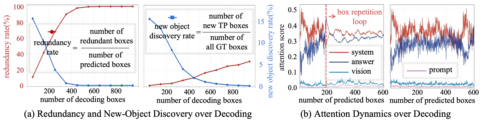
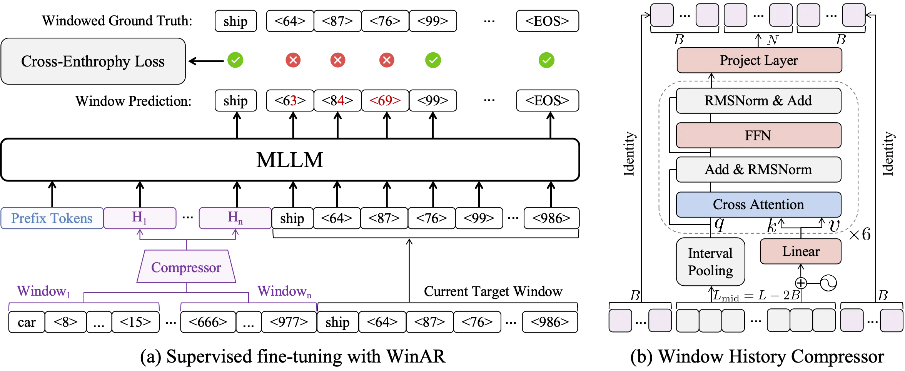
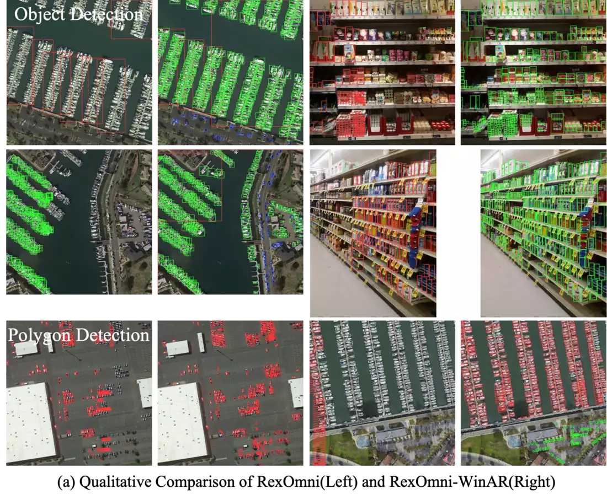

# WinARDet: Compressed Window Auto-Regression for Long-Horizon Vision-Language Grounding

- **来源**: https://arxiv.org/abs/2610.19419
- **本地PDF**: `../raw/2026-10-14-winardet.pdf`（本地文件，不随仓库分发）
- **参考链接**: https://mp.weixin.qq.com/s/UadwSxrLCvFR2FdZCRTxOA
- **日期**: 2026-10-14
- **标签**: `mllm` `autoregressive-detection` `dense-scene` `grounding` `remote-sensing` `history-compression`
- **研究方向**: 多模态大模型 → 生成式目标检测 → 长时序密集场景定位
- **作者**: Chenxu Wang, Hangyi Kuang, Bowen Yin, Yuxuan Li, Quansheng Zeng, Yang Zhang, Xu Guo, Xiang Li, Qibin Hou（南开大学、上海创智学院、北京师范大学）
- **提交日期**: 2026-10-14 (v1)
- **会议/期刊**: ICLR 2027 投稿（LaTeX 源码为 iclr2027 模板）
- **代码**: https://github.com/facias914/WinARDet
- **权重地址**: https://huggingface.co/facias/WinARDet / https://modelscope.cn/models/facias914/WinAR_Model

---

## 摘要

**问题**: 基于 MLLM 的生成式检测器（RexOmni、LocateAnything）把检测统一为自回归序列生成，但在极密集场景（单图数百至上千目标）下陷入长时序失效：全历史自回归（Full-History Auto-Regression, FHAR）使模型不断重复输出相同/近似检测框——RSDense 上前 400 个预测框内，重复率从约 10% 升至接近 100%，新目标发现率从约 16% 跌至接近 0，有限的解码预算被大量浪费。

**方案**: 提出压缩窗口自回归（Compressed Window Auto-Regression, WinAR），核心原则是"紧凑记忆、局部生成"（remember compactly and generate locally）：当前窗口保留精确的词元级自回归；已完成窗口经 Window History Compressor 压缩为少量潜在词元（默认一个 300 词元窗口压缩为 20 个历史表示），既减少模型反复接触原始坐标词元，又保留跨窗口依赖。

**关键创新/贡献**：
- **发现并量化长时序失效模式**：将框重复循环归因于"历史答案注意力接管"（historical-answer attention takeover）——坐标词元随解码推进不断挤占 attention sink 的注意力份额，形成自我强化的循环
- **WinAR 范式**：窗口内精确自回归 + 窗口间压缩记忆，替代不断增长的原始答案历史
- **通用性与实用性**：跨解码范式（NTP=逐词元自回归预测 / PBD=并行框解码 / Hybrid=混合解码）、跨输出格式（框/Polygon）泛化；窗口式训练可及时释放已完成窗口的激活，训练显存降 25-34%

**验证**: DOTA2 & SODA-A、RSDense（>200 目标/图的极密子集）、DOTA2-Poly、SODA-A-Poly、SKU110K。RexOmni 上 RSDense F1@0.5 从 32.16 提升至 39.36，平均重复率从 35.48% 降至 13.00%（Table 1）；LocateAnything PBD 模式 F1 26.15→27.54、重复率 14.89%→2.13%；训练峰值显存 RexOmni 57.62→42.97 GB（-25.4%）、LocateAnything 67.38→44.43 GB（-34.1%），使 WinAR 全部实验可在 8×A40（48 GB）完成而无需 H100 + MagiAttention。

---

## 1. 引言

**背景 & 动机**:
- 现代基于 MLLM 的检测器（RexOmni、LocateAnything）将目标检测表述为自回归下一词元预测，可在复杂语言指令下统一完成检测、指向、OCR、关键点定位等任务，突破了传统检测器固定预测接口的限制
- 但扩展到密集视觉场景时引入根本性的长时序定位挑战：单图需生成数百上千目标，模型必须持续发现未覆盖目标、同时记住已定位结果，答案序列快速增长到数千词元
- **有限解码预算放大重复代价**：每个重复框都占用本可用于发现新目标的生成步数，最终表现为召回率提前饱和、推理时延持续增加
- **完整历史并不总是有利**：FHAR 每步保留全部原始答案词元，坐标序列持续累积后，历史答案逐渐主导注意力分配，使模型越来越偏向已生成的位置

**本文贡献**:
1. 发现 MLLM 检测器的长时序失效模式：FHAR 渐进触发历史答案注意力接管和自我强化的框重复循环（量化：前 400 框内重复率 ~10%→~100%，新目标发现率 ~16%→~0，Fig. 2a）
2. 提出 WinAR：窗口内保留精确自回归，已完成窗口压缩为紧凑潜在词元，在不丢弃跨窗口依赖的前提下抑制重复
3. 跨场景密度、解码策略、结构化输出格式的大量实验：一致提升检测精度、显著降低预测冗余、降低长序列训练显存

**注意力接管机制**（Fig. 2b）: 将条件上下文划分为系统/视觉/提示/历史答案四个区域，跟踪坐标词元查询对各区域的 softmax 注意力质量。随解码推进，对历史答案的注意力稳步上升并在重复循环起点附近陡增，同时对初始系统词元（已知的 attention sink）的注意力显著下降。原始坐标模式主导条件上下文后，解码器偏向已生成位置；每个重复框又追加回历史进一步强化偏置，形成自我强化的循环。因此关键不是简单删除历史，而是设计新的历史表示。

---

## 2. 相关工作

**回归式目标检测**: Faster R-CNN、Cascade、DETR 系、YOLO 系等建立在判别式分类+回归范式上——backbone（ViT/DINOv3）+ FPN 提取多尺度特征，anchors/points/object queries 实例化候选，经标签分配后分别优化分类和回归损失。受 CLIP 等对比式视觉-语言预训练推动，开放词汇检测器（Grounding DINO 等）将类别名/文本提示与区域视觉特征对齐，但其语言理解受限于相对轻量的文本编码器（BERT 类 训练时冻结）和以区域-文本匹配为主的窄监督接口，难以利用异构视觉-语言监督、应对复杂语言指令与推理任务。
> 注：「BERT 类」指 Transformer 文本编码器这一类——CLIP 的文本塔是与图像塔一起从零对比训练的标准 Transformer（12 层 / 8 头 / 512 维），并非直接复用预训练 BERT 权重；Grounding DINO 则直接用（或初始化自）BERT-base。两者文本塔都偏轻量、且只在「区域-文本匹配」窄接口上训练，故语言理解深度不如 RexOmni/WinAR 这类把文本编码器换成完整 MLLM（Qwen2.5-VL）的检测器。

**基于 MLLM 的目标检测**: Pix2Seq 最早将类别和坐标量化为离散 token、把检测表述为自回归序列预测；该表述延伸到 MLLM 后统一了检测/指向/OCR/关键点等任务。RexOmni 用特殊坐标 token 表示几何位置，大规模 SFT 后接几何感知 GRPO 后训练以减轻坐标漂移和重复预测；LocateAnything 引入并行框解码（PBD），把每个框/点作为原子几何单元，块内并行预测坐标，降低逐 token 生成的串行时延。**共同局限**：都保留不断增长的原始答案历史，未显式处理长时序密集定位中坐标 token 积累主导后续预测、诱发自我强化框重复循环的问题。

---

## 3. 方法

### 3.1 预备知识

**核心思想**: MLLM 检测器把检测表述为自回归序列生成（FHAR），本节先建立这一基线形式与坐标序列化方案，作为后续 WinAR 的对照。

MLLM 检测器基于预训练多模态大模型（Qwen2.5-VL-3B）。给定图像 $I$ 和自然语言提示 $P$，视觉编码器将 $I$ 编码为视觉词元 $\mathbf{V}$，系统指令与提示映射为文本嵌入，拼接为多模态前缀 $\mathbf{X}=[\mathbf{S};\mathbf{V};\mathbf{P}]$。

**FHAR 生成**：目标答案 $\mathbf{Y}=(y_1,\ldots,y_T)$ 在完整原始答案历史条件下生成：

$$
p_{\theta}(\mathbf{Y}\mid\mathbf{X})
=
\prod_{t=1}^{T}
p_{\theta}
\left(
y_t \mid \mathbf{X},\mathbf{Y}_{<t}
\right)
$$

SFT 时将真值答案拼到前缀后按因果掩码优化交叉熵；推理时前缀预填充 KV cache，自回归生成直到终止符或最大解码长度。

**坐标序列化**：空间位置用量化相对坐标编码——像素坐标按图宽/高归一化后均匀量化为 1000 个离散 bin，词表最后 1000 项（$\langle 0\rangle$~$\langle 999\rangle$）复用为坐标 token，一个框 $[x_0,y_0,x_1,y_1]$ 用 4 个坐标 token 表示。RexOmni 用 Qwen2.5-VL 原生结构 token（`<|object_ref_start|>`、`<|box_end|>` 等）分隔类别短语与框，整个答案串行化为扁平序列做 NTP；LocateAnything 把响应重组为 6 token 定长原子块（不足用 `<null>` 填充）支持 PBD——每个框可在单次前向中并行解码。

### 3.2 压缩窗口自回归

**核心思想**: 用「窗口内精确自回归 + 窗口间压缩记忆」替代不断增长的原始答案历史——已完成窗口经 Window History Compressor 压成少量潜在词元，既抑制坐标 token 对注意力的挤占，又保留跨窗口依赖。

**窗口划分**：给定答案 $\mathbf{Y}=(y_1,\ldots,y_T)$ 和窗口长度 $L$，划分为 $K=\lceil T/L\rceil$ 个连续窗口：

$$
\mathbf{Y}
=
[\mathbf{Y}^{(1)};\mathbf{Y}^{(2)};\ldots;\mathbf{Y}^{(K)}]
$$

生成第 $k$ 个窗口前，每个已完成窗口独立经 Window History Compressor 压缩为潜在词元：

$$
\mathbf{H}^{(i)}
=
\mathcal{C}_{\phi}
\left(
\mathbf{Y}^{(i)}
\right),
\qquad i<k
$$

**窗口式生成**（替代 FHAR 的核心公式）：

$$
p_{\theta}(\mathbf{Y}^{(k)}_{t}\mid\mathbf{X})
=
\prod_{t=1}^{T_k}
p_{\theta}
\left(
y_t^{(k)}
\mid
\mathbf{X},
\mathbf{H}_{<k},
\mathbf{Y}^{(k)}_{<t}
\right)
$$

仅当前窗口的局部历史 $\mathbf{Y}^{(k)}_{<t}$ 保持显式可见；原始多模态前缀 $\mathbf{X}$ 全程保留，答案上下文只通过紧凑潜在词元增长，而非原始坐标 token 序列。

**Window History Compressor**：定长窗口切分可能把类别短语或几何结构切在窗口边界上，因此窗口两端各保留 $B$ 个边界 token 不压缩、直接透传；中间 $L_{\mathrm{mid}}=L-2B$ 个 token 才进入压缩器，压成预定义的 $N$ 个潜在词元（要求 $L-2B$ 可被 $N$ 整除）。压缩器双分支：
1. **内容感知 query 初始化**：中间 token 均匀分成 $N$ 个连续区间，每区间平均池化初始化一个 query——每个 query 获得窗口不同局部的摘要，而非随机初始化
2. **K/V 分支**：可学习的窗口局部位置编码保留窗口内相对顺序，经线性投影产生交叉注意力的 key/value

Query 经堆叠的交叉注意力 + FFN 层细化，归一化后过输出投影（两层线性夹 GELU）。最终表示 = 前部边界 token + $N$ 个压缩 token + 后部边界 token，一个 $L$ token 窗口压缩为 $2B+N$ 个历史 token。

**训练与推理**：
- **训练**：真值答案按窗口处理；训练第 $k$ 个窗口时此前窗口仅以压缩记忆 $\mathbf{H}_{<k}$ 存在，交叉熵只施加在当前窗口。窗口压缩完成后即可释放其原始词元表示和相关激活，无需全程保留全序列激活，显著降低长序列训练显存
- **推理**：从前缀生成第一窗口 → 压缩为 $\mathbf{H}^{(1)}$ 并移出显式答案上下文 → 基于原始前缀 + 累计压缩记忆 + 当前窗口局部 token 继续生成，直到终止符或最大解码预算

---

## 4. 实验

### 4.1 训练细节与评测设置

**训练细节**：
- RexOmni 系全部训练 4 epochs，per-device batch size 1 + 16 步梯度累积；基础学习率 $4\times10^{-5}$，vision tower 学习率 $4\times10^{-6}$
- RexOmni-WinAR 额外以 $4\times10^{-4}$ 学习率优化 Window History Compressor；token 级窗口 $L=300$、两端各保留 $B=6$、压缩为 $N=8$（一个 300 token 窗口 → 20 个历史 token）
- Polygon 检测用更大窗口：$L=400, B=8, N=12$
- **FHAR\* 基线**（公平性关键设计）：窗口式训练使长样本获得约 $\lceil T/L\rceil$ 倍曝光，为控制该混淆因素，将含 $T$ 个答案 token 的样本过采样约 $\lceil T/L\rceil$ 次，匹配有效样本曝光和总优化器步数
- GRPO 实验沿用 RexOmni 奖励设计，在 >200 目标的训练子集上训 1 epoch
- LocateAnything 系用相同优化设置；LocateAnything-WinAR 采用块级窗口：$L=50$ 块（300 token）、两端各 $B=1$ 块（6 token）、压缩为 $N=2$ 潜在块（12 token）
- FHAR 实验用 8×H100，WinAR 实验用 8×A40（48 GB）

**评测设置**：DOTA2 与 SODA-A 训练集联合训练、验证集联合评测；**RSDense** = 从DOTA2&SODA-A 评测集选取 >200 目标的极密子集（200-2000 目标/图）；Polygon 在 DOTA2/SODA-A 分别单独训练评测。指标：类别平均（DOTA2 & SODA-A）/ 图像平均（RSDense）的 Recall、Precision、F1@IoU0.5，另引入两个描述完整生成行为的指标：

| 数据集 | 预处理（裁切） | 官方切分 | 进入统一训练集 | 进入统一评测集 |
|---|---|---|---|---|
| DOTA-v2.0 | 高分图裁 1024×1024，相邻重叠 200px | train 13,447 / val 4,053 | 13,447 | 4,053 |
| SODA-A | 高分图裁 800×800，步长 650px | train+val 合并 32,181 / test 14,654 | 32,181 | 14,654 |
| **合计（DOTA2 & SODA-A）** | — | — | **45,628** | **18,707** |

> 注：RSDense 再从统一评测集（18,707 张）中筛出含 >200 目标的图，最终 **712 张**（平均 412 目标/图）。

> 注（视觉编码器输入）：RexOmni 基座是 **Qwen2.5-VL-3B**，其 ViT 走**动态分辨率**（并非固定 448）。代码用 `smart_resize` 将每张图缩放到 `[min_pixels, max_pixels] = [16·28², 2560·28²]` 像素预算内，再以 patch 14 + 2×2 merge 变成**可变数量**的视觉 token（约 16–2560 个）。因此 1024² / 800² 的裁切 patch 都落在像素预算内、**不会被下采样**；`smart_resize` 仅把边长取整到 28 的倍数（1024→1036、800→812），再 tokenize 成可变数量的视觉 token（1024 patch ≈ 37×37=1369 个，800 patch ≈ 29×29=841 个）。

> **动态分辨率的原理**：① **原始 ViT 为何固定分辨率**——它给每个 patch 加的是**可学习的绝对位置嵌入**，而这张嵌入表是**固定网格形状**的（例如 224×224 图按 16×16 切分 → 固定的 14×14 网格），没法塞进任意大小的网格，因此必须先把图 resize 成固定正方形。注意此处的 14×14 是「网格」、由 16×16 的 patch 推出，与下文 (c) 中 Qwen 的 14×14「patch 大小」不是一回事。② **Qwen-VL v1 就是用的 CLIP 的 ViT**——它直接冻结 OpenCLIP ViT-L 当视觉塔，所以输入被钉死在 **448×448**。③ **Qwen2-VL / Qwen2.5-VL 的改动**——骨架仍是 ViT（patch embedding + Transformer），但做了三件事：(a) 把绝对位置嵌入换成 **2D 旋转位置编码（2D-RoPE）**，位置变成坐标 `(x,y)` 的函数、与网格大小无关，同一套权重能吃任意 H×W 网格；(b) 输入改用 **NaViT 式 token 化**（`smart_resize` 按像素预算缩放、高宽取 28 的倍数），token 网格随分辨率/长宽比变化；(c) **qwen2.5-vl 的patch 大小与 2×2 merge**——ViT 的 patch embedding 用 **14×14** 切图（每个 raw patch token 覆盖 14×14 像素）；随后在**patch embedding (14×14 conv) 之后 self-attention 之前**做一次 **2×2 pixel shuffle**：把相邻 2×2 共 4 个 patch embedding（各 C 维）空间交错拼成 4C，再经一层线性层降维回 C，于是每个最终视觉 token 覆盖 28×28 像素；最终 token 网格为 H/28 × W/28，这正好是 `smart_resize` 中 factor=28 的由来； Qwen 视觉塔是**从头训练**的（论文明确 from scratch，含 CLIP 式预训练阶段）。整个视觉塔 = patch embedding + merge + ViT Transformer 块（带 2D-RoPE），其输出再经 projector 映射后作为视觉 token 喂给 LLM。

$$
R_{\mathrm{dup}}=N_{\mathrm{dup}}/N_{\mathrm{pred}},\qquad
R_{\mathrm{over}}=(N_{\mathrm{pred}}-N_{\mathrm{gt}})/N_{\mathrm{gt}}
$$

其中 $N_{\mathrm{dup}}/N_{\mathrm{pred}}/N_{\mathrm{gt}}$ 分别为重复预测数、总预测数、真值目标数；逐图计算后取平均得 Mean $R_{\mathrm{dup}}$ 和 Mean $R_{\mathrm{over}}$。

### 4.2 主结果

**1. 极密集场景提升最显著**（Table 1）:

| RexOmni (NTP) | RSDense R | RSDense F1 | Mean $R_{\mathrm{dup}}$ | Mean $R_{\mathrm{over}}$ |
|---|---|---|---|---|
| Baseline | 17.32 | 12.69 | — | — |
| FHAR | 23.39 | 16.57 | 58.74% | 5.85 |
| FHAR* | 36.82 | 32.16 | 35.48% | 3.14 |
| FHAR*-GRPO | 37.27 | 31.98 | 35.05% | 3.11 |
| **WinAR** | **45.23** | **39.36** | **13.00%** | **0.87** |

DOTA2 & SODA-A 上 WinAR 将 Recall 66.94→68.32、F1 67.59→67.97，重复率 2.43%→1.26%、过预测率 1.39→0.51。GRPO 后训练对重复率几乎没有额外收益（35.48%→35.05%），而 WinAR 的窗口压缩把重复率直接砍到 13%。**场景越密集、序列越长，压缩历史收益越大**。

**2. 极密类别的提升**（Table 2，RexOmni，RSDense）: Ship 的 F1 51.71→61.74（R 57.13→65.35），Small Vehicle 的 F1 19.94→26.96（R 22.65→30.06）。

**3. 不依赖特定解码范式**（Table 1，LocateAnything，RSDense）:
- NTP：重复率 5.90%→0.49%，Recall 53.87→55.42，F1 基本持平（54.87 vs 54.40）
- PBD：F1 26.15→27.54，重复率 14.89%→2.13%，过预测率 0.84→0.02
- Hybrid：F1 49.76→50.82，重复率 10.60%→1.75%

说明 WinAR 不仅适用于逐词元坐标生成，也能控制并行几何解码中的历史累积与重复预测。

**4. 泛化到 Polygon 输出**（Table 3，每个目标 8 个相互依赖的坐标 token）: DOTA2 上 F1 47.25→48.93、重复率 6.34%→2.46%、过预测率 4.99→0.89；更密的 SODA-A 上 F1 38.64→44.00、重复率 3.72%→1.93%。WinAR 不局限于定长框序列，对更复杂的结构化几何输出同样有效。

**5. 训练显存与有效吞吐**（Table 2）:
- 训练峰值显存：RexOmni 57.62→42.97 GB（-25.4%）；LocateAnything 67.38→44.43 GB（-34.1%），使 WinAR 全部实验可在 8×A40（48 GB）完成、无需 MagiAttention
- 推理：窗口边界的压缩与 KV cache 预填充有额外开销，原始 Boxes/s 不一定总提升（RexOmni 6.05→6.68）；但重复预测大幅减少使解码预算利用更有效，**Valid Boxes/s 从 3.57 提升至 5.40**

### 4.3 消融实验

**压缩配置**（Table 4，$L$/$B$/$N$ 共同决定"抑制重复"与"保留精确上下文"的平衡）:

| $L$ | $B$ | $N$ | DOTA2&SODA-A F1 | RSDense F1 | RSDense $R_{\mathrm{dup}}$ |
|---|---|---|---|---|---|
| 300 | 6 | 8 | **68.49** | **44.78** | 5.38% |
| 200 | 4 | 6 | 67.22 | 44.56 | 4.21% |
| 200 | **0** | 20 | 64.82 | 32.47 | 2.59% |
| 100 | 2 | 4 | 67.04 | 43.71 | **0.89%** |

两个发现：
- **更短窗口 = 更频繁压缩**：$L$ 300→100 使 RSDense 重复率 5.38%→0.89%、过预测率 0.66→0.32，但 F1 44.78→43.71——过度压缩损害定位精度
- **边界保留不可替代**：同样 $L=200$，取消边界保留（$B=0$）即使把压缩 token 加到 $N=20$，RSDense F1 也从 44.56 大幅崩到 32.47——窗口边界的精确局部信息无法靠更多潜在 token 补偿

默认取 $(L,B,N)=(300,6,8)$：精度最优的同时仍大幅抑制冗余。

**压缩器深度**（Table 5）: 4 层在极密场景下压缩能力不足（RSDense F1 37.73）；6 层最佳（F1 67.97 / 39.36，重复率 13.00%）；8 层 Recall 略升（45.23→45.75）但 Precision 下降、重复率反升至 16.87%，F1 39.32 无稳定收益。默认 6 层。

---

## 5. 结论

**总结**: 识别了 MLLM 检测器在密集视觉-语言定位中的关键长时序失效模式——生成渐进坍缩为自我强化的框重复循环；提出 WinAR，当前窗口内保留精确自回归、已完成窗口用紧凑潜在词元表示，在限制重复接触原始历史坐标的同时不丢弃跨窗口依赖。实验表明 WinAR 在越密集场景收益越大，跨解码范式和结构化几何输出泛化，同时提升有效检测效率、降低长序列训练显存。

**局限性**: 论文未单列局限性章节。可观察到的点：(1) 压缩器超参（$L/B/N$/层数）需按任务手动调节且互相耦合；(2) 窗口边界的压缩与 KV 预填充带来推理开销，原始吞吐不保证提升（仅有效吞吐提升）；(3) 实验聚焦遥感与 retail 密集检测域，对自然图像中等密度场景收益未单独展示。

---

## 代码仓库补充（论文未涵盖）

仓库 `facias914/WinARDet` 在 RexOmni（IDEA-Research）+ Locate Anything 之上改造，核心新增四块：

**1. Window History Compressor（`finetuning/models/compression/object_memory_compressor.py`，类 `ObjectMemoryCompressor`）**
- 与论文 §3.2 一一对应：边界透传 token（`passthrough_tokens_per_side`=B）直接拼接，中间 token 压成 `num_memory_tokens`=N 个潜在 token
- **内容感知 query 初始化**：中间 token 均分成 N 段、每段平均池化出一个 query（方法 `_build_interval_memory_queries`），正是论文的「内容感知 query 初始化」
- 压缩器主体：每段可学习位置编码 + `segment_proj`（Linear-GELU-Linear）+ 堆叠 `num_layers` 层 **交叉注意力（MultiheadAttention）+ 前置 RMSNorm + FFN**（Pre-RMSNorm 残差块，注释明说 follow Qwen2.5-VL ViT 模式）+ `output_norm`/`output_proj`；输出 = `[前部边界 token, N 压缩 token, 后部边界 token]`
- 配置写死 `num_memory_tokens=8, num_layers=6, num_heads=8`（类默认却是 8/2/8），与论文默认 $(L,B,N)=(300,6,8)$、6 层一致

**2. 窗口式训练引擎（`finetuning/engine/chunked_context_compression.py`，`ChunkedContextCompressionTrainer`）**
- `forward_chunked` 把答案按 `max_tokens_per_segment=300` 切段，**每个样本只训练一个 chunk**，历史段记忆在 `torch.no_grad()` 下重建——坐实论文「释放已完成窗口激活、降长序列显存」
- 自定义 `_build_chunk_attention_mask` / `_build_chunk_position_ids`：监督段只看见前缀 + 历史压缩记忆 + 自身因果三角，被压缩掉的原始历史段在 mask 中隐藏且不占位置编号（压缩时间线），与论文窗口式生成的注意力/位置构造吻合
- 仅最后一个段算 LM loss，其余段记忆 no_grad；当前仅支持 `batch_size==1`

**3. FHAR\* 过采样基线（`finetuning/dataset/oversample_grounding_dataset.py`，`GroundingOversampleTSVDataset`）**
- 一条含 N 个回答 token 的样本重复 `max(1, ceil(N / tokens_per_segment))` 次（默认 `tokens_per_segment=200`），每次仍用完整普通 SFT 序列 + 完整因果 loss——坐实论文「过采样对齐曝光量」的控制变量设计

**4. 其它确认点**
- 训练配置 `sft_winar.py`：`use_context_compression=True, compression_train_mode="segment_causal"`、`detach_compressor_inputs=True`、`lambda_cls=lambda_cov=0`（覆盖/分类辅助 loss 默认关）、`use_coord_soft_loss=False`；基座 `model_name_or_path` 直接指向 Rex-Omni 本地路径
- 评测指标 `evaluation/metrics/coco_lvis_metric_rsdense.py` + `analyze_redundancy.py` 实现论文 $R_{\mathrm{dup}}$ / $R_{\mathrm{over}}$；`eval_*_compressed.sh` 为 WinAR 推理入口
- GRPO 走 `finetuning/verl/` + `scripts/grpo.sh`；数据集以 TSV（base64 图 + 标注）组织，从 ModelScope `facias914/WinAR_Data` 下载

**5. 开源与可复现性**
- 仓库只含 **RexOmni 路径**的完整代码（只有 `RexOmni_WinAR/` 一个代码目录，无独立 LocateAnything 文件夹；`rex_omni/wrapper.py` 搜 `LocateAnything` = 0 命中）。论文中 Locate Anything 的实验结果来自另一代码库，**未随本仓库发布**。
- RexOmni 路径的训练**基本可完整复现**——各组件齐全：

| 组件 | 是否在仓库 | 位置 |
|---|---|---|
| WinAR 核心代码（压缩器 / 窗口训练引擎 / FHAR\* 过采样） | ✓ | `models/compression/`、`engine/`、`dataset/` |
| 训练入口 + DeepSpeed 配置 | ✓ | `train.py`、`train_seg.py`、`scripts/*.sh`、`scripts/zero*.json` |
| 基座模型 RexOmni | 外部但开源 | 独立仓 IDEA-Research/Rex-Omni + 权重（HF/ModelScope） |
| 训练数据 | ✓ | ModelScope `facias914/WinAR_Data`（TSV） |
| 训好的 WinARDet 权重 | ✓ | HF `facias/WinARDet` / ModelScope `facias914/WinAR_Model` |
| 超参 + 环境 | ✓ | 论文给出（L=300,B=6,N=8,lr 4e-5,压缩器 4e-4,4 epoch）；环境锁 torch 2.6.0 / flash-attn 2.7.4 |

- 训练脚本**分阶段串联**（依赖链）：`sft_base.sh`（RexOmni 基础 SFT）→ `sft_base_oversample.sh`（FHAR\* 过采样基线）→ `sft_winar.sh`（WinAR 压缩）→ `grpo.sh`（GRPO）。脚本里 `MODEL_PATH` 指向上一步产出的本地 checkpoint（注释 "replace it with your local file path"），需自己把路径串起来，非一键，但所有环节的代码/配置/数据/权重/超参都在。
- 复现需注意：(a) 项目挂在独立开源的 RexOmni 之上，需先备好 RexOmni 基座权重；(b) GRPO 依赖 `verl` + Ray + DeepSpeed，环境更重；(c) **Locate Anything 实验结果无法从本仓库复现**（代码未发布）；(d) RexOmni 基座本身的预训练数据未必全开放，但复现 WinARDet 只需从 RexOmni 发布权重起步，无需重训基座。

---

## 个人评价

**核心价值**: 这是第一篇系统性诊断"生成式检测器在密集场景下为什么越生成越差"的工作。之前 RexOmni 用 GRPO 后训练缓解重复、LocateAnything 用并行解码降低时延，但都没动"答案历史无限增长"这个根因。本文把问题归因到注意力机制层面（历史答案注意力接管挤出 attention sink），给出了可量化的失效曲线（Fig. 2），然后从历史表示这个正交维度给出解法——这个"诊断→归因→正交解法"的叙事结构非常干净。

**可借鉴点**:
- **"窗口压缩记忆"是通用的长时序生成技术**：不止检测，任何需要长结构化输出的生成任务（长文档生成、多轮工具调用、长视频字幕）都面临同样的历史稀释问题，WinAR 的"局部精确 + 全局压缩"框架可直接迁移
- **FHAR\* 曝光匹配基线设计**：窗口式训练隐含改变样本曝光量，论文用过采样对齐排除"训练多了"的混淆——这是消融实验公平性的教科书处理，值得在自己实验中复用
- **$R_{\mathrm{dup}}$ / $R_{\mathrm{over}}$ 指标**：把"重复"和"过预测"拆成两个独立可测的量，比单看 F1 更能定位生成质量问题

**实验设计亮点**: 基线梯度设计（Baseline → FHAR → FHAR* → FHAR*-GRPO → WinAR）层层排除混淆因素；训练/推理效率分开报告（峰值显存 vs Valid Boxes/s），不回避"原始吞吐不总提升"的负面结果；消融把 $L/B/N$ 三超参的耦合效应拆开验证。

---

## 疑问解答 (Q&A)

### Q1: 为什么不直接滑动窗口截断历史（像 streaming LLM 那样丢弃旧上下文）？

**答**: 论文在引言中明确"关键问题不是简单删除历史"。密集检测中跨窗口依赖是必要的（已检测目标的位置信息可避免后续重复框住同一目标）。消融也佐证：完全去掉边界保留（$B=0$）即使增加压缩 token 预算也大幅掉点（F1 44.56→32.47），说明精确局部上下文与全局压缩记忆各有不可替代的作用。WinAR 的答案是把"精确"限定在当前窗口、把"全局"交给压缩表示。

### Q2: FHAR* 和 FHAR 的区别是什么？为什么要造 FHAR*？

**答**: FHAR 是常规训练（每样本曝光 1 次）；WinAR 窗口式训练使含 $T$ token 的样本等效曝光约 $\lceil T/L\rceil$ 次（每个窗口都是一次监督信号）。若只对比 FHAR，无法区分 WinAR 的收益来自"压缩历史"还是"多看了几遍数据"。FHAR* 通过过采样对齐曝光量与总优化步数，是归因到压缩机制本身的关键控制变量。

### Q3: GRPO 后训练（RexOmni 原论文的方案）为什么压不住重复循环？

**答**: Table 1 显示 FHAR*-GRPO 重复率仅从 35.48% 降到 35.05%，F1 反而略降（32.16→31.98）。推测原因：GRPO 的奖励信号作用于"最终检测质量"，但重复循环是解码动力学层面的自我强化过程——历史坐标 token 对注意力的挤占是表征层面的问题，奖励 shaping 难以扭转；而 WinAR 从条件上下文的构成上直接切断了"重复框→强化重复"的反馈通路。

### Q4: 论文里的「窗口压缩」到底是什么意思？（大白话版）

**答**: MLLM 检测器「把图里所有框一个一个写成一串文字」，窗口压缩 = 写完一段就把这段原文压成一小撮「记忆」、原文扔掉，下一段只看着「图片 + 提示 + 前面各段的压缩记忆 + 自己已写的部分」继续写。既不丢记忆、又不让坐标把注意力冲垮。

**旧做法 FHAR 为啥会崩**：边写边把「已经写过的所有坐标字」全摊在眼前。写多了之后，那一大坨坐标会霸占模型的注意力（论文叫「历史答案注意力接管」），模型越来越盯着已写的位置，于是开始重复框已经框过的目标——写到后面几乎全在抄自己。

**具体例子**（每框≈12 token，窗口 L=300≈25 框）：

| 写到第几段 | FHAR 眼前堆的原始坐标 | WinAR 眼前堆的 |
|---|---|---|
| 第 1 段（25框,300tok） | 300 | 300（当前段，精确生成） |
| 第 2 段 | 300 + 正在写的 | 20（第1段总结） + 正在写的 |
| 第 3 段 | 600 + 正在写的 | 20+20=40 + 正在写的 |
| 第 4 段 | 900 + 正在写的 | 60 + 正在写的 |

到第 4 段，FHAR 已经被 900 个原始坐标 token 糊脸（注意力被劫持→狂重复），而 WinAR 只有 60 个「小总结」token——既记得前面找过啥，又不让坐标洪水冲垮注意力。这就是论文那句「紧凑记忆、局部生成」。

**那 20 个记忆 token 怎么来的（压缩器在干啥）**：一个 300 token 的已完成窗口：
- 两端各留 B=6 个 token 原样透传（不压缩）——因为窗口边界可能把一个框切两半，边界要保精确；
- 中间 288 个 token 交给压缩器：先均匀分成 8 段、每段平均池化出一个「查询」（内容感知，每段抓窗口的不同局部），再用交叉注意力把这 8 个查询去「读」中间 288 个 token，提炼出 8 个潜在 token；
- 最终 = 6 + 8 + 6 = 20 个历史 token 喂给后面的窗口。

所以「压缩」不是简单删字，而是保留边界精确 + 用交叉注意力把中间摘要成 8 个语义 token。

**顺带的好处：训练省显存**：训练时，已完成的窗口只在 no_grad 下重建出那 20 token 记忆，原始 300 token 的激活直接释放，不用全程存全序列。所以峰值显存降 25–34%（RexOmni 57.62→42.97 GB）。
