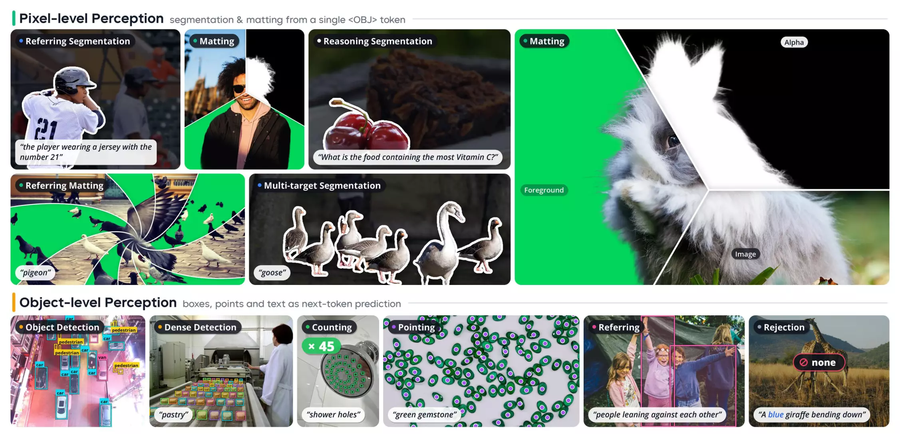
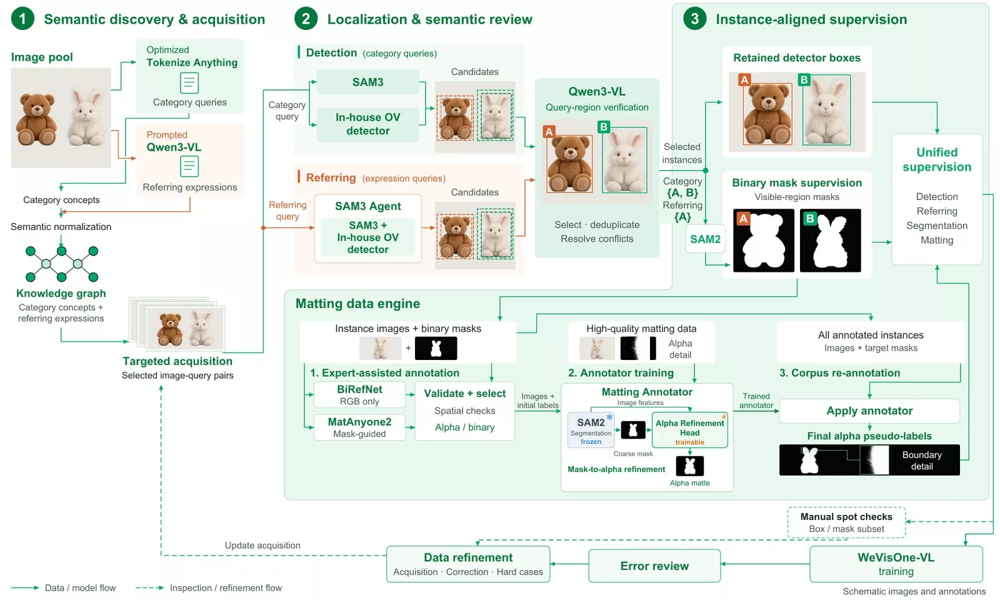
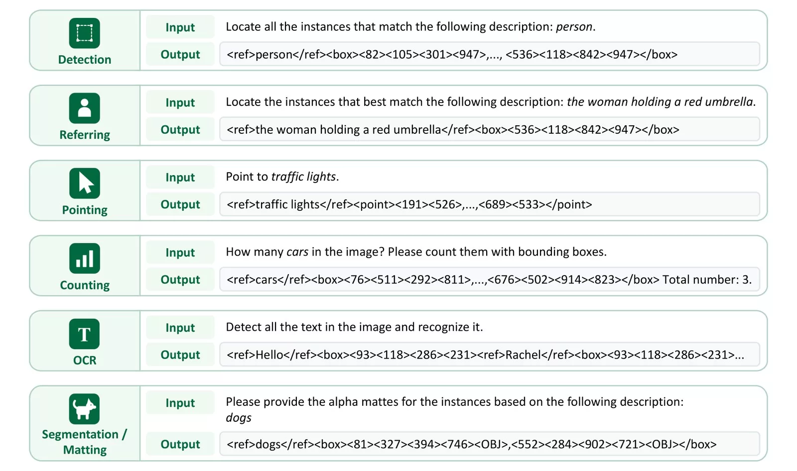
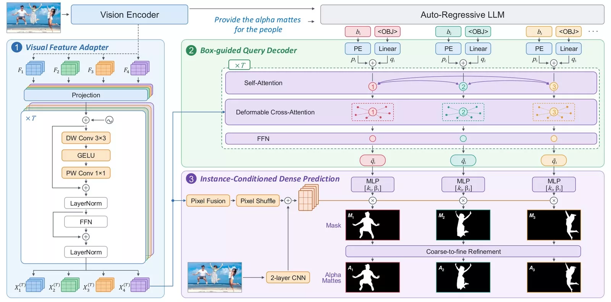
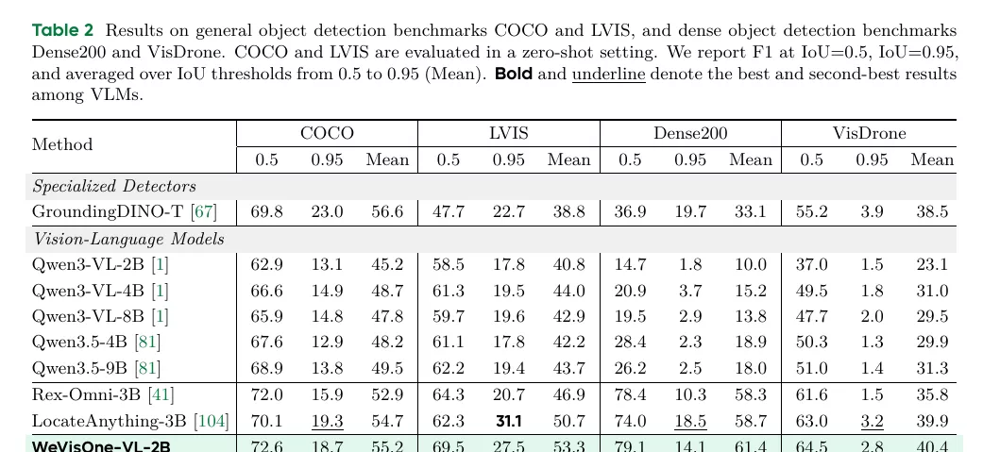
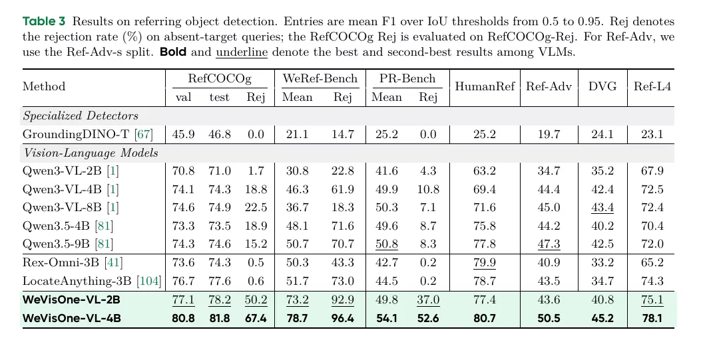
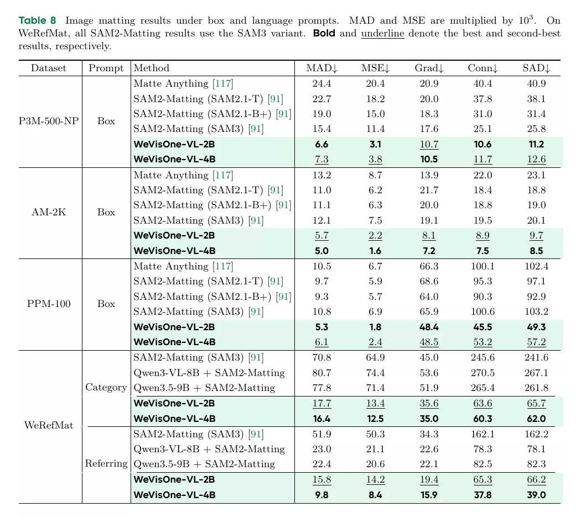

# WeVisOne-VL: Unified Visual Perception from Objects to Pixels

- **来源**: https://arxiv.org/abs/2610.31329
- **本地PDF**: `raw/2026-10-22-wevisone-vl.pdf`（本地文件，不随仓库分发）
- **日期**: 2026-10-22
- **标签**: `vlm`, `object-detection`, `segmentation`, `matting`, `rejection`, `data-engine`, `grpo`, `open-source`
- **研究方向**: 2D Object Detection → 开放词汇检测 → VLM-based 统一感知（物体级 + 像素级）
- **作者**: Tianming Liang*, Junyi Pan*, Yuxi Li*, Canmiao Fu, Zhipeng Huang, Chong Sun† (项目负责), Chen Li‡ (通讯), Jing Lyu（WeChat Vision, Tencent）
- **提交日期**: 2026-10-22 (v1), 2026-10-24 (v2)
- **代码**: https://github.com/Tencent/WeVisOne-VL （推理包 + 评测管线；**微调代码 TODO 未开源**；另开源抠图标注器 [Mask2Alpha](https://github.com/Tencent/WeVisOne-VL/tree/mask2alpha)）
- **权重**: https://huggingface.co/collections/tencent/wevisone-vl （2B & 4B，Apache-2.0）
- **项目主页**: https://tencent.github.io/WeVisOne-VL

关联笔记：[Rex-Omni](./2025-10-14-rex-omni.md)（坐标 token + GRPO 的先行者，本文 [41] 号引用与直接基线）、[LocateAnything](./2026-05-26-locateanything.md)（并行框解码，本文 [104] 号引用与直接基线）、[VLX-Seek](./2026-10-16-vlx-seek.md)（区域引用范式，同属"VLM 细粒度感知"赛道）。

---

## 摘要

**问题**: 现有 VLM 在细粒度视觉感知上仍不可靠：幻觉出不存在的物体、误解用户意图、漏检不显著实例；且物体级（框/点）与像素级（mask/alpha）感知长期由不同模型承担（检测器 + SAM 系）。

**方案**: WeVisOne-VL（WeChat Vision All-in-One）——基于 **Qwen3-VL**（2B/4B 两档）的统一感知模型，把检测/指代定位/计数/pointing/OCR/分割/抠图全部统一为**结构化 next-token prediction**；用一个特殊 **`<OBJ>` token** 把 9.6M 参数的轻量像素解码器接进 VLM，输出实例级 mask 与连续 alpha 抠图，**不依赖 SAM 等独立分割大模型**。

**关键创新/贡献**:
- **统一任务格式**: 专用坐标 token `<0>`–`<1000>` + `<OBJ>` token，一个自然语言接口覆盖从点/框到 mask/alpha 的任意粒度
- **WDE 数据引擎**: 知识图谱驱动，1 亿图、36 亿框标注，检测/指代/分割/抠图四任务实例对齐监督
- **可靠拒识**: 目标不存在时输出 `None` 而非幻觉（WeRef-Bench 拒识率 96.4%）
- **三阶段课程 SFT + 混合任务 GRPO**，含不确定性感知采样与 IoU³ grounding 奖励

**验证**: 30+ 基准，物体级与像素级均领先同规模 VLM：检测 LVIS 55.3 F1（vs LocateAnything-3B 50.7）、密集检测 Dense200 71.3（+12.6）、拒识 WeRef-Bench 96.4%（vs 最强基线 73.0）、ReasonSeg gIoU 71.2（超 LISA-13B）、P3M-500-NP 抠图 MAD 7.3（vs SAM2-Matting 15.4）。



---

## 1. Introduction

**背景 & 动机**: 十年间视觉感知从专用检测器（YOLO/DETR）→ 开放世界模型（Grounding-DINO/SAM）→ VLM，可识别的概念和可跟随的指令不断变宽；但**同时考虑性能与效率时，离真实部署还差得远**——幻觉不存在物体、遇到生疏描述误读意图、漏掉不显著实例导致召回不全。

**本文贡献**:
1. **数据引擎（WDE）**: 连接语义发现与实例对齐监督——共享知识图谱组织类别概念与指代表达、互补定位专家生成候选 + VLM 视觉语言验证、验证后的框延伸出二值 mask、专用管线再升级为连续 alpha 监督；模型错误回流指导下一轮采集（~100M 图 / 3.6B 框）
2. **模型设计**: Qwen3-VL 底座 + 结构化 next-token prediction（坐标 token）+ 9.6M 轻量像素解码器（`<OBJ>` hidden state 作实例表征，无需独立分割大模型）
3. **训练管线**: 三阶段课程 SFT（任务对齐 → 高分辨率/密集 → token-像素交替）+ 混合任务 GRPO

---

## 2. WeVisOne-VL 数据引擎（WDE）

数据源：GRIT、CC3M、LAION、SA-1B 及任务专用数据集；标注清单 **1 亿+ 图、约 36 亿框**。



### 2.1 概念发现与定向采集

**核心思想**: 语义发现产出两类互补查询——**类别概念**（用优化版 Tokenize Anything 发现）与**组合式指代表达**（prompt Qwen3-VL 生成，经由属性/状态/动作/关系指定目标）。两者组织进**共享知识图谱**（初始化自 Wikipedia + WordNet，含规范名、别名、分类关系、整体-部分关系）：候选词先经文本检索 + 视觉语言验证挂到已有节点，有稳定视觉证据才入库；归一化时合并等价类别词、保留指代表达的限定约束。

**定向采集**: 概念名/别名作文本检索 query，已验证实例作视觉检索线索，历史错误指明覆盖缺口；按概念代表性、图像域、目标尺度、遮挡/密集等困难条件设定采样优先级——**标注力气花在语义缺口和当前模型的持续失败模式上**。

### 2.2 检测标注

**核心思想**: 检测器密集场景召回高但长尾/开放世界概念弱，VLM 反之——所以**专家组合 + VLM 仲裁**：
- SAM3 与自研 DINO 式开放词汇检测器**并行**出 proposal，合并进共享候选池（降低对单一来源依赖，利用检测器间差异扩大实例覆盖）
- Qwen3-VL 逐候选验证"该区域是否匹配类别查询"→ 选留、去重、消解冲突
- 保留定位模型产出的框，作为检测监督 + 后续分割标注的目标实例定义

### 2.3 指代标注

**核心思想**: 构建于 SAM3 Agent 框架 + 自研 OV 检测器作额外定位专家。同一表达式条件下两专家出候选区域，Qwen3-VL 逐个核对是否匹配表达式在图像语境中的组合语义（属性/状态/动作/关系），并区分"被指代的目标"与"仅作为语境提到的物体"；整体还是部分由表达式本身决定。接受的结果把表达式绑定到单个目标或目标集合——**标注保留了查询的选择约束**。

### 2.4 Mask 标注

**核心思想**: 每个定位实例用 SAM2 预测**可见区域**二值 mask；mask 继承其框的查询——同一实例在相同查询下同时拥有框和 mask：类别查询 → 框监督检测、mask 监督类别条件分割；指代表达 → 框监督指代定位、mask 监督指代分割。人工抽检 mask/框是否连到正确实例，缺陷走 §2.7 修正；**每条标注记录来源**，可追溯重生成。

### 2.5 困难样本构建

**核心思想**: 难点在**负例判定**——"查询无匹配"不能只看查询或检测器输出：把 "red car" 换成 "blue car" 不代表图中没有蓝车，检测器没返回也可能只是漏检。因此每条候选负例都**对全图复核**属性/动作/关系，复核发现真有匹配目标就打回正例标注。

负例是否"难"由**当前模型行为**定义：复核过的负例若模型仍预测出目标区域 → 硬负例（空目标集，只教拒识，不引入框/像素目标），错误预测留作混淆证据；硬正例捕获漏检、指代选错、密集/遮挡下的困难定位。样本难度**随模型版本重估**，采样重心持续对准新失败模式。

### 2.6 抠图数据引擎

**核心思想**: 高质量 matting 标注贵而稀缺；合成换背景有光照/边界失真泛化问题；已有实例标注有目标身份但缺连续 alpha。三步解决：

1. **专家辅助标注**: 每个实例同 crop 上取两个 alpha 候选——BiRefNet（纯 RGB 预测，可能对准别的物体，需严格空间一致性检查后才收）与 MatAnyone2（以 mask S 初始化引导）。BiRefNet 接受准则：`|B|≥8`、IoU(B,S)≥0.5、覆盖率≥0.5、前景精度≥0.8、面积比∈[0.5,2]、框 IoU≥0.7、质心偏移≤0.15×对角线；接受后保留 αB≥0.01 连通分量（允许细结构超出粗边界）。拒绝则回退 MatAnyone2（IoU≥0.9 时），再不行保留 S。
2. **抠图标注器训练**: 受 SAM2Matting 启发——**冻结 SAM2.1-Base+ + 可训练 alpha 精修头**（融合多尺度图像特征、逐解码阶段注入的 prompt-mask 引导、浅层 RGB stem 细节特征，top-down 解码直接出 alpha）；损失 = 多尺度 L1 + Laplacian + 前景/背景监督 + prompt 一致性项 + 过渡区域损失。
3. **全语料重标注**: 训练好的标注器对全部已标注实例重跑，预测替代初始标签成为最终 alpha 伪标签——**每个 matte 仍链回原实例描述和框**，语言 grounding 与 matting 监督同一目标。

### 2.7 训练反馈与数据修正

**核心思想**: 每轮训练后分析模型错误（按概念/图像域/目标尺度/遮挡/任务/失败类型聚类去重），区分**预测错误**与**标注错误**：标注可靠 → 保持不动或加大采样/作检索种子；发现标注缺陷 → 先修正再进下一版数据。**模型不一致只触发调查，标注修改必须经复核**。每版数据记录来源、暴露错误的模型版本与修订历史；正式基准与训练/反馈驱动的数据构建**严格隔离**，保证评测独立性。

---

## 3. 模型设计

基于 Qwen3-VL 的两个扩展：① 任务格式——专用坐标 token 与任务标签；② 架构——把离散 token 表征转成稠密预测的轻量解码器。

### 3.1 任务格式

**核心思想**: 受 Rex-Omni [41] 与 LocateAnything [104] 启发，引入 **`<0>`–`<1000>` 专用 token** 表示归一化坐标（词表扩展，见 Q&A Q1）。框 = `[x0,y0,x1,y1]`，点 = `[x0,y0]`；目标不存在时坐标字段填 **`None`**。像素级任务在每个框坐标四元组后（同一 `<box>` 字段内）额外生成一个 **`<OBJ>` token**，作为该实例的像素解码表征。



输出示例（论文 Figure 3）：

```text
Detection:   <ref>person</ref><box><82><105><301><947>,...,<536><118><842><947></box>
Referring:   <ref>the woman holding a red umbrella</ref><box><536><118><842><947></box>
Pointing:    <ref>traffic lights</ref><point><191><526>,...,<689><533></point>
Counting:    <ref>cars</ref><box>...</box> Total number: 3.
Seg/Matting: <ref>dogs</ref><box><81><327><394><746><OBJ>,<552><284><902><721><OBJ></box>
```

### 3.2 模型架构

推理流程：Qwen3-VL 视觉编码器编码图像 → 自回归生成结构化响应 → 每生成一个 `<OBJ>` token 就调用一次轻量解码器，输入 = 该 token hidden state + 预测框 + Qwen3-VL 视觉编码器多层特征。**从共享视觉特征取图像上下文、从预测框取空间引导，省掉 SAM**。解码器共 **9.6M 参数**，三个组件：



#### 3.2.1 视觉特征适配器（Visual Feature Adapter）

**核心思想**: 为稠密预测保留细粒度信息——从 ViT **中间层（pre-merging）** 抽 $L$ 层特征 $\{F_l\}$ 作多级视觉特征，逐级映射到解码器空间并加位置与层级信息：

$$
X_l^{(0)} = W^l F_l, \qquad E_l = P_{2D} + e_l
$$

适配器由 $T$ 个卷积块组成：

$$
\bar{X}_l^{(t)} = \text{LayerNorm}\big(X_l^{(t)} + \text{PWConv}_t(\text{GELU}(\text{DWConv}_t(X_l^{(t)} + E_l)))\big)
$$

$$
X_l^{(t+1)} = \text{LayerNorm}\big(\bar{X}_l^{(t)} + \text{FFN}_t(\bar{X}_l^{(t)})\big)
$$

各级输出沿空间展平后拼接成视觉记忆 $M \in \mathbb{R}^{L H_p W_p \times d}$。

#### 3.2.2 框引导查询解码器（Box-guided Query Decoder）

**核心思想**: 骨架沿用 Deformable DETR（6 个 deformable block：自注意力 + 多尺度可变形交叉注意力 + FFN），**关键差异在查询初始化**——不用静态可学习 embedding，而是**直接从 VLM 输出实例化**：第 $i$ 个实例的 `<OBJ>` hidden state $h_i$ 初始化内容查询、归一化框 $b_i$ 经 Fourier 编码初始化位置查询：

$$
q_i = W_h h_i, \qquad p_i = \text{MLP}(\phi(b_i))
$$

自注意力中 $q_i + p_i$ 作 query 与 key、$q_i$ 作 value（实例间交互）；交叉注意力以参考框 $r_i = [\frac{x_{i1}+x_{i2}}{2}, \frac{y_{i1}+y_{i2}}{2}, x_{i2}-x_{i1}, y_{i2}-y_{i1}]$ 为条件，从 $M$ 聚合多尺度可变形特征。

#### 3.2.3 实例条件稠密预测（Instance-Conditioned Dense Prediction）

**多级像素融合**: 深层特征语义强、浅层特征细节多，自顶向下融合：

$$
G_l = \begin{cases} \text{Conv}_{1\times1} X_L^{(T)}, & l = L \\[4pt] \text{GELU}\big(\text{GroupNorm}(\text{Conv}_{3\times3}(G_{l+1} + \text{Conv}_{1\times1} X_l^{(T)}))\big), & l = L-1,\dots,1 \end{cases}
$$

再把输入图像 resize 到 1024×1024 过两层 CNN 提取浅层特征，与上采样到 512×512 的 $G_1$ 逐元素相加，恢复颜色/纹理/边缘细节：

$$
P = \text{Up}(G_1) + \text{CNN}(I)
$$

**动态 mask 头**: 实例查询 $\tilde{q}_i$ 过 MLP 生成实例感知动态卷积核，作用在 $P$ 上逐像素出 logit：

$$
[k_i, \beta_i] = \text{MLP}(\tilde{q}_i), \qquad M_i = k_i^\top P + \beta_i
$$

**由粗到细精修**: 单次预测对细结构与半透明边界不够。三级上采样逐级精修——第 $j$ 级把上一级特征上采样后与 resize 的原图、像素特征 $P$、前级 mask 预测拼接：

$$
U_i^{(j)} = \text{Conv}_{1\times1}\big(\text{Up}(F_i^{(j-1)}) \,\|\, \text{Interp}_j(I) \,\|\, \text{Interp}_j(P) \,\|\, C_i^{(j)}\big)
$$

用实例查询做通道级 scale/shift 调制（FiLM 式），过残差卷积块预测 logit 残差：

$$
[\gamma_i^{(j)}, \delta_i^{(j)}] = \text{MLP}_j(\tilde{q}_i), \qquad F_i^{(j)} = f_{rc}^{(j)}\big(1 + \tanh(\gamma_i^{(j)}) \odot U_i^{(j)} + \delta_i^{(j)}\big)
$$

$$
M_i^{(j)} = \text{Interp}_j(M_i^{(j-1)}) + \text{Conv}_{1\times1}(F_i^{(j)}), \qquad A_i = \text{Sigmoid}(M_i^{(3)})
$$

分割与抠图共享以上组件；**抠图额外挂一个轻量精修模块**出细边界与分数不透明度。

---

## 4. 训练管线

三阶段课程 SFT + 混合任务 RL。SFT 各阶段数据量：Stage 1 **90.2M** → Stage 2 **41.8M** → Stage 3 **40.5M**（另分割预热 **250M**、抠图微调 **130M**）→ RL **178K**（Table 1）。

### 4.1 课程监督微调

**Stage 1: 任务对齐**。从**扩展词表后**的 Qwen3-VL 出发（实测 +1010 token：1001 个坐标 `<0>`–`<1000>` + 9 个任务标签，见 Q1），冻结视觉编码器与投影器，只训语言模型；90M 样本 / 13K 步，学会任务指令、结构化输出与 `None` 拒识。像素任务样本此阶段只做 NTP（不激活解码器），先建立实例与 `<OBJ>` 的对应。视觉 token 16–512/图，上下文 4096。**注意**：早期训练会被极端密集样本主导（单响应几百框），模型极易重复输出坍塌——此阶段每类最多 50 框/点。

**Stage 2: 分辨率与密度扩展**。解冻全部，视觉 token 上限提到 **1960**（保小目标细节），单响应框/点上限提到 **500**（密集场景），上下文 8192；41.8M 样本 / 9K 步。像素任务仍只 NTP。

**Stage 3: token–像素交替优化**。先**分割预热**：S2 的 VLM + 随机初始化解码器在 250M 分割样本上联合训 100K 步：

$$
\mathcal{L}_{seg} = 20\mathcal{L}_{focal} + \mathcal{L}_{dice}
$$

预热后**只保留解码器权重和学到的 `<OBJ>` embedding**，接回 Stage 2 checkpoint，VLM 与解码器联合训 9K 步；为保定位能力按 1:1 交替 NTP 与像素任务：

$$
\mathcal{L}_{joint} = \mathcal{L}_{NTP} + 10\mathcal{L}_{seg}
$$

最后**抠图微调**：VLM 冻结，仅解码器在 130M 抠图样本上再训 100K 步，L1 + 梯度 + Laplacian 损失外加难像素监督：

$$
\mathcal{L}_{mat} = 200\mathcal{L}_{l1} + 5\mathcal{L}_{grad} + 50\mathcal{L}_{lap} + \mathcal{L}_{hard}
$$

### 4.2 混合任务强化学习

SFT 的 token 级似然目标无法直接优化任务奖励，故在**不确定性过滤后的语料**上做混合任务 RL。

**不确定性感知采样**: 对每个候选 prompt 采一组响应算任务奖励，$\mu_x$、$\sigma_x$ 为组内均值/标准差：

$$
U(x) = 4\mu_x(1-\mu_x)\sigma_x
$$

偏好"中等难度 + 高方差"样本（部分 rollout 成功部分失败 → 相对优势信号强），选出 ~140K，补目标框监督与 pointing 数据共 **178K**。

**带 grounding 奖励的 GRPO**: 每对采样 $G=8$ 个完整响应，逐类匈牙利匹配预测框与 GT 框：

$$
r_i = \frac{2\sum_{(\hat{b},b^*)\in \mathcal{M}_i} \text{IoU}(\hat{b},b^*)^3}{N_{gt} + N_{pred}}
$$

IoU **三次方**使奖励对高 IoU 区间的定位改进更敏感；分母同时惩罚漏检与重复。**分割/抠图的 RL 只用框奖励**（不评 mask/alpha）；指代分割的预测仅当框后跟了 `<OBJ>` 才有效；负例只有"不预测任何物体"才得奖励 1。

---

## 5. 实验

五个物体级任务（检测/指代/计数/pointing/OCR）+ 两个像素级任务（指代分割/抠图）。推理：greedy（temperature 0），每图 ≤1960 视觉 token。基线：Qwen3-VL（Instruct 版）/ Qwen3.5（开 thinking）作通用 VLM，Rex-Omni-3B 与 LocateAnything-3B 作 VLM 感知专用模型。指标沿用 Rex-Omni/LocateAnything 的 **F1@Mean**（VLM 生成式检测无置信度，mAP 不可算，见 [LocateAnything 笔记 §4.2](./2026-05-26-locateanything.md)）。

### 5.1 主要结果

**物体检测（Table 2）**——通用（COCO/LVIS）与密集小目标（Dense200/VisDrone，zero-shot）：



4B 全面领先同规模 VLM：COCO 57.1 / LVIS 55.3 / Dense200 71.3 / VisDrone 44.7（F1@Mean）；密集场景优势最大（Dense200 超 LocateAnything-3B **+12.6**），且 IoU=0.95 严格准则下仍领先，说明是"覆盖广 + 定位准"双提升。

**指代检测与拒识（Table 3）**：



单目标、多目标、目标缺失三设定全面领先：RefCOCOg test 81.8（拒识 67.4）；自建 **WeRef-Bench**（2880 条中英文 query，含多目标与缺失查询）78.7 F1 / **96.4% 拒识率**，而 Rex-Omni/LocateAnything 拒识率仅 0.5%/73.0。这是论文最差异化的能力——**该拒的时候拒**。

**计数（Table 4）**: PixMo-Count test 89.6、CountQA 57.1、MixCount test 40.4，全面最高；CLOC/KubriCount 上对专用基线优势尤其大（MixCount test 超 LocateAnything 25.2 分）。

**OCR（Table 6）**: TotalText 52.0、SROIE 68.1、ICDAR2015 47.8，超 PP-OCRv5 专用模型与所有 VLM 基线。

**指代分割（Table 7）**: RefCOCO testA 84.5 cIoU（超 UniPixel-7B 83.0）、ReasonSeg val **71.2 gIoU**（超 LISA-13B-ft 65.0）；Ref-ZOM 拒识 86.0（基线最高 41.9）。

**抠图（Table 8）**——框/类别/指代三种 prompt 的可提示抠图：



框 prompt 下 P3M-500-NP MAD 7.3（2B 达 6.6，vs SAM2-Matting(SAM3) 15.4、Matte Anything 24.4）；语言 prompt 下优势拉得更大——WeRefMat 类别/指代 MAD 16.4/9.8，而 SAM2-Matting 系为 70.8/51.9、Qwen3.5-9B+SAM2-Matting 为 77.8/22.4。**语言条件目标选择 + 边界级 alpha 质量**同时成立，这是"像素解码器直接吃 `<OBJ>` 表征"路线的实证。

---

## 6. 定性分析

论文 §6 给出五方面对比（Figure 5–9）：密集场景逐实例定位、指代检测（空间位置/属性/多物体关系/负例拒识四维度）、计数（**计数单元由查询决定**——"几双鞋"不能数成单只；Rex-Omni 在某例中报 537 而非 56）、密集/关系/属性/细粒度 pointing、以及**带框接地描述**（grounded caption：描述中彩色短语与坐标 token 对应图中同色框）。

---

## 8. 局限性（论文 §8）

1. 通用训练数据占比有限，**通用能力相对底座可能退化**
2. 为推理效率直接输出结构化结果、**无 CoT**，复杂推理任务受限
3. 仅**单轮预测**，agent 框架集成留作未来工作
4. 真实用户指令往往模糊犹豫，基准里的 prompt 清晰规整——强意图推理是可靠视觉系统的下一步

另注：本报告**无消融实验章节**（tech report 风格），各组件贡献（如 `<OBJ>` vs 无框引导、动态核 vs 固定头、RL 增益）未拆开量化。

## 9. 结论

统一物体级与像素级感知于一个语言接口：专用坐标 token 编码实例预测，`<OBJ>` token 把每个实例接到 9.6M 像素解码器出 mask/alpha；三阶段 SFT 课程 + 混合任务 RL。30+ 基准上物体级/像素级双强，且能拒识缺失目标。定位是"面向真实部署的实用视觉系统地基"。

---

## 个人评价

**核心价值**: 这是 Rex-Omni → LocateAnything 这条"VLM 生成式感知"线的第三步——前两篇解决了"坐标怎么 token 化"和"解码怎么快"，这篇把版图从**物体级推到像素级**：证明一个 9.6M 的小解码器接 `<OBJ>` hidden state 就能同时做好分割与抠图，把 SAM 从部署链路里拿掉了。对"VLM 能否承担完整感知栈"这个方向，这是迄今最完整的正面证据。也印证了我们在 [Rex-Omni 笔记 Q2](./2025-10-14-rex-omni.md) 的判断：**新底座（Qwen3-VL）+ 底座无关的数据引擎**是正确迁移姿势——本文 2B 就在多数基准上打 3B 基线，底座红利 + 1 亿图数据引擎缺一不可。

**可借鉴点**:
- **不确定性采样公式** $U=4\mu(1-\mu)\sigma$：RL 数据选择不必靠人工配比，"模型忽对忽错"的样本天然是 GRPO 最佳养料
- **IoU³ 奖励**：让强化学习在中高 IoU 区间仍有梯度感，可直接搬到任何定位任务 RL
- **硬负例流程**："换颜色 ≠ 图里没有"——负例必须全图人工复核，由模型行为定义"难"；这套拒识数据打法对一切"该拒就拒"的任务通用
- **Mask2Alpha**（已开源）：二值 mask → 高质量 alpha 的标注器，任何分割数据集都能借此升级出抠图监督
- **数据飞轮**：错误聚类 → 人工分诊（预测错 vs 标注错）→ 定向采集/修正/难例，且基准与训练数据严格隔离

**批判 / 保留**:
- **WeRef-Bench / WeRefMat / WeRef-Rej 均为自建基准**，拒识 96.4% 的对比优势部分来自"主场"；公共 RefCOCOg-Rej 上拒识 67.4 虽也领先（基线最高 22.5），但幅度小得多，读数时应以公共基准为准绳
- **无消融实验**：`<OBJ>` 桥接、框引导查询、动态核、RL 各自贡献多少无法拆分；reward 设计（IoU³）合理性只有结论没有证据
- **训练不开源**（README TODO），1 亿图数据引擎 + 250M 分割预热样本也不公开——复现路径和 VLX-Seek 一样断在数据与训练侧，实际可用的只有 2B/4B 权重与推理包
- 密集场景 F1@0.95 仍只有 23.2–28.8（Table 2），高 IoU 精确定位远未解决；MAD 7.3 的抠图也只到"可用"级（对比 SOTA 抠图专用模型仍有差距，且 WeRefMat 上 2B/4B 互有胜负）

---

## 相关工作对比

### 同系列四篇横向（Rex-Omni / LocateAnything / VLX-Seek / WeVisOne-VL）

| 维度 | Rex-Omni | LocateAnything | VLX-Seek | **WeVisOne-VL** |
|------|----------|----------------|----------|-----------------|
| 底座 | Qwen2.5-VL-3B | Moon-ViT + Qwen2.5（自组装） | Qwen3.5-VL-9B | **Qwen3-VL（2B/4B）** |
| 坐标表示 | 复用词表末 1000 token（相对坐标） | `<box>` 文本坐标、框对齐原子块 | **不生成坐标**，选候选框索引 | **扩展词表** `<0>`–`<1000>`（Rex-Omni 式） |
| 像素级输出 | 无 | 无 | 无 | **mask + alpha（9.6M 解码器，免 SAM）** |
| 解码方式 | NTP（SFT+GRPO） | 框级并行（NTP+块 MTP 双公式） | 索引选择 | NTP + `<OBJ>` 触发解码，GRPO |
| 拒识能力 | 弱（Rej 0.5） | 弱（0.6）/自建 73.0 | 显式 None（OPN 未开源） | **显式 None + 硬负例体系，Rej 96.4** |
| 数据资产 | 2200 万样本引擎 | 138M 查询 / 785M 框 | 未公开 | **1 亿图 / 3.6 亿框（36 亿）引擎，错误回流闭环** |
| 开源完整度 | 推理（无训练） | 推理 + 训练（MagiAttention 限 H100） | 仅推理 | 推理 + 权重 + Mask2Alpha（**无训练**） |

一句话：Rex-Omni 定范式，LocateAnything 提速度，VLX-Seek 换表示（不生成坐标），**WeVisOne-VL 补全像素级并把拒识做成体系**——四篇合起来基本就是 2025–2026 "VLM 生成式感知"的演进主线。

---

## 疑问解答 (Q&A)

### Q1: 坐标 token `<0>`–`<1000>` 是复用 Qwen3-VL 词表已有的，还是新增的？

**答**: 是**新增**。先分清两件事——「用 0–1000 表示坐标」是**值的归一化约定**（输出普通数字文本，BPE 正常切分），「`<N>` 离散坐标 token」是**词表机制**（词表里字面存在 `<0>`…`<1000>` 词条，每个坐标值一个专属 token）。四代模型放一起：

| 模型 | 坐标值域 | 坐标怎么变成 token | 词表里有 `<N>` 词条吗 |
|------|---------|-------------------|---------------------|
| Qwen2.5-VL（legacy 默认） | 绝对像素 | 明文数字，BPE 切开（`1921`→`1,9,2,1`） | **碰巧有** `<0>`–`<999>`（藏在基础词表末尾，日常不用） |
| Qwen3-VL | [0,1000] 归一化 | 明文数字，BPE 切开 | **没有**（发布 tokenizer 实测 `<N>` 形为 0） |
| Rex-Omni | [0,999] 归一化 | **每个值一个 token**（复用） | 复用 Qwen2.5-VL 碰巧有的那批 |
| WeVisOne-VL | [0,1000] 归一化 | **每个值一个 token**（新增） | Qwen3-VL 没得复用 → **自己加了 1001 个** |

**实锤来自发布权重 `tokenizer.json` 实测**：新增 **1010** 个 token——① `<0>`–`<1000>` 共 **1001 个**，ID **151669–152669** 连续、追加在 Qwen3-VL 原生 added token（151643–151668 共 26 个）之后；② 9 个任务标签 `<ref>`/`</ref>`/`<box>`/`</box>`/`<point>`/`</point>`/`<polygon>`/`</polygon>`/`<OBJ>`（ID 152670–152678）。Qwen3-VL 基础词表（0–151642）中 `<N>` 形 token 为 0。专用 token 的价值：一框 4 token（明文数字一框 8–15 token）、坐标语义与普通数字隔离、连续 ID 块可整段切片做几何感知训练/loss（Rex-Omni 的 `coord_token_start:start+1000` 切片）。

### Q2: `<OBJ>` token 和 LISA 的 `[SEG]` token 有什么本质区别？

**答**: 三点。① **粒度**：LISA 每次分割一个目标（一句一个 `[SEG]`），WeVisOne-VL 每个实例一个 `<OBJ>`，一帧 N 目标 N 个 token，天然支持多实例密集输出；② **初始化**：`<OBJ>` 的 hidden state 不是直接当解码器输入完事，而是**内容查询** + 预测框 Fourier 编码作**位置查询**，走 6 层 Deformable DETR 式解码——框先验让交叉注意力有明确落点；③ **无外部依赖**：LISA 系（及 Sa2VA 等）依赖 SAM/SAM 2 出 mask，WeVisOne-VL 的解码器直接消费 Qwen3-VL 自家 ViT 多层特征，9.6M 参数独立成段。代价是这一段没有 SAM 级的预训练先验，精度上限靠数据引擎的 alpha 伪标签堆出来。

### Q3: RL 只用框奖励，mask/alpha 质量怎么保证？

**答**: 论文明确：分割/抠图任务的 RL **只评框**（§4.2），mask/alpha 完全不进奖励。像素质量全部押在 SFT Stage 3 的预热 + 交替训练 + 抠图微调上（250M/130M 样本）。合理性：mask 质量评估（IoU 之外的边界/连通性）奖励难设计且评估贵，框对了 `<OBJ>` hidden state 就大致对；风险是 RL 阶段模型可能学到"框准即可"而忽视 `<OBJ>` 表征质量——好在 `<OBJ>` 只有在框后出现才计有效，算是弱约束。Table 8 显示像素指标确实没退步，但**没有消融证明 RL 对像素任务无负迁移**。

### Q4: 拒识 96.4% 可信吗？

**答**: 分两层看。**WeRef-Bench（自建）**上的 96.4% 有主场效应——查询分布、负例构造都出自同一团队的硬负例体系；**公共 RefCOCOg-Rej** 上拒识 67.4%（2B 50.2），对比基线（Qwen3-VL-8B 22.5、Qwen3.5-9B 15.2、Rex-Omni 0.5）仍是压倒性领先，说明能力是真的，只是幅度被自建基准放大了。机制上是三件事叠加：`None` 作为显式输出字段（格式层）、硬负例数据（数据层，"负例必须全图复核"的构建纪律）、负例奖励（RL 层，预测任何框都得 0）。**但这套数据不公开，第三方想复现拒识只能靠自己造负例。**

### Q5: 密集检测（Dense200 71.3）大幅领先靠的是什么？

**答**: 论文没有消融，只能从设计推断三个来源：① **Stage 2 专门的高分辨率 + 密集课程**（视觉 token 拉到 1960、单响应 500 框，明确针对小目标与拥挤场景，且解决了早期"密集样本导致重复坍塌"的训练不稳定）；② 基线在密集场景本来就崩——Qwen3-VL-8B Dense200 只有 13.8（Table 2），通用 VLM 的密集召回是已知短板，WeVisOne-VL 的 WDE 采集阶段明确按"遮挡/密集条件"加权采样；③ 相比之下 LocateAnything/Rex-Omni 的 58.3/58.7 说明"密集"主要拼数据分布而非架构。真正剩下的硬骨头是 F1@0.95（23.2–28.8）：密集小目标的高 IoU 精确定位仍远未解决。

### Q6: `<OBJ>` token ID 是固定的，hidden state 不也一样吗？喂给解码器有啥用？

**答**: 混淆了 **token embedding（输入侧，固定）** 和 **hidden state（输出侧，上下文化）**。ID 只决定查词嵌入矩阵的哪一行；hidden state 是这个 token 走完 Transformer 后的向量，是 (自身 embedding + 位置 + 前面所有 token + 图像特征) 的函数。同构先例：**BERT 的 `[CLS]`**——固定 ID、上下文化 hidden state 作整句表征，`<OBJ>` 就是检测版 `[CLS]`。保底区分：解码器位置查询 $p_i = \text{MLP}(\phi(b_i))$ 来自各实例自己的框，框不同查询也不同。
