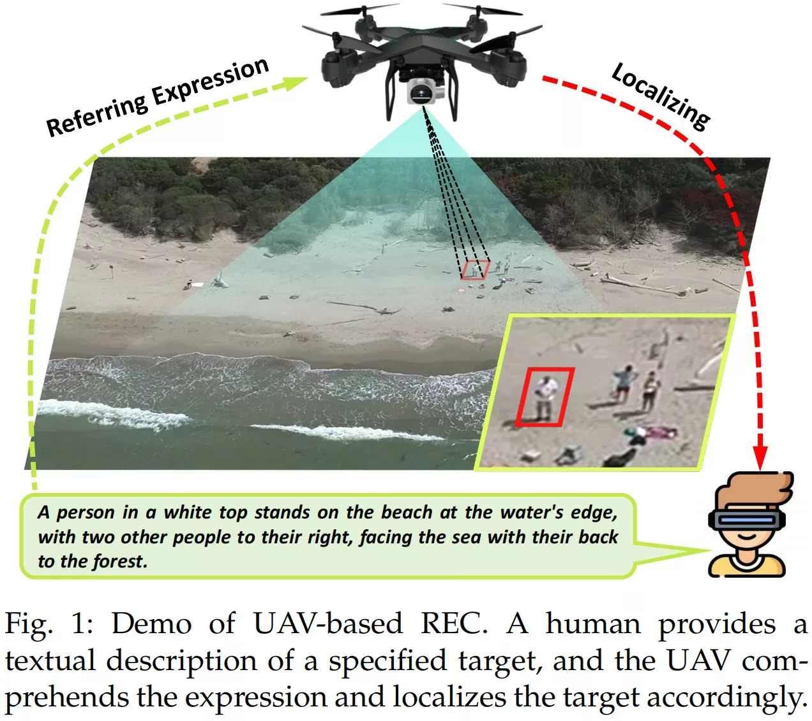
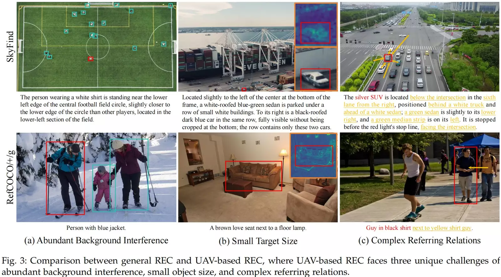
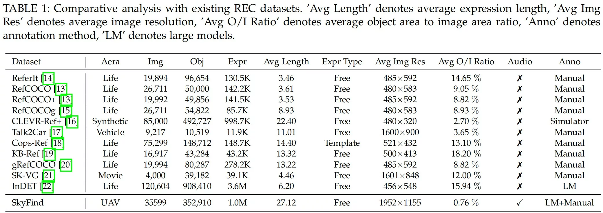
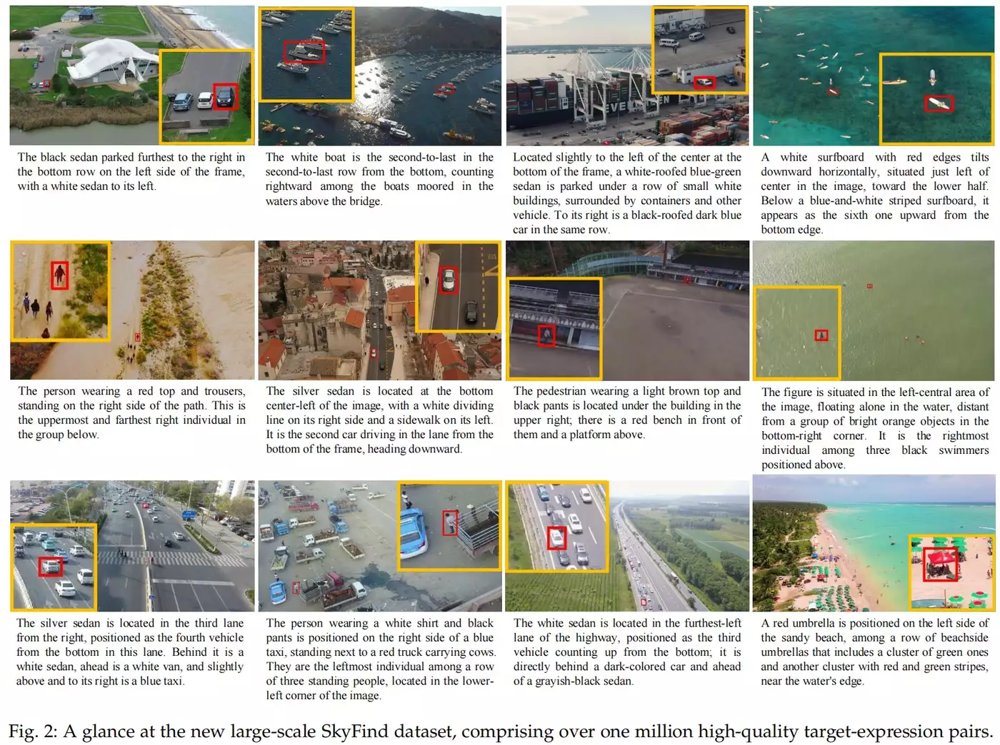

# SkyFind: A Large-Scale Benchmark Unveiling Referring Expression Comprehension for UAV

- **来源**: https://doi.org/10.1109/TPAMI.2026.3681112
- **参考链接**: [公众号解读 · 遥感与深度学习](https://mp.weixin.qq.com/s/ijXVTJZIyMSKT2rJbNfPbA) | [HuggingFace 数据集](https://huggingface.co/datasets/kunyu241/SkyFind)
- **日期**: 2026-04-16
- **标签**: `REC`, `UAV`, `visual-grounding`, `benchmark`, `dataset`
- **研究方向**: 视觉定位 → 无人机场景理解 → 指代表达理解（UAV-based REC）
- **作者**: Kai Wang, Guanbo Wu, Xueyang Fu, Xingbo Wang, Kean Liu, Xin Lu, Chengjie Ge, Wei Zhai, Jing Zhang, Zheng-Jun Zha（中国科学技术大学）
- **会议/期刊**: IEEE TPAMI 2026（early access，PP: 1–17）
- **代码**: https://github.com/wangkunyu241/SkyFind
- **数据**: HuggingFace [`kunyu241/SkyFind`](https://huggingface.co/datasets/kunyu241/SkyFind)（Parquet 分片）；原始图片+JSON 另提供百度网盘 / Google Drive 下载

> **来源说明**：论文为 TPAMI 付费全文，未获取 PDF/LaTeX 原文。

---

## 摘要

**问题**: 现有 REC 研究（RefCOCO 系）全部基于地面视角图像，而无人机航拍视角存在"大场景小目标、背景干扰丰富、指代关系复杂"三大独特挑战，地面 REC 的方法与基准无法直接迁移。

**方案**: 正式定义 **UAV-based REC** 新任务（聚焦人-机自然语言交互），构建百万级规模的 **SkyFind** 数据集（1M+ 目标-表达式对，test 刻意聚合海洋场景制造分布偏移），并提出 **AerialREC** 两步式定位基线框架（先粗搜索排除背景干扰，再精定位回归边界框）。

**关键创新/贡献**：
- **新任务定义**：正式定义 **UAV-based REC** 任务（面向"人通过自然语言指挥无人机找目标"的人机交互闭环），并构建**首个百万级** UAV REC 数据集；与 RefDrone（CVPR Findings 2026，武汉大学，arXiv 2502）**同期并行**——二者均为 2025–2026 年提出的早期无人机 REC 基准，RefDrone 公开预印本更早（2025-02），SkyFind 以规模与跨场景分布偏移见长。
- **大规模基准**：1,015,638 目标-表达式对 / 35,599 图 / 352,910 目标，规模比现有同类数据集大约三个数量级（公众号表述）；
- **分布偏移评测设计**：train/val 用陆地场景，**test 全部来自海洋场景数据集**，刻意制造分布差异以测跨场景泛化；
- **高效标注流水线**：CogVLM→LLaVA→GPT-4 预标注 + 三团队人工精修，单条标注时间 85s → 52s（省 38.8%）。

**验证**: AerialREC 在 **SeqTR** 与 **PolyFormer** 两个代表性 seq2seq REC 模型上实例化，均报告显著定位提升（具体数值未获取，见 §4）；另对 12 个大规模视觉语言模型做零样本评估（分数未获取）。

---

## 1. 引言：从地面 REC 到 UAV-based REC

**背景 & 动机**: 无人机在监控、救援、配送中越来越依赖"理解人的意图"——人不可能总去界面上点框，更自然的方式是直接说"找桥边那辆白车"。语言是人传递意图最直接的媒介，因此让无人机把**自然语言表达式链接到航拍画面中的具体目标**（REC）成为人机协同的关键能力。地面 REC（RefCOCO 系）研究已经成熟，但航拍视角的三大差异使既有方法与基准失效。

**本文贡献**:
1. 正式提出 **UAV-based REC** 任务定义；
2. 构建 **SkyFind**——首个大规模 UAV REC 数据集（1M+ 对，跨多样 UAV 场景，test 多源分布偏移）；
3. 提出面向航拍场景的 **AerialREC** 两步定位基线框架。

### 1.1 无人机视角的三大独特挑战

与通用 REC（RefCOCO / RefCOCO+ / RefCOCOg）相比，UAV-based REC 引入三个独特挑战：

1. **背景干扰丰富**：大视野带来语义丰富的场景，大量与目标相似的干扰实体，定位难度陡增；
2. **目标尺寸极小**："大场景、小目标"，目标常只占画面极小比例（**测试集约 0.16%**），边界模糊、纹理弱，识别困难；
3. **指代关系复杂**：为在杂乱航拍画面中唯一确定目标，表达式更长（**平均约 27 词**，RefCOCO 系通常 <10 词）、指代关系层次更多。

---

## 2. SkyFind 数据集

### 2.1 数据来源

**14 个公开 UAV 数据集**：
- 检测类：DroneVehicle、SeaDronesSee、VisDrone2019、UAVDT、AU-AIR
- 计数/动作类：CAPRK、MOBDrone、Okutama-Action、Stanford Drone
- 分割类：Semantic Drone、UAVid、UDD、UVSD、Aeroscapes（掩码统一转边界框）

**网络爬取**：YouTube 约 2 万段视频（Creative Commons 许可），帧提取 + P-Hash 去冗余帧；另经 HSV 空间过滤亮度异常帧，目标人工标注。

**筛选标准**：排除运动模糊/低分辨率图像、非 UAV 视角图像、无有效目标图像，最终保留 35,599 张图像 / 352,910 个标注目标。

### 2.2 标注流水线（大模型预标注 + 人工精修）

| 阶段         | 工具                                 | 产出                                         |
| ------------ | ------------------------------------ | -------------------------------------------- |
| 基础描述生成 | CogVLM-grounding-generalist-v1.1-17B | 目标基础文字描述（bbox 嵌入提示模板）        |
| 位置关系扩展 | LLaVA-1.5-13B                        | 补充目标与周围环境的相对位置（红框视觉提示） |
| 描述精炼     | GPT-4-turbo                          | 兼顾外观、类别与位置的简洁表达式             |
| 人工精修     | VIA 工具 + 三个子团队                | "处理—验证—复核"三步流程                     |

**效率**：平均标注时间从 85s 降至 52s，**节省 38.8%**。

### 2.3 训练集表达式扩增

- GPT-4 为每条训练集表达式生成 **2 条语义等价变体**（多样词汇与句式），训练数据量三倍扩增；
- T-SNE 验证：扩增后语义空间覆盖更广，且保持语义一致性；
- 最终训练集 **999,092 对**（原始 331,364 条）。

### 2.4 数据划分与分布偏移设计

| 子集   | 数量（对）                  | 来源                                    |
| ------ | --------------------------- | --------------------------------------- |
| 训练集 | 331,364 → 999,092（扩增后） | 网络爬取 + 12 个公开数据集              |
| 验证集 | 5,000                       | 与训练来源同分布，随机抽取              |
| 测试集 | 16,546                      | **SeaDronesSee + MOBDrone（海洋场景）** |

> 注：**扩增仅作用于训练集**。GPT-4 三倍扩增只加在训练表达式上；验证集（5,000）与测试集（16,546）均为**原始未扩增**对，保留干净以公平评测。故总量 1,015,638 = 扩增训练集 999,092 + 原始测试集 16,546（验证集不单独计入总量，已并入训练池）。Q1 中 999,092 与 331,364×3=994,092 差 5,000，恰好 = 验证集规模，疑为验证集原始对一并计入训练池所致（README 未明说，待原文核对）。

测试集与训练集存在**显著分布差异（海洋 vs 陆地为主）**——刻意设计的分布偏移，用于检验跨场景泛化。REC 若学的是属性/关系对齐(红→红色像素、"左侧"→空间左)，而不是死记类别名词，那么即便测试集换成船舰(训练里没见过)，语言结构(颜色词、方位词、关系词)是共享的，理论上能迁移。

**结论（见 §4.1）：并未成功泛化。** RefCOCO 零样本直迁海洋 test 仅 5~7% IoU；即便用 SkyFind 陆地训练集训练，海洋 test 也只 +14~20pp（约 19~27% IoU@0.5），远低于可用水平。即当前方法跨场景泛化基本失败，这恰是论文要凸显的难题。

### 2.5 统计特征

| 统计项                         | 数值                                    |
| ------------------------------ | --------------------------------------- |
| 图像                           | 35,599 张                               |
| 标注目标                       | 352,910 个                              |
| 目标-表达式对（原始 / 扩增后） | 352,910 / **1,015,638** 条              |
| 表达式平均长度                 | 27.15 词（train/val）、25.48 词（test） |
| 词汇量                         | 11,934                                  |
| 目标占图面积比                 | 0.767%（train/val）、**0.161%**（test） |
| 平均分辨率                     | 1952×1155                               |

高频目标类别：car、person、truck、boat、bus 等。

> 由此推断：**SkyFind 是单目标 REC**（如 RefCOCO），不像 [RefDrone](/readings/2025/2025-11-24-refdrone) 那样包含"一条表达式指 0–242 个目标"和"图中无该对象（no-target）"的样本。**每个目标原本只有 1 条表达式**。GPT-4 给每条原始表达式生成 2 条语义等价变体，于是每个目标对应 3 条不同措辞的**同义**表达式

### 2.6 音频模态

Google TTS 为全部文本表达式生成音频，含多样音调、音色与口音，支持"视觉 + 语言 + 音频"多模态人机交互研究。

> 注：据 README/论文描述，**本文自身方法与实验均为视觉+文本 REC**，音频是随数据集发布的**预留模态**，供后续 spoken / audio-conditioned grounding 研究使用；本文未训练或评测任何音频条件。属"benchmark 多释放一个模态、但本论文未利用"的能力。

### 2.7 发布与许可

- 数据集以 **CC BY-NC-ND 4.0** 发布：仅限学术非商业用途、禁止分发修改版、使用必须引用 TPAMI 论文；
- HuggingFace 提供 Parquet 分片（`datasets` 库直接 `load_dataset("kunyu241/SkyFind", split=...)`，含 train / validation / test / train_aug 四个 split）；原始文件为 `images.zip` + 4 个 JSON 标注；
- 官方提供 `bad_image.zip` 补丁替换少量坏图（README 披露）。

---

## 3. AerialREC：两步式定位基线

### 3.1 核心思路

直接回归边界框容易被大量语义相似的非目标实体干扰、产生定位混淆。AerialREC 把定位拆成两步：**先粗搜索排除无关背景，再在聚焦区域内精定位**。基于 seq2seq REC 范式，两步坐标序列拼接（以 `<SEP>` 分隔符区分阶段语义）后由自回归 Transformer 解码器统一回归。

**怎么理解「seq2seq + 两步拼接」**：
- **seq2seq REC 是什么**：把 REC 当成"翻译"问题——输入是图像特征 + 文本表达式，输出**不是**检测头（class + box 回归），而是一串**离散坐标 token**（把 x1/y1/x2/y2 量化成 token 序列），由自回归 Transformer 逐个生成。
- **为什么要拼两步**：普通 seq2seq REC 只输出"一个框"的坐标子序列；AerialREC 要"粗框 + 精框"两个框，于是让解码器一次性输出**两段坐标子序列**：`[粗框 token] <SEP> [精框 token]`。
- **`<SEP>` 的作用**：特殊分隔符，告诉解码器"第一阶段结束、开始第二阶段"。因为解码是**自回归**的（每个 token 依赖前面所有 token），精框 token 天然以粗框 token 为上下文——第二阶段等于"看到了第一阶段输出"，从而实现由粗到细，却**不需要两个独立网络**。
- **标注要不要双框？不用**：精框 GT = 数据集原本的单条标注框（标准 REC 标注）；粗框的训练目标**不是额外标注**，而是从这条唯一 GT 框**随机扩大采样**合成（§3.2），推理时粗框由模型自预测。即"输出双框"靠训练时合成第二个目标，数据集标注量不变、仍是单框。

> 注：**token_positive 是 GDINO/GLIP「对齐损失」训练目标的要求，不是 SkyFind 数据格式的要求**。SkyFind 标注 =（图像, 表达式, 单框），本身不绑定 token_positive。两条路：
> - **若改用 GDINO/NGDINO 类 grounding 方法训 SkyFind**：需要 positive_map，但因 SkyFind 是**单目标**（每条表达式唯一对应一个框），整条表达式的**全部 token 都是该框的正样本** → positive_map = 整句 token span，**自动推导、无需逐词人工标注**；与多目标检测（文本="cat . dog . person"、每框只匹配自己短语词）不同，单目标 REC 句内没有"其他框的词"可当负样本。
> - **SkyFind 自己的 baseline AerialREC 根本不用 token_positive**：它是 seq2seq（借 SeqTR/PolyFormer），解码器直接以整句文本为条件自回归生成框坐标 token，**没有 grounding 对齐损失那一套**，自然不需要 token_positive。（详见 [RefDrone 笔记 §7](/readings/2025/2025-11-24-refdrone) 对齐损失说明）

### 3.2 Search Step（潜在区域搜索）

- 预测粗粒度潜在目标区域，排除大量无关背景；
- **训练标签非固定值**：在真实框周围随机采样扩大区间生成；
- 作用：平滑损失函数、降低优化难度。

### 3.3 Refine Step（精确定位）

以第一步预测区域为视觉提示，在更聚焦、干扰更少的区域内精确回归边界框。

### 3.4 理论解释：随机采样监督 ≈ 损失卷积平滑

README 给出的定性解释：

- 随机采样监督等价于对原始损失函数做**卷积平滑**，形成更宽的收敛盆地，降低陷入局部极小值的风险；
- 与**延续法（Continuation Method）**和**课程学习（Curriculum Learning）**原理一致：由易到难渐进优化。

### 3.5 方法贡献定位（与 SeqTR / PolyFormer 的关系）

**AerialREC 作为 baseline，decoder 主干借自 SeqTR/PolyFormer，但它有自己的三点设计**：
① 针对 UAV 背景干扰提出的**两步粗→细**定位范式（适配域挑战，非泛用）；
② 用 `<SEP>` 把"粗框 + 精框"拼成**一条自回归序列**统一回归（seq2seq 框架内的具体实例化）；
③ **随机采样监督**这一训练策略

---

## 4. 实验（待原文补全）

### 4.1 领域鸿沟量化

在 RefCOCO 上训练的模型直接迁移到 SkyFind 测试集，IoU@0.5 仅约 **5~7%**；换用 SkyFind 训练集后提升 **14~20 个百分点**——地面 REC 与 UAV REC 之间的域鸿沟被直接量化。

### 4.2 AerialREC 基线提升

在 SeqTR 和 PolyFormer 两个基线模型上均报告"显著定位性能提升"（具体数值未披露）。

### 4.3 大模型零样本评估

12 个大规模视觉语言模型零样本结果"普遍较低"。这与 [RefDrone 的零样本发现](/readings/2025/2025-11-24-refdrone)（26 个模型在无人机域全线崩溃）相互印证：通用域预训练跨不过航拍域差异。

---

## 5. 结论

**总结**: 论文将 REC 正式拓展到 UAV 场景，以百万级数据集 + 多源分布偏移 test + 两步定位基线，系统建立了 UAV-based REC 的任务定义与评测基础。

**局限性**（基于已获取材料的观察）:
- 实验细节（AerialREC 具体数值、SOTA 对比、消融）在公开渠道未完整披露，方法部分仅 README 层面；
- 训练/验证以陆地场景为主，海洋仅作 test——"跨采集条件泛化"仍只在场景维度做了验证；
- **组合式数据集，覆盖非穷举**：SkyFind 由现有数据集拼合而成（网络爬取 + 12 公开数据集 + SeaDronesSee/MOBDrone 作 test），覆盖面受源数据集分布约束，**不能声称覆盖全部无人机场景**；新场景/新传感器/新地理大概率 OOD 失效。此局限与论文暴露的泛化鸿沟一致——任何经验基准皆是分布的一个样本，无人能声称"全覆盖"，SkyFind 的价值在规模与显式分布偏移测试，不在穷举场景。

---

## 相关笔记

- [RefDrone：无人机场景 REC 基准（CVPR Findings 2026）](/readings/2025/2025-11-24-refdrone)——同为 UAV REC 基准：RefDrone 17,900 式 / 8,536 图、单源 VisDrone2019、主打多目标/无目标；SkyFind 规模大三个数量级、14 数据源 + 爬取、test 多源海洋分布偏移。
- [无人机 REC / 视觉定位调研（topics）](/topics/2026-10-29-uav-rec)——SkyFind 在整个 UAV REC 研究格局中的定位：已抢占"广覆盖多源基准"空白。

## 个人评价

**核心价值**: 把"无人机听懂人话找目标"正式任务化，并给出目前该方向最大的基准。其 **test 集刻意做分布偏移（海洋 vs 陆地）** 的设计，比同分布刷点更能反映真实部署泛化能力。

**可借鉴点**:
1. **两步定位（Search → Refine）**：先用粗区域排除背景干扰再精定位，思路可迁移到任何"小目标 + 干扰密集"的定位任务，实现成本低（seq2seq 里只是两段坐标序列 + `<SEP>`）；
2. **标注流水线**：CogVLM→LLaVA→GPT-4 三级预标注 + 三团队人工三步复核，85s→52s 的效率账算得清楚，可作为半自动标注的工程参考；
3. **test 分布偏移设计**：train/val 与 test 刻意异源异场景，评测协议本身就成了贡献的一部分。

**实验设计亮点**: RefCOCO→SkyFind 的迁移实验（IoU 5~7%）是"领域鸿沟"最直观的量化方式；12 个大模型零样本评估则划清了"通用 VLM 现状"与"UAV REC 需求"的差距。

---

## 疑问解答 (Q&A)

### Q1: 训练集扩增后是 999,092 对，但 331,364 × 3 = 994,092，差的 5,000 是什么？

**答**: 未解释。差值恰好等于验证集规模（5,000），可能扩增集把验证集也算入、或另有来源——README 未说明，待原文核对。总对数 1,015,638 = 999,092 + 16,546（test），即总量口径为"扩增训练集 + 测试集"，不含验证集单独计数。

### Q2: 为什么测试集刻意全用海洋场景？

**答**: 刻意制造分布偏移：训练/验证以陆地场景为主，test 全部来自 SeaDronesSee + MOBDrone 海洋场景，T-SNE 验证两者分布差异显著。这是把"跨场景泛化"写进评测协议，防止模型在同分布上过拟合刷点。

### Q3: SkyFind 与 RefDrone 什么关系？做 UAV REC 该用哪个？

**答**: 同方向、不同侧重，不冲突：RefDrone（CVPR Findings 2026，武汉大学）单源 VisDrone2019、17,900 式，主打**多目标/无目标**与分粒度评测；SkyFind（TPAMI 2026，中科大）规模大三个数量级、14 数据源 + 网络爬取、表达式更长，主打**大规模 + 跨场景分布偏移**。方法侧借鉴看 RefDrone（数量先验），预训练/大规模训练用 SkyFind 更合适。
