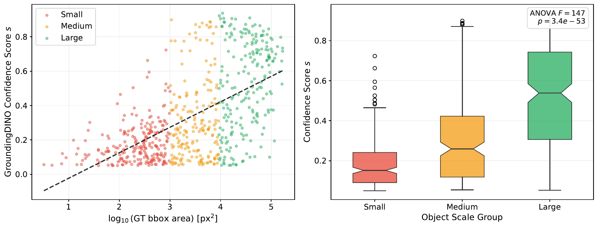
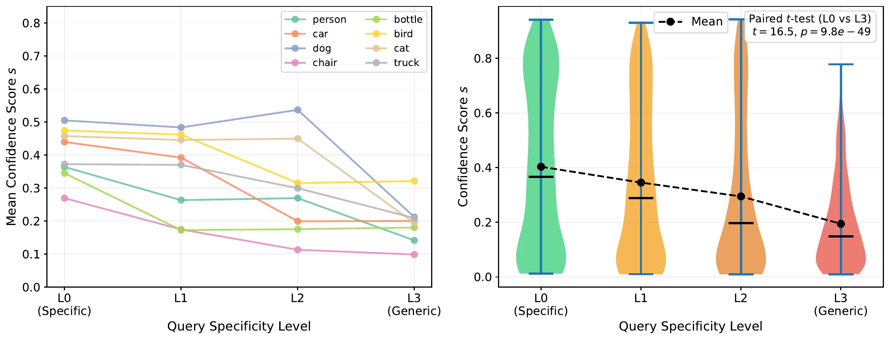
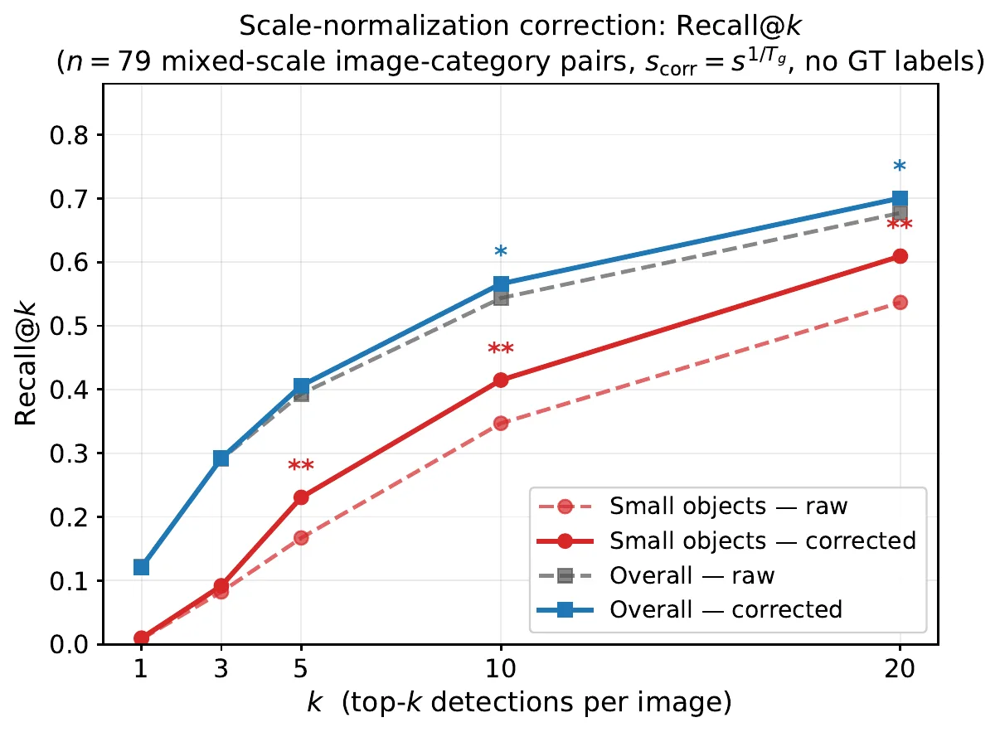

# Confidence Scores in Open-Vocabulary Detection Are a Biased Mixture of Scale and Semantics

- **来源**: https://arxiv.org/abs/2607.10993
- **日期**: 2026-07-13
- **标签**: `open-vocabulary detection`, `confidence calibration`, `scale bias`, `small object`, `diagnosis`
- **研究方向**: 计算机视觉 → 目标检测 → 开放词汇目标检测
- **作者**: Yi Tang Soon, Jun-Wei Hsieh
- **提交日期**: 2026-07-13 (v1)
- **会议/期刊**: arXiv preprint（原文用 LNCS 模板，未注明投稿会议）

---

## 摘要

**问题**: 开放词汇检测器给每个检测框输出一个分数 $s\in[0,1]$，使用者默认它表示定位正确的概率，于是拿一个固定阈值筛结果。这篇论文要问的是，这个分数到底是不是定位概率。

**方案**: 把 $s=\cos(v,t)$ 形式化为可分解的量，用受控实验分别固定类别、尺度和查询措辞，量化两个偏差项，再从理论上说明它们为什么是结构性的。最后给一个不需要标签的推理时修正。

**关键创新/贡献**：

- **加性分解**: 把分数拆成尺度项、语义特异性项和残差，两项系数都估出了具体数值。
- **跨架构复现**: 尺度偏差在 GroundingDINO、OWL-ViT、YOLO-World 三个检测器上同向复现。
- **跨数据集复现**: 同一偏差在 LVIS 的 1,203 类、1,816 个标注上复现，稀有类比常见类更严重。
- **地板效应**: 用 $2\times2$ 因子实验说明小目标分数被压到接近零，语义信号跟着被淹没，定位信号无法靠阈值找回。
- **免训练修正**: 一个按尺度分组估计的温度缩放，把分数开 $1/T$ 次方再排序，小目标召回提升约 20%，代价是整条排序的 AP 略降。

**验证**: COCO 2014 val 上 8 类、每类 80 图，共 640 对；LVIS v1 val 上 1,816 个标注；三个现成检测器不改权重直接测。

---

## 1. Introduction

**背景 & 动机**: CLIP、ALIGN、SigLIP 这类视觉语言基础模型让开放词汇检测成为可能，GroundingDINO、OWL-ViT、YOLO-World 都靠区域特征与文本向量的余弦相似度打分。问题在于，这个相似度是为图文级别的语义匹配训练的，而使用者把它当成区域级的定位置信度在用。两者并不是一回事。

论文开场给了一个很具体的场景。阈值取 0.3 时，小目标被系统性丢掉。检测器其实把框画对了，但分数只有 0.08、0.11、0.09。把阈值降下去救小目标，大目标的误报立刻铺满输出。作者认为这不是模型能力问题，而是 $s=\cos(v,t)$ 这一个标量里混进了两个互相独立的信号。

**本文贡献**:

1. 给出加性分解 $s\approx\alpha\cdot\phi(a)+\beta\cdot\psi(d_\mathrm{sem})+\varepsilon$，并估出系数，说明基础模型的置信度对区域级任务是结构性有偏的。
2. 受控实验确认尺度偏差跨三个检测器成立（$r\in[0.36,0.64]$），语义偏差在 GroundingDINO 的 8 个类上成立（配对 $t>16$）。
3. $2\times2$ 因子实验揭示地板效应，小目标的定位信号被压没。
4. 一个免训练、无参数的测试时修正，把小目标 Recall@10 提升约 20%，并把精度和校准的代价实测出来。

---

## 2. Related Work

**基础模型用于检测**: 从用 caption 做新类检测的早期工作，到 ViLD、GLIP、RegionCLIP、OWL-ViT/v2、GroundingDINO、YOLO-World，这条线的共同点是置信度接口始终是 CLIP 空间的余弦相似度。同期还有一项免训练工作，把多个 proposal 的分数聚合成更强的分数。作者说，本文正好解释了这类修补为什么会被需要。

**图像级预训练的局限**: 已有工作记录过 CLIP 在组合推理、空间理解、细粒度视觉任务上的失败。DeCLIP 和 FLAVA 探索过替代训练方式，但仍然停留在图像级对齐。本文的切入点是，分数的生成机制本身会引入与特征质量无关的系统偏差。

**置信度校准**: 分类、分布偏移、检测三个方向都有校准研究，温度缩放和标签平滑是常见的后处理 logit 修正。作者认为这类方法治不了结构性纠缠，也没有前人指出基础模型开放词汇检测器里不校准的结构来源。

**小目标检测**: 特征金字塔、单阶段检测器、专用架构都在处理小目标。本文提供的是另一种解释，即基础模型检测器在小目标上的系统性弱势，有一部分来自分数机制而不是感受野或分辨率。

---

## 3. Formal Formulation

**打分接口**: 设 $v\in\mathbb{R}^d$ 是区域特征，$t\in\mathbb{R}^d$ 是查询 $q$ 的文本向量，检测器计算

$$
s=\cos(v,t)=\frac{v\cdot t}{|v|\,|t|}
$$

实际实现里每个检测器都会接一个可学的、带 sigmoid 的投影头，不是裸余弦。作者用 $\cos(v,t)$ 作为统一抽象，因为三个检测器都归结为区域文本相似度的单调函数。

**两个自变量**: $a$ 是候选框的像素面积，当作尺度的几何代理。$d_\mathrm{sem}$ 是查询的语义特异性，操作化为该查询与同类最具体措辞 $q_0$ 之间的 CLIP 文本余弦距离：

$$
d_\mathrm{sem}=1-\cos(t_q,t_{q_0})
$$

按这个定义，最具体措辞取 0，越笼统的改写越大。

**定义 1（理想置信度）**: 理想分数是

$$
s^{*}=P\big(\mathrm{IoU}(\hat{b},b^{*})\geq 0.5 \mid v,t\big)
$$

其中 $\hat{b}$ 是预测框，$b^{*}$ 是真值框。校准良好意味着 $s\approx s^{*}$。

**观察 1（尺度偏差）**: 固定类别和查询，小目标的条件期望分数远低于大目标。三个检测器上 $\log a$ 与 $s$ 的 Pearson 相关系数落在 $[0.36,0.64]$，$p<10^{-20}$。

**观察 2（语义偏差）**: 固定视觉内容，具体查询的分数明显高于笼统查询。8 个类上配对 $t=16.5$，$p=9.83\times10^{-49}$。

**发现 1（加性分解）**: 令 $\phi(a)=\log(a+1)$，$\psi$ 取恒等映射，则

$$
s\approx\alpha\cdot\phi(a)+\beta\cdot\psi(d_\mathrm{sem})+\varepsilon
$$

估计值 $\hat{\alpha}={+}0.064$，$\hat{\beta}={-}0.705$，两者 $p<10^{-40}$。残差 $\varepsilon$ 里装着定位信号 $s^{*}$ 和噪声。

作者明确说这是一阶近似，只用来识别和量化两个系数，不主张分数处处严格可加。实验 3 里看到的非平行交互与这个乘性来源是相容的：面积越小，尺度项把分数压向零，留给语义项活动的空间就被挤掉了。

**推论 1（判别力损失）**: 对小目标，扣掉尺度项后方差只剩

$$
\mathrm{Var}(\varepsilon\mid a_\mathrm{small})\approx 0.0138-0.0054=0.0084
$$

这个量级不足以区分真正例和假正例。实验侧的证据是，按尺度分别取最优阈值，小目标的 F1 只涨 0.001，大目标能涨 0.102。

### 3.1 为什么纠缠是结构必然

**尺度偏差来自方向聚集**: $s=\cos(v,t)$ 对 $|v|$ 不敏感，所以偏差只能来自尺度对特征方向的影响。把未归一化特征写成 $v_\mathrm{raw}=\mu+\bar{\eta}(R)$，$\mu$ 是无噪声的类别方向，$\bar{\eta}(R)$ 是区域内像素级零均值噪声的平均。由大数定律，$\mathrm{Var}(\bar{\eta}(R))\propto\sigma_f^2/|R|$，区域越小，对 $\mu$ 的估计越噪。归一化后方向偏离无噪声方向一个小角度 $\delta$，$\mathrm{Var}(\delta)\propto\sigma_f^2/(|R|\,|\mu|^2)$。令 $\theta$ 为无噪声的类别查询夹角，二阶展开得到

$$
\mathbb{E}[s\mid a]\approx\cos\theta\left(1-\frac{\kappa}{2a}\right)
$$

$\kappa\propto\sigma_f^2/|\mu|^2$ 是局部噪声水平。当 $\cos\theta>0$ 时这个式子对 $a$ 单调递增，并在 $a\to\infty$ 时趋近无噪声对齐。作者指出这正是 von Mises–Fisher 分布方向估计的聚集行为，所以尺度偏差是空间池化作用在区域嵌入方向上的结构后果。

**语义偏差来自 CLIP 的对齐几何**: CLIP 的对比损失把具体查询（如 "a dog"）训得紧贴概念特征，笼统查询（如 "an object"）则弥散地对齐所有物体。对任意固定的 $v$，有 $\cos(v,t_{q_0})>\cos(v,t_{q_k})$，也就是观察 2 的方向。

两个偏差同源：$s=\cos(v,t)$ 优化的是图像级语义相似度，不是区域级定位确定性。

---

## 4. Experiments

### 4.1 设置

三个现成模型：GroundingDINO-SwinT、OWL-ViT-B/32、YOLO-World-S，在 COCO 2014 val 上测，8 个类、每类 80 图，共 640 对。尺度分三组，小目标 $a<32^2$，中目标 $32^2$ 到 $96^2$，大目标 $a\geq96^2$。除非另有说明，推理时框和文本阈值都取 0.01，目的是保留足够的弱检测用于后面的 PR 和 oracle 阈值分析。

### 4.2 实验 1：尺度偏差

查询固定为 "a [category]"，平均分数随尺度单调上升：小 0.180、中 0.317、大 0.520，ANOVA $F=146.92$，$p=3.40\times10^{-53}$。逐类相关系数落在 $[0.296,0.666]$，全部 $p<0.01$。

三个检测器都同向，数值见下表。

| 检测器 | $r$ | $p$ | 小目标均值 | 大目标均值 |
|---|---|---|---|---|
| GroundingDINO | 0.579 | $1.29\times10^{-58}$ | 0.180 | 0.520 |
| OWL-ViT | 0.363 | $3.18\times10^{-21}$ | 0.085 | 0.279 |
| YOLO-World | 0.637 | $4.56\times10^{-72}$ | 0.145 | 0.615 |

*图 1：GroundingDINO 在 COCO 8 类上的尺度偏差。左图为分数对 $\log(\text{area})$ 的回归，$r=0.579$；右图为按尺度分组的分数分布，ANOVA $F=146.92$。查询措辞全程固定（论文 Figure 1）。*

**LVIS 复现**: 为检验偏差是否只在手挑的 8 个类上成立，作者在 LVIS v1 val 上复现，覆盖 1,203 类、19.8K 图，用 GroundingDINO 测 1,816 个标注。偏差显著复现：$r=0.369$，$p=1.08\times10^{-59}$，ANOVA $F=135.90$，$p=1.01\times10^{-55}$。分组均值仍同向：小 0.110、中 0.167、大 0.301。

值得注意的是，稀有类的偏差（$r=0.491$）强于常见类（0.386）和普通类（0.351）。作者的解释是，CLIP 预训练语料里样本少的物体更容易受尺度引起的分数扭曲，这对长尾部署直接相关。

### 4.3 实验 2：语义偏差

固定视觉内容，同一张图、同一个框，只用大目标，查询沿一条四级的、逐级笼统的层级变化。以 dog 为例，L0 是 "a dog"（类别名），L1 是 "a pet"（功能类别），L2 是 "an animal"（上位类），L3 是 "an object"（最笼统）。8 个类都套同一个模式。进入分解式的 $d_\mathrm{sem}$ 取的是每级查询相对 L0 的 CLIP 余弦距离，不是层级序号。

8 个类的分数全部下降，L0 的 0.403 降到 L3 的 0.194，配对 $t=16.5$，$p=9.83\times10^{-49}$。

*图 2：语义偏差。左图为逐类在不同查询层级上的平均分数，右图为合并后的小提琴图，视觉内容固定（论文 Figure 3）。*

作者也记录了反例：8 个类里有 3 个的 CLIP 距离随层级非单调。这说明文本嵌入空间反映的是语料统计，而不是分类学层级。

### 4.4 实验 3：双信号交互

$2\times2$ 因子设计，尺度分大小两组，查询分具体和笼统两级，两个主效应都显著，$p<10^{-58}$。

| | 具体查询 | 笼统查询 |
|---|---|---|
| 大目标 | 0.409 | 0.187 |
| 小目标 | 0.171 | 0.071 |

语义效应在大目标上是 $+0.223$，在小目标上只有 $+0.100$，前者是后者的 2.2 倍。作者的解释是地板效应：尺度偏差把小目标分数压到接近零，语义项失去了活动空间，两条线因此不平行。

---

## 5. Practical Consequences

### 5.1 PR 与阈值差距

按尺度分组算 AP，大目标减小目标是 0.27。要让小目标达到 50% 召回，阈值要比大目标低 3.7 倍，分别是 0.129 和 0.476。

| 尺度 | AP | $\tau(R{=}0.3)$ | $\tau(R{=}0.5)$ | $\tau(R{=}0.7)$ |
|---|---|---|---|---|
| 小 | 0.430 | 0.186 | 0.129 | 0.088 |
| 中 | 0.566 | 0.302 | 0.234 | 0.184 |
| 大 | 0.704 | 0.645 | 0.476 | 0.350 |

关键的对照是 oracle 逐尺度阈值：小目标的 F1 只涨 0.001，大目标涨 0.102。也就是说，阈值选择救不回小目标的定位信号，这不是调参能解决的问题。

### 5.2 校准分析

在 56,630 个检测上算可靠性图（$s\geq0.05$），所有组都是欠自信，而且欠自信的程度跟尺度相关：小目标 -0.384，大目标 -0.205。尺度偏差把分数压到了真实定位概率之下。

### 5.3 免训练的测试时修正

尺度偏差在混合尺度的图里造成排序不公，大目标不管定位质量如何都占据 top-$k$。作者提出方差匹配的温度缩放：

$$
s_\mathrm{corr}=s^{1/T_g},\quad T_g=\sqrt{\frac{\mathrm{Var}(\log s_g)}{\mathrm{Var}(\log s_\mathrm{large})}}
$$

三个组的温度不需要真值标签就能估出来，分别为 1.28、1.06、1.00，大目标作为不修正的参照组。

在 79 对混合尺度样本上，小目标 Recall@10 从 0.347 升到 0.415，即 $+19.6\%$，$p<0.01$。整体 Recall@10 从 0.544 升到 0.566，$+4.1\%$，$p<0.05$。大目标下降 6.0%，$p=0.10$，不显著。

代价也实测了。把小目标和大目标的检测并进一条排序后，AP 从 0.500 掉到 0.476，$\Delta=-0.025$，95% bootstrap 置信区间 $[-0.041,-0.007]$，$p=0.002$。作者认为这跟召回提升不矛盾，Recall@k 只看前 $k$ 个，AP 要对整条排序积精度，重排对低分尾巴伤害最大。

校准方面，ECE 在小目标上从 0.102 降到 0.047，中目标从 0.079 降到 0.040，大目标作为参照不变。

*图 3：79 对混合尺度样本上的尺度归一化修正。实线为修正后，虚线为原始。小目标 Recall@k 在各 $k$ 上都显著提升，整体 Recall@10 也提升，大目标下降不显著，全程不需要真值标签（论文 Figure 7）。*

---

## 6. Discussion and Conclusion

**总结**: 基础模型的开放词汇检测分数不该被当成校准过的定位概率。分数高不一定是框得准，可能只是目标大；分数低不一定是认错，可能只是查询措辞笼统。贡献包括：可分解的结构诊断与两个系数、尺度偏差的跨架构与跨数据集量化、小目标上的地板效应、以及一个只部分可逆的推理时修正。

**局限性**: 理想分数被定义为纯定位正确性 $P(\mathrm{IoU}\geq0.5\mid v,t)$，不涵盖语义落地的不确定性，作者明确说这是另一条轴。大目标可能因为遮挡更少而更好检，作者用 640 个大目标做了排除实验，遮挡代理与分数的相关为 0（$r=-0.000$，$p=0.99$），但局部分辨率、背景杂乱、候选质量、类别频率这些与尺度相关的因素没有逐个解耦。全部受控实验在 COCO 2014 val 上完成，LVIS 只做了 GroundingDINO 的复现。作者把"哪个架构部件该为哪个偏差负责"和"跨更多数据集架构验证"都列为未来工作。

论文结尾明确说，温度缩放只让尺度偏差部分可逆，更深的解法是让检测器用区域级监督直接预测 $P(\mathrm{IoU}\geq0.5\mid v,t)$，而不是拿图像级相似度当代理。作者还点名机器人、视频监控、医学影像，以及航拍和卫星影像里的稀有小目标，是这套偏差复合作用的场景。

---

## 个人评价

**核心价值**: 它把"开放词汇检测的分数不可信"从一句经验抱怨，变成了可测量、可分解、有推导的结构问题。一个常见的解释是分辨率或感受野不够，这篇给的是另一条：即使框画对了，分数也会因为区域面积小而系统性偏低，这是池化加余弦的结构后果，不是模型没学好。

**可借鉴点**: 对低空开放词汇检测这条线，最直接的价值是量法。它给出了四个可直接搬进评测口径的量：分数对 $\log a$ 的回归斜率和相关系数、分数对语义特异性 $d_\mathrm{sem}$ 的回归斜率、按尺度分档的 AP 与达到目标召回所需阈值、oracle 逐尺度阈值的 F1 增益。把这四个量固定下来，就能把"候选能盖住 30.6% 的 GT、最终 AP 只有 9.6"这个落差拆成尺度项、语义项和残差三部分，而不是笼统地说对齐不好。低空目标普遍落在最小档，正好是这篇指出的受害区，所以低空上的系数很可能比 COCO 更极端，这本身就是一个值得单独报的发现。

**实验设计亮点**: 两个设计值得借鉴。一是语义偏差实验固定视觉内容，同一张图同一个框，只改查询措辞，把文本侧的影响单独隔离出来。二是 $2\times2$ 因子设计，用两条不平行的线把地板效应画出来，比单纯报两个主效应有说服力。

---

## 疑问解答 (Q&A)

### Q1: 语义偏差只在 GroundingDINO 上测，能推广到另外两个检测器吗？

**答**: 不能直接推广。原文的跨架构复现只针对尺度偏差，语义偏差是在 GroundingDINO 的 8 个类上做的。作者的理论推导是通用的，但实验证据只有这一个模型。引用时要说清楚这一点。

### Q2: 温度缩放的 $T_g$ 不用标签怎么估？

**答**: 用的是各尺度组 $\log$ 分数的方差与大目标组方差之比再开根号。这个量只需要推理时的分数分布，不需要真值。代价是大目标组被当成参照，$T_\mathrm{large}=1$，所以修正只作用于小目标和中目标。

### Q3: 召回涨了但 AP 掉了，这算改进吗？

**答**: 取决于用途。做 top-$k$ 检索，或者任务要求小目标不漏检时，这个修正有用。做整条排序的精度评估时，它是负收益，因为把小目标提上来会带进更多假正例，在低分尾巴上尤其明显。原文没有回避这个矛盾，把两边都实测了。

### Q4: 这篇对低空开放词汇检测意味着什么？

**答**: 意味着低空场景是这套偏差最重的地方，因为目标尺寸集中在小档，而且类名词表偏层级和细类，语义特异性跨度大。它同时说明两件事：一是只调阈值救不回小目标，二是推理时的温度缩放只能部分补偿，代价是排序精度。论文自己把更深的解法指向训练层的区域级监督，但那部分它没有做。
