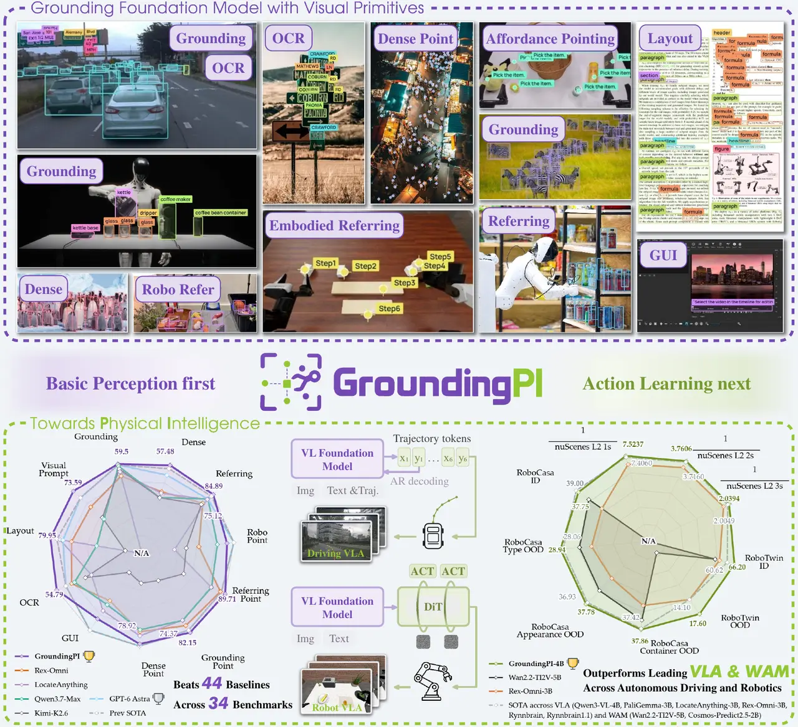
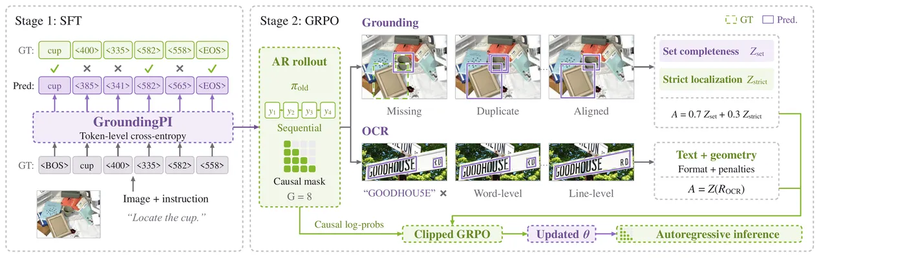
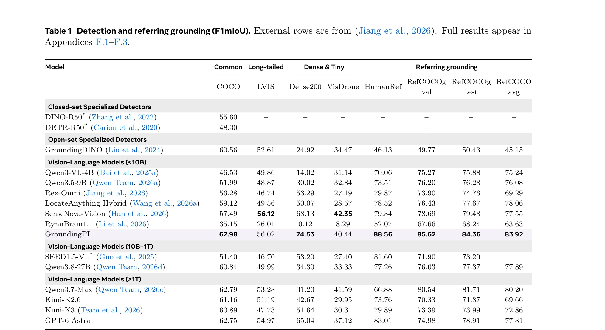
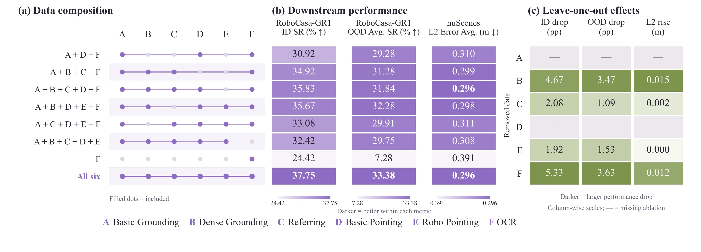

# GroundingPI: A Grounding Foundation Model towards Physical Intelligence with Visual Primitives

- **来源**: https://arxiv.org/abs/2609.39601
- **参考链接**: [项目主页](https://groundingpi.github.io/)、[HuggingFace 模型卡](https://huggingface.co/GroundingPI/GroundingPI)
- **日期**: 2026-09-30
- **标签**: `grounding`, `foundation-model`, `vlm`, `coordinate-token`, `grpo`, `data-engine`, `physical-intelligence`, `open-source`
- **研究方向**: 多模态感知 → 视觉定位 → grounding 基础模型与具身迁移
- **作者**: Qize Yu*, Lianrui Fan*, Boyu Chen*, Jiaqi Liang*, Xini Ding*（共同一作，Qize Yu 为项目负责）等 27 人；机构含 XPeng、北京大学、香港大学、UC Berkeley、Princeton、NUS、清华大学、HKUST(GZ)；通讯 Ping Luo（HKU）、Shiyu Huang（XPeng）
- **提交日期**: 2026-09-30 (v1)
- **会议/期刊**: arXiv preprint
- **代码**: https://github.com/groundingpi/GroundingPI （权重、部署、评测全开源）
- **项目主页**: https://groundingpi.github.io/

关联笔记：[Rex-Omni](../2025/2025-10-14-rex-omni.md)（坐标 token + GRPO 的先行者，本文直接基线）、[LocateAnything](./2026-05-26-locateanything.md)（并行框解码路线，本文直接基线）、[WeVisOne-VL](./2026-10-22-wevisone-vl.md)（同属"统一感知 + 数据引擎 + GRPO"赛道，晚本文三周挂出，本文未引用，未正面交手）、[WeDetect](../2025/2025-12-16-wedetect.md)（双塔检测底座路线，与本文的生成式定位是两条技术路线）。

---

## 摘要

**问题**: VLA 与世界动作模型（WAM）的感知普遍取自通用 VLM 和视频生成底座，而这类底座没有为"精确知道目标是哪个、在哪里"优化过。密集场景、微小目标下通用 VLM 明显掉链子，连 GPT-6 Astra 也有提升空间，感知成了动作学习的瓶颈。

**方案**: GroundingPI，4B 参数的 grounding 基础模型。把点、框作为量化坐标 token（`<0>`–`<999>`）放进共享词表，将定位、指代、pointing、OCR、GUI、文档版面、视觉提示统一为语言条件下的结构化生成。训练分三段：多模态与空间预训练、SFT、GRPO 强化学习，数据来自公开数据集加自建数据引擎。

**关键创新/贡献**:
- **统一协议与紧凑序列化**: 接口本身不是首创，量化坐标 token 是 Pix2Seq 提的，Qwen2.5-VL、Rex-Omni 都在用。本文的贡献是协议覆盖拉到 11 类能力（含 GUI、文档版面、示例视觉提示）加 `None` 拒绝；Dense200 上 5.1 token/框，比 SEED1.5-VL 的 74.5 省 14 倍
- **多教师字段级融合的数据引擎**: 多个 teacher 的预测按字段对齐融合，任务相关字段逐一验证，验收标注反哺统一定位专家迭代标注
- **感知原生迁移的系统性验证**: 固定动作学习器只换感知底座的受控对比，证明精确定位预训练直接提升操作与驾驶的动作学习和 OOD 泛化

**验证**: 34 个基准、11 类感知能力、44 个基线，平均 73.68% 超 GPT-6 Astra 的 71.54%。迁移侧：nuScenes 开环 L2 0.296 m；RoboTwin 2.0 四个 OOD 设置全部第一，最高相对提升 24.8%；RoboCasa-GR1 用 50% 演示数据超过基线用 75% 的成绩。



*图 1：GroundingPI 总览，上为 34 个感知基准的统一接口，下为驾驶与操作两类物理智能迁移（论文 teaser）。*

---

## 1. 引言

**背景 & 动机**: 视觉定位连接语言与物体、位置和交互相关结构，是 VLM 的核心感知能力。UI 元素、区域、任务实体的定位近年都有进展，但物理智能（VLA、WAM）需要的定位有自己的特殊要求：杂乱场景和微小目标里也要指得准，还要快到能进闭环控制。通用 VLM 底座没为此优化；现有补救都是在动作学习里打感知补丁，如 π0 直接拿通用 VLM 训动作没有感知监督，π0.5 才在动作训练里加了框预测任务显式补感知，另一些工作加辅助感知模块。作者认为更自然 scalable 的做法是把强定位做成基础模型的原生能力，而不是逐个任务打补丁。

**本文贡献**:
1. 强 grounding 基础模型：4B，视觉原语 + 分阶段训练配方，grounding SOTA
2. 物理智能迁移验证：驾驶与操作上 ID、OOD 一致领先，动作数据效率提升
3. 感知预训练的 scale 与数据构成分析，及 System-1/System-2 具身基础模型设计讨论

---

## 2. 相关工作

**视觉定位模型**: 从闭集检测到 open-set（GLIP、GroundingDINO），再到生成式定位：自回归 next-token 预测产出标签加量化坐标（Pix2Seq、Florence、Rex-Omni），LocateAnything 走并行框解码。空间可供性预测与空间指代（RoboPoint、RoboRefer）把能力伸向机器人交互。

**物理智能基础模型**: VLA 继承 VLM 的语义先验，WAM 继承视频/世界模型的时空动态先验，具身基础模型再叠加具身经验。但宽泛能力不等于物理交互所需的精确任务条件感知，预训练与动作学习之间存在能力错配。

**面向动作迁移的感知学习**: π0.5 加框预测、ReconVLA、affordance 类方法把感知作为动作学习里的代理任务或辅助目标引入。这类机制覆盖的感知信号有限，依赖额外标注或策略专用组件，难以 scale。作者由此提出感知原生基础模型：先学宽而精的感知，再让动作学习建在感知之上。

---

## 3. GroundingPI 模型设计

### 3.1 架构与定位格式

**核心思想**: 自回归 grounding 模型，MoonViT-V2（Kimi K3 的视觉编码器，27 层、hidden 1024、patch 14）加可学习 projector（2×2 相邻特征聚合，两层无偏置线性 4096→4096→2560 带 GELU 与 RMSNorm）接 Qwen3-4B 语言解码器（36 层全注意力）。视觉输入用动态 patch 预算，最多 4096 个 patch、投影后至多 1024 个视觉 token。

语义标签、协议标记和 1000 个量化坐标 token（`<0>`–`<999>`）共享输出词表，响应变长，查问的类别不存在时输出 `None`。所有感知任务共用这一套输入输出协议，下游驾驶轨迹也复用同一坐标词表（见 §4）。

### 3.2 数据

**核心思想**: 公开数据集加数据引擎产出标注。数据引擎做多 teacher 的字段级融合与任务相关验证：候选实例映射回原图、在同一查询范围和标注粒度内对齐，语义字段与几何字段分开融合，分歧触发补充取证。每个字段标记接受、拒绝或未决，查询所需的全部字段都接受才算一条合格监督；全实例类查询额外要求覆盖检查，目标不存在时"不存在"本身是要验证的事实，空预测不等于验证过缺检。

验收标注训练一个统一定位专家做迭代标注，语义身份、几何或覆盖仍有疑义时调互补 teacher 和局部观测（crop 预测映射回原图坐标）。修订向依赖任务传播，失效标签撤回直到依赖解决。一条验证过的实例记录可以派生多种监督：类别-框对给 grounding，属性关系给 referring，实例区域给 pointing，文本区域加转写给 OCR。

### 3.3 训练设计

**Base VLM 训练**: 三阶段。先冻结两个 backbone 只训 projector 对齐图文；再解冻全部模块做文本与图文联合多模态预训练；最后用问答和 caption 做通用视觉视频理解。全部是因果 next-token prediction。

**监督微调**: 让坐标与视觉位置对齐、学会共享输出协议。teacher forcing 下最小化响应位置（含协议标记与坐标）的交叉熵：

$$
\mathcal{L}_{\mathrm{SFT}}=-|\mathcal{S}|^{-1}\sum_{t\in\mathcal{S}}\log p_\theta(y_t\mid I,P,y_{<t})
$$

先全模块更新，再冻结视觉编码器与 projector 做语言侧精调。

**强化后训练**: GRPO，每个图-查询对采样 $G=8$ 个自回归响应。grounding 用两个独立标准化的奖励：$R_{\mathrm{set}}$ 按参考逐一最大 IoU 匹配加类别校验来度量覆盖完整性；$R_{\mathrm{strict}}$ 组合多阈值 F1、定位、格式、计数与顺序分数，罚重复框和过大框。优势为两者加权和：

$$
\widetilde{A}_i=0.7\,Z(R_{\mathrm{set},i})+0.3\,Z(R_{\mathrm{strict},i})
$$

OCR 用匈牙利一对一匹配评文本与几何一致性，加格式门控与输出惩罚合成单一奖励。带 SFT 冻结参考，只更新语言参数。



*图 2：SFT 学结构化输出，GRPO 用覆盖与定位两类奖励直接优化落点质量（论文配图）。*

---

## 4. 面向物理智能的模型

**核心思想**: 保留各领域原生动作学习器，GroundingPI 只当共享感知底座，验证定位表征能否转化为动作学习能力。

### 4.1 自动驾驶

nuScenes 上的语言条件轨迹预测：当前前视图加历史自车状态，未来 3 秒轨迹表示为 0.5 秒间隔的 6 个有序路点，每个路点是当前自车坐标系下的累计位置（前向与左向，单位米），固定度量范围映射到既有的 `<0>`–`<999>` 词表，语言头自回归生成。适配目标只有响应位置交叉熵。

### 4.2 机器人操作

按 π0 的 flow-matching 策略，采用 StarVLA 的层级连接：底座前向一次，中间特征投影重采样后注入 Action DiT 的交叉注意力层，动作专家去噪出连续控制。受控对比覆盖四类底座：通用 VLM（Qwen3-VL-4B、PaliGemma-3B）、视频生成底座（Wan2.2-TI2V-5B、Cosmos-Predict2.5-2B）、定位模型（LocateAnything-3B、Rex-Omni-3B）、具身基础模型（RynnBrain、RynnBrain1.1）。同一基准内 Action DiT 架构、动作数据、优化预算、动作表示与推理流程全部固定，只换预训练底座。

---

## 5. 实验

### 5.1 Grounding 基准结果

**评测设置**: 44 基线、34 基准、11 类能力，覆盖专用检测器、通用 VLM、定位专用模型与具身底座。自家模型取 10 次运行均值（5 种子 × 2 次），本地评测的基线 3 次均值。GPT-6 Astra 用 thinking effort High。指标：框定位与 OCR 用 F1mIoU，物体 pointing 用 F1@Point，空间与 GUI 用任务特定准确率。基准覆盖 COCO、LVIS、Dense200、VisDrone（检测），RefCOCO 系加 HumanRef（指代），RoboSpatial、RefSpatial、ScreenSpot-V2/Pro、OSWorld-G（空间与 GUI），HierText、ICDAR2015、TotalText、SROIE（OCR），DocLayNet、M6Doc（版面），FSC147（示例视觉提示）。

**主结果**: 平均 73.68%，与 GPT-6 Astra（71.54%）之外的所有基线拉开差距。检测与指代的关键数字看原表：

GroundingPI 在 Dense200 拿 74.53，比 Astra 的 65.04 高近 10 分，是同尺寸模型（Qwen3-VL-4B 只有 14.02）的 5 倍以上，密集场景缺口被直接补上。VisDrone 上 40.44 没到第一，SenseNova-Vision 的 42.35 领先，论文自己承认 VisDrone 仍是难点。指代四列全领先，HumanRef 88.56 比 Astra 高 5.5 分。OCR 与版面上 SROIE 72.47、M6Doc 74.82，大幅超 Astra 的 53.57、60.59，但 TotalText 是 Astra 更强，DocLayNet 略输 SenseNova-Vision，增益不均匀。物体 pointing 七列赢六列，Astra 反而在 Dense200 pointing 上领先，说明选点和边界精度是与框检测不同源的难题。空间与 GUI 上小模型全面领先，但 Astra 优势仍明显，这是明说的残余短板。



*表 1：检测与指代定位（F1mIoU），44 基线中的代表行（论文 Table 1）。GroundingPI 在 Dense200 领先 9.5 分，VisDrone 落后 SenseNova-Vision 1.9 分。*

### 5.2 物理智能性能

**自动驾驶**: nuScenes 开环 L2 平均 0.296 m，好于 Qwen3-VL-4B（0.301 m）和 RynnBrain（0.308 m）。增益不大但一致，论文明确说这不足以证明闭环性能，只是表明具身专精底座未必自动提供驾驶最有用的感知。

**机器人操作**: 六个评测设置里五个第一，包括 RoboTwin2.0 Full 与全部 OOD。RoboTwin2.0 Full 66.20%；Clean2Random 场景鲁棒性 17.60%，第二的 Rex-Omni 只有 14.10%。RoboCasa-GR1 Full 37.75%，输给 RynnBrain 的 39.00%，但三个实体泛化 OOD（外观、组合、物体类型）全部第一。两个协议分别考场景鲁棒性与实体泛化，GroundingPI 在后者上压过更具身语义的 RynnBrain，说明精确空间感知对实体泛化是更对口的先验。

**数据效率**: RoboCasa-GR1 上只用 25%/50%/75% 演示，GroundingPI 在三个降档设置全部第一。50% 数据拿到 28.75% 成功率，超过所有基线用 75% 数据的成绩（最强的 RynnBrain 27.75%）。动作数据稀缺时不必再拿它重学基础感知，这直接呼应"先感知后动作"的立论。

### 5.3 消融与分析

**规模效应**: grounding 预训练曝光从 88.4B 涨到 221B token，grounding 均分与 RoboCasa-GR1 的 ID、OOD 成功率同向稳步上涨，OOD 曲线贴着感知增益走。规模决定学到多少定位能力，且这个能力直接兑换成下游泛化。

**什么监督在迁移**: 对训练混合（基础定位、密集定位、指代、pointing、OCR、版面 GUI）做 leave-one-out。去掉密集定位对操作和驾驶的伤害最大，作者把密集定位定为迁移的空间核心，理由是驾驶与操作的目标都密集堆积或相对图像很小，密集与微小目标感知共享同一套细粒度空间判别。去掉 OCR 组在两个操作 split 上损失最大（5.33/3.63 个百分点），但这个组单独用迁移很差。作者给出假设：锐利的字符边界逼出局部精度，转写把视觉区域绑到语义上，相当于局部化的 captioning 代理任务，起感知学习的催化剂作用。论文诚实标注这个机制未证实。任何缩减混合都不同时赢过全混合：密集定位供空间核心，辅助感知磨利表征，指代与 pointing 把表征接上语言与动作目标。



*图 3：训练混合的 leave-one-out 消融，密集定位是空间核心，OCR 组单独迁移差、组合增益大（论文配图）。*

**底座选择的影响**: RynnBrain1.1 六个操作设置全输给 RynnBrain，尽管驾驶更好。前者用 Qwen3.5（Gated DeltaNet 加门控注意力），后者用 Qwen3-VL。作者推测循环压缩与输出门控可能妨碍动作目标下对空间特征的访问。GroundingPI 自己用单一视觉接口直连全注意力解码器，不叠 DeepStack。这些是受控对比引出的观察，论文明确说没有确立架构因果。

**定位消融**: 量化坐标比文本坐标平均分高 2.47（71.21 → 73.68），文本坐标相对速度只有 0.25×。视觉编码器 MoonViT-V2 73.68，优于 MoonViT 的 73.17 和 Qwen3-ViT 的 71.65。去掉 RL 阶段掉到 72.86。三个设计选择都有正贡献。

**输出效率**: COCO 上每框 7.6 个 token，Dense200 上 5.1 个，SEED1.5-VL 分别是 148.8 和 74.5。共享协议开销在密集输出里摊薄，但自回归生成成本仍在，密集场景的延迟是承认的代价。

---

## 6. 结论

**总结**: 4B grounding 基础模型在 34 个基准上超同尺寸模型、追平更大的 GPT-6 Astra，并有效迁移到驾驶与操作。基础定位是地基，密集定位对物理交互最有价值，OCR 是感知学习的潜在催化剂。设计启示是双系统分工：宽泛推理模型管 System-2 规划，感知原生基础模型管可靠的 System-1 执行。

**局限性**: 论文自己列的——VisDrone 仍难，Astra 在空间/GUI 与 Dense200 pointing 上保持优势；驾驶只测开环；OCR 催化机制是未验证假设；双系统部署与延迟未实测；底座架构差异只有相关性观察。

---

## 个人评价

**核心价值**: 这是"感知当原生动能，而不是动作学习的附属品"这个主张到目前为止最完整的实证。受控底座对比的设计（只换感知底座、动作侧全固定）让"感知质量 → 动作泛化"的因果链第一次有了干净的读数，密集定位是空间核心、OCR 是催化剂这两个数据构成结论对任何做感知预训练的人都有直接指导意义。

**可借鉴点**（对照低空 OVD 计划）:
- **数据引擎的验证观**: 目标不存在时，不存在本身是要验证的事实，空预测不等于验证过缺检
- **密集定位优先**: leave-one-out 证明密集小目标监督是迁移核心，这直接支持我们"切片保小目标、训练框必须穷尽"的路线选择；它的 VisDrone 40.44 F1mIoU 也顺手成了低空域通用模型的新参照点
- **GRPO 奖励拆分**: 覆盖完整性（$R_{\mathrm{set}}$）与定位精度（$R_{\mathrm{strict}}$）分开奖励再加权，比单一 IoU 奖励更贴合"漏检与框不紧是两种错"的直觉，可平移到我们若做生成式检测器的 RL 阶段

**实验设计亮点**: 三个值得抄的做法。一是自家分数跑 10 次取平均，没挑最好的一次；二是自己给基线写的 prompt 和解析代码没把握时，直接在这些分数旁标注"仅供参考，不能当定论"；三是基线不支持的任务（GroundingDINO 没有 GUI/OCR 接口）标 `--`，不硬凑数字。

---

## 疑问解答 (Q&A)


### Q2: 视觉端最多 4096 个 patch，实际支持多大分辨率？

**答**: patch 14，4096 个 patch 对应约 80 万像素，约 900×900 的有效输入；投影后至多 1024 个视觉 token，vLLM 服务上下文限 16,384。对比 Qwen3-VL 默认像素预算 1677 万（4096×4096），MoonViT 的视觉输入能力小了约 20 倍，4K 图整张吃不下。它的密集与微小目标能力来自训练数据与监督设计，不是靠高分辨率输入堆出来的；反过来，拿它标 4K 原图必须先切片。

### Q5: 模型层面到底有哪些创新？为什么用 MoonViT？

**答**: 别人没用过的只有三条：用 MoonViT-V2（Kimi K3 的编码器）做 grounding 视觉塔，此前生成式定位清一色 Qwen 系（消融 73.68 vs Qwen3-ViT 71.65，但论文自己注明编码器对比同时换了预训练表征，隔离不出结构贡献）；nuScenes 路点不加新 token 直接复用 `<0>`–`<999>` 坐标词表，感知与动作在同一几何接口；$R_\mathrm{set}$/$R_\mathrm{strict}$ 分开标准化按 0.7/0.3 加权的奖励配方。其余零件全是现成的：坐标 token 是 Pix2Seq/Rex-Omni 的，GRPO 是 DeepSeek 的，数据引擎是 LAE/WeVisOne-VL 路数，还反主流地不用 DeepStack。选 MoonViT 论文没给原理性理由，消融赢了就用，2 分差距大概率主要来自 Kimi 的预训练质量。整体定性是配方实证论文，分量在实验设计与结论，不在模型结构。

---

## 代码解读

> **代码仓库**：https://github.com/groundingpi/GroundingPI
> 权重： [HF](https://huggingface.co/GroundingPI/GroundingPI) 与 [ModelScope](https://www.modelscope.ai/models/GroundingPI/GroundingPI)）

### 1. 代码结构

```
groundingpi/
├── grounding_pi/       # 客户端与输出协议（client.py、protocol.py），不含模型权重
├── configs/            # train/ 训练配置（语言、视觉、projector 各自 lr 与冻结开关），release/ 分布式启动
├── eval/               # 34 基准评测：按任务分目录（Grounding/OCR/GUI/Layout/Pointing/Referring/VisualPrompt/Dense），eval_runner.py 统一入口
├── scripts/            # 环境搭建、依赖准备、模型代码准备（prepare_model_code.py）、评测预检
├── infer/ examples/    # 推理与批量标注示例（batch_predict.py，JSONL 清单）
├── docs/               # vLLM 部署、原生推理、批量标注、训练指南
└── run.py              # 服务启动入口
```

注意模型实现代码不在仓库里，由 `scripts/prepare_model_code.py` 从权重仓库取 adapter 与捆绑的 Transformers 5.7.0 fork，仓库本体只含客户端、协议、评测与配置。

### 2. 代码怎么用

#### 2.1 权重

HF 或 ModelScope 下载 `GroundingPI/GroundingPI`（含 VLM、tokenizer、processor、自定义模型代码，BF16）。

#### 2.2 推理

vLLM 0.18.x + 捆绑 Transformers fork，OpenAI 兼容 API，`/v1` 端点模型 ID `groundingpi`，默认 BF16、TP=1、单图请求、16,384 上下文。客户端 `predict(图路径, 短语, task="bbox"|"point")` 返回 0–999 网格坐标。

#### 2.3 训练 / 微调

`configs/train/vlm.yaml` 配模型与缓存路径、学习率、batch、序列长度；语言模型、视觉编码器、projector 支持独立 lr 与冻结开关，与论文的阶段式模块调度对应。训练环境只提供 PPU 厂商镜像，GPU 上跑训练要自己适配。

#### 2.4 评测

`scripts/evaluate.py` 加 `eval/` 各任务目录，评测模式用 GAM；`scripts/eval_preflight.py` 与 `check_eval_data.py` 做预检。复现论文数字需自备 34 个基准的数据。

#### 2.5 部署

`run.py` 起 vLLM 服务，批量标注走 `examples/batch_predict.py --input requests.jsonl --output predictions.jsonl`，支持断点续跑。

#### 2.6 环境坑

- Linux x86_64 + Python 3.12，Torch 与 vLLM 0.18.x 要预先装好，`requirements.txt` 只装客户端依赖
- 自定义 HTTP 请求必须设 `skip_special_tokens: false` 与 `spaces_between_special_tokens: false`，否则相邻坐标 token 被合并解析失败
- 启动器用 eager 模式，CUDA Graph 在该配方下禁用
- 训练环境绑定 PPU 厂商镜像，评测加速器实测覆盖 B300/B200/H200/H800 与 PPU
