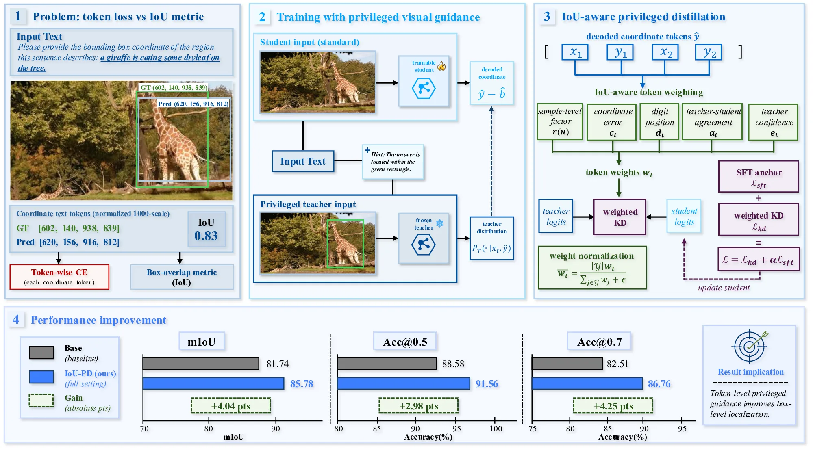
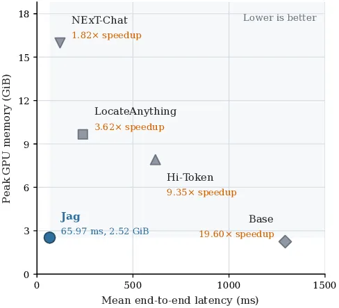

# Jag: Direct Box Prediction for Efficient Visual Grounding

- **来源**: https://arxiv.org/abs/2610.13239
- **解读日期**: 2026-11-14
- **标签**: `视觉定位`, `视觉 grounding`, `直接框预测`, `Qwen3.5`, `回归头`, `低延迟`, `多模态模型`
- **研究方向**: 计算机视觉 → 视觉语言 → 指代表达理解 / 视觉定位（Referring Expression Grounding）
- **作者**: Xiuyuan Zhu, Ke Lu, Hao Wu, Zijin Du, Dongming Zhang, Jian Xue（UCAS 等）
- **提交日期**: 2026-10-09 (v1)
- **会议/期刊**: ACL 格式稿（LaTeX `acl.sty`，preprint 模式），未注明录用会议
- **项目主页**: https://xyzzzh.github.io/Jag/
- **代码**: https://github.com/xyzzzh/Jag （Apache 2.0，含训练 / 评测脚本）
- **模型**: https://huggingface.co/xyzzzh/Jag （基座 Qwen3.5-0.8B）

---

## 摘要

**问题**：视觉定位（图 + 指代表达 → 出框）里，主流多模态模型用自回归一个个生成坐标 token 再解析，序列解码给本就繁重的多模态处理又叠了一层输出计算。

**方案**：Jag 把紧凑预训练多模态模型 Qwen3.5-0.8B 适配成「直接连续框预测」——加一个轻量回归头，读「最后一个有效输入 token」的隐藏状态，一次前向 pass 直接吐出一个框的 4 个归一化坐标（中心 + 宽高）。**关键不是「只输出 4 个值」，而是彻底绕过 LM 的生成循环与词表投影**：AR 生成 4 个坐标要把坐标文本化、跑 K 次 transformer 前向（每个 token 一次）+ LM-head + 采样，再把文本解析回数字；Jag 只需 1 次多模态前向 + 一个 52.9 万参数 MLP，无自回归、无词表投影、无文本解析。**每次推理给定「一张图 + 一句指代表达」只输出一个框（单目标定位）**；多目标需改多查询头设计。

**关键创新 / 贡献**：
- 直接框预测：用现有输入 token 状态做读出，不加专门的回归 / trigger token；四坐标同出，跳过词表投影。
- 几何监督 + 联合训练：L1 + GIoU 损失同时训练语言主干、视觉合并器、回归头（不只训头）。
- 两阶段训练：先冻主干只训头，再联合微调。

**验证**：RefCOCO / RefCOCO+ / RefCOCOg 上，比基座 Qwen3.5-0.8B 涨 9.6–17.5 点，和专用定位模型 LocateAnything 互有胜负（全集平均 88.30% vs 88.00%），但单请求延迟最低（65.97ms），显存仅 2.52 GiB。

---

## 1 / 引言（Introduction）

**背景 & 动机**：视觉定位 = 图像-语言理解 + 紧凑几何答案。比如「鼻子朝上的大象」，扬起的鼻子锁定目标，框定范围。两类做法：
- **自回归生成坐标**（Shikra / Qwen-VL 等）：把框写成坐标串，逐 token 生成再解析——慢，还给定位所需的图像-文本处理额外叠了输出计算。
- **连续框回归**（TransVG / MDETR / NExT-Chat）：MLP 回归头直接出连续框，绕开逐坐标生成。
- **并行离散预测**（LocateAnything）：坐标量化成词表 token，在 box-aligned 块内并行解码出框（论文将其与「连续回归」单列对比，非同一类）。

**本文贡献**：
1. 提出 Jag，把紧凑预训练多模态模型适配成从「已有输入 token 状态」直接连续框预测，单前向 pass 出完整框。
2. 几何监督 + 语言主干 / 视觉合并器 / 回归头联合训练（只训头不够）。
3. 在基准上比基座和 NExT-Chat 涨点，和 LocateAnything 持平，且单请求延迟与显存显著更低。

---

## 2 / 相关工作（Related Work）

论文用一张表点清「读头位置 / 出框形式」的区别（Table 2）：

| Method | State source | Box output |
|---|---|---|
| NExT-Chat | Generated trigger | Continuous |
| LocateAnything | Box-aligned blocks | Discrete |
| **Jag** | Existing input state | Continuous |

- **trigger（触发 token）**：NExT-Chat 在词表新增的一个特殊 grounding 标记 token，模型在输出序列里生成它，回归头读这个 token 的隐藏态出框。Jag 不增这类 token，直接读已有输入 token 的隐藏态。可看作 NExT-Chat 连续回归思路的极简版——不仅架构更轻，Acc@0.5 上还比 NExT-Chat 高 +4.24~+13.89（§4.1），即更简且更准；NExT-Chat 本身是做带定位对话的多模态模型，其短语/指代定位即 REC，Jag 论文直接在 RefCOCO 系列 REC 测试集上与之比较。另外，NExT-Chat 作为对话定位模型可一轮生成多个 grounding token、对应多个框（多目标 / 多短语），只是在 REC 评测里被压成单框模式；Jag 结构性每前向只出一个框，无多框机制。NExT-Chat 的完整解读见 [NExT-Chat 笔记](../2023/2023-11-08-next-chat.md)。
- 与 LocateAnything（在 box-aligned block 内并行离散预测）相反，Jag 从共享状态一次出 4 个连续值。
- 损失用 L1 + GIoU 直接监督连续预测，联合训练主干 + 合并器 + 头。

---

## 3 / 方法（Method）


*图 1：Jag 流程（论文 Figure 1）。保留多模态输入处理，用回归头从「最后有效输入 token 状态」直接出框，单 pass 完成。*

基座是 Qwen3.5-0.8B，多模态主干由三部分串联（对照代码 `jag/model.py`）：

- **视觉编码器**（代码 `backbone.visual`，即视觉塔）：处理输入图像，把图切成 patch 编码成视觉特征。**全程冻结**。
- **视觉合并器**（`backbone.visual.merger`）：把视觉特征映射到语言主干的输入表示空间（对齐维度、合并 patch），是视觉 token 与文本 token 之间的接口。第二阶段参与训练，见 §3.3。
- **语言主干**（`backbone.language_model`）：decoder-only 语言模型，沿用预训练架构与注意力结构，处理「视觉 token + 表达文本」序列，输出隐藏序列 $\mathbf H$。第二阶段参与训练，见 §3.3。

「第二阶段」指训练分两步走，同一损失：第一步冻整个主干、只训新加的回归头，先把头拟合到预训练表示上；第二步保留已适配的头，把它和语言主干（含输入嵌入）、视觉合并器**一起**优化，即「联合训练」，视觉塔仍然冻结。详见 §3.3。


### 3.1 任务定义与多模态表示

目标框归一化到 $[0,1]^4$，用中心-尺寸表示：

$$
\mathbf b=(c_x,c_y,w,h)^{\mathsf T}\in[0,1]^4,\quad c_x=\tfrac{x_1+x_2}{2},\;c_y=\tfrac{y_1+y_2}{2},\;w=x_2-x_1,\;h=y_2-y_1
$$

多模态主干输出隐藏序列 $\mathbf H=f_\theta(I,q)\in\mathbb R^{L\times d}$。取**最后一个有效输入位置**（用原始输入 mask 选 $j=\max\{t:m_t=1\}$）：

$$
\mathbf z=\mathbf H_{j,:}^{\mathsf T}
$$

这个位置跟在其它有效视觉 / 文本位置之后，经主干注意力已融合了它们信息；且左右 padding 下定义一致——**不另加任务专用 token**。

### 3.2 回归头与直接出框

回归头 $g_\phi$ 把 $\mathbf z$ 映射为四坐标：

$$
\mathbf u=\operatorname{GELU}(\mathbf W_1\operatorname{LN}(\mathbf z)+\mathbf a_1),\qquad \hat{\mathbf b}=\sigma(\mathbf W_2\mathbf u+\mathbf a_2)
$$

其中 $\mathbf W_1\in\mathbb R^{d_h\times d}$、$\mathbf W_2\in\mathbb R^{4\times d_h}$，sigmoid 把中心与尺寸约束在 $[0,1]$；四坐标同出，绕过预训练词表投影。对 0.8B 基座，$d=1024,\;d_h=512$，回归头（LN + 两层投影 + GELU + sigmoid）共 **528,900** 参数。

### 3.3 训练目标与两阶段适配

唯一损失 = 坐标 L1 + 几何 GIoU（都在**未裁剪** corner 框上算，框越界也计入惩罚）：

$$
\mathcal L=\lambda_{\mathrm{L1}}\mathcal L_{\mathrm{L1}}+\lambda_{\mathrm{GIoU}}\mathcal L_{\mathrm{GIoU}},\qquad \lambda_{\mathrm{L1}}=5,\;\lambda_{\mathrm{GIoU}}=2
$$

训练分两阶段（同一目标）：
1. **冻主干，只训头** $\phi$：先把新加的回归头拟合到预训练表示；
2. **联合训头 + 语言主干（含输入嵌入）+ 视觉合并器**，视觉编码器仍冻。

### 3.4 推理

构造同样的图 + 表达输入，取式 (3.1) 的 $\mathbf z$ → 式 (3.2) 出 $\hat{\mathbf b}$ → 转 corner → clip 到 $[0,1]$ → 乘原图尺寸得像素框。**一次多模态前向 + 回归头 + 坐标转换即出框**，无坐标 token 生成、无文本解析。（注意：Qwen3.5 是 decoder-only，所谓「不用 decoder」是指不用其**自回归生成 / 输出头**；视觉编码器与 LLM 主干的前向编码仍要用，且主干还被联合微调——丢掉的是「生成阶段」，不是「decoder 组件」。）

---

## 4 / 实验（Experiments）

**数据**：
- 训练：RefCOCO / RefCOCO+ / RefCOCOg 的官方训练划分合并，**321,327** 条指代表达，覆盖 **28,158** 张图（论文报的是去重后的唯一图像数；其中 RefCOCO 与 RefCOCO+ 标注在同一批 COCO 图像上、仅表达不同，RefCOCOg 是另一套更大的图像与短语级标注，三者都源自 COCO 2014）。
- 评测：RefCOCO 与 RefCOCO+ 取 testA + testB，RefCOCOg 取 test 划分；三部分分别为 **10,752 / 10,615 / 9,602** 条表达，合计 **30,969** 条（RefCOCO / RefCOCO+ 的 testA / testB 按表达数合并计分）。
- 训练 / 评测方式：**三个训练集合并训一个模型**，再用这一个模型分别跑三个测试划分、报各自分数——这是 REC 主流协议（TransVG / MDETR 同款）。

指标 Acc@0.5（IoU≥0.5 的比例），增益为绝对点差。

### 4.1 主结果（Acc@0.5, %）

| Model | RefCOCO testA | testB | RefCOCO+ testA | testB | RefCOCOg test |
|---|---|---|---|---|---|
| Base（Qwen3.5-0.8B，无微调） | 84.27 | 74.72 | 76.53 | 62.57 | 77.96 |
| **Jag** | **93.90** | 88.36 | **90.69** | **80.08** | 87.72 |
| NExT-Chat | 89.66 | 77.04 | 83.76 | 66.19 | 79.28 |
| LocateAnything | 93.23 | **89.26** | 88.00 | 79.57 | **88.54** |

- **比基座全划分涨 +9.63~+17.51**，弱划分（testB）涨更多；RefCOCO+ 涨最猛（该集标注限制方位词，更能体现「理解」而非方位词匹配）。
- **比 NExT-Chat**（同样连续框回归）全划分高 +4.24~+13.89。
- **比 LocateAnything**：5 个划分里 3 个最高（含两个 RefCOCO+），LocateAnything 在 RefCOCO testB、RefCOCOg 略高；全集平均 Jag 88.30% vs LocateAnything 88.00% vs NExT-Chat 79.57%。注意 LocateAnything 是**通用定位模型**：它用自有的 LocateAnything-Data（138M 查询 / 785M 框，含检测 / GUI / REC / OCR 等多任务）训成，**未在 RefCOCO / RefCOCO+ / RefCOCOg 训练划分上训过**。

### 4.2 推理效率


*图 2：推理成本 pareto（论文 inference_cost_pareto）。Jag 单请求延迟最低，显存低于 NExT-Chat / LocateAnything / Hi-Token。*

- 延迟 **65.97 ms**（全场最低）、显存 **2.52 GiB**（最低），均优于 NExT-Chat / LocateAnything / Hi-Token（见图 2）。
- 19.6× 是 vs 同一 0.8B 被迫做 AR（自回归，把坐标当文本逐 token 生成）的 Base；公平同主干对比为 **8.9×**（§4.3，vs 同主干自回归微调基线），差距来自省去 AR 解码。

### 4.3 消融

- **联合训练 >> 只训头**：主干 + 合并器 + 头联合更新，比冻结主干只训头在三个数据集各涨 **>60 点**——冻主干训头根本不够。
- **读头方式**：对表达 token 取平均大跌；加一个输入 marker 与默认在 1 点内；默认「最后有效输入 token」已够好且不用专门 marker。
- **连续 vs 并行离散**（四个独立分类头）：连续回归在全数据集、多种子下都更好（同时输出 ≠ 连续好，量化 + 监督一起变）。
- **vs 同主干自回归基线**（微调同一 0.8B、用文本生成坐标，全量数据）：Acc@0.5 上 Jag 落后 AR 不到 1 点（基本打平：RefCOCO / RefCOCO+ 无统计显著差异，仅 RefCOCOg 上 AR 略高）；**但 IoU 0.75 / 0.9 严格阈值下 Jag 明显落后 AR**；同主干下 Jag 比 AR 快 **8.90×**。

### 4.4 训练数据预算

训练数据从 20k 最小子集递增到全量 321k 时，最小子集就已超过 Base（同 0.8B 未微调模型）；RefCOCO+ 涨最多（80.33% → 85.80%）。曲线上升是「更多样本 + 更多优化步」叠加所致——加大数据也意味着更多梯度步，不能单纯归因于数据量。

---

## 5 / 结论与局限

**总结**：Jag 不改架构，只给紧凑多模态模型加一个约 53 万参数的回归头 + 几何监督，就把它适配成单 pass 出框的定位器；准度接近专用模型，延迟 / 显存远低于 AR 与专用模型。

**局限**：
- **只能单实例（REC），做不了『所有汽车』式枚举**：回归头一次只输出一个 4 维向量（一个框），每次 (图 + 表达) 前向出一个框。这是指代表达理解（REC）的任务定义——一句表达指代一个目标。但它**不是检测器**：遇到「图里所有汽车」「数一下有几辆车」这类开放实例枚举 / 计数查询，Jag 一张图只给一个框；要么你得先知道目标数、逐条发表达各跑一次前向（开放计数场景不现实），要么改多查询头设计（DETR 式）。对比 NExT-Chat：它作为对话定位模型，一轮回复可生成多个 grounding token、对应多个框（多目标 / 多短语），只是在 REC 评测里被压成「一句表达→一个框」的单框模式；Jag 则结构性地每前向只出一个框，无多框机制。多实例 / 视频 / 分割需专门设计与评测。
- 效率数字依赖输入分辨率、表达长度、硬件、部署；论文测的是端到端负载，换场景要自测。
- 严格 IoU（0.75 / 0.9）下定位精度不如 AR。

---

## 个人评价

**核心价值**：不是新 backbone，而是「把已有紧凑多模态模型用几何监督直接适配成定位器」的**最小改动做法**——加的回归头相对 0.8B 几乎可忽略，却换来接近专用模型的准度 + 远低于生成式 / 专用模型的延迟和显存。对「边理解边定位」的实时 / 端侧部署很实用。

**可借鉴点**：
1. 读头选「最后有效输入 token 状态」而非加 trigger / marker——省一个 token、少改结构，且左右 padding 下定义一致。
2. 两阶段训练（先训头再联合）让几何损失反过来调整多模态模型的表示，这是涨 >60 点的关键。
3. L1 + GIoU 直接监督连续坐标，跳过词表投影——输出侧彻底脱离语言生成。

**实验设计亮点**：用 ms-swift 训练 + EvalScope 评测（可复现）；多种子 + 配对 95% CI 报告（表 tab:full_data 直接给置信区间，诚实）；把效率拆成延迟和显存两条线，而非只报 FLOPs。

---

## 疑问解答 (Q&A)

### Q1: Jag 和 NExT-Chat / LocateAnything 这种连续 / 离散框预测，本质区别在哪？
**答**：
- NExT-Chat 也是 MLP 连续回归，但要在词表新增一个特殊的 grounding 触发 token、并**由模型在输出里生成它**，再读它的隐藏状态出框；Jag 读的是**已有输入里最后一个有效 token**，不出 trigger，少一个 token、结构改动更小。
- LocateAnything 走**并行离散**预测（坐标量化成词表 token，在 box-aligned 块内并行解码、块内双向注意力一步出，以词表分类形式选坐标），Jag 是共享状态一次出 4 个连续值。三者「出框形式」不同，Jag 在连续回归里最轻量。

### Q2: 为什么用「最后一个有效输入 token」做读出，而不是加个特殊 token？
**答**：论文消融过——加一个输入 marker 与默认做法在 1 点内，而用表达 token 平均会大跌。默认位置跟在全部有效视觉 / 文本输入之后，经主干注意力已融合它们信息，且左右 padding 下定义一致，所以不用专门 marker 也已够好，还能少改输入结构。


### Q3: 和 detector 类（Grounding DINO / MDETR）比，Jag 定位准吗？
**答**：论文主表没直接和 Grounding DINO 比准度，只和 NExT-Chat / LocateAnything / Hi-Token 这几个多模态定位模型比。和 detector 类的差异是做法不同：Grounding DINO / MDETR 是检测架构 + 语言条件，Jag 是「多模态模型 + 回归头」。

### Q4:「decoder-only 语言模型」怎么理解？

**答**：名字来自 2017 年原始 Transformer 的机器翻译结构（encoder 读源句、decoder 生成目标句）。decoder-only 就是只保留 decoder 那一半：纯 Transformer 块堆叠，没有独立 encoder，也没有 cross-attention。

机制两点：
- **因果注意力**：每个位置只能看见它左边的 token；
- **下一 token 预测**：每个位置预测紧跟着的下一个 token。

理解与生成是同一机制：前面所有内容被压缩进最后位置的隐藏状态。

顺带分清三种注意力，两个正交维度：Q 与 K/V 是否同源（self / cross），可见范围（因果 / 双向）。「左右都看」是双向 self-attention，不是 cross-attention，cross 指 Q 与 K/V 来自不同序列：

| 类型 | Q 来自 | K/V 来自 | 可见范围 | 代表 |
|------|--------|----------|----------|------|
| causal self-attention | 本序列 | 本序列 | 只看左边 | GPT / Qwen 等一切 decoder-only |
| 双向 self-attention | 本序列 | 本序列 | 左右都看 | BERT / Transformer encoder |
| cross-attention | A 序列 | B 序列 | B 的全部 | 翻译 decoder、DETR、Stable Diffusion 文本条件 |

三种架构现状：

| 架构 | 代表 | 现状 |
|------|------|------|
| decoder-only | GPT 系 / LLaMA / Qwen / DeepSeek | 通用 LLM 一统天下 |
| encoder-decoder | T5 / BART | 基本退出通用 LLM 舞台，只剩翻译等特定 seq2seq 场景 |
| encoder-only | BERT 系 | 不是 LLM，但 embedding / 检索 / 分类等判别任务仍主流 |

decoder-only 胜出的原因：
- 架构简单，一个栈好扩展；
- 训练信号密度高，每个位置都有 loss（encoder-decoder 只有 decoder 侧有）；
- 推理对 KV cache 友好：因果注意力保证每个位置的 K/V 只取决于它左边的内容，前缀缓存永不失效，生成每步只算新 token 的增量；
- 任何任务统一成「续写文本」；
- 多模态融合方便，视觉 token 直接拼进因果序列。

这也是本文做法的架构前提：最后一个有效输入位置天然看全了之前所有视觉与文本信息，才能从它的隐藏状态直接回归出框。

### Q5: decoder-only 的训练和推理具体是怎么跑的？

**答**：训练是「一次做完一万道填空题」，推理是「文字接龙」。

训练（并行刷填空题），拿「今天天气真不错」举例：
1. 整句喂给模型，每个位置"藏"住下一个词让模型猜：看到「今天」猜「天气」、看到「今天天气」猜「真」、看到「今天天气真」猜「不错」；
2. 所有位置的猜测**一次并行算完**，每个位置都和标准答案对比、各算一份 loss。一篇一万字的文章就是一万道题，一个 batch 全做完；
3. 靠因果 mask 防作弊：每个位置只能看左边，"藏答案"才藏得住；
4. 在海量 token 上重复猜错→调参。这就是预训练的全部，任务只有一个：猜下一个 token。指令微调与 RLHF 不换任务，只是把考题换成对话格式。

推理（串行接龙）：
1. 输入的 prompt 并行过一遍前向，算出每个位置的 KV（这一步叫 prefill）；
2. 用**最后一个位置**的隐藏状态猜下一个 token。输出不是"一个词"，是**整个词表上每个词的概率**，按 temperature / top-p 等策略抽一个；
3. 把抽到的词拼到句尾，只对这个新词做一次前向（前面的 KV 有缓存，不重算），再猜下一个；
4. 循环，直到抽到结束符。

训练并行、推理串行的原因：训练时标准答案已知，可以 teacher forcing 一次并行打分；推理时下一个词是模型自己产的，不生成完就不知道后面是什么，只能一步一挪。

回扣本文：Jag 把接龙整个跳过——prefill 完不进入"猜词→拼上→再猜"的循环，直接读最后位置的隐藏状态，回归头一把吐出 4 个坐标，几十上百次自回归前向全省，这就是 65.97ms 延迟的来源。

### Q: 怎么理解 decoder-only 的输入输出？

**答**：分三步：**查表变向量 → 几十层「交流 + 消化」→ 最后位置得到理解浓缩；正常模型拿它接龙，Jag 拿它出框**。

**第一步，查表变向量**。每个模型有一张词表，每个 token 一个编号；模型内部存一张「词表大小 × 隐藏维度」的 embedding 矩阵，token 的 embedding 就是按编号查出的那一行向量（0.8B 模型隐藏维度 $d=1024$）。这张表随训练更新，练完后语义相近的 token 向量相互靠近。位置信息不放进 embedding（GPT-2 之后的主流做法），由 RoPE 在注意力内部按位置间距旋转 q/k 注入。多模态：视觉 token 也是 1024 维向量——图像过视觉编码器与合并器投影到同一维度，与文本查表所得的向量并排组成同一条序列，decoder 不区分向量是查表来的还是算出来的。

RoPE 大白话：RoPE 的作用对象是**每个注意力头里的 q/k**（不是整条 1024 维隐向量）——注意力按「头」进行，本模型 8 个 Q 头、每头 256 维。每头 q/k 256 维分成 128 组「箭头」，每组随位置匀速旋转但**转速各不相同**——第 0 组最快，位置每挪一步转 1 弧度，第 127 组最慢，每步只转约万分之一弧度，各组转速 $\theta_i = 10000^{-2i/256}$ 是**写死的超参数**（组数 = 头维度 ÷ 2，各家模型不同）。位置 m 的转角 = m × 该组转速，位置越靠后转得越多。关键：**转速与序列长度无关**——100 个 token 和 1000 个 token 用同一组转速，同一个位置编号在两种序列里转角完全一样，变的只是编号上限，这正是 RoPE 能自然外推到长序列的前提。注意力分数是两个箭头做内积，同组旋转后的内积只取决于转角差 $(m-n)\,\theta_i$，即两个 token 隔多远，绝对位置在相乘时被消掉。128 组快慢不同的转速组合起来像秒针、分针、时针：单看快针转一圈就分不清前后，组合读数在很长范围内唯一，所以「隔 2 个位置」不管出现在句首还是第 1000 位，算出的分数都一样——这叫相对位置编码。对比老办法（GPT-2 把学到的位置向量直接加在 embedding 上），RoPE 不改 embedding 本身，位置感只在算注意力的那一刻出现。

**第二步，decoder 层交替做两种工序**（堆几十层，每层两步，靠残差连接不断累加）：
- **注意力层负责位置之间搬运信息**：q/k/v 都是当前 1024 维隐向量经三个不同线性变换投出来的。各位置用自己的 q 与别的位置的 k 算相似度，按权重把对方的 v 搬进自己，混合结果投影回 1024 维再加回残差流；因果 mask 保证只能搬左边的；
- **MLP 层负责位置内部加工信息**：每个位置独立地升维、过非线性、降回原维度，模型参数大头在此，大部分「知识」也存在这。

**第三步，读出**。最后一层输出后，每个位置都有一个 1024 维向量，排起来就是最终隐藏状态序列 $\mathbf H$。生成时取最后一个位置的向量乘 LM head，得到词表上每个 token 的概率，用于接龙。LM head 本质也是一张「词表大小 × 隐藏维度」的大矩阵，且在本模型中与前面的 embedding 表是**同一个张量**（模型 config `tie_word_embeddings: true`，权重绑定）：同一张表两个方向用。大模型常解绑成两个独立训练的矩阵。**LM head 之前、该位置上那根 1024 维向量**——模型对「到目前为止全部输入」的理解浓缩；因果注意力保证最后一个有效位置看全了此前所有内容，它的向量信息量最大。

**回扣本文**：Jag 的改动就一处——不把 $\mathbf z$ 交给 LM head 翻译成词表概率，而是接给回归头（LN → Linear(1024→512) → GELU → Linear(512→4) → Sigmoid），4 个输出即框坐标。

---

## 代码解读

> **代码仓库**：`https://github.com/xyzzzh/Jag`（Apache 2.0）；模型 `https://huggingface.co/xyzzzh/Jag`；在线 Demo `https://huggingface.co/spaces/xyzzzh/Jag`。

### 1. 代码结构（目录树 + 简短注释）

```
jag/  (仓库根，克隆自官方 GitHub)
├── jag/                          # Python 包：核心实现
│   ├── predict.py                # 推理入口 jag.predict（读最后输入 token → 连续框）
│   ├── model.py                  # 回归头 + 直接出框模型
│   ├── trainer.py                # 两阶段训练（先训头、再联合）
│   ├── data.py                   # RefCOCO 系列数据加载
│   ├── geometry.py               # IoU / 框坐标工具
│   ├── evaluation.py / evaluate.py / evaluate_batched.py / evaluate_base.py
│   ├── benchmark.py              # 推理成本基准
│   ├── hub.py / resources.py     # 权重下载与缓存
│   └── batching.py / monitoring.py / recipes.py / base_predict.py / __init__.py
├── train.py                      # 训练主脚本，调用两阶段训练
├── configs/train/jag.json        # 训练配方：合并 RefCOCO 系列训练数据 → models/Jag
├── scripts/                      # 数据准备 / 训练 / 评测 / 导出 / 环境
│   ├── prepare_data.py           # 解 RefCOCO 标注
│   ├── download_model.py         # 下载基座
│   ├── train.sh / evaluate.sh / benchmark.sh / infer.sh / export_model.sh
│   ├── export_model.py           # 导出模型
│   ├── train_in_container.py / docker.sh / docker_compose.py
│   └── check_environment.py / render_*.py / prepare_cost_set.py / publish_site.sh
├── docker/                       # Docker 训练/评测环境（Dockerfile / compose.yaml / requirements.*）
├── docs/                         # 文档站点（inference/training/evaluation/data/setup/architecture）
├── demo/                         # Gradio 演示（app.py / examples.json / rendering.py）
├── data/                         # 数据集 manifest 与样例（manifest.json / examples/）
├── assets/                       # 架构图与评测结果图
├── tests/                        # 单元测试（预测/评测/训练/数据等）
├── pyproject.toml                # 工程配置
├── requirements-inference.txt    # 纯推理依赖
├── README.md / README_zh.md / MODEL_CARD.md / LICENSE / NOTICE / CONTRIBUTING.md
└── .env.example / .dockerignore / .gitignore
```

### 2. 代码怎么用

#### 2.1 权重
已发布模型首次推理自动从 HF 下载（`xyzzzh/Jag`，safetensors，基座 Qwen3.5-0.8B）；`--checkpoint` 也可指向本地目录。骨干 BF16、回归头 FP32（`--weight-dtype fp32` 为全精度评测配置）。

#### 2.2 推理
```bash
python -m jag.predict \
  --checkpoint xyzzzh/Jag \
  --image /path/to/image.jpg \
  --expression 'the person wearing a red shirt' \
  --device cuda --weight-dtype bf16
```
输出 JSON 字段 `bbox_xyxy` = `[x1, y1, x2, y2]`（原图像素）；`--output prediction.json` 保存。**表达必须是英文**（模型在英文 RefCOCO 上训练）；每次 (图 + 一句表达) 出一个框。

#### 2.3 训练 / 微调
环境：
- 训练依赖 **ms-swift**（ModelScope 开源的大模型 / 多模态微调框架，提供 Trainer；`pyproject.toml` 列 `ms-swift==4.3.2`，为硬依赖）；
- **Docker 不是必需**——官方 `scripts/train.sh` 只是把训练包进容器（pin CUDA 12.8 + 全套依赖）以保证可复现，装好 `pyproject` 依赖后直接 `python scripts/train_in_container.py` 也能训（见 §2.5）。

训练步骤（Docker 路径，官方推荐）：
1. 准备配置：`cp .env.example .env`，并在 `.env` 设 `REFCOCO_IMAGES_DIR`（train2014 图像，取自 VLM-R1 的 HF 数据集）。
2. 解数据：`python3 scripts/prepare_data.py --archive refcoco.zip --output data/refcoco`。
3. 构建镜像：`bash scripts/docker.sh build`。
4. 下载基座：`python3 scripts/download_model.py`。
5. 开训：`bash scripts/train.sh`（配方 `configs/train/jag.json`）。

训练配置：数据 = RefCOCO / RefCOCO+ / RefCOCOg **合并训练集**（321,327 条）；损失 `5·L1 + 2·(1−GIoU)`；两阶段训练，可训练范围 = 回归头 + 语言主干（含输入嵌入）+ 视觉合并器，**视觉编码器全程冻结**（对照代码 `set_stage`）。

#### 2.4 评测
`bash scripts/evaluate.sh jag` / `evaluate.sh base` 复现准度（EvalScope）；`bash scripts/benchmark.sh` 测延迟 / 显存。

#### 2.5 环境坑
- 推理只需 Python 3.12 venv + `requirements-inference.txt`；训练 / 评测需 Docker Compose + NVIDIA Container Toolkit。
- 表达限英文；不支持中文，也不输出 segmentation / 多目标（只返回单个 box）。
- 评测数字依赖硬件 / 输入分辨率 / 部署，换环境要自测。
