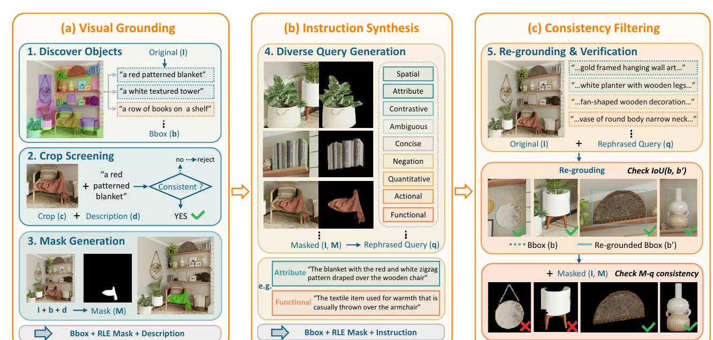
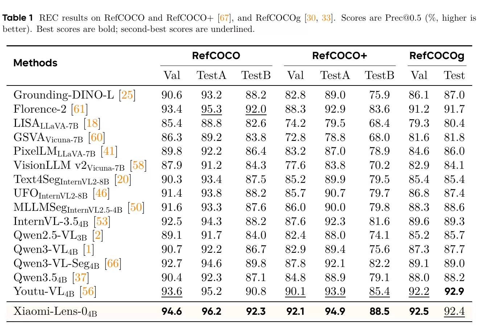
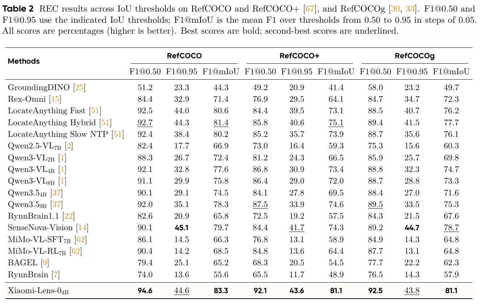
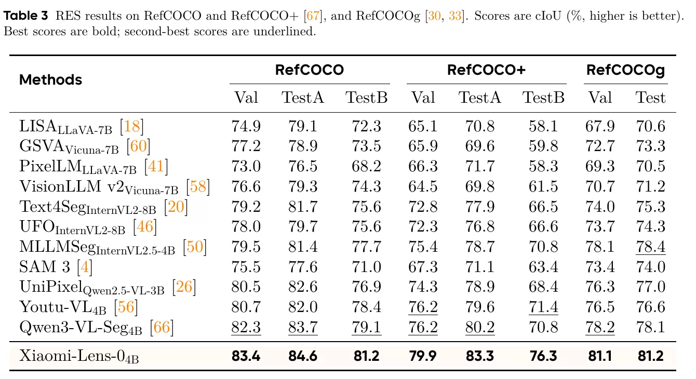
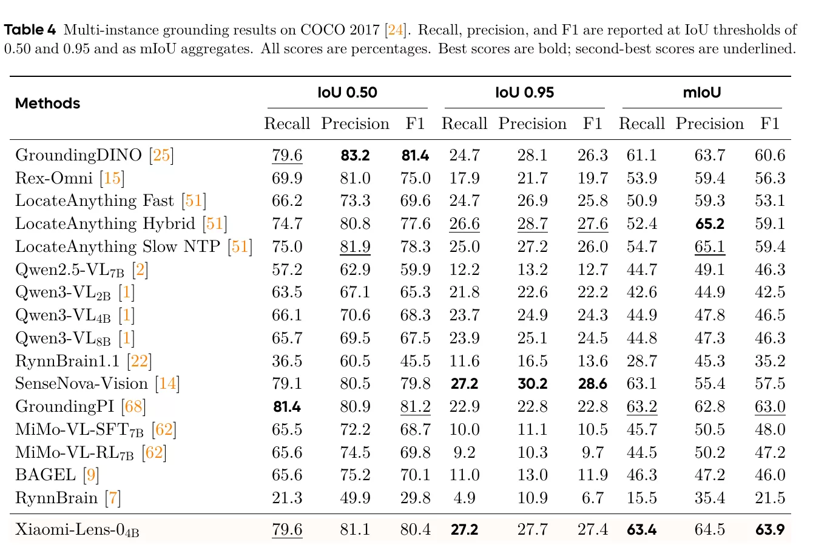
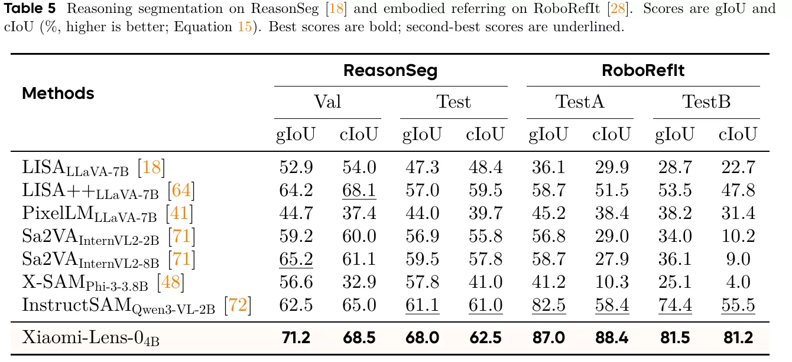
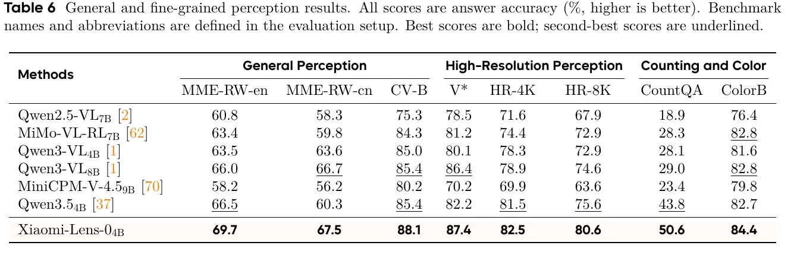
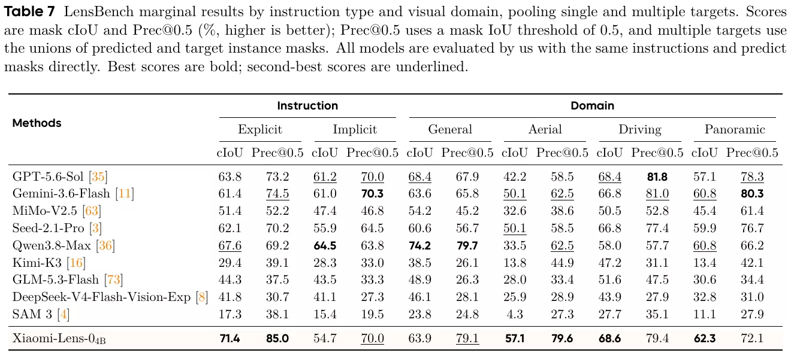
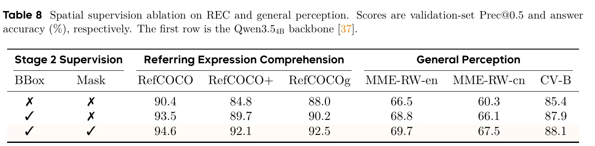
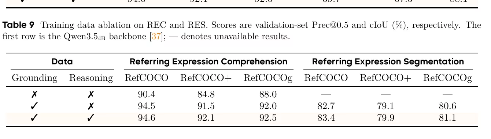

# Xiaomi-Lens-0 Technical Report

- **来源**: arXiv:2610.23279 (https://arxiv.org/abs/2610.23279)
- **参考链接**: 项目主页 https://seerray-lab.github.io/Xiaomi-Lens-0/
- **日期**: 2026-10-16（v1）
- **标签**: `MLLM`, `visual-grounding`, `reasoning-segmentation`, `region-understanding`, `mask-supervision`
- **研究方向**: 多模态大模型 → 区域/像素级理解 → 指代/推理分割
- **作者**: Xiaoai Plus, SeerRay Team（Xiaomi）
- **提交日期**: 2026-10-16（v1），2026-10-19（v2）
- **会议/期刊**: arXiv 技术报告（非会议）
- **代码**: https://github.com/SeerRay-Lab/Xiaomi-Lens-0

---

## 摘要

**问题**: MLLM 对整图问答好，但细粒度区域理解弱（数错邻近物体、认错小区域属性）。根因是**纯文本监督**：图像只是条件输入，训练信号全来自文本答案，不明确"哪些区域支撑答案、区域延伸到哪"。分割掩码能提供显式空间目标，但现有 RES 方法要么用额外分割编码器（LISA/Sa2VA 用 SAM 系、Qwen3-VL-Seg 用轻量补充图像编码器），要么从自身视觉特征解码但**冻结视觉编码器**，掩码损失到不了共享表征。

**方案**: Xiaomi-Lens-0，基于 **Qwen3.5** 的 **4B MLLM**，直接从自身视觉表征预测掩码。
- 取 vision encoder 在 **spatial merger 之前**的 `patch grid`（保留 patch 分辨率），与一个轻量 `mask decoder` 结合；
- 在输出词表加特殊 `<|mask|>` token，其在第 k 次出现时的上下文状态称为 **visual latent**，作为查询去问 `patch grid`"哪里是该区域"；
- **联合语言 + 掩码监督**：掩码损失经 patch 特征 F 回传 vision encoder、经 mask token 状态 $m_k$ 回传 LM，从而在"与语言生成共享的表征"里直接监督区域范围；
- **Thinking with visual latents**：推理时把文本推理与 `<|mask|>` token 交错，每个 latent 解码成掩码，使 CoT 中引用的中间区域可被掩码显式落地、可检查；用 **grounded reasoning traces**（中间区域引用配掩码）做监督，把像素级监督扩展到 CoT 中间区域。

**验证**: 六个任务（REC / RES / 多实例定位 / 推理分割 / 具身指代 / 细粒度感知）。RefCOCO/+/g 八 split 上 REC 相对 Qwen3.5 backbone 平均 +5.6（RefCOCO+ 上 +7.6）；RES 八 split cIoU 全榜第一（均值 81.4，超最强基线 Qwen3-VL-Seg4B 的 78.6，超 SAM 3 达 7.0–12.9）；COCO 2017 多实例定位 mIoU-F1 第一（63.9）；在所有细粒度感知基准上超 backbone。LensBench 在 aerial/driving/panoramic 三域 cIoU 第一（implicit 指令仍难，panoramic 多目标尤甚）。

---

## 1. Introduction（引言）

视觉定位（visual grounding）是 MLLM 基础能力，REC/RES 直接评测。但当前 MLLM 细粒度区域理解弱（邻近物体数错、小区域属性认错），归因于纯文本监督：图像只作条件、信号全来自文本答案，不指定"哪些区域支撑答案、区域延伸到哪"。分割掩码提供显式空间目标，但现有 RES 方法：LISA/Sa2VA 用额外层级分割编码器，Qwen3-VL-Seg 融补充图像编码器多尺度特征；PixelLM/MLLMSeg 从自身视觉特征解码但**冻结视觉编码器**，掩码损失到不了共享特征。且两路都把掩码监督仅当分割手段、只在 RES/grounding 评，未探索其能否改善细粒度感知与视觉推理。

本文问：密集掩码监督能否通过让 MLLM 从自身表征预测掩码，来改善细粒度感知与视觉推理。

Xiaomi-Lens-0 的四大贡献：
1. **从共享视觉表征预测掩码**：4B MLLM，从 vision encoder 的 `spatial merger` 之前的 `patch grid` + LM 产生的 `visual latent` 解码区域掩码，无额外层级编码器/多尺度融合；联合监督直接在共享表征里监督区域范围。
2. **thinking with visual latents**：文本推理与 `visual latent` 交错，`mask decoder` 把 latent 映成掩码；构建 grounded reasoning traces，把像素级监督扩展到 CoT 中间区域。
3. **LensBench**：人工审校的指代基准，单/多目标 × 显/隐指令跨 general/aerial/driving/panoramic 四域，支持目标选择与掩码预测配对比较。
4. **掩码监督也改善感知**：在所有细粒度感知基准上都超过 backbone；消融显示，在 box 监督之上再加掩码，还进一步改善了三个通用感知基准与 RefCOCO 系列的 REC 验证集。

---

## 2. Method（方法）

Xiaomi-Lens-0 不接任何额外的分割编码器，直接从 MLLM 自己的视觉表征预测掩码。它与现有方法最大的不同是：掩码损失能回传到**和语言生成共用的一组视觉特征与状态**，所以区域范围的监督既改善定位、也改善细粒度感知，见 §1。

实现上：Qwen3.5 的视觉编码器在把特征送进 LM 前，会先做一个 s×s 的 **spatial merger**（把相邻 patch 合并成更少的 token、压低序列长度）。本文利用这一步**前后**的两份特征：

- **post-merge 的 `merged tokens`（V）** 喂给 LM 做语言生成；
- **pre-merge 的 `patch grid`（V₀，未降采样的全分辨率 patch 特征）** 喂给轻量 `mask decoder`。

解码器再把这份网格与 LM 在 `<|mask|>` 处的 `visual latent` 结合，联合训练时掩码损失通过它同时更新编码器和 LM。

### 2.1 Mask Prediction from Shared Visual Features（从共享视觉特征预测掩码）

LISA/Sa2VA 的空间特征来自额外层级分割编码器，Qwen3-VL-Seg 融补充图像编码器多尺度特征。这些设计下 MLLM 自身视觉表征不必编码掩码损失监督的区域细节。为直接监督共享表征，本文从 `spatial merger` 之前的**单一 `patch grid`** 解码掩码，无额外编码器/多尺度融合，保留 encoder 的 patch 分辨率，给掩码损失一条直达"用于语言生成的视觉特征"的路径。

ViT `patch grid` 提供空间索引特征。残差结构使最终表征 = 初始 patch 特征 + 逐级变换（式 1）：

$$x_L = x_0 + \sum_{l=1}^{L} F_l(x_{l-1})$$

恒等映射保留早层细粒度信号不被高层语义覆盖。LongCat-Next 将此形式化为 intrinsic information recovery（随机初始化的 ViT 甚至比预训练版重建更好，说明可恢复性来自网络结构而非学习到的语义）。QwenViT 无 `spatial merger` 时像 plain ViT 保留单一 patch 分辨率、仍能恢复粗结构，而 `spatial merger` 因激进下采样丢弃细粒度高频细节。因 `patch grid` 取自 pre-merge，它既保留掩码所需的空间结构，又是 encoder 共享计算的一部分。故把它喂给 `mask decoder`，并用 LM 的 region-specific 上下文状态作查询。单一共享网格即可支持多个掩码预测。

### 2.2 Model Architecture（模型架构）

#### 2.2.1 Shared Visual Features and Visual Latents（共享视觉特征与视觉潜变量）

给定图像 $I \in \mathbb{R}^{3\times H\times W}$，vision encoder $E_v$ 产生 patch 特征网格（式 2）：

$$V_0 = E_v(I) = [v_1,\dots,v_{N_p}] \in \mathbb{R}^{N_p\times d_v},\qquad N_p = h_v w_v$$

依 Qwen3.5 主干，一个 $s\times s$ spatial merger 把相邻 patch 特征分组，visual projector $\phi$ 把 `merged tokens` 映到 LM 宽度 $d_l$（式 3）：

$$V = \phi(\text{Merge}_s(V_0)) \in \mathbb{R}^{N_v\times d_l},\qquad N_v = N_p / s^2$$

自回归 LM 处理 `merged tokens` 与系统/用户 token。解码步 t，LM head 把上下文状态 $h_t$ 映到下一 token 预测。为标记每个掩码解码区域，在输出词表加特殊 `<|mask|>` token；其第 k 次出现（响应位置 $t_k$）的上下文状态 $m_k = h_{t_k}$ 即 **visual latent**。token 身份跨出现共享，但每个状态依赖图像、指令与前序响应，故代表"指令要求的 / 前序响应引用的区域"。一个响应可含多个 mask token，每个提供独立掩码的查询。

#### 2.2.2 Mask Decoding（掩码解码）

mask decoder 对网格 $V_0$ 的每个 patch 打分。一个轻量 Transformer 层先用全局视觉上下文精炼特征，线性投影把每个 patch 映到宽度 $d_m$ 的掩码特征空间（式 4）：

$$F = P_v^\top T_{\text{mask}}(V_0) = [f_1,\dots,f_{N_p}] \in \mathbb{R}^{N_p\times d_m}$$

再把 mask token 状态投影到同空间 $q_k = P_m(m_k) \in \mathbb{R}^{d_m}$，作为对 patch 位置的动态分类器，与 patch p 的兼容性（式 5）：

$$z_{k,p} = \frac{q_k^\top f_p}{\sqrt{d_m}},\qquad p=1,\dots,N_p$$

最后把 $N_p$ 个分数重排回原始 patch 布局，两层层转置卷积上采样得稠密掩码 logit，sigmoid 得掩码（式 6）：

$$\hat M^k = \sigma\!\big(U_{\text{mask}}(\text{Reassemble}_{h_v,w_v}(z_k))\big) \in [0,1]^{H\times W}$$

因所有区域共享同一图像特征，每图只算一次 F，每个 visual latent 只换查询 $q_k$。除共享 vision encoder 外，decoder 仅一个 Transformer 精炼层 + 两个线性投影 + 两层上采样 head。架构见图 2。


*图 2：Xiaomi-Lens-0 整体架构。LM 消费 post-merge 的 `merged tokens`；每个生成的 `<|mask|>` 的上下文状态作为 `visual latent`，经轻量 `mask decoder` 查询编码器 patch-level 特征，patch 级兼容性分数重排回空间网格并两层转置卷积上采样成掩码（论文 Figure 2）。*

#### 2.2.3 Joint Language and Mask Supervision（联合语言与掩码监督）

像素级掩码监督给每个 visual latent 显式目标区域。一个训练样本有 K 个受监督 `<|mask|>` 出现，第 k 个配二值目标掩码 $M^k$。掩码目标结合像素级二值交叉熵与 Dice 损失（式 7）：

$$\mathcal L_{\text{mask}} = \frac{1}{K}\sum_{k=1}^K \big(\lambda_{\text{bce}}\mathcal L_{\text{bce}}(\hat M^k, M^k) + \lambda_{\text{dice}}\mathcal L_{\text{dice}}(\hat M^k, M^k)\big)$$

交叉熵监督单像素，Dice 监督区域重叠。把掩码目标加到 next-token prediction 损失得联合目标（式 8）：

$$\mathcal L = \mathcal L_{\text{ntp}} + \mathcal L_{\text{mask}}$$

联合训练时，掩码损失经 F 回传 vision encoder、经 $m_k$ 回传 LM，而 $\mathcal L_{\text{ntp}}$ 监督响应序列。区域范围因此须编码进共享图像特征与识别目标的上下文状态。因文本答案也由这些表征生成，掩码监督也改善细粒度感知，见 4.4 节。

#### 2.3 Thinking with Visual Latents（以视觉潜变量思考）

因每个 visual latent 是 LM 的上下文状态，mask decoder 也解码推理中产生的 visual latent。thinking with visual latents 中，响应把文本推理与放在区域引用处的 `<|mask|>` token 交错；每个 token 的上下文状态代表前序文本讨论的区域，decoder 把它映成共享图像网格上的掩码。举例来说，计数 trace 给每个实例一个 latent，空间比较给被比较的两个物体各一个 latent，每个 latent 都绑定一个显式图像区域。用 **grounded reasoning traces**（区域引用配目标掩码）监督这些中间区域，细节见 3.2：next-token 损失监督推理文本、空间引用与最终答案，掩码损失监督每个标注区域的范围。式 8 的联合目标因此同时监督最终分割目标与 CoT 中间区域。推理/思考示例见图 6。


*图 6：thinking with visual latents。与文本推理交错的 `<|mask|>` 各自解码成掩码，使 CoT 中间区域引用可检查、可对齐；计数、空间比较等 trace 为每个被引用区域各给一个 latent（论文 Figure 6）。*

推理时，掩码解码是伴于自回归生成的输出分支：后续文本以图像与前序响应 token 为条件，不把 crop/区域特征回灌 LM；故解码掩码使中间陈述背后的区域可检查，训练把像素级监督扩展到代表这些区域的 visual latent。

### 2.4 Training Recipe（训练配方）

两阶段。Stage 1 预训练 mask decoder 把冻结表征映到区域；Stage 2 联合微调 backbone 与 decoder。图 3 总结数据混合；其中作者内部收集、未公开的数据见第 3 节，为指代目标与 grounded reasoning traces 的中间区域提供掩码。

#### 2.4.1 Stage 1: Mask Decoder Pretraining（掩码解码器预训练）

冻结预训练 backbone，只用式 7 优化 mask decoder，使其从固定图像特征与 visual latent 解码区域。训练时把内部收集、未公开的数据与公开数据混在一起，公开部分包括 Objects365、LVIS、PACO、PhraseCut 和 RefCOCO 系列，覆盖物体、部件、指代表达式，让 decoder 在联合适配前先接触不同尺度和特异度的区域。

#### 2.4.2 Stage 2: Supervised Fine-Tuning（监督微调）

解冻 backbone，用式 8 优化全模型：语言损失监督响应序列，掩码损失更新共享视觉特征与 visual latent。数据把内部收集、未公开的指代表达式与 grounded reasoning 样本，同 COCO 2017、RefCOCO 系列、RoboRefIt、ReasonSeg 混在一起。

---

## 3. Data Pipeline（数据管线）

数据管线提供第 2 节用的两种区域监督，两条管线都在采纳伴随语言前先修订/验证区域标注：

- **指代数据**：把指令与最终目标掩码配对，监督 REC/RES 输出，细节见 3.1；
- **grounded reasoning 数据**：把掩码贴到 CoT 中间步骤引用的区域，监督 thinking with visual latents，细节见 3.2。

随后给出 LensBench，见 3.3：它随指令语义、目标基数、视觉域变化评测目标选择与区域范围。

### 3.1 Referring-Expression Training Data（指代训练数据）

指代数据给 REC/RES 显式区域目标：先给每个候选物体定 box + mask，再生成描述它的指令，最后验证每条指令是否选中标注区域（图 4）。



*图 4：RES 数据管线。(a) 视觉定位：object discovery 返回 box 与短描述并做 crop–text 验证；(b) 指令合成：为每个候选物体生成指代指令；(c) 一致性过滤：验证指令是否唯一选中标注区域（论文 Figure 4）。*

#### 3.1.1 Visual Grounding（视觉定位）

物体发现返回 box $b_i$ 与短描述 $d_i$；生成掩码/指令前，crop–text 检查 $V_{\text{crop}}(X,t)\in\{0,1\}$ 先验证每个描述对其 crop。接受候选（式 9）：

$$C_I = \{(b_i,d_i)\in D(I): V_{\text{crop}}(\text{Crop}(I,b_i), d_i)=1\}$$

对每个 $(b_i,d_i)\in C_I$，掩码生成得 $M_i = S(I,b_i,d_i)$。

#### 3.1.2 Instruction Synthesis（指令合成）

从目标外观与场景上下文生成指代指令。对每个保留目标，masked view $I\odot M_i$ 保留目标像素、背景置黑；生成器收此 view 定位指称对象、收原图描述其与周遭物体关系（式 10）：

$$Q_i = \{q_{ij}\}_{j=1}^{K_i} = G(I, I\odot M_i)$$

表达式通过位置/外观/动作/功能或邻物对比识别目标（如毯子可由花纹或"保暖用途"描述）；简洁描述、否定、数量引用（在计数组中区分某物体）进一步丰富措辞，同时保留单一标注目标。

#### 3.1.3 Consistency Filtering（一致性过滤）

保留在定位与语义上都契合目标的指令。在原图 re-grounding 每个 $q_{ij}$ 须恰好返回一 box $R(I,q_{ij})=\{b'_{ij}\}$，其与候选 box 的 IoU 过阈值；另用单独检查 $V_{\text{ref}}(I, I\odot M_i, q_{ij})$ 评表达式是否唯一描述目标及其上下文关系（式 11）：

$$Q_i = \{q_{ij}\in Q_i : R(I,q_{ij})=\{b'_{ij}\},\ \text{IoU}(b_i,b'_{ij})\ge\tau,\ V_{\text{ref}}(I, I\odot M_i, q_{ij})=1\}$$

语义检查筛掉"引用邻近实例/目标缺失属性"的表达，补足 box 重叠准则。每个保留指令的最终 box 是掩码紧框 box($M_i$)；样本 $(I, q_{ij}, \text{box}(M_i), M_i)$ 把同一指称对象配 box 与像素级监督。

### 3.2 Grounded Reasoning Data（带 grounding 的推理数据）

Grounded Reasoning 数据用来监督 thinking with visual latents 引用的中间区域，见 2.3，专门针对细粒度区域失败：把挨着的物体数错、把小区域的颜色或属性认错。每个 VQA 样本把一张图、一个问题，配上一条推理 trace、一个最终答案，以及 trace 所引用区域对应的掩码。

制作分三步：先合成问答对，再独立验证答案，最后生成带掩码标注的推理 trace，见图 5。这样空间监督就从只标最终答案，扩展到也标注推理过程中提到的每个区域。

#### 3.2.1 Question–Answer Synthesis（问答合成）

合成计数、属性、空间关系三类问题，它们都必须看清特定区域才能回答。先从图像里筛出可用的区域标注，再给保留的每个框一个临时 ID，方便区分长得很像的实例、或把几个区域的信息合在一起提问。然后让 MLLM 出题，答案统一做成选择题或数值题；这样后面判对错时可以直接精确比对。

#### 3.2.2 Question–Answer Verification（问答验证）

生成 trace 之前先把答案核准，分四步：

- **规则过滤**：删掉格式错误或重复的选项、意思几乎重复的问题，以及会把答案泄露出来的措辞。
- **打乱选项**：把多选题的选项顺序随机化，去掉"正确答案总固定在某个位置"这种捷径。
- **独立复核**：让另一个 checker 重新作答，它看不到参考答案；只有当问题本身点名了某个区域时，才把那个区域提示给它，其余全靠重新看图来判断。
- **判对错**：checker 选出的选项标签或算出的数值，必须与参考答案完全一致，这道题才保留。

#### 3.2.3 Trace Generation and Mask Annotation（Trace 生成与掩码标注）

生成推理 trace：正文要显式引用图像里的区域，并以答案收尾。对每个已通过验证的样本，推理模型产出若干条候选 trace，其中文字描述与 `<bbox>` 框引用交替出现。然后按三条筛掉不合格的 trace：

- 只保留内容完整、每个框引用都有效、且答案与参考答案一致的 trace；
- 若有多条都通过，选最短的那条，去掉啰嗦的步骤；
- 一条都不通过，就把这个样本整个丢掉。

选定 trace 后，给每个被引用的框配一个实例掩码：优先用现成的，没有就调用 SAM 3 生成。掩码要够准才采纳：它的紧框与被引用框的 IoU 必须超过阈值。通过后，在该框引用的后面追加一个 `<|mask|>` token；经式 7，这个 token 的上下文状态就成为受该掩码监督的 visual latent。

### 3.3 LensBench（基准）

现有指代基准（如 RefCOCO）把每条表达式配日常照片里的单一目标、通常直呼类别。LensBench 考察"指令间接描述目标、要求多个实例、或来自不同视觉域"时目标选择与掩码预测如何变化，覆盖 general/aerial/driving/panoramic 四域，每域 300 个完整评测单元。每单元配一张图、两个目标掩码、四条指令（单/多目标 × 显/隐措辞，图 7）。基准共 1,200 个配对单元、4,800 条指令级样本。

#### 3.3.1 Benchmark Design（基准设计）

每单元把"请求实例数"与"描述方式"解耦。Single 指令选一实例，Multiple 指令选至少两不同实例。Explicit 指令直呼类别并用属性/关系/数量定目标集；Implicit 指令通过功能/用途/常识关系描述、省去类别与直接同义词，使选择需图像支撑的推断。对图 I，令 G 为同类别目标实例集（$|G|\ge 2$），$f\in G$ 为可区分焦点实例；目标掩码（式 12）：

$$M_{\text{single}} = M_f,\qquad M_{\text{multiple}} = \bigvee_{i\in G} M_i$$

每掩码生成一条 explicit + 一条 implicit 指令，同基数下两指令类型共享同一 GT 掩码，支持配对比较。

#### 3.3.2 Benchmark Construction（基准构建）

先定目标实例与掩码再生成指令。候选标注走 3.1.1 的 visual-grounding 流程；实例筛选验证身份与可见范围、解重。掩码以无损 RLE 存原始分辨率。

#### 3.3.3 Consistency Filtering（一致性过滤）

自动筛查检查三类一致性，全部通过才入选：

- **掩码检查** $V_{\text{mask}}(u)$：评身份与可见范围、检重复物理实例、验各掩码并集；
- **指令检查** $V_{\text{ref}}(u,q)$：用单/并集掩码评措辞是否自然、自洽、精确、符合显/隐条件；
- **独立 re-grounding** $R(I,q)$：只收原图+指令（无目标标注），输出保留重复预测；一对一最大化 IoU 匹配预测 box 到目标实例（$b'_{qi}$ 为分给实例 i 的预测），$\delta_q$ 计相同归一化预测 box 对数。

意图实例集单目标为 $\{f\}$、多为 G；以上检查过阈值 $\tau$ 且全部通过（式 14）：

$$\mathcal Q_u = \Big\{q\in\mathcal Q_u : |R(I,q)|=|G_q|,\ \delta_q=0,\ \min_i \text{IoU}(b'_{qi}, \text{box}(M_i))\ge\tau,\ V_{\text{mask}}(u)=1,\ V_{\text{ref}}(u,q)=1\Big\}$$

单元须四条指令全过才过自动筛查；不确定判断与失败请求单独记录供人工审。人工审最后对每完整单元做选择/修订：同看原图、各实例掩码、两目标掩码、四指令，查目标完整性与指令–掩码一致性；仅完整四样本单元 $W$ 进入 LensBench，保留配对比较。每样本 $(I, q, \text{box}(M_q), M_q)$，$M_q = \bigvee_{i\in G_q} M_i$。

---

## 4. Experiments（实验）

实验检验第 1 节问题：从 MLLM 自身视觉表征预测的掩码做密集掩码监督，能否改善细粒度感知与视觉推理。三问：

- **(1) 空间预测**：无额外空间特征编码器，相比用编码器的方案框/掩码预测多好？
- **(2) 细粒度感知**：增益是否扩展到以文本回答的计数/属性/空间关系？
- **(3) 归因**：掩码监督与 grounded reasoning traces 各贡献什么？

4.2 用六任务答前两问，4.3 在 LensBench 看指令语义与视觉域，4.4 答第三问。

### 4.1 Evaluation Setup（评测设置）

覆盖 REC/RES/多实例定位/推理分割/具身指代/细粒度感知；分数均为百分比，差异以百分点报；主结果用三个 Stage 2 checkpoint 等权平均，生成上限 16,384 token。

- REC/RES：RefCOCO/+/g 的 val/TestA/TestB（RefCOCOg 为 val/test）。REC 用 Prec@0.5（预测框与目标框 IoU≥0.5 的比例）；另报 box-grounding 的 F1@0.50/0.95 与 mIoU 均值 F1@mIoU。RES 用 cIoU（同八 split）。
- 多实例定位：COCO 2017，报 recall/precision/F1 @IoU 0.50/0.95 及 mIoU 聚合。
- 推理分割/具身指代：ReasonSeg（val/test）与 RoboRefIt（TestA/TestB），报 gIoU/cIoU（式 15，gIoU 为每图均值 IoU，cIoU 跨数据池化像素交并）。
- 细粒度感知：MME-RealWorld 英/中（MME-RW-en/cn）、CV-Bench（CV-B）、V*、HRBench 4K/8K（HR-4K/8K）、CountQA、ColorBench（ColorB）；皆测答案准确率，无框/掩码输出。
- LensBench，见 3.3：报掩码 cIoU 与 Prec@0.5（按指令类型与视觉域）；多目标用预测/目标实例掩码并集。

### 4.2 Main Results（主结果）

#### 4.2.1 Referring Expression Comprehension（指代理解）

如表 1，Xiaomi-Lens-0 在八个 REC split 上全部超过 Qwen3.5 backbone，七 split 排名第一，只有 RefCOCOg test 略逊最强基线 Youtu-VL4B。增益主要来自 RefCOCO+：它禁用了绝对位置词，实例只能靠外观和属性区分，最难，也提升最多。



*表 1：八个 REC split 的 Prec@0.5。Xiaomi-Lens-0_4B 多数 split 排名第一，普遍高于 Qwen3.5_4B backbone。*

表 2 是跨 IoU 阈值的结果：三个数据集的 F1@mIoU 均排名第一，且 F1@0.95 相对 backbone 大幅提升，说明增益同时来自更准的框放置和正确的目标选择。



*表 2：跨 IoU 阈值 REC（F1@0.50 / 0.95 / mIoU）。三数据集 F1@mIoU 皆第一，F1@0.95 相对 backbone 大幅提升，说明增益同时覆盖框放置精度与目标选择。*

#### 4.2.2 Referring Expression Segmentation（指代分割）

RES 直接检验「不靠额外编码器、只从共享 `patch grid` 解码掩码」能否匹敌那些用额外编码器的方案。表 3 给出答案：八个 split 的 cIoU 全部榜单第一，不仅超最强基线 Qwen3-VL-Seg4B，也超专用分割模型 SAM 3，以及同样「从 MLLM 自身视觉编码器解码」的 MLLMSeg-InternVL2.5-4B。



*表 3：八个 RES split 的 cIoU。Xiaomi-Lens-0_4B 全榜第一，明显高于 backbone，也超专用分割模型 SAM 3。*

#### 4.2.3 Multi-Instance Grounding（多实例定位）

表 4 是 COCO 2017 多实例定位：Xiaomi-Lens-0 的阈值均值 F1 排名第一，超过 GroundingPI 和 GroundingDINO 两个 grounding 基础模型。它的领先来自高 IoU 阈值下更紧的框放置，而不是召回了更多实例。



*表 4：COCO 2017 多实例定位。Xiaomi-Lens-0_4B 阈值均值 F1 第一，高 IoU 阈值下反超 GroundingPI 与 GroundingDINO，领先来自更紧的框放置而非更多召回。*

#### 4.2.4 Reasoning Segmentation and Embodied Referring（推理分割与具身指代）

表 5 覆盖推理分割（ReasonSeg）与具身指代（RoboRefIt）：这两类任务上 Xiaomi-Lens-0 的 gIoU/cIoU 都排名第一，超过最强基线 InstructSAM。



*表 5：ReasonSeg 与 RoboRefIt 的 gIoU/cIoU。Xiaomi-Lens-0_4B 各 split 均第一，超过最强基线 InstructSAM。*

#### 4.2.5 Fine-Grained Perception（细粒度感知）

为检验增益是否扩展到空间输出之外，表 6 用八个只答题、不输出框或掩码的感知基准，考察第 1 节指出的区域级失败。Xiaomi-Lens-0 在这八个基准上全部超过它的 Qwen3.5-4B backbone 和所有其他对比开源模型，其中在三个高分辨率基准上还额外超过 Qwen3-VL8B。



*表 6：通用与细粒度感知（答案准确率）。Xiaomi-Lens-0_4B 在八个基准全部第一，说明掩码监督改善的是共享视觉特征，而非只是空间输出。*

### 4.3 LensBench Results（LensBench 结果）

表 7 让模型在指令语义、目标基数、视觉域都变化时预测区域，覆盖四个视觉域。Xiaomi-Lens-0 在其中三个域（aerial、driving、panoramic）的 cIoU 排名第一，aerial 提升最大；只有 general 域由 Qwen3.8-Max 领先。



*表 7：LensBench 边际结果（cIoU / Prec@0.5），合并单/多目标。四域中三域 cIoU 第一，general 域由 Qwen3.8-Max 领先。*

不过 implicit 指令仍明显难于 explicit：模型在 explicit 上排第一，换成 implicit 就掉到中游；把「间接描述」和「多目标」叠加时跌落最大，panoramic 多目标最明显。可见「用间接语言同时指出多个目标」仍是没解决的难点。

### 4.4 Ablation Study（消融）

消融把增益归因于第 2 节两组件。BBox-only 变体在同 Stage 2 数据上关掩码损失，隔离像素级掩码监督；Grounding-only 变体保留掩码监督但省 grounded reasoning 数据，隔离 thinking with visual latents；两表都含原 backbone 作参考。

**掩码监督与感知**（表 8）：只用 box 监督就已较 backbone 改善 REC 与感知；在同样的数据上再加掩码监督，六项指标都进一步提升。两个变体只差掩码损失这一项，所以这份额外提升直接回答第 1 节的问题：在 MLLM 自身表征里监督区域范围，既改善框定位，也改善靠文本作答体现的细粒度感知。掩码监督在 RefCOCO+ 这类须靠外观或形状、从相邻物体中区分目标的场景帮助最大。



*表 8：空间监督消融（Box-only vs 全模型）。仅 box 监督已较 backbone 提升 REC 与感知，再加掩码监督后两类指标进一步上升。*

**Takeaway 1**：掩码监督提供 box 之外的目标范围信息，在须靠外观消歧时帮助最大；其在通用感知基准上的增益说明它改善了共享视觉特征。

**Grounded reasoning traces**（表 9）：只喂 grounding 数据的 Grounding-only 变体就已取得很强的指代性能；在此之上加入监督中间区域的 grounded reasoning traces，REC 和 RES 再小幅提升。增益集中在掩码质量：每个数据集上 RES 的改善都不小于 REC 的改善。



*表 9：训练数据消融（Grounding-only vs 全模型）。Grounding-only 已得强指代性能，加 grounded reasoning traces 后 REC 与 RES 再升，增益集中在掩码质量。*

**Takeaway 2**：grounding 数据驱动大部分指代增益，grounded reasoning traces 主要锐化最终掩码；监督中间区域从而精炼区域范围。

---

## 5. Related Work（相关工作）

- **MLLM 中的 visual grounding**：Shikra、Ferret、CogVLM、Florence-2 等把 grounding 表示成文本流里的 box 坐标，空间监督只能靠这些坐标 token 传进模型，被指区域的范围始终是隐式的。Youtu-VL 把自回归监督从语言扩展到视觉目标。RES 要求输出像素级掩码，从而把区域范围显式化。
- **用 MLLM 做分割**：多数系统都从一个专用分割器取空间特征：LISA 用生成的 token 条件化一个基于 SAM 的分支，LISA++ 增加实例感知输出，GSVA 处理多目标或空目标；GLaMM 与 OMG-LLaVA 把掩码和 grounded 对话交错在一起；Sa2VA 把 MLLM 与 SAM 2 结合，同时支持图像和视频；Seg-Zero 训练一个推理模型去提示一个冻结的分割器；InstructSAM 学习可并行的实例查询来条件化 SAM 3；Qwen3-VL-Seg 则用一个轻量补充编码器替代分割器，再配合多尺度特征融合、box 引导解码和迭代掩码精炼。另一条路线不引入额外分割器，而是从 MLLM 自身的表征或输出接口派生空间预测：PixelLM 从视觉编码器的多层特征解码掩码，MLLMSeg 从浅层视觉编码器特征出发、融合语言模型的视觉 token 再解码（这两者都冻结视觉编码器）；ClawMachine 用一组视觉 token 表示被指代的实体，PaDT 把由 patch 派生的 reference token 映射成框或掩码；Text4Seg 把分割表示成文本描述，UFO 把语言接口和 embedding 检索结合。这两条路线主要用分割和 grounding 来衡量掩码监督的收益；本文关心空间预测之外的效果，只从共享视觉编码器的单个 `patch grid` 解码掩码，并检验这份监督是否也能改善细粒度感知（用文本答案来测）。
- **grounded 与 visual latent 推理**：细粒度视觉推理常常需要全局描述之外的细节。为了抓住这些细节，Cambrian-1 用一个空间感知连接器融入高分辨率特征；V\* 主动搜索相关区域；Divide-Conquer-Combine 用文本摘要处理高分辨率 patch。OpenAI o3 靠裁剪、缩放等图像变换来「用图像思考」；DeepEyes、Pixel Reasoner、Chain-of-Focus、Mini-o3 则在视觉搜索中学习或控制这类图像交互。与这些图像交互互补，另一批工作要么显式地把推理的中间步骤 grounding 到区域上，要么用视觉形式承载中间步骤：Visual CoT 监督中间的 box 引用，UniPixel 把中间的掩码指针连到以物体为中心的推理；Mirage 在多模态推理中把 `visual latent` token 与文本交错，LVR 在视觉嵌入空间里推理。thinking with visual latents 把这些方向串起来：每个区域引用产生一个 `visual latent`，共享的 `mask decoder` 把它映射成掩码，而这个 latent 上的掩码损失会更新 backbone。于是中间区域既获得像素级监督，又能通过解码出的掩码被检查。

---

## 6. Conclusion（结论）

提出 Xiaomi-Lens-0：一个 4B MLLM，从共享 `vision encoder` 的 `patch grid` 和 `visual latent`（生成 `mask token` 时的 LM 状态）解码区域掩码。掩码损失因此能回传到语言生成所用的视觉表征；thinking with visual latents 又把这份像素级监督扩展到 grounded CoT 每一步点名的区域。

以下结果都在不额外引入空间编码器的前提下取得：

- RES：八个 split 的 cIoU 全部第一；
- REC：八个 split 全部超过 Qwen3.5 backbone；
- COCO 2017 多实例定位：阈值均值 F1 第一；
- 细粒度感知：每个基准都超过 backbone。

消融显示，BBox-only 对比坐实这些进一步增益来自掩码监督，grounded reasoning traces 则再抬 REC/RES。在自建的 LensBench 上，aerial/driving/panoramic 三个域的 cIoU 第一，但 implicit 指令仍难，尤其 panoramic 多目标。

附录 A 给对话格式与示例；附录 B 给定性分析，覆盖 RefCOCO 与多实例定位、功能描述的 grounding、杂乱场景下的目标选择、空间比较与颜色识别、逐实例计数等，都展示 visual latent 如何把推理中点名的中间区域落到可检查的掩码上。

---

## 个人评价

**核心价值**: 这篇把"密集掩码监督能否反哺 MLLM 的细粒度感知与视觉推理"这个被忽视的问题系统性地回答了，并指出关键机制：**不靠额外分割编码器、而是让掩码损失直达共享视觉表征**。这与我们笔记里 WeDetect / WeVisOne-VL / Rex-Omni 那条"检索式/生成式感知"线互补：那些是检测/分割模型的区域理解，Xiaomi-Lens-0 是 MLLM 原生地把"指哪、说哪、数哪"都落到像素监督。对"无人机影像回溯 / 遥感小目标 / 低空感知"等需要细粒度区域问答的场景，visual latent 把推理中引用的区域显式解码成掩码、使中间步骤可检查，是个可直接借用的范式。

**可借鉴点**:
- **掩码损失直达共享表征**：把分割监督当成让区域范围进入语言生成共享特征的手段，而不只是为分割任务服务。凡是答案需要先定位到具体区域才能回答的 MLLM 任务，比如计数、属性、空间关系，都可以加这一路监督。它几乎不增加推理开销，因为 decoder 只是一个 Transformer 层加两层上采样。
- **thinking with visual latents**：把 CoT 中间步骤引用的区域也解码成掩码并加以监督，让推理过程可检查、可对齐。这个思路可以迁移到需要多步空间推理的下游任务，例如在遥感图里数某类目标、比较相邻物体。
- **LensBench 的评测设计**：把单个/多个目标、显式/隐式指令、四个视觉域交叉配成对照基准，专门去挖 implicit 多目标这类难例。这套评测构造值得借鉴。

**实验设计亮点**: 消融把只用 box 监督、再加掩码监督、再加 grounded reasoning 这三层拆开对比，说明两件事：掩码监督改善的是共享视觉特征，reasoning traces 则主要锐化最终掩码。此外，LensBench 用人工审核加自动 re-grounding 来保证指令与掩码一致，避免指令泄漏或目标缺失污染结果。

---

## 疑问解答 (Q&A)

### Q1: Xiaomi-Lens-0 与 LISA/Sa2VA/Qwen3-VL-Seg 在"掩码怎么来"上的本质区别？

**答**: 后三者都靠额外的编码器来取空间特征：LISA 和 Sa2VA 用基于 SAM 的层级分割编码器，Qwen3-VL-Seg 用一个轻量补充图像编码器做多尺度融合。PixelLM 和 MLLMSeg 虽然从模型自身的视觉特征解码掩码，但冻结了视觉编码器，掩码损失传不到共享特征。Xiaomi-Lens-0 的做法不同：它取 `vision encoder` 在 `spatial merger` 之前、保留 patch 分辨率的 `patch grid`，再拿 LM 在 `<|mask|>` token 处的状态作为 visual latent 当动态查询；掩码损失会经由 patch 特征 F 和 mask token 状态 $m_k$ 同时回传给 vision encoder 和 LM。也就是说，掩码监督直达语言生成所共享的那组表征，这正是它在不增加编码器的情况下还能把掩码增益外溢到通用感知基准的原因。

### Q2: visual latent 到底是什么，一个响应里多个 mask token 怎么各管各的？

**答**: visual latent 就是特殊 `<|mask|>` token 在响应中第 k 次出现时的**上下文状态** $m_k = h_{t_k}$，也就是 LM 在解码步 $t_k$ 的隐状态。`<|mask|>` 这个 token 每次出现都是同一个，但它的上下文状态依赖于当前的图像、指令和前序响应，所以第 k 个状态代表的正是"这条指令要求、或前序文本引用的那个区域"。一个响应里可以有多个 `<|mask|>` token，每个都给出一次独立的掩码查询 $q_k = P_m(m_k)$。所有区域共用同一份图像 patch 特征 F，每张图只算一次；不同的 latent 只是换掉查询 $q_k$ 去和 F 做兼容性打分（式 5），再把结果重排、经两层转置卷积上采样成掩码（式 6）。因此多个 latent 各自绑定不同区域，互不冲突。

### Q3: thinking with visual latents 和普通的"推理时 crop/zoom 看图"有什么区别？

**答**: OpenAI o3、DeepEyes、Pixel Reasoner 这些"用图像思考"的方法，靠的是对图像做裁剪、缩放、变换等图像交互；Visual CoT 监督中间的 box 引用，UniPixel 把中间的掩码指针连到以物体为中心的推理。Xiaomi-Lens-0 的 thinking with visual latents 走的是另一条路：推理时它不把任何 crop 或区域特征回灌给 LM，掩码解码只是自回归生成旁边的一个输出分支。它把文本推理和 `<|mask|>` token 交错，每个 token 的上下文状态天然就代表前序文本正在讨论的那个区域，decoder 再把它映射成掩码。**中间区域因此既能被 grounded reasoning traces 监督，又能通过解码出的掩码被显式检查**，整个过程不需要引入图像变换模块。

### Q4: 论文与代码是否开源？能否复现？

**答**: 代码和权重都已开源。里面有位于 `src/xiaomi_lens/train/` 的训练代码、两阶段启动脚本和示例数据，也有 HuggingFace 权重 `SeerRay-Lab/Xiaomi-Lens-0` 与 LensBench 数据集 `SeerRay-Lab/LensBench`，许可证 Apache-2.0。模型主体继承 transformers 的 `Qwen3_5ForConditionalGeneration`，只额外挂一个 `PixelMaskDecoder`。

复现的主要门槛在数据、不在代码：

- 训练混合里有大量作者内部收集、未公开的数据，Stage 1 和 Stage 2 都用到了，见 图 3；
- 公开可用的只有 Objects365、LVIS、PACO、PhraseCut、RefCOCO 系列、COCO 2017、RoboRefIt、ReasonSeg 等；
- 想完全复现需要自备这些未公开数据，但仓库给了 `examples/train/sample/` 里两条可直接训练的 RefCOCO RES 样本，以及 `make_toy_data.py` 做端到端冒烟测试；
- LensBench 的流程和构建、筛选步骤都描述得很详细，相对更容易复现，见 3.3。

## 代码解读

> **代码仓库**：https://github.com/SeerRay-Lab/Xiaomi-Lens-0 （含在线 Demo）

### 1. 代码结构（目录树 + 简短注释）

```
Xiaomi-Lens-0/
├── README.md / README_CN.md          # 方法/结果/Quick Start（含各任务指标表）
├── infer.py                          # 两阶段推理 + 掩码叠加可视化
├── requirements.txt
├── tools/prepare_base_model.py        # 把 Qwen 原生 <|box_start|>/<|box_end|> 改名为 <bbox>/</bbox>（仅 tokenizer 元数据，权重不变）
├── examples/train/                    # 数据格式文档 + stage1/stage2 YAML + toy 数据生成
│   ├── README.md                      # JSONL / RLE / 0–1000 归一化框 的权威说明
│   ├── stage1.yaml / stage2.yaml
│   ├── make_toy_data.py               # 合成彩色形状 smoke test
│   └── sample/                        # 两条可直接训练的 RefCOCO RES 样本
├── src/xiaomi_lens/
│   ├── constants.py                   # <|mask|> / <bbox> / </bbox> token 定义
│   ├── model/
│   │   ├── modeling_xiaomi_lens.py    # 核心：继承 Qwen3.5，挂 PixelMaskDecoder，做两路监督
│   │   ├── pixel_mask_decoder.py      # PixelMaskDecoder（MaskFormer 风格动态分类器）
│   │   ├── config.py                  # 由 Qwen vision/text config 推导 decoder 超参
│   │   ├── losses.py                  # MaskLoss：InstructSAM 风格 dice + BCE
│   │   └── lm_loss.py                 # 融合式 Causal LM loss（fused lm_head）
│   ├── train/
│   │   ├── train.py                   # JSONL manifest 训练入口
│   │   ├── trainer.py / collator.py
│   │   └── data/  (preprocess, segmentation, sft_format, jsonl_index, render)
│   └── integrations/vllm/             # 双 vLLM 进程（文本生成 + 掩码池化）serving
├── eval/run.py                        # LensBench 评测（Prec@0.5 / cIoU / gIoU）
└── scripts/train_stage1.sh / train_stage2.sh
```

模型类 `XiaomiLensQwen3_5ForConditionalGeneration`（`modeling_xiaomi_lens.py:65`）直接继承 transformers 的 `Qwen3_5ForConditionalGeneration`，只在上面挂一个 `PixelMaskDecoder` 和 `MaskLoss`。没有改 Qwen3.5 的任何结构，印证论文"不增加层级分割编码器 / 多尺度融合"。下面按论文方法逐点对照。

#### 1.1 共享 patch grid：一次 ViT 前向，两种视图（论文 §2.1 / §2.2.1）

最巧妙处在 `get_image_features` 的返回：`_flatten_image_features` 取 `visual_outputs.pooler_output`（**post-merge** 的特征，作为图像 token 插入 LM 的 image-token 槽位，`modeling_xiaomi_lens.py:94-102`、`_prepare_multimodal_inputs:172-181`），而 `_extract_pre_merge_features` 取 `visual_outputs.last_hidden_state`（**pre-merge** 的 patch 特征，给 `mask decoder` 用，`modeling_xiaomi_lens.py:104-148`）。即同一个 ViT 前向，post-merge 特征喂 LM、pre-merge 特征喂 `mask decoder`。这正是论文说的"从 pre-merge 的单一 `patch grid` 解码掩码，且它与语言生成共享同一组视觉特征"。Qwen3.5 的合并块是 `(merged_h, merged_w, merge_size, merge_size, hidden)`，代码把它 permute 回行主序 `(grid_h, grid_w, hidden)`（patch 尺寸 16px），并校验 `grid_h/grid_w` 能被 `spatial_merge_size` 整除。

#### 1.2 visual latent 提取 + 分组解码（论文 §2.2.2 / Eq 5–6）

`forward` 跑完 LM 拿到 `hidden_states`（B×seq×hidden，`:456-469`）。当传入 `mask_positions`（`<|mask|>` 在 `input_ids` 里的 token 下标，B×K）且图像存在时，进入 `_decode_pixel_masks`（`:197-398`）：
- 每个有效 (b,k) 直接取 `hidden_states[b, pos]` 作为该 `<|mask|>` 的 **visual latent** $m_k$（`:373`）：与论文"第 k 次出现 `<|mask|>` 的上下文状态"一致；
- `<|mask|>` 绑定到其前面最近的 image：当 `mask_image_index` 缺省时，用 `is_vision_start` 的累积和算出每个 mask 对应哪张图（`:510-522`）；
- **分组批处理（关键工程）**：把 (sample, image) 作为 batch 维度（不是 sample）。同一张图上的所有 mask query 共享一次 patch 特征的"投影 + 自注意力"，无论多少个 query 命中它（`:273-289` 的分组逻辑与 `:384-390` 的单次 `mask_decoder` 调用）。这样每卡每前向只调一次 `mask_decoder`，DeepSpeed 的参数集体通信不会因各 rank 的 mask 数量不同而失步；小图按最大 grid 零填充，并用 `patch_key_padding_mask`（True=pad）让自注意力忽略填充 patch（`:325-369`）。

#### 1.3 PixelMaskDecoder：MaskFormer 风格动态分类器（论文 §2.2.2 / Eq 4）

`PixelMaskDecoder`（`pixel_mask_decoder.py:463`）是论文 `mask decoder` 的完整实现，数据流（`pixel_mask_decoder.py:22-27`、`forward:554-611`）：
- `mask_embed`：两层 MLP（llm_hidden→llm_hidden→`embed_dim=32`），把 visual latent 投影成**动态分类器** $q_k = P_m(m_k)$；
- `patch_proj`：Linear(vision_hidden→llm_hidden)；`patch_self_attn`：**单层 pre-norm Transformer，只做 patch 自注意力、无 cross-attn、不上采样**（`:152-187`）：对应论文"一个轻量 Transformer 层精炼特征"；
- `channel_reduce`：1×1 Conv2d(llm_hidden→`channels=256`)，把特征降到掩码特征空间（论文把这一步并进了 $P_v^T T_{mask}$）；
- `upscaler`：两个 stride-2 **转置卷积**（256→128→32），实现 4× 学习上采样；
- 兼容性打分：`mask_logits = einsum("bkc,bchw->bkhw", mask_embedding, pixel_embedding) / sqrt(embed_dim)`（`:603-607`），即论文 Eq 5 的 $z_{k,p}=q_k^T f_p/\sqrt{d_m}$；
- 最后 `_bilinear_interpolate_4x` 做固定 4× 双线性，得到 `(B, K, grid_h*16, grid_w*16)`（`:611`）：2 个转置卷积(4×) + 固定 4× 双线性 = 16×，正好恢复到 ViT 输入画布分辨率（`MASK_CANVAS_SCALE=16`，`modeling_xiaomi_lens.py:46`）。论文只写了"两层层转置卷积上采样"，代码在这里补了"再固定 4× 双线性"，因为 ViT patch=16px。

#### 1.4 联合损失：InstructSAM 风格的 dice + BCE（论文 §2.2.3 / Eq 7–8）

`MaskLoss`（`losses.py:147`）= `dice_weight·Dice + bce_weight·BCEWithLogits`，默认 `dice_weight=1.0`、`bce_weight=2.0`（`:165-176`），并注明照搬 `DCDmllm/InstructSAM`（`instructsam/models/utils.py`）。论文 Eq 7 只写了 $\mathcal L_{mask}=\frac1K\sum(\lambda_{bce}\mathcal L_{bce}+\lambda_{dice}\mathcal L_{dice})$、未给权重，实现取了 InstructSAM 的 1/2。每个 mask 独立算、按 `num_masks` 求平均（DETR/Mask2Former/SAM3 约定）。`_global_num_masks`（`:42-77`）跨 rank all-reduce mask 计数，使 ZeRO 下的 per-mask 梯度尺度一致（N/W 除数），并处理 padding 行（全 0 valid 的 mask 不贡献）。损失在 `forward` 里组装（`modeling_xiaomi_lens.py:559-602`）：`loss = lm_loss_weight·lm_loss + mask_loss_weight·mask_loss`，**负权重即关闭该项**。Stage 1 的 mask-only 训练就是靠 `lm_loss_weight < 0` 关掉 LM 项、同时冻结 backbone 实现的（README："Stage 1 trains the mask decoder and the `<|mask|>` embedding with mask loss alone"）。无 mask 的卡也会跑一次零权重 surrogate 过 `mask_decoder`，以维持 DeepSpeed 梯度规约同步（`:545-557`）。

#### 1.5 thinking with visual latents：`<think>` 内 mask 不算最终答案（论文 §2.3）

代码里 `<|mask|>` 同时出现在推理链和最终答案中，但 `infer.py` 明确区分：`split_answer_content`（`:100-110`）在第一个 `</think>` 处切分，统计 `<think>` 内的 `<|mask|>` 数量 `thought_mask_count`；`run_forward` 解出全部 K 个 mask 的 logits（`:213-268`），最终可视化只取 `pred_masks[:, thought_mask_count:]`（`infer.py:476`）。即 `<think>` 中的 mask 是"推理过程落地的可检查中间区域"，不纳入最终输出。与 README "Masks emitted inside `<think>` ground the reasoning and are not part of the final answer" 一致。

#### 1.6 底座改造：box token 改名 + `<|mask|>` 后加（论文 §2.2.1）

`tools/prepare_base_model.py` 只做一件事：把 Qwen3.5 原生 box 特殊 token `<|box_start|>`/`<|box_end|>` 改名为 `<bbox>`/`</bbox>`（`TOKEN_MAP`，`:43-46`），**只改 tokenizer 元数据，token ID 与权重完全不动**；`<|mask|>` 则由 trainer 在训练时通过 `add_special_tokens` + `resize_token_embeddings` 加入词表（`trainer.py:150-165`），会**新增一行 embedding**。

三种符号里只有 `<|mask|>` 是真正的功能标志：它本身就表示"在这个位置要生成一张掩码"，`infer.py` 用 `mask_token_id` 精确找到每个 `<|mask|>` 在序列里的位置（`mask_positions`）再去跑 mask decoder，所以必须是独占一个 ID 的单个特殊 token。`<bbox>`/`</bbox>` 也要特殊 token，原因是模型必须**可靠地发射**这对定界符去包住坐标文本——基础 LLM 不会稳定吐出 `<`、`b`、`b`、`o`、`x`、`>` 这种标点串，而 Qwen3.5 出厂就带 `<|box_start|>`/`<|box_end|>` 这对专为 grounding 训好的特殊 token（改名 `<bbox>` 即复用它）。相比之下 `<mask>`/`</mask>` 只是 `sft_format.py:46` 里把 `<|mask|>` 裹起来的装饰性外壳，没有任何代码靠 id 或正则去定位它，给它们单独开 token id 纯属浪费词表行，因此用普通文本即可。

### 2. 代码怎么用

#### 2.1 权重
HF 权重：`SeerRay-Lab/Xiaomi-Lens-0`（或 ModelScope 同名）；LensBench 数据集：`SeerRay-Lab/LensBench`。`infer.py` 用 `from_pretrained` 直接加载，bf16 + FlashAttention-2（`:119-139`）。底座 Qwen3.5-4B 需先用 `prepare_base_model.py --in-place` 改名 box token 才能训练。

#### 2.2 推理
两阶段（`infer.py`，README "Quick Start"）：先 `generate_completion` 生成含 `<bbox>` 与 `<|mask|>` 的文本，再 `run_forward` 把整段（prompt+completion）重喂一遍、传 `mask_positions` 解出掩码 logits。示例：
```bash
python infer.py --checkpoint SeerRay-Lab/Xiaomi-Lens-0 --image img.jpg \
  --text 'Locate all instances in the image that match the description "the cat on the left". Report bbox coordinates and masks.' \
  --output result.jpg --draw-bbox
```
框坐标归一化到 0–1000；`--per-mask-output` 每 mask 单独存图；`--mask-threshold` 二值化阈值（0=软热力图）。

#### 2.3 训练 / 微调
两阶段（DeepSpeed ZeRO-1 / ZeRO-2）：
```bash
pip install -e ".[train]"
hf download Qwen/Qwen3.5-4B --local-dir checkpoints/Qwen3.5-4B
python tools/prepare_base_model.py checkpoints/Qwen3.5-4B --in-place
# Stage 1（仅 `mask decoder` + <|mask|> embedding 可训，其余冻结，mask loss only）
MODEL_PATH=checkpoints/Qwen3.5-4B DATA_CONFIG=examples/train/stage1.yaml bash scripts/train_stage1.sh
# Stage 2（全参数 SFT：LM loss + mask loss）
DATA_CONFIG=examples/train/stage2.yaml bash scripts/train_stage2.sh
```
数据格式见 `examples/train/README.md`：JSONL，每行 `messages`/`images`/`segmentation`（COCO RLE；第 k 个 RLE 监督第 k 个 `<|mask|>`）；`<|mask|>` 仅出现在 assistant 轮；框为 0–1000 的 per-mille 整数；assistant 内容以 `<think>\n\n</think>\n\n`（空推理）或带推理开头。`make_toy_data.py` 生成合成数据做端到端冒烟。注意 Stage 1 用 assistant-only 行（user 图轮由脚本自动加）；Stage 2 混合 grounding/VQA/文本行，无 `segmentation` 的行只训 LM loss。

#### 2.4 评测
LensBench：`pip install -e ".[eval]"` 后 `python eval/run.py`，单卡或多卡分片，`--model-path`/`--dataset-path` 接受本地路径，`--backend vllm` 走双引擎。输出 `metrics.json`（Prec@0.5、cIoU、gIoU，整体/分域/显隐/基数）与 `predictions.jsonl`；`--resume`、`--limit N` 可用。

#### 2.5 部署
vLLM 双进程（`integrations/vllm/`）：终端1 跑文本生成 `run_vllm.sh`，终端2 跑掩码解码 `run_vllm_mask.sh`（用 vLLM pooling API），终端3 `python -m ...client` 同时查两个引擎并叠图。client 把图片路径发给 mask 服务，故须与服务器同机；`MAX_PIXELS` 两服务须一致。


#### 2.6 环境坑
- 推理需 CUDA GPU（bf16 + FlashAttention-2）；CPU 环境 `flash_attn` 缺失时解码器注意力自动回退 SDPA（`pixel_mask_decoder.py` 的 `XIAOMI_LENS_DECODER_ATTN`）。
- 依赖：`transformers 5.4`、`flash-attn`、`deepspeed`/`accelerate`（README `requirements.txt`）。
- 训练 `MAX_PIXELS`/画布过大时，解码器自定义 `_ChunkedBilinearInterpolate4x` 会分块以避免 CUDA 单核 INT32_MAX 限制；报错"单 mask 平面超 CUDA 双线性上限"时需调小 `--max_pixels`。
- Stage 1 mask-only 依赖 `lm_loss_weight < 0` 关闭 LM 项；若误设为正会同时训 LM，与"冻结其余"的 Stage 1 设定不符。
- base 模型必须先 `prepare_base_model.py --in-place` 改名 box token，否则 tokenizer 里仍是 `<|box_start|>`。

