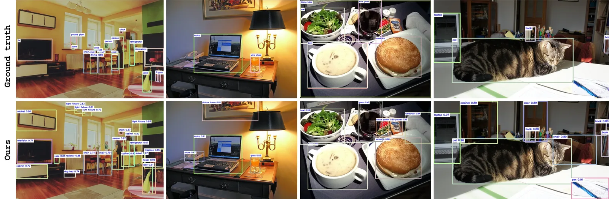
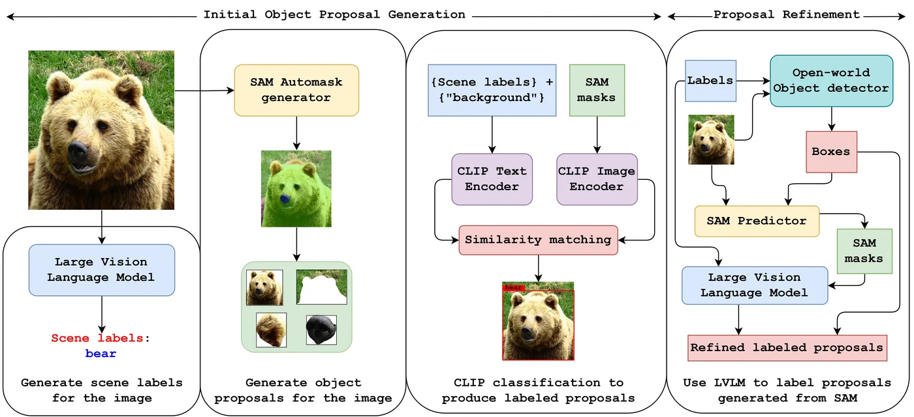
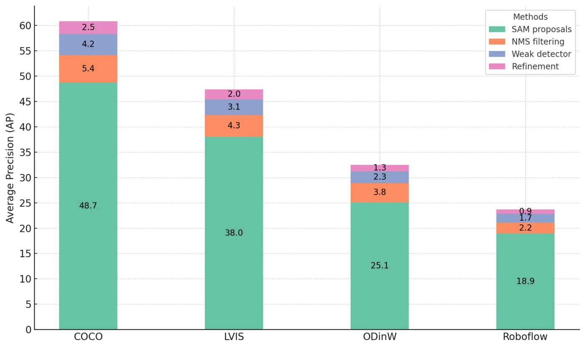

# Annotator-Free Object Detection via Foundation Model Collaboration

- **来源**: https://arxiv.org/abs/2611.06195
- **本地PDF**: `../../raw/2026-11-04-annotator-free-det.pdf`
- **日期**: 2026-11-04
- **标签**: `object-detection`, `annotation-free`, `pseudo-labeling`, `SAM`, `CLIP`, `LVLM`, `open-vocabulary`, `data-engine`
- **研究方向**: 目标检测 → 免标注伪标数据构建 → 开放词汇与开放集检测
- **作者**: Yasiru Ranasinghe, Vishal M. Patel（Johns Hopkins University）
- **提交日期**: 2026-11-04 (v1)
- **会议/期刊**: arXiv preprint（LaTeX 用 WACV 模板，未见录用信息）
- **代码**: 未见开源链接（论文与 LaTeX 源码中均未出现仓库地址）

关联笔记：

- [LAE](../2024/2024-08-17-lae.md)：同为 SAM 出候选加 VLM 打标签的伪标数据引擎，但按面积取 top-K
- [WeVisOne-VL](./2026-10-22-wevisone-vl.md)：多教师融合的数据引擎，检测标注同样靠基础模型协作
- [WeDetect](../2025/2025-12-16-wedetect.md)：objectness 全召回的自标管线，与本篇的 SAM 提案路线正相反

---

## 摘要

**问题**: 目标检测被标注成本和闭集假设卡死。COCO 这类集每张图标注要 5–30 分钟，训出来的检测器只会预定义类别，长尾和新类无力。

**方案**: 只拿目标数据集的图片、不用任何框和标签，让基础模型协作产出伪标：SAM 出分割提案，CLIP 预筛并做初分类，LVLM（GPT-4o 场景级、CogVLM 对象级）给语义标签，再训一个开放的 YOLO-World 检测器，用检测器反过来给 SAM 出框提示、精修提案、重训。

**关键创新/贡献**:
- 免标注管线：分割、视觉语言、LVLM 三路协作，目标数据集零人工标注
- 自精修循环：检测器训练后回灌提案，逐轮提升定位与分类
- 按 CLIP 特征给图像分组，每组只问一次 VLM：图里大量是重复场景，先把相似的图归成组，挑组里最典型的一张问标签，答案复制给全组
- 五个基准的实证：COCO 60.8 AP、LVIS 47.4 AP，均超同规模开放词汇与长尾检测器

**验证**: 主表对比 GLIP-L、GDINO-L、T-Rex2、DetCLIPv3；ODinW-35 32.5、Roboflow-100 23.7；COCO OVD split 新类 55.9 AP50 超 DetCLIPv3 的 54.7；合成域偏移集上超 GDINO-L。

*图 1：上排 GT、下排免标注管线的预测，能补回漏标目标、给出词表外的新类名，同义类名也算检对（论文 teaser）。*

---

## 1. 引言与相关工作

**背景 & 动机**: YOLO、DETR 系检测器精度好但依赖逐实例的框和标签，标注成本让大规模训练不可行；训完又被锁死在预定义类别上。已有的减负路线各有短板：

- 新类检测（RNCDL 等）：无监督能分区，但没验证数据就给不出语义标签
- 广义类发现（GCD、PromptCAL）：做对比聚类，不管定位
- 开放词汇检测（GLIP、GroundingDINO、YOLO-World）：靠视觉语言对齐扩词表，但底座仍是在人工标注数据上训出来的检测器
- 无监督检测与发现（CutLER、FreeSOLO、TokenCut、MaskDistill）：能出掩码，但给不出开放式语义标签
- 区域级图文路线（RegionCLIP、OWLv2、Grounded-SAM）：要么依赖既有检测/grounding 监督，要么依赖整理好的区域-文本对

本文免掉的只有一件事：**目标数据集上的框和标签**。只给图片，不用标，跑一遍管线就出伪标，不审、不校对。

跟 OVD 的差别有两层。标注层：OVD 除了依赖基础模型，还得在基类上用人工 GT 训底座，本文连基类标注都不要。流程层：GLIP、GDINO、YOLO-World 都是在一个几十 M 级的人工标注大池（Objects365、GoldG、网络图文对）上训好，再零样本测目标集；本文是在目标集自己的图（无标注）上产伪标再评测，属于直推设定，比基线多用了目标集的图像信息。

唯一破例的是 COCO OVD split 的对比实验，沿用 OVR-CNN 的划分：COCO 80 类先去掉 15 个 WordNet 里没有同义词集的类（没法做任意文本查询），剩 65 类，再切成 48 基类加 17 新类。老方法在 48 个基类上用 GT 训完再评新类。

只训基类还能检新类，因为分类头拿区域特征跟类名 embedding 点积出分，不是固定类别 logits，词表在推理时自由；训练只教「什么样的视觉区域配什么样的词向量」，学到的是对齐方式而不是某个词。例子：训练只有 horse，推理输入 zebra 时斑马区域特征与马的几乎一样，落在 $\mathbf{e}(\text{horse})$ 附近，CLIP 里 $\mathbf{e}(\text{zebra})$ 与 $\mathbf{e}(\text{horse})$ 也挨得近，分数够高就检出。

**本文贡献**:
1. 免标注检测管线，基础模型与视觉语言模型协作
2. 自精修机制，无标签数据下逐轮提升
3. 模块化设计，可换检测器、可扩到未见类别
4. 五个基准的实证

---

## 2. 免标注目标检测

三阶段：**自标定**（基础模型出框出标签）→ **训练**（开放集检测器吃伪标）→ **精修**（检测器给 SAM 出框提示，LVLM 复核标签）。

*图 2：阶段一 LVLM 给场景标签、SAM 出提案；阶段二 CLIP 给提案分类；阶段三训练后的检测器给 SAM 出框提示、LVLM 复核重标（论文配图）。*

### 2.1 从图片到伪标：要产出三样东西，还要少问 VLM

训练检测器需要三样东西：

- **词**：这张图里出现的若干个类名词。LVLM 看图列出一份自由文本清单，没有预定义类别，跨图汇总成标签字典
- **框**：目标在哪。SAM 出分割掩码，取外接框
- **对应关系**：每个框配哪个词。CLIP 在图文空间里找最近的词

麻烦在第一样：LVLM 一次推理要一秒级，逐提案问会爆炸。所以先做一个省钱步骤——把相似的图归组，每组只问一张：

1. 每图跑 SAM 出掩码。提示是铺均匀网格自动撒点（官方默认每边 32 个，共 1024 个），每个点生成多个掩码候选，再按预测 IoU 与稳定性过滤、NMS 去重。网格密度就是提案上限
2. 按掩码裁出每个目标、背景涂黑，取面积最大的至多 $K=32$ 个
3. 每个裁剪图过 CLIP 图像编码器得 768 维向量（论文叫 landmark 特征）。一张图里几十个目标就对应几十个向量
4. 粗筛（图与图比，便宜）：把每张图的几十个向量先平均成 1 个，用它找整体最像的 75 张当候选，避免两两全比
5. 精算（目标与目标比，细）：在候选里逐个目标配对。A 图每个目标找 B 图里最像的那个算差距，反向再算一遍，两个平均值的均值就是两图距离。这一步保留了「图里有几个不同的东西」的信息，比第 4 步的平均向量更细：

$$
d(i,j)=\tfrac{1}{2}\Bigg(\frac{1}{K_i}\sum_{\mathbf{a}\in Z_i}\min_{\mathbf{b}\in Z_j}(1-\mathbf{a}^{\top}\mathbf{b})+\frac{1}{K_j}\sum_{\mathbf{b}\in Z_j}\min_{\mathbf{a}\in Z_i}(1-\mathbf{a}^{\top}\mathbf{b})\Bigg)
$$

6. 只连真像的邻居，三道门槛：在最近的 k 个里、比本图大多数邻居更近、比全局大多数更近；再要求双方互相认可，剩下的连通块就是一组
7. 每组挑最中心的一张（邻居最多，并列取组内距离和最小），只对它问 LVLM，标签复制给全组
8. 重复 2–3 轮：剪掉坏掩码、重算不确定图的特征、可选重训检测器后再分组

效果：VLM 调用次数从「提案数」降到「组数」，同组标签也更一致。

**框配词**：裁出区域（乘掩码去掉背景，避免框内混进别的类）后过 CLIP，跟候选词逐个算相似度取最高，候选里带 `background` 用来兜掉无效提案：

$$
y_i=\underset{c\in\mathcal{C}}{\arg\max}\ \text{sim}(\boldsymbol{\phi}_b(b_i),\boldsymbol{\phi}_\ell(c))
$$

**VLM 一共被调用在四处**:

| 环节                   | 模型            | 输入                                                                 | 输出                                               |
| ---------------------- | --------------- | -------------------------------------------------------------------- | -------------------------------------------------- |
| 场景级列词表           | GPT-4o          | 整张图加「列出场景中出现物体的通用标签」                             | 一串类名词，如 person、car、table                  |
| 字典归一               | CogVLM          | 新出现的标签列表加已有字典                                           | 用字典里的相近词替换后的列表（television 换成 tv） |
| 对象级配词（精修阶段） | CogVLM          | 目标裁剪图（乘掩码）加「从标签列表里为这个物体挑一个」加该图标签列表 | 一个词，必须来自列表                               |
| 对象级配词（初筛阶段） | CLIP，不是 LVLM | 裁剪图加候选词（场景词表加 background）                              | 每个词的相似度分数，取最高                         |

**这套分组的问题**:

- 超参多且不做敏感性分析：每图 32 个掩码、候选 75 张、三个门槛阈值，换数据集要重调
- 中心图词表覆盖全组只是假设：组里某图有、中心图没列的类配不上词，被当背景丢掉，直接漏标
- 论文没报告组大小分布和组内标签覆盖率，漏标规模未知
- 只适合同机位重复帧；多场景图池是拿漏标换速度

### 2.2 自标定的提案生成

**核心思想**: 三个基础模型互补——SAM 给定位，LVLM 给语义，CLIP 当便宜的中间人做预筛和初分类。

具体处理：

- SAM 自动模式会吐背景、冗余、部件级、噪声掩码，必须清掉
- 先用 CLIP 预筛（阈值 0.5），CLIP 分数还能直接当 NMS 置信度（IoU 阈值 0.6）
- 标为 `background` 的提案丢弃，其余 NMS 去重，剩下的训 YOLO-World

### 2.3 检测器实现

**标签字典**: LVLM 对同类会给不同名字（television 与 tv），造成类别冗余。解法是维护一个从空开始、逐步扩充的标签字典，每次新标签先查字典里有没有同义词，用「把标签列表里的词替换成字典里的相近词」这条指令归一化。字典收敛后**冻结**，防止 LVLM API 的不确定性让标签空间漂移、污染最终数字。这条冻结操作是全文最值得抄的工程细节。

「对象级标签与场景标签对齐」指的是：对象级命名不许自由造词，只能在场景清单与字典的词表里挑。具体调用是，精修阶段把目标裁剪图加「从标签列表里为这个物体挑一个」这条提示送 CogVLM，输出必须是列表里的某一个词；初筛阶段则由 CLIP 打分取最高。必须先收敛词表，是因为检测器分类头拿类名 embedding 做点积，同义词一多，同一类被拆成多个 embedding，训练信号和评测匹配都会碎。

字典最终收了多少词（只给了词云定性，能看到 COCO 80 类加 fence、building、window 这类额外词，具体数量未报）。

训练侧：YOLO-World（MMYOLO/MMDetection），AdamW，lr 0.002、wd 0.05，100 epochs，8 张 A5000，batch 64，颜色、仿射、翻转、mosaic 增强。

### 2.4 提案精修

检测器训完后用场景标签做闭集推理，只考虑字典里的类。拿检测框当 SAM 的框提示，重新分割——这一步把「全图撒点式」的大量噪声提案收敛到真实目标上。提案数大减之后，再让 LVLM 复核 CLIP 给的标签（「从标签列表里挑一个」），最后用精修后的提案重训检测器。

### 2.5 新类检测

推理时先取场景标签，检测器出 ROI、标签、分数，把场景标签拆成已知类和新类。已知类的 CLIP 分数通常更高（预训练偏置），分数低的框按精修流程送 LVLM 重新命名，从而在场景里就地发现新类。

---

## 3. 实验与结果

### 3.1 实现细节

- LVLM：GPT-4o（API，场景级标签与字典生成）、CogVLM（对象级标签与场景标签对齐）。CogVLM 出自智谱，开源，论文未标版本；其 grounding 变体也被 SkyFind 的标注管线使用
- 评测：五个基准——COCO val2017、LVIS minival、ODinW-35、Roboflow-100、COCO OVD split（48 已知 + 17 新类）
- 指标：AP@[.50:.95]，**严格类名精确匹配**，原因是标签字典只保证数据集内部一致，评测用的却是基准官方类名，两套词表没打通

### 3.2 免标注检测主结果

主表数字见下表（零样本设定，不碰测试集 GT）：

| 模型          | 骨干   | COCO val | LVIS |
| ------------- | ------ | -------- | ---- |
| GLIP-L        | Swin-L | 49.8     | 26.9 |
| GDINO-L       | Swin-L | 48.4     | 27.4 |
| T-Rex2 (Text) | Swin-L | 52.2     | 45.8 |
| DetCLIPv3     | Swin-L | 48.5     | 48.8 |
| 本文          | Swin-T | 57.2     | 46.2 |
| 本文          | YOLO   | **60.8** | 47.4 |

换骨干不换管线（Swin-T 57.2 / 46.2）证明增益来自伪标管线：只把骨架换成 Swin-T 重训，分数掉 3.6 / 1.2；COCO 上仍高于所有 Swin-L 基线，LVIS 上低于 DetCLIPv3 的 48.8。LVIS 稀有类上 AP_r 46.1，与 AP_all 47.4 只差 1.3，说明长尾稳健。

GDINO 那一格要对一下账：GDINO 原论文报的 COCO zero-shot 是 Swin-T 48.4、Swin-L 52.5，本文写的是「GDINO-L / Swin-L / 48.4」，要么标错骨干，要么自己重跑但没说明。若按 52.5，它宣称的「比 GDINO 高 25.6%」应降到约 15.8%。LVIS 那格 GDINO 原论文没报，只能是自跑，但表里没标注哪些数字是外部引用。

表里「本文 YOLO」就是 YOLO-World 架构，但成绩来自用目标集伪标重训，和 YOLO-World 原文的跨数据集零样本（LVIS 35.4 AP）不是一个设定，不能理解成「YOLO-World 变强了」。原文也只有 COCO 微调结果（52.9 AP，与 YOLOv8-L 持平），没有 COCO 零样本，预训练含 GoldG 里的 COCO 框，报了也不成立。

60.8 比这个全监督的 52.9 还高 8 分。伪标的框质量不可能优于人工 GT，最合理的解释是训练图与评测图同源：伪标若产自 COCO val，检测器在训练时已见过这些图里每个目标的位置，等于在考卷上练兵，AP 虚高。这个反常差值本身，就是「训练与评测同图」的旁证。

ODinW-35 与 Roboflow-100（考察野外场景）：本文 YOLO 版 32.5 / 23.7，超 T-Rex2 视觉版（27.8 / 18.5）与所有 Swin-L 基线；Swin-T 版 30.1 / 20.8。

### 3.3 新类检测

COCO OVD split：为跟既有 OVD 方法公平对比，本文在 48 个基类上用 GT 训练检测器（其他方法同样待遇），然后考 17 个新类。

新类 55.9 AP50（Swin-T 版 56.3），比最强的 DetCLIPv3（54.7）高 1.2；已知类 64.6、全类 59.1。对照实验：完全走免标注管线（基类也不用 GT），基类 AP50 48.9、新类 55.9——论文自己注明这个 48.9 与表里的 64.6 不可直接比（前者无 GT 监督）。这个对照的价值是证明了「一点 GT 都不用」也能做开放词汇。

### 3.4 消融

按阶段拆增量的柱状图：SAM 提案（含 CLIP 初分类、NMS 前）就已经拿到 COCO 48.7 / LVIS 38.0 / ODinW 25.1 / Roboflow 18.9，这一档本身超过 GDINO-L 的 48.4；NMS 去重 +5.4 / +4.3 / +3.8 / +2.2；弱检测器初训 +4.2 / +3.1 / +2.3 / +1.7；精修 +2.5 / +2.0 / +1.3 / +0.9。

*图 3：四个数据集按管线阶段的累计增益，底段是纯基础模型提案，零训练、零调参（论文配图）。*

**域偏移**: 作者用 Applied Intuition 仿真器自建的私有集，不公开。10 类——已知 car、airplane、bus、truck、bicycle，新类 tank、tractor、helicopter、scooter、excavator。检测器直接推这个仿真集，不在仿真集上训练。结果新类/已知/总 43.7 / 32.8 / 38.8，对比 GDINO-L 38.4 / 26.5 / 33.0。定性上 GDINO 能定位新类但常给错类名，本文分类更一致。图像数量、分辨率、标注方式均未交代，数字不可复现。

**成本**: 提案生成是主要开销，LVLM 每场景约 1–2 秒（全离线）。CLIP 预筛让标注量降到 1/60；按 CLIP 特征分组把每图标注从 15–20 分钟压到约 45 秒（20–27 倍）。

### 3.5 局限

- LVLM 对遮挡、歧义目标的错标会进伪标，直接污染训练
- 定位上限被 SAM 分割质量卡住，低对比、拥挤、细粒度重叠时退化
- 标签对 LVLM 提示措辞敏感，字典只部分缓解
- LVLM 查询仍是主要算力开销，聚类把成本压了两个数量级，但「标签质量换成本」的折中程度没有刻画

---

## 4. 结论

**总结**: 本文的主张是「目标数据集免标注」这条路可行：基础模型协作加自精修，能把零标注适配做到超过同规模零样本 OVD 与长尾检测器，且在域偏移下稳住。

---

## 个人评价

**核心价值**: 把伪标数据引擎的完整闭环写清楚了：提案（SAM）→ 初筛与分类（CLIP）→ 场景语义（LVLM）→ 训练 → 回灌精修。其中两条最值得抄：标签字典收敛后冻结，防 API 不确定性让最终数字漂移；按 CLIP 特征分组，只在每组的中位图查 LVLM，查询量从提案级降到组级。

**可借鉴点**（对照低空 OVD 计划）:
- **按 CLIP 特征分组省 VLM 查询**：我们 COD 管线要 VLM 给每条框写层级标签，30–40 人天里 VLM 调用是硬成本。这篇的做法可借一半：场景级词表发现和一致性可以按组传播，逐框穷尽框不行，得逐图跑
- **标签字典冻结**：我们的 `coarse / mid / fine` 三段汇总去重会遇到同一问题（VLM 非确定性），冻结字典这一步直接抄
- **反面教材**：这篇的伪标不穷尽，SAM 漏掉的目标、CLIP 阈值滤掉的目标都不会进训练集，这些区域在训练时就是背景负样本，正是我们铁律警告的假负样本。它能这么干是因为只求 AP，而我们训 OVD 需要穷尽框。我们自己的 Uni 路线同样没有被证明穷尽，摸底只验证了大中目标召回可用；要下「Uni 比 SAM 更适合做训练数据」的结论，得在 VisDrone 有 GT 的图上同时跑两者，比 AR@100/@300 并看漏检集合是否互补
- **严格类名匹配的评测口径**：同义不同拼写算误报，这让它的主表分数偏保守；我们的评测协议也该把这一点写死

---

## 疑问解答 (Q&A)

### Q1: 「annotator-free」到底免掉了什么？

**答**: 免的是目标数据集上的框与标签，流程零人工：不标框、不审、不校对。OVD 还需要基类的人工标注来训底座，本文不需要（唯一例外是 COCO OVD split 的公平对比，用了 GT 训基类）。

训练图与标注来源的对照：

| 工作 | 训练数据 | 标注来源 | 评测设定 |
|---|---|---|---|
| GLIP / GDINO | 约 27M 网络图文对加 GoldG 加 Objects365。GoldG 是 MDETR 整理的约 0.8M 条人工 grounding 标注，两家均不含 COCO：GLIP 用 Flickr30K、VG、GQA，GDINO 用 Flickr30k 与 VG | 检测部分人工框，图文对齐部分人写 caption | 大池预训练，零样本测目标集 |
| YOLO-World | Objects365 加 GQA 加 GoldG | 全人工框 | 同上 |
| T-Rex2 / DetCLIPv3 | Objects365 等大规模检测集 | 人工框 | 同上 |
| 本文 | 目标数据集的无标注图（哪个 split 未交代） | 基础模型伪标 | 同一批图上先训后测，属直推 |

差别不在「有没有人工」，在「在哪个数据集上要人工」：基线在别的大数据集上标好再零样本测，本文在目标集自己的图上产伪标再同集评测，多用了目标集的图像信息，所以分数不能直接横向比。

训练词表有三层。数据集类名总数：GDINO 用 Objects365 365 类，GoldG 是 Flickr30k Entities 与 Visual Genome 的名词短语（Flickr30k 44K 加 VG 110K，150K 量级）；YOLO-World 是 O365 365 类加 GQA 602 词加 Flickr30k 44k 词。单次前向的子集：GDINO 受 BERT 256 token 限制，COCO 80 类塞得下，O365 塞不下只能 GT 类全留加负类随机采样；YOLO-World 在线词表最多 80 个名词。评测目标词表：COCO 80、LVIS 1203。1203 类超 BERT 256 token，实际实现是按块切分多次前向再按类合并分数，每块 40 类，共 31 次。COCO 80 能一次装下、LVIS 每块只装 40，差别在类名长度：COCO 多为单词，平均约 2.4 token（80 类约 192）；LVIS 多词短语多，平均约 5–6 token（40 类约 240，刚好不溢出 256）。

注：GoldG 名字出自 GLIP。MDETR 把 Flickr30k、COCO、VG、GQA、RefCOCO 的现成区域-短语标注合并成 1.3M 图文对 / 200K 图，GLIP 称其中 0.8M 条为 gold grounding data（Flickr30K、VG Caption、GQA），并明确剔除 COCO 图像；250K 图 0.8M 标注对。GDINO 附录只提 Flickr30k 与 VG 两个图像源，与 GQA 标注落在 VG 图上一致。两家都不含 COCO。区别在配置：GDINO-T 是 O365v1 加 GoldG 加 Cap4M，没有 COCO，48.4 算跨数据集零样本；GDINO-L 是 O365v2 加 OI 加 GoldG 加 Cap4M 加 COCO 加 RefC，训过 COCO 检测数据，且原文脚注自认 RefC 含 COCO val 图像，存在泄漏，52.5 不能叫零样本。

### Q2: 它和 LAE-COD 的伪标路线差在哪？

**答**: LAE 用 SAM 撒点后**按面积取 top-K**，小目标被系统性丢弃；本文取面积最大的 K=32 个掩码但加了 CLIP 预筛、场景标签约束和后续精修，且用检测器回灌提示让 SAM 聚焦真实目标。区别在于本文有一整轮自精修闭环，LAE 是一次性伪标。两者都不保证框穷尽。

### Q3: 为什么它的 COCO 数字比完全监督的检测器还高？

**答**: 三个可能来源：一是伪标来自基础模型，SAM+CLIP+LVLM 的组合对常见类的召回和定位本来就很强；二是严格匹配口径下它仍有 60.8，说明框质量确实高；三是前述训练/评测图像是否同源未交代，若同源则分数被抬高。在没有澄清之前，不宜把 60.8 当作「免标注超过全监督」的证据。

### Q4: 一张中心图的词表能覆盖全组的类吗？

**答**: 不能保证，论文也没打算保证。它默认同组图场景高度重复，所以一张代表图的词表够用。组内是同一机位的连续帧时基本成立；组内只是「看起来像」的不同场景时，缺口很大，后果是漏标——组里某图有、中心图没列的类配不上词，被当背景丢掉。论文的局限只写了 LVLM 错标会传播，没提这条，也没报告组大小分布和组内标签覆盖率。所以这套聚类只适合同机位重复帧，多场景图池是拿漏标换速度。