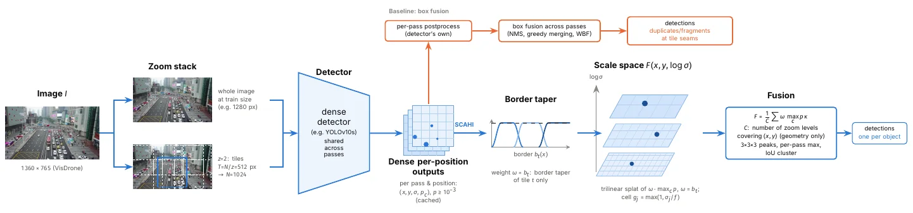
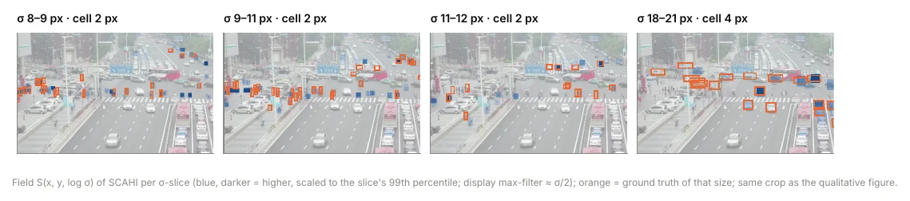

# When Does Sliced Inference Pay Off? Resolution, Tiling and Dense Fusion for Small Object Detection

- **来源**: https://arxiv.org/abs/2611.12657
- **本地PDF**: `../raw/2026-11-09-scahi.pdf`
- **日期**: 2026-11-09
- **标签**: `小目标检测`, `切片推理`, `密集融合`, `航空图像`, `VisDrone`, `DOTA`, `YOLO`
- **研究方向**: 计算机视觉 → 目标检测 → 高分辨率 / 小目标检测（切片推理）
- **作者**: Stefan Becker, Jens Bayer, David Münch, Wolfgang Hübner（Fraunhofer IOSB, Germany）
- **提交日期**: 2026-11-09 (v1), 2026-11-10 (v2)
- **会议/期刊**: CVPR 2027（格式稿/投稿中，据论文 LaTeX 模板 `confName=CVPR`/`confYear=2027`）
- **代码**: https://github.com/beckerio/scahi

---

## 摘要（一句话版）

**问题**：航拍/卫星图里检测小目标，常规做法是切片(sliced inference)逐片跑再合并。但大家报告的增益，是拿「低分辨率整图」当基线比出来的——把「切片放大了尺度」和「切片本身」两件事混为一谈。

**做法**：把「分辨率」单独拎出来当变量。每个切片方案，都配一个「整图直接拉到同样或更高分辨率」的单遍方案来对比。在此对照下提出 SCAHI：在出框之前，就把所有 pass（整图+各切片）的密集预测攒进一个「位置×尺寸」的体积场，按覆盖权重归一，再从细网格上取峰。

**两个结论（全文核心）**：
1. **能上分辨率就别切片**：只要图能在目标分辨率下单遍训练，单遍高分辨率就胜过「切片+框融合」。同等算力下，提分辨率比换大模型更划算。
2. **真要切片，瓶颈在合并步**：切片携带的互补信息被 box fusion 浪费了。SCAHI 用「先密集融合再定框 + 覆盖感知权重 + 细 peak grid」，在相同 pass 上稳赢 box fusion；图太大训不下时（DOTA），切片+SCAHI 大幅超过最强单遍。

**验证**：7 个密集检测器（YOLOv10/11/12 的 s/m + FCOS），VisDrone2019-DET 与 DOTA v1.5 上，用「预先注册假设、校准集调参、留出测试只评一次、带 bootstrap 置信区间」的严谨协议。

---

## 1 / 背景：切片到底帮了什么

常规切片（SAHI 那套）：把大图切成重叠小片，每片跑检测器，再把框合并。报告增益很大，但基线往往是「低分辨率整图」。

这里混了两个效应：
- **尺度效应**：切片让局部目标显得更大 → 好检。
- **切片本身**：多遍 + 合并的工程。

但「尺度效应」可以靠**直接把整图喂更高分辨率**得到，不一定要切片。例：VisDrone 长边约 1360 px，一个 640 px 切片里目标的表观大小，和整图缩到 1280 px 几乎一样。

所以本文把 scale 当显式变量，每个切片配置都配匹配分辨率的单遍基线。两个数据集代表两种体制：
- **VisDrone**：图中等大，单遍能在原生分辨率训练。
- **DOTA**：图数千 px 宽又密，单遍超 2048 px 就爆显存。

---

## 2 / 相关工作（一句话）

- **切片推理**：SAHI 普及；后续 ASAHI/DAHI/GOIS/ROI-Gated SAHI 做选区或跳背景；[ESOD](../2024/2024-07-23-esod.md) 做特征级切片。大多对照固定低分辨率整图，少有匹配分辨率基线。
- **合并检测**：NMS/Soft-NMS/SAHI 贪心合并/WBF 都作用在**已解码的框**上；SCAHI 改在出框之前合并密集输出。语义分割里重叠窗加权聚合是常规（如 nnU-Net），但检测还需事后分离目标。
- **检测器与数据**：YOLOv10 训 one-to-many + 无 NMS 的 one-to-one 头、推理只用后者；YOLOv11/12 单稠密头 + NMS，三者都按 GFL 逐位置预测框分布。DOTA 是数千 px 级大尺度航拍检测标准基准；本论文另一数据集 [VisDrone](../2020/2020-01-17-visdrone.md) 同为航拍检测数据集。

---

## 3 / 实验协议（严谨在哪）

- **数据集**：VisDrone2019-DET（10 类，官方 AP@[.5:.95]）；DOTA v1.5（水平框、16 类、官方 mAP50，无每图检测数上限；忽略 <8px difficult 目标）。DOTA 每图最多留 200k 检测，VisDrone 每图上限 500。同类 IoU>0.3 定义为 crowded，否则 isolated。
- **拆分**：VisDrone 抽 594 张(30 序列)校准、对 test-dev 评一次；DOTA 抽 141 张校准、官方 val(458)作留出。所有调参只用校准集。
- **预先注册三个问题**（结果存在前定好，ε=0.30）：
  - Q1：单遍高分辨率是否胜过「切片+box fusion」；
  - Q2：相同 pass 下 SCAHI 是否胜过 box fusion；
  - Q3：切片+SCAHI 是否胜过最强单遍。
- **显著性**：配对 bootstrap 95% 置信区间（1000 重采样）；VisDrone 上 Δ>ε 且 ≥4/5 检测器成立则跨检测器确认；DOTA 上 Holm 校正后单侧检验拒绝 Δ≤ε。
- **检测器**：VisDrone 用 YOLOv10/11/12 的 s/m（COCO 起、Ultralytics 统一 recipe、100 epoch）；DOTA 用 YOLOv10/11/12 s + FCOS(ResNet-50-FPN)。FCOS recipe 简单，跨家族绝对精度不可比，问题只比同检测器不同配置。

---

## 4 / 方法 SCAHI


*图 1：SCAHI 概览（论文 Figure 1）。一个检测器在整图(训练尺寸)与重叠切片上各跑；基线合并解码框(橙)，SCAHI 把各 pass 密集输出攒进体积场、按覆盖归一、取峰。*

### 4.1 Passes（遍）
一个配置 = 若干 pass + 一个合并规则。一遍以绝对缩放 z（每图像像素对应的网络输入像素）看图像；边长 T=N/z 的图像块被放到网络输入 N。

多遍配置 = **整图单遍(按训练尺寸跑) + 重叠切片(overlap ρ=0.3)**：
- VisDrone：z=2、N=1024（即 512 px 图像块放大到 1024）；
- DOTA：z=1、N=1024。

基线合并用「对小框取交并的 NMS」（校准集最优框级规则）；密集场景用贪心合并或 WBF 合并不同邻居。

> 注意：切片输入 N=1024 是写死的统一配方，跟训练分辨率(1280/2048)无关。检测器推理可用任意尺寸，所以同一份权重既能跑整图 1280、又能跑切片 1024。固定 1024 是为了让「切片」这个变量在不同配置里完全一致，只让单遍分辨率当变量。

### 4.2 Dense accumulation（密集累积）
box fusion 每 pass 只看最终框；SCAHI 在**出框之前**就合并。每个 pass 的位置 i 预测类别概率 p_i 与框（中心、宽高），物体尺寸 σ_i=√(w_i h_i)。max_c p_{c,i}≥τ_splat 的预测被攒进覆盖位置与对数尺寸的体积场：

$$
F(\mathbf{v})=\frac{1}{C(x,y)}\sum_{k}\sum_{i\in k} \omega_i\,\max_c p_{c,i}\;\kappa(\mathbf{v}-\mathbf{v}_i),
$$

其中 v=(x,y,u)、v_i=(x_i,y_i,u_i)，u_i=β log2(σ_i/σ_0)，σ_0=2 px；κ 为三线性插值核，网格单元 g(σ)=max(1,σ/f) px，β 为每倍频尺寸 bin 数。YOLOv10 的 one-to-many 头冗余预测正被融合所利用。

### 4.3 Coverage-aware weights（覆盖感知权重）
切片边界附近的预测看到被截断的目标、不可靠。切片 t 用抬升余弦 taper 从每个内边界起、宽度 Δ=ρT 内抬升来加权：

$$
r_t(x,y)=\prod_{e\in\mathcal{E}_t} s(d_e),\quad s(d)=\sin^2\!\bigl(\tfrac{\pi}{2}\,\mathrm{clip}(d/\Delta,0,1)\bigr),
$$

E_t 为切片 t 的内边界，d_e 为到边界距离。taper 在各切片间归一化 b_t=r_t/Σr_{t'}，使 Σb_t=1；预测权重 ω_i=b_t(x_i,y_i)，整图 pass ω_i=1。覆盖 C(x,y) 统计覆盖该位置的层数，每个位置从每层获相同总权重，被切坏的目标碎片只得到很小权重。本文配置两层都覆盖全图，C=2 处处成立。


*图 2：体积场 F 构建（论文 Figure 2）。加权置信度三线性 splat 进 (x,y,u) 网格，u 为对数尺寸轴；归一化使每空间位置总权重一致。*

### 4.4 Separating neighbours（分离邻居）
目标 = F 在 (3×3×3) 邻域内、且 F≥τ_peak 的局部极大。峰周围、距其 1.5 单元且同尺寸 bin、框与最强者 IoU≥0.5 的预测聚成簇 K（跨所有 pass）。类别得分与框：

$$
S_c=\frac{1}{C}\sum_{k}\max_{i\in\mathcal{K}\cap k} \omega_i\,p_{c,i},\qquad
\hat{\mathbf{q}}=\frac{\sum_{i\in\mathcal{K}}a_i\,\mathbf{q}_i}{\sum_{i\in\mathcal{K}}a_i},\quad a_i=\omega_i\max_c p_{c,i},
$$

q_i=(x_i,y_i,log w_i,log h_i)。每峰最多留 3 个 S_c>0 的类，之后不做 NMS。**grid 必须相对物体尺寸够细**：一个单元盖住两个相邻目标就会并成一个检测。VisDrone 用预指定 f=5；事后发现这会把拥挤邻居合并，故 DOTA 用 refined grid（校准集选 f∈{7..13} 及 β、阈值，预先指定）。

SCAHI 不动检测器、只换合并步，由此让 box fusion 掩盖的两效应显形：重叠 pass 证据可在定目标前合并；peak 搜索相对物体尺寸的分辨率决定切片能否胜过强单遍。

---

## 5 / 结果

### 5.1 VisDrone：分辨率胜过切片（Q1）
凡能训到 2048 px 的检测器（除 YOLOv12m），单遍都胜过「1280 单遍+切片+box fusion」，val 2.8–3.5 AP、test-dev 1.8–3.1 AP；标准 SAHI 最弱。同等算力下 YOLOv10s@2048(128 GFLOPs) 胜 YOLOv10m@1280(136 GFLOPs) 1.7 AP(val)/1.6 AP(test-dev)：提分辨率更划算。YOLOv10s 到 2560 px 仍涨(39.51)；3072 px 训超显存。

| 检测器 | 单遍1280 | 单遍2048 | SAHI | 1280+切片(box) | 2048+切片SCAHI | refined† | ΔQ1(val) | ΔQ1(test) |
|---|---|---|---|---|---|---|---|---|
| YOLOv10s | 33.66 | 38.47 | 31.52 | 35.00 | 39.34 | **40.72** | +3.47 | +2.75 |
| YOLOv10m | 36.81 | 41.03 | 34.18 | 37.66 | 41.29 | **42.67** | +3.37 | +3.05 |
| YOLOv11s | 32.20 | 36.80 | 30.26 | 34.05 | 38.66 | **40.03** | +2.75 | +1.83 |
| YOLOv11m | 35.82 | 40.00 | 33.80 | 37.05 | 41.54 | **42.86** | +2.95 | +1.90 |
| YOLOv12s | 32.64 | 37.94 | 30.95 | 34.87 | 39.80 | **41.18** | +3.07 | +2.03 |
| YOLOv12m | 35.41 | – | 33.70 | 36.95 | – | – | – | – |

（†VisDrone 为事后 refined grid；AP 为 val。YOLOv12m 无法训到 2048。）

### 5.2 VisDrone：融合与切片何时见效（Q2、Q3）
相同 pass 下 SCAHI 对每个检测器都胜过 box fusion（val 1.4–2.0、test-dev 1.9–2.4 AP），Q2 跨检测器成立。切片+SCAHI 是否超 2048 单遍(Q3)因检测器而异：预指定下三个成立、YOLOv10m 不成立(+0.26<ε)，val 未确认；test-dev 上四个可测都过阈值。

**分解**：切片增益各检测器相近(2048 px、test-dev 1.1–1.5 AP)，几乎全在 <16 px 目标；f=5 时融合后单遍在邻居目标上 recall 掉 22–24 点，refined grid 挽回大部分(val +1.2–1.4)。

**算力**：YOLOv10s 单遍 2560 px 以 36% 算力与「2048+切片+预指定 SCAHI」val 持平；refined 下切片 val 超 1.2、test-dev 超 1.3，代价 2.8× 算力。SCAHI 77 ms/图 vs box fusion 51 ms（因需稠密输出）。结论：**VisDrone 上切片买精度不买效率**。

| 配置(YOLOv10s, VisDrone) | val | test | GFLOPs | ms |
|---|---|---|---|---|
| 单遍 2048 | 38.47 | 33.48 | 128 | 9.6 |
| 单遍 2560 | 39.51 | 33.98 | 203 | 13.6 |
| 2048+切片 box fusion | 38.85 | 33.25 | 562 | 50.8 |
| 2048+切片 SCAHI | 39.34 | 34.53 | 562 | 77.3 |
| 2048+切片 SCAHI refined† | **40.72** | **35.28** | 562 | 77.3 |

### 5.3 DOTA：切片见效的场景
DOTA 是另一体制：图数千 px 宽、上万目标；3072 px 单遍即便 batch=2 也爆显存，YOLOv12s 训不过 1024 px。这里切片见效。refined grid 在任何 DOTA 结果前就固定，是独立验证。原生分辨率切片+SCAHI 对每个检测器都胜最强单遍：2048 px 上 4.3–5.6 mAP50，YOLOv12s 在 1024 px pass 上 +9.6(Q3)。计 difficult 增益更大。Q1 对 YOLOv10m/YOLOv11s 成立、对 YOLOv10s/FCOS 勉强未过：DOTA 上「仅提分辨率」已不再明显胜切片。SCAHI 在相同 pass 各可测分辨率都胜 box fusion(Q2)；FCOS 两融合持平。

| DOTA v1.5(mAP50, val) | YOLOv10s | YOLOv10m | YOLOv11s | YOLOv12s | FCOS |
|---|---|---|---|---|---|
| 单遍 1024 | 55.80 | 58.44 | 56.16 | 56.36 | 42.64 |
| +切片 box fusion | 64.86 | 64.57 | 62.14 | 62.88 | 52.56 |
| +切片 SCAHI | **66.17** | **67.34** | **65.26** | **65.97** | **52.96** |
| SAHI | 59.20 | 60.96 | 57.90 | 60.21 | – |
| SAHI+SCAHI | 62.08 | 63.22 | 61.87 | 63.30 | – |
| Q3(切片+SCAHI vs 单遍,2048) | +5.50 | +4.34 | +4.62 | +9.62† | +5.57 |

（†YOLOv12s 在其最大可训练 pass 1024 px 测 Q3。）

**SAHI+SCAHI(Q4)**：给定稠密输出，SCAHI 只换 SAHI 合并步：恰好 SAHI 的 pass 上，四检测器各 +2.3–4.0 mAP50，且不显著增加延迟。增益来自合并步。

**算力**：切片代价大——YOLOv10s 约 5.5× GFLOPs、4.8× 单遍延迟(134 vs 28 ms)；90% 是切片 pass（含 SAHI 的 195 ms），SCAHI 仅 +13 ms。

**FCOS**：切片+SCAHI 胜其单遍 5.6 mAP50；持平 box fusion 是因 peak grid 太粗（校准集留了粗 cell factor，拥挤 recall 少 ~30 点），refined grid 可解。

### 5.4 消融（事后）
| 变体 | VisDrone AP | DOTA mAP50 | crowded recall |
|---|---|---|---|
| 去 C 归一化 | ±0.00 | ±0.00 | ±0 |
| 去边界 taper | −0.74~−1.01 | −1.12/−0.99 | −2~+1 |
| 加 validity windows | −1.61~−1.79 | –* | −1~−2 |
| refined peak grid | +1.32~+1.38 | +0.36/+0.41 | +18~+24 |

（*windows 为 VisDrone 尺寸；DOTA 上切掉大目标 −19/−20。）去显式归一化无影响（taper 已保证等权）；去 taper 两集各掉 ≤1.1。validity windows 一致有害。peak grid 分辨率是拥挤场景的决定性设计：更细 grid 把 crowded recall 提 18–24 点。给 box fusion 同权重只挽回部分（YOLOv10s/11s：加权 NMS VisDrone +0.5–0.75、DOTA +1.4–1.7，但 SCAHI 仍领先）。

### 5.5 Scale analyses
在「网络输入中的物体尺寸」上的 recall 与推理分辨率无关，故切片和高输入分辨率同样帮小目标；约 6 输入像素以下几乎检不到。退化测试：大目标丢一半分辨率 recall 仅掉 0.03，原本小的目标同表观尺寸下低 0.09——剩余难点更多来自目标本身(遮挡/拥挤)而非像素缺失。按 zoom 级别只在有效尺寸带训练(SNIPER 思路)相对 ignore-aware 训练无增益。

---

## 6 / 讨论与局限

**切片何时见效**：取决于「所需分辨率能否单遍训练」。能(VisDrone)→高分辨率更便宜且胜过标准切片；不能(DOTA)→切片明显见效。边界随硬件/检测器移动。对 YOLO，能分离邻居的密集融合把切片变成比 box fusion 更多精度(两体制皆然)；FCOS 两融合持平(粗 grid 所致)。SCAHI 成倍增 pass 数，绝大部分代价来自 pass，融合只占余下——面向大图精度导向处理(航拍离线分析)；延迟更关键时，单遍最高可训练分辨率仍更好。

**局限**：(i) 需稠密逐位置预测(anchor-free)；query-based 如 [RT-DETR](../2025/2025-11-15-rf-detr.md) 需稀疏变体(未来)。(ii) VisDrone refined grid 事后发现、留出增益约 val 一半，DOTA 预指定；cell factor 按校准集选，拥挤稀少时(FCOS)可能漏。(iii) DOTA devkit 忽略最小目标，图像为重编码 JPEG。(iv) 延迟在单 RTX 5090 每表独占测。(v) 仅水平框。

> **LLM 使用声明(论文自带)**：研究问题与核心想法来自作者；通用助手(Claude)在其指导下帮起草实验设计/分析/稿件/三张图；作者审查批准。Claude Opus 5.5 作 coding agent 实现代码跑实验。关键决策(假设/成功标准/数据模型/偏差/冻结配置/单一授权评估)均由作者做并记录于带日期决策日志。

---

## 7 / Conclusion
切片是否见效取决于所需分辨率能否被训练。VisDrone 能训时单遍高分辨率胜「切片+box fusion」；DOTA 不能时切片对每个检测器都带来可观精度。对 YOLO，合并步两体制都起决定作用：覆盖感知权重+能分离邻居的 peak grid 的密集融合，把切片信息变成 box fusion 留在桌上的精度。

---

## 个人评价

**核心价值**：不是「又提一个检测器」，而是一套极严谨的对照实验戳破「切片对小目标天然有效」的直觉。两点反直觉但有证据：(1) 多数切片增益是分辨率效应，能上分辨率就别切片；(2) 必须切片时瓶颈在合并步，SCAHI 拿到 box fusion 浪费的互补信息。对航拍/无人机检测是直接可落地的工程建议（呼应 [VisDrone](../2020/2020-01-17-visdrone.md) 长期关注的小目标痛点）。

**可借鉴**：
- 「分辨率 vs 切片」对照思路直接用于 pipeline 选型：先确认图能否单遍分辨率训，能就别切片。
- SCAHI 融合是 Apache-2.0、仅依赖 numpy/pandas/scipy/torch（`scahi/fusion/scalespace.py`/`scalespace_torch.py`），可脱离 Ultralytics 单用。
- 实验方法论(preregistration+冻结配置+决策日志+字节级复现 `regenerate_paper.py`)值得抄。

**实验设计亮点**：scale 当显式变量、每切片配置配匹配分辨率单遍；paired bootstrap 而非点差；crowded/isolated 分开报 recall 定位 refined grid 作用；消融把增益与 crowded recall 并列。

---

## 疑问解答 (Q&A)

### Q1: SCAHI 和 SAHI/WBF 差在哪？
**答**：合并发生的阶段不同。SAHI/NMS/WBF 都作用于**已解码的框**——每 pass 先出框再合并。SCAHI 在**出框之前**就把各 pass 稠密输出(类别概率+框参数)攒进 (x,y,u) 体积场，按覆盖权重归一，取峰聚类出框。box fusion 把跨 pass 的同一目标不同切片视图先压成框再合并，切坏目标/边界不可靠预测被当普通框；SCAHI 先按位置/尺寸聚合，边界 taper 自动压低碎片权重，细 peak grid 分离邻居。消融证明：给 box fusion 同权重只挽回部分，大部分增益来自「先密集融合后定框」。

### Q2: 为什么 VisDrone 单遍高分辨率胜切片、DOTA 却相反？
**答**：看「所需分辨率能否单遍训练」。VisDrone 中等(长边~1360)，2048 单遍能训且显存够，整图高分辨率直接给更大尺度、等价于切片效果，还省切片合并开销；切片反引入切坏目标与合并误差。DOTA 数千 px 宽又密，3072 单遍训就爆显存，单遍达不到图像分辨率，只能靠切片——且切片+SCAHI 显著超最强单遍。边界随硬件/检测器移动。

### Q3: SCAHI 对 FCOS 为什么只持平 box fusion？方法失效？
**答**：不是失效，是 FCOS 上 peak grid 太粗。事后：校准集留了粗 cell factor，拥挤 recall 比 box fusion 少 ~30 点、孤立几乎相等——正是 VisDrone 上 f=5 过度合并的同机制。YOLO 上 refined grid(更细)解决；FCOS 的 refined 事后才发现且校准集拥挤稀少，未预指定。把 grid 调细 FCOS 也应得同样增益，是调参问题非算法局限。

### Q4: 为什么 SCAHI 不能用于 RT-DETR 这类 query-based 检测器？
**答**：SCAHI 靠「稠密逐位置预测」——每空间位置给类别概率和框(YOLO/FCOS/GFL 都这样)，才能 splat 进体积场。query-based 每 pass 只出固定数量(如 300)稀疏预测，无逐位置稠密输出，需稀疏变体(论文留未来)。若想接进你已有的 DETR 系检测器（如 [RF-DETR](../2025/2025-11-15-rf-detr.md)），要改融合入口。

### Q5: SCAHI 只换合并步不动检测器，和端到端训练的检测器怎么配合？
**答**：完全是推理/后处理期的融合模块，不碰权重。吃任意检测器的「稠密头输出+框」吐最终检测；训练按原流程。可和任意已训检测器(包括你自己的无人机模型)即插即用，只要输出稠密逐位置预测。

---

## 代码解读

> **代码仓库**：`https://github.com/beckerio/scahi`（融合核心 Apache-2.0；其余 AGPL-3.0；未发训练权重）

### 1. 结构
```
scahi/
├── scahi/fusion/        # ★融合：scalespace.py(CPU参考)/scalespace_torch.py(GPU)
│                       #   pipeline.py/pipeline_gpu.py/run.py
├── scahi/infer/        # 单遍推理、稠密头缓存、SAHI 基线
├── scahi/visdrone/     # VisDrone→COCO/YOLO 转换、训练、评估
├── scahi/dota/         # DOTA v1.5 数据、devkit 移植、训练、SAHI
├── scahi/fcos.py       # FCOS(torchvision) DOTA 训练缓存
├── scahi/data/zoom.py  # 缩放/切片几何
├── scahi/eval/         # VisDrone 工具包移植、COCO 指标、bootstrap
├── scahi/reproduce.py  # VisDrone 复现入口
├── examples/           # scahi_yolov10s.py(最小示例)/scahi_arrays.py(合成预测)
├── scripts/            # 复现图表/延迟/消融/SAHI→SCAHI
├── tests/              # 单元测试(含 CPU/GPU 融合 parity)
├── configs/            # final/ext/dota 冻结参数(frozen_rows*.json)
├── docs/               # PREREGISTRATION*.md/DECISIONS.md/ALGORITHM.md/figures/
├── runs/               # 已存档结果(字节级比对基准)
├── expected/           # 论文表/图参考输出
└── LICENSES/           # Apache-2.0(融合核心) 与 AGPL-3.0
```

### 2. 怎么用
**装**：`conda env create -f environment.yml && conda activate scahi`；`pip install -r requirements.lock --extra-index-url https://download.pytorch.org/whl/cu130`；`pip install -e .`（论文精确版：ultralytics 8.4.183、torch 2.14.1+cu130；`pytest -q` 跑无数据/无 GPU 单测）

**跑自己的图**（最小可跑）：
```bash
python examples/scahi_yolov10s.py path/to/image.jpg                     # SCAHI 预指定
python examples/scahi_yolov10s.py path/to/image.jpg --setting refined --fusion-device gpu --box-fusion --out dets.csv
```
注：`scahi_yolov10s.py` 参数是 VisDrone-YOLOv10s 设置，COCO 权重上仅示例未调参。

**对任意检测器的稠密预测做融合**（只依赖 numpy/pandas/scipy/torch，无需 Ultralytics）：
```python
import numpy as np
from scahi.fusion.scalespace import CachedLevel, FusionParams, fuse_image
whole = CachedLevel(key="whole", xyxy=boxes_w, probs=probs_w, std=np.zeros((len(boxes_w),4),np.float32),
                    tile=np.zeros(len(boxes_w),np.int16), tiles=np.array([[0,0,W,H]]), gains=np.ones(1),
                    whole=True, overlap=0.3)
tiles = CachedLevel(key="tiles", xyxy=boxes_t, probs=probs_t, std=np.zeros((len(boxes_t),4),np.float32),
                    tile=tile_index, tiles=tile_rects, gains=np.ones(len(tile_rects)), whole=False, overlap=0.3)
det = fuse_image([whole, tiles], W, H, "F2", FusionParams(tau_splat=0.005, tau_peak=0.001, cell_factor=5.0, bins_per_oct=5), nc=num_classes)
```
完整可跑版：`examples/scahi_arrays.py`。

**复现论文表**：`CUDA_VISIBLE_DEVICES="" python scripts/regenerate_paper.py`（无需数据/权重/GPU，从 runs/ 重建所有表图，与 expected/ 字节级比对）。完整实验见 `REPRODUCE.md`。

### 3. 坑
- **许可证陷阱（务必注意）**：仅 `scahi/fusion/scalespace.py` 与 `scalespace_torch.py` 为 **Apache-2.0**，仅依赖 numpy/pandas/scipy/torch/torchvision，可脱离 Ultralytics 单用。其余训练/推理/评估基于 Ultralytics（AGPL-3.0）——用于产品或网络服务须以 AGPL-3.0 释放完整源码（Ultralytics 另售商业许可）。若接进自己无人机检测产品（如 [WeDetect](../2025/2025-12-16-wedetect.md)、[VLX-Seek](../2026/2026-10-16-vlx-seek.md) 那条线），**只用 Apache-2.0 两融合文件**最安全，别碰 AGPL。
- 训练/评估需 VisDrone、DOTA（各自学术/非商业条款）；权重从 Ultralytics/torchvision COCO 起，仓库不含权重。
- GPU 融合 `scalespace_torch.py` 用 float64 与空间分块成员计算省显存（DOTA 密集图避免 ~90 GiB dense membership 矩阵），与 CPU 参考有字节级 parity 测试 `tests/test_scalespace_torch.py`。

### 4. 与论文一致性/未开源
- 代码与论文一致：GPU 版 `fuse_image_f2` 严格复现公式(1)–(4)，过 CPU 参考 parity。
- **未开源**：训练权重；预注册/决策日志（部分德语，本地路径已移除）；`scripts/ablation_components.py` 与部分延迟脚本需内部驱动与稠密头缓存（不在仓库），但不影响论文表复现。
- 论文把「假设/校准/冻结/单一授权评估」做带日期决策日志与冻结 JSON（`configs/`），`regenerate_paper.py` 字节级可复现——近年少见实验纪律样本。
