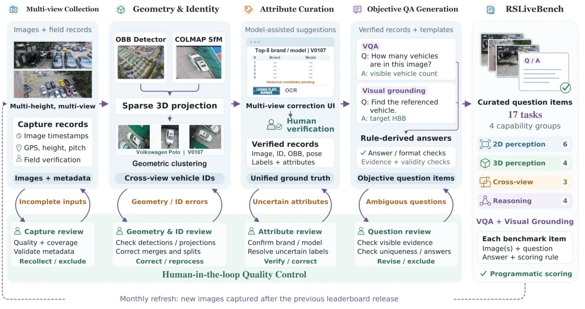
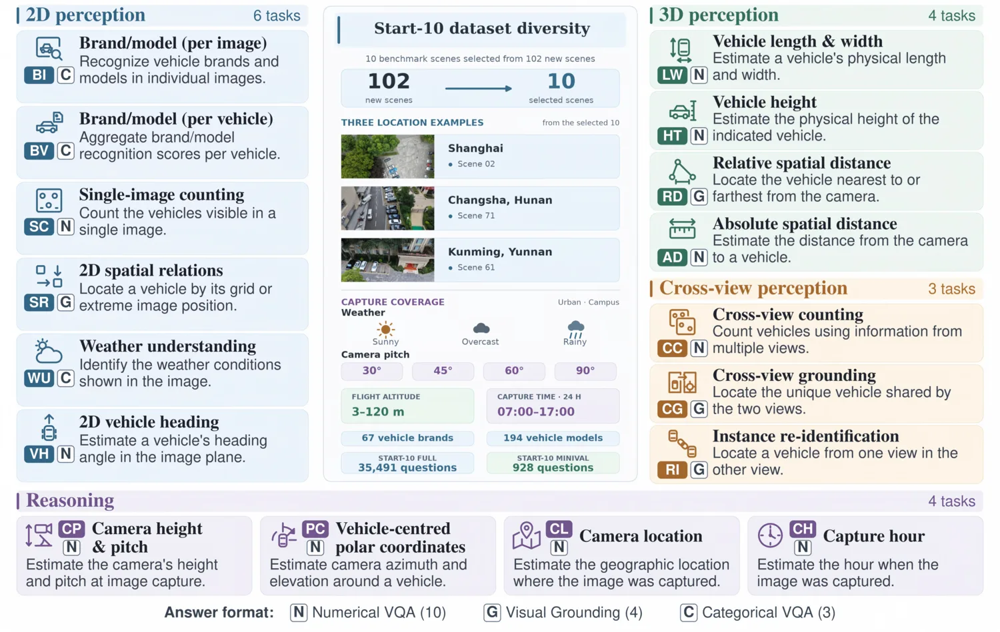
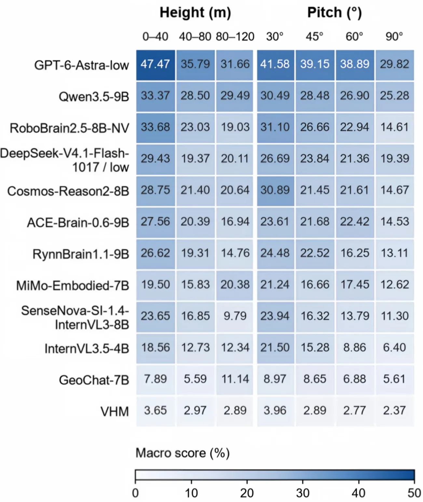

# RSLiveBench-UAV: A Continually Evolving Vision-Language Benchmark for Aerial Spatial Intelligence

- **来源**: https://arxiv.org/abs/2611.14953
- **日期**: 2026-11-11
- **标签**: `航拍空间智能`, `视觉语言基准`, `UAV`, `持续评估`, `实体关联`, `确定性评测`, `具身模型`
- **研究方向**: 计算机视觉 → 视觉语言基准 → 航拍空间智能（ASI）评测
- **作者**: Yue Zhou, Jiawei Liu, Jue Chen, Ziyang Gong, Haojia Wei, Jingxiang Li, Xue Jiang, Zhihang Zhong, Pai Peng, Xue Yang, Yansheng Li, Jonathan Li
- **提交日期**: 2026-11-11 (v1)
- **会议/期刊**: CVPR 2027（格式稿/投稿中，据论文 LaTeX 模板 `cvpr.sty` 与 `confName=CVPR`/`confYear=2027`）/ arXiv cs.CV
- **代码/数据**: 基准发布于 https://rslivebench.space（无方法代码仓；数据为真实 UAV 采集，答案延迟披露）

---

## 摘要（一句话版）

RSLiveBench-UAV 是一个**靠真实无人机反复实地采集、按月滚动更新**的视觉-语言基准，专门考模型在「航拍空间智能（ASI）」上的能力（跨视角/尺度的物体识别、度量空间关系、跨视角身份关联、空间推理）。它用「以实体为中心」的生产流程把标注成本砍到原来的约 1/5，并用**确定性评测（无 LLM 裁判）**给 30 个模型打了分。

两个核心看点：
1. **所有 18 个具身（embodied）模型 Overall 都超过 3 个遥感专用模型**；但最强具身模型（ACE-Brain-0.6-9B）只有 43.29，远不及通用旗舰 GPT-6-Astra 的 59.88。
2. **细粒度车辆识别仍然很难**，且性能随飞行高度和俯仰角大幅波动——即便最强模型也掉 10–16 分。

---

## 1 / 背景：为什么需要「活的」航拍基准

- **航拍空间智能（ASI）**：模型要从空中视角理解物体语义、物理尺寸、空间关系，以及「相机中心 ↔ 物体中心」参考系的切换。
- **难点**：无人机高度/姿态一变，目标尺度、遮挡、投影关系全变；评价这种能力需要**新的真实物理观测**，而造新题要反复确认「这是哪辆车、几何参照是什么、跨视角怎么对应」。
- **现有基准多静态测试集 → 易被训进模型（污染）**。LiveBench / LiveCodeBench / MMBench-Live 把「持续采集 + 可验证答案」带到代码、科学文档、多模态，但**搬到航拍需要真的去飞、去重建几何、去核实跨视角身份**——这篇就是干这个。

---

## 2 / 持续演进协议（live protocol）

- 一个 **scene = 一次带时间戳的实地采集批次**。维护一个 **4-scene FIFO 窗口**，每月换 1 个场景（25% 更新率），连续换 4 次就彻底换掉初始阵容。
- **准入**：只收「上一次榜单发布之后」拍的图（$R_{v-1} <$ 拍摄时间 $< R_v$）。
- **答案延迟披露**：场景退役 + 首次准入后至少 **4 个日历月**才公开完整答案（防刷榜）。
- 每次发布记录场景名单、采集日期、组件计数、答案/打分版本、模型运行记录 → 结果可追溯。

> 窗口大小为啥定 4：实验发现场景数越多、task–model 分数模式越一致，但超过 4 个收益很小（见 `window_sizes` 表），所以定 4 作为「跨版本一致性 ↔ 数据更新」的折中。

---

## 3 / 以实体为中心的答案生产（核心创新，配图）

*图 1：实体为中心的生产流水线（论文 Figure 1）。采集 → 几何辅助关联 → 属性审核复用 → 模板化出题，全程保留可追溯来源。*

**标注是什么**（自动化 + 人工核实，非传统逐图拉框）：
- 自动：OBB 检测（MMRotate）出车辆框 + COLMAP SfM 建稀疏几何；按「同图不能有同一实体的两个检测」约束做空间聚类，把**同一辆车跨视角/高度**归并成一个物理实体。
- 人工：Top-5 品牌/型号建议 + OCR 辅助核实身份；车长车宽按确认型号从懂车帝/汽车之家查规格；修正检测/投影/合并或拆分错误；审每道题的目标身份、唯一性、视觉证据、参照一致性、格式。
- 产出：实体级记录（品牌/型号 + 规格属性，批次内复用）+ 每观测记录（HBB、可见性、相机参数，各自独立）。

---

## 4 / 17 个任务 + 确定性评测（配图）

*图 2：17 个任务分四组（论文 Figure 2）。2D 感知 / 3D 感知 / 跨视角感知 / 推理。*

四组能力、共 17 个任务（3 个分类 VQA、10 个数值 VQA、4 个视觉定位）：

- **2D 感知**：品牌/型号识别（BI）、车辆级识别（BV）、单图计数（SC）、2D 空间关系（SR）、车头朝向（VH）、天气理解（WU）
- **3D 感知**：车长车宽（LW）、车高（HT）、相对空间距离（RD）、绝对空间距离（AD）
- **跨视角感知**：跨视角计数（CC）、跨视角定位（CG）、实例重识别（RI）
- **推理**：相机高度与俯仰（CP）、以车为中心的极坐标（PC）、相机位置（CL）、拍摄时刻（CH）

**确定性评测（无模型裁判，0–100 分）**：
- 数值题用 **MRA**（VSI-Bench 的均值相对精度，相对误差 5%–50% 每 5% 一档取平均）；
- 视觉定位用 **HBB IoU≥0.5**；
- 角度在 5°/10°/15° 取平均，地理距离在 1/10/100 km 取平均；
- 汇总：组件 → 任务 → 四组 → Overall **等权平均**。

---

## 5 / 实验结果（30 个模型）

数据：Start-10 full = 10 个场景、35,491 条问答记录、17 任务；另有 928 题 minival 做推理力度诊断。模型：**3 遥感 + 18 具身 + 9 通用**共 30 个 MLLM。

| 模型 | Overall | 2D | 3D | Cross-view | Reasoning |
|---|---|---|---|---|---|
| VHM（遥感） | 4.38 | 9.83 | 0.33 | 6.48 | 0.89 |
| GeoChat-7B（遥感） | 8.31 | 8.63 | 7.15 | 7.64 | 9.82 |
| SenseNova-SI-1.4 | 18.95 | 22.16 | 12.01 | 23.36 | 18.30 |
| Cosmos-Reason2-8B | 20.80 | 27.02 | 17.42 | 13.71 | **25.05** |
| MiMo-Embodied-7B | 23.98 | 23.68 | 42.07 | 11.87 | 18.30 |
| RoboBrain2.5-8B-NV | 32.84 | 35.55 | 57.49 | 16.09 | 22.24 |
| RynnBrain1.1-9B | 35.10 | 31.13 | 56.73 | 37.79 | 14.75 |
| ACE-Brain-0.6-9B | **43.29** | 33.96 | **69.52** | **55.97** | 13.70 |
| InternVL3.5-4B | 18.81 | 19.97 | 27.73 | 11.56 | 15.98 |
| Qwen3.5-9B | 36.08 | **40.20** | 69.31 | 15.69 | 19.10 |
| DeepSeek-V4.1-Flash | 37.19 | 36.34 | 60.70 | 32.38 | 19.33 |
| GPT-6-Astra | **59.88** | **54.17** | **77.46** | **69.07** | **38.81** |

**关键发现**：
- **具身模型整体碾压遥感模型**：18 个具身模型的 Overall 全部高于 3 个遥感对比（VHM 4.38、GeoChat 8.31 都不到 10）。说明「见过航拍图」≠「能做物体级航拍空间任务」。
- **通用旗舰最强**：GPT-6-Astra 四项全第一，Overall 59.88，比次高代表高 16.59 分。
- **最强具身（ACE-Brain-0.6-9B, 43.29）靠的是跨视角感知**（Cross-view 55.97，比 Qwen 高 40 分），但推理最差（13.70）。**推理项反转**：Cosmos-Reason2-8B 推理第一（25.05）却 Overall 仅 20.80——评测具身模型不能只看总分。
- **Qwen3.5-9B vs DeepSeek-V4.1-Flash** 总分接近但画像不同：Qwen 强 3D、DeepSeek 强跨视角。

---

## 6 / 诊断分析（配图）

*图 4：12 个代表模型在高度/俯仰分箱上的等权平均（论文 Figure 4）。低飞、小俯仰（更接近地面视角）分数更高。*

- **对观测条件极敏感**：12 个代表里 10 个在「最高高度箱」比「最低高度箱」低；全部 12 个从 30° 俯仰掉到 90° 俯仰都降分。最强 Astra 在高度/俯仰两端也分别掉 15.81 / 11.76 分。
- **细粒度车辆识别仍是硬骨头**：30 个模型里 21 个「车辆级识别（BV）」高于「单图识别（BI）」（聚合多视角投票有用），但**最高 BV 也 <27 分**（品牌 + 联合品牌-型号指标），提升空间巨大。
- **空间想象力靠推理力度**：PC 任务要求从航拍视角切换到「以车为中心」参考系推断无人机方位/仰角。Astra 在关工具、5 档推理力度下 PC 从 57.22 单调升到 77.22，但 xhigh→max 只涨 1.11（边际递减）。

---

## 7 / 局限

- 评的是**单项空间技能**，不是需要协调多种能力的复合任务；离线的单轮图像接口，**不含视频、连续空间状态更新、持续跟踪**。
- **只聚焦车辆**，物体多样性有限（不过车辆规格提供了低成本的尺寸参照，利于持续生产）。
- 定位：**给具身模型做航拍评估的易用基础，不是对自主航拍智能的完整评估**。未来可扩物体类别、引入基于智能体的复合任务评测。

---

## 个人评价

**核心价值**：不是又一个静态 VQA 榜，而是把「持续、防污染、可追溯」的 live 基准范式真正落到了**需要真去飞、真去重建几何**的航拍场景。三个设计点最值得抄：
1. **实体为中心的生产**：用几何关联把同一辆车跨视角归并、复用核实过的属性，把标注成本砍到 1/5——这是它「能每月滚动」的工程前提。
2. **确定性评测**：全部用固定规则打分、无 LLM 裁判，避免「裁判模型漂移 / 被刷」。
3. **4-scene 滚动窗口 + 答案延迟 4 月披露**：既持续换新又保证跨版本分数模式稳定（Pearson/Spearman 一致性高）。

**对你无人机检测线的启示**：这篇印证了两件事——(a) 纯遥感/航拍专用模型在「物体级空间理解」上被通用/具身模型甩开，说明**航拍场景的细粒度理解不能只靠遥感预训练**；(b) 细粒度车辆识别（BI/BV <27）仍是开放难题，和 [VLX-Seek](./2026-10-16-vlx-seek.md) 那条「VLM 细粒度感知」赛道直接相关；而航拍数据持续生产/防污染的思路，也可借鉴到 [VisDrone](../2020/2020-01-17-visdrone.md) 这类老牌航拍数据集的维护上。

**可质疑处**：车辆单一类别、单轮离线接口，离「自主航拍智能」还远；ACE/Rynn/SenseNova 等一票具身模型分数差异大但论文未深究原因；GPT-6-Astra 明显断层领先，但它是闭源旗舰，基准能否持续区分顶尖模型存疑。

---

## 疑问解答 (Q&A)

### Q1: 「live / 持续演进」到底解决了什么？
**答**：静态榜的测试集会被训进模型（污染），且无法反映模型随时间的进步。这篇用「每月收新真实航拍 + 只收发布后拍的图 + 答案延迟 4 月披露 + 版本化打分」，让榜单持续有新题且难刷，同时用滚动窗口保证跨版本可比。

### Q2: 确定性评测为什么重要，怎么打的？
**答**：很多 VLM 基准用另一个 LLM 当裁判，裁判本身会漂移、也能被针对性刷。这篇全部用固定规则：数值题用 MRA（相对误差阈值取精度平均），定位用 IoU≥0.5，角度/地理用固定阈值，分数 0–100、无模型裁判，结果可复现可追溯。

### Q3: 为什么遥感专用模型反而垫底？
**答**：GeoChat/VHM 即便在航拍图上有指令微调，Overall 也都在 10 以下；论文认为「见过俯拍图」不等于「能做物体级航拍空间任务」（需要跨视角身份、度量几何、空间推理）。具身模型因为有第一/第三人称空间经验更占优。

### Q4: 这个基准和我做无人机检测有什么关系？
**答**：同属航拍视觉，但它考的是「给定图/多图，回答空间问题」（VQA/定位），不是检测器输出框。最直接的关联是「细粒度车辆识别（BI/BV）」这道硬骨头，与 VLM 细粒度感知赛道一致；另外它的「持续采集 + 防污染 + 实体关联」数据生产范式，对维护 VisDrone 这类数据集有借鉴价值。

### Q5: 数据到底是什么、怎么来的、标注是什么、规模多大？只标了车辆吗？
**答**（关键硬数字 + 定位；细节见正文对应节，不重复展开）：
- **数据是什么**：真实无人机**多高度多视角车辆**影像，每张带时间戳/GPS/高度俯仰/实地核验，喂模型时抹掉内嵌 metadata（防泄题）。
- **怎么来的**：实地飞采（field acquisition），同场景不同高度/俯仰重复拍，采集 **14.48 分钟/场景**；只收「发布后」拍的图（准入见 §2）。
- **标注是什么**：先用 **OBB 旋转框**（MMRotate）定位 + COLMAP SfM 跨视角聚合成车辆实体（OBB 是上游检测）；每个观测落地存 **HBB 轴对齐框 + 可见性 + 相机参数**（HBB 是评测口径，因通用 VLM 不支持旋转框，按 IoU≥0.5 打分）。人工核实型号/规格、审每题——完整流程见 §3。
- **规模多大**：成本表覆盖 **96 场景 / 12,162 张图像**（623+1,195+3,529+6,815），库存 **102 场景**；新流程标注 **29.5 分钟/场景**，较历史 136.3 降 **78.3%**。评测集 Start-10 = 10 场景 / **35,491 题** / 928 minival，见 §5。**论文不报总框数**（标注单位是车辆实体/观测，框数 = 车辆数 × 其出现的视角数）。
- **只标了车辆吗**：**是**，单类别（车辆）+ 细粒度属性（品牌/型号/规格），其它当背景不画框（局限见 §7）。

---

## 代码/数据

- **基准发布**：https://rslivebench.space（榜单、数据、任务定义）。论文未提供训练/推理代码仓（它是基准，不是方法）；数据含真实 UAV 采集图像，答案延迟披露。
- **构建依赖**：实体关联用 OBB 检测（MMRotate）+ COLMAP SfM；度量对齐用 XMP 地理标签 + 相对高度做相似变换到 ENU；规格属性来自懂车帝/汽车之家。
